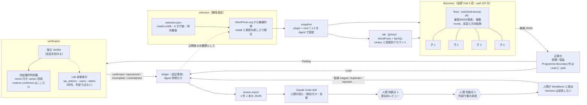
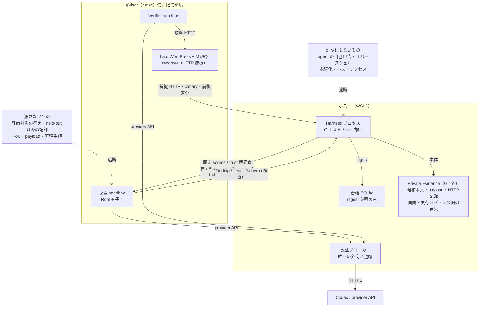
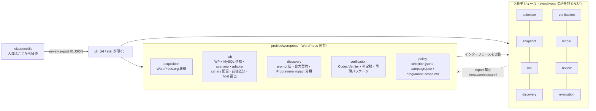
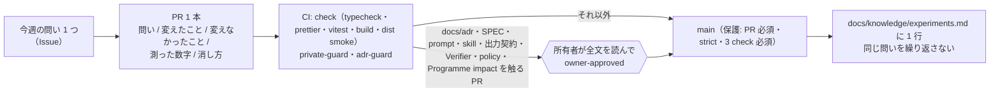

# 全体設計の図解（2026-10-13 確定版）

> **2026-10-19 時点で図と違う点**（図は描いた日の記録。正本は SPEC と ADR）: (1) 探索は既定で Lab を付けず（`discovery.lab: none`、PR #365）、検証は後から Finding 単位に Lab を立てて `verify next`（Codex Verifier）か `verify next --handoff`（skill `wbh-verify`、ADR 0035）で行う。(2) 新規探索は `wp2shell-bounty-v8` だけで、Root＋最大 4 子、wall 120 分・最低 60 分。`provider-cyber-policy` で止まった Root は操作者の `campaign resume` で同じ Trial の segment として再開する（ADR 0033、0036）。(3) 選定は主帯 100k–1M を mirror の paying class 件数・最終記録の新しさ・install で順位付けし、尽きたら cascade 50k → 30k → ≥1M（ADR 0037）。(4) Programme Boundary 外と判別の付きにくい 5 分類は `finding-parked`（ADR 0032）。(5) 入口索引と coverage は削除（ADR 0034）。(6) `owner-approved` は委任済みの AI が付ける（ADR 0032 の 2026-10-18 節）。

正本は [SPEC.md](SPEC.md) と [adr/](adr/)。この図はその要約で、食い違えば正本が勝つ。所有者は 2026-10-13 にこの設計を確定し、Step 1 の完了条件（[DEVELOPMENT.md](DEVELOPMENT.md) 第 2 節）が満たされるまで変えない。設計を動かしたい案は [PARKING.md](PARKING.md) に 1 行で書く。

閲覧用の描画版: <https://claude.ai/artifact/VmjM8Th7cWSeGzB6zR7UWt>（所有者の非公開 Artifact。この文書の Mermaid 原稿が正）。

## 1. 1 周の流れ（campaign 1 周 = 対象 N 件）

Harness が人手なしで進めるのは「選定 → 固定 → Lab → 探索 → 検証 → 台帳」まで。人間が入るのは最後の 2 点だけ（不変条件 6）。

## 2. 隔離と信頼境界（何が中に入り、何が出るか）

対象の実行は gVisor（runsc）の使い捨て環境の中だけ。ホストで実行せず、弱い隔離へ黙って切り替えない（不変条件 2）。`runtime-confirmed` の証明は nonce 付き canary の回収だけ（不変条件 3）。

## 3. モジュール境界（依存の向き）

汎用側は profile が実装するインターフェースの型だけに依存する。`plugin`、`slug`、`wp_options` のような語が汎用側に現れたら profile へ移す合図（ADR 0011）。2 つ目の profile ができるまで汎用化しない。

## 4. 不変条件と、それを守らせる場所

| #   | 不変条件（SPEC 第 2 節）                                                                                       | 守らせる場所                                                                       |
| --- | -------------------------------------------------------------------------------------------------------------- | ---------------------------------------------------------------------------------- |
| 1   | 探索に渡すのは固定 source・人間が書いた trust 境界宣言・Programme Boundary・Lab・時点で切ったカタログ履歴だけ | discovery の入力組み立て、ADR 0012、prompt は所有者が全文確認（CI `adr-guard`）    |
| 2   | 対象の実行は gVisor の中だけ、外向きはブローカー経由の provider API のみ                                       | lab / sandbox の `--runtime=runsc` 固定、ブローカー、`lab down` の残存 0 検査      |
| 3   | `runtime-confirmed` は Harness 所有の決定論的判定器だけ、証明は nonce 付き canary の回収                       | `profiles/wordpress/verification/judges.ts`、負の対照テスト                        |
| 4   | 検証の失敗（環境・手順・観測・証拠不足）は `incomplete`。`contradicted` にも棄却にもしない                     | `verification/index.ts` の結果型、`incomplete(reason)`                             |
| 5   | Finding と検証結果が同じ Snapshot digest を持つときだけ判定する                                                | 同上の digest-mismatch 判定                                                        |
| 6   | 人間の判断点は提出前レビューと外部行動承認の 2 つ。対象選定の承認と未検証候補の採否は置かない                  | review の `decide` / `authorize`                                                   |
| 7   | 外部送信は正確な候補・文案の版・送信先に結び付いた承認があるときだけ。Harness 自身は送らない                   | `external-action-authorized` event、送信は人間                                     |
| 8   | 台帳は追記専用で digest 参照だけ。本体は Git 外の Private Evidence                                              | ledger の append-only、CI `private-guard`（path・大きさ・内容走査）                |

## 5. 変更の統治（誰が何を決めるか）

変更は「今週の問い」1 つに答える PR 1 本。agent に渡る文章と所有者の方針を触る PR は、所有者が全文を読んで `owner-approved` を付けるまで merge されない。prompt と skill の文章は AI が要素を足さず、所有者が比較表から採った要素だけを書く。CLI は AI 向けで、人間向け機能は増やさない（ADR 0032 Q27）。

## 6. 2026-10-13 に確定したもの

| 領域               | 確定内容                                                                                                                                                                 | 根拠                                          |
| ------------------ | ------------------------------------------------------------------------------------------------------------------------------------------------------------------------ | --------------------------------------------- |
| 流れ               | 選定 → Snapshot → Lab → 協調 Trial 1 回 → Verifier + 判定器 + 前後差分 → 台帳 → review export → skill → 人間 2 判断点 → 人間が提出                                       | SPEC 第 3 節、ADR 0029 / 0031                 |
| 探索               | Root + 子 4、最低60分・wall上限120分、新規探索 prompt は `wp2shell-bounty-v8` のみ（2026-10-18 所有者決定）。対象・WordPress本体・PHP・依存pluginの固定sourceを使う | SPEC 第 6 節、ADR 0029、ADR 0033 |
| 検証               | 判定器は増やさない。Verifier は「発火したか」を見る。失敗は incomplete。再試行は recipe 2 / observation 1                                                               | ADR 0022（0032 で修正）、所有者決定 2026-10-13 |
| 人間レビュー       | scope 内の Finding は判定結果に関係なく人間に届く。順位付け・要約・文案は skill が担い、Harness は材料（review export）だけ出す                                         | #185 / #186、ADR 0031                         |
| 選定               | install 下限 100,000、候補タグはミラー由来の 8 族、plugin 別の順位付けに公開履歴を使わない。6 か月後に `candidateTag` で効果を測る                                      | ADR 0030 / 0032 Q3〜Q6                        |
| Programme Boundary | content-deletion は scope 内、reflected XSS は scope 外（Wordfence 公開 page 2026-10-13 確認）                                                                           | ADR 0032 Q1、D15 / D16                        |
| 統治               | agent に渡る文章は所有者が全文を読んでから merge。CLI は AI 向け。設計の新案は PARKING へ置き、Step 1 完了まで SPEC 第 2〜4 節と ADR を変えない                         | DEVELOPMENT.md 第 2 節・第 5 節、ADR 0032 Q27 |

ここから先の変更は「実装」と「測定」だけ。設計を動かしたくなったら PARKING に書き、Step 1 の数字（本番 4 周の review 件数、人間が 1 件を読む分数、提出 1 件）が出てから判断する。
