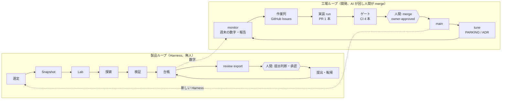
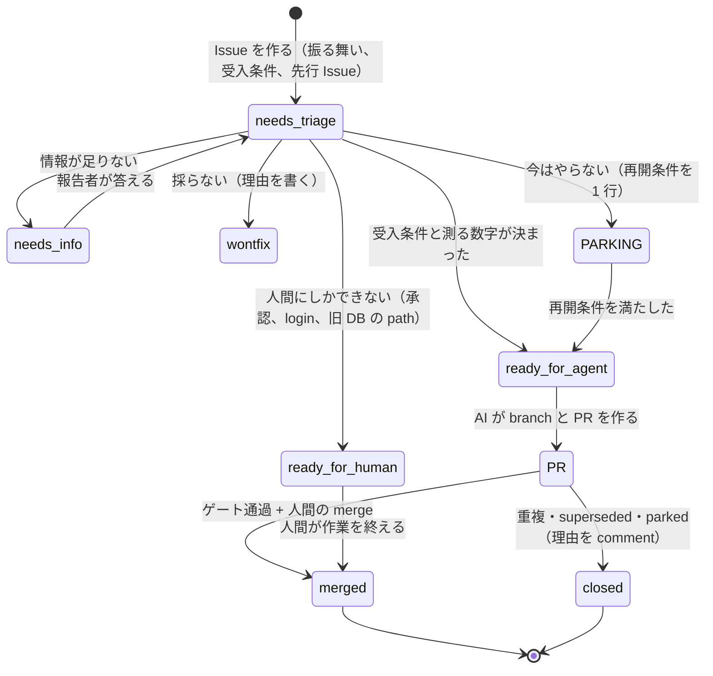
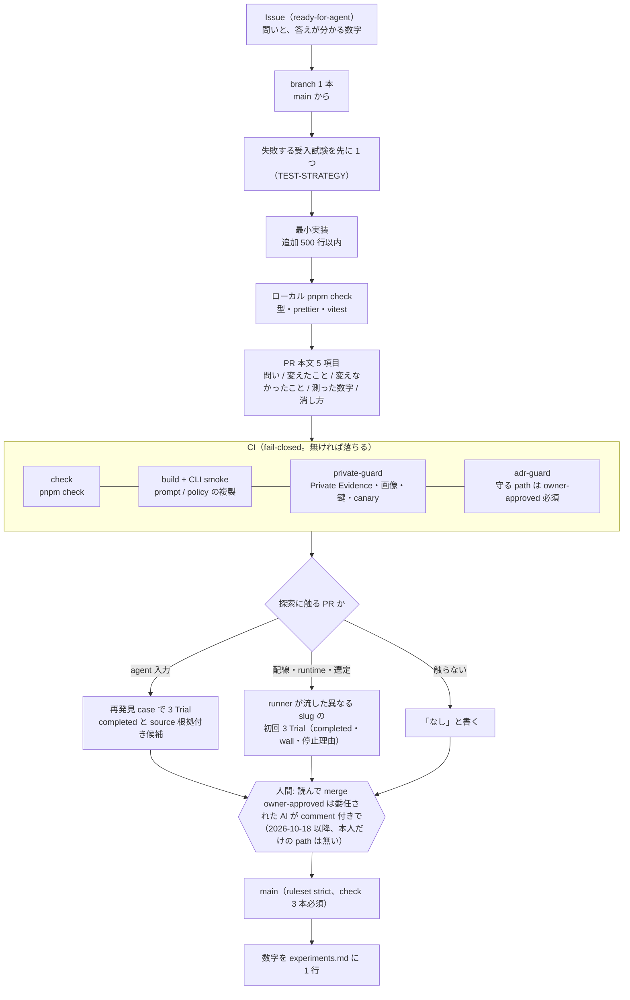
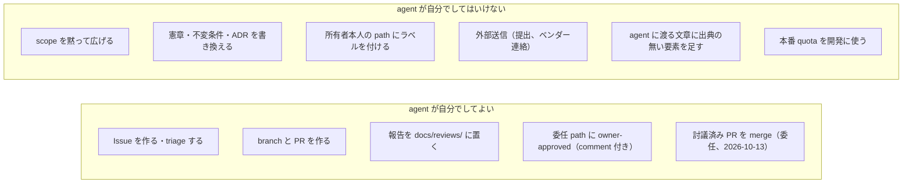
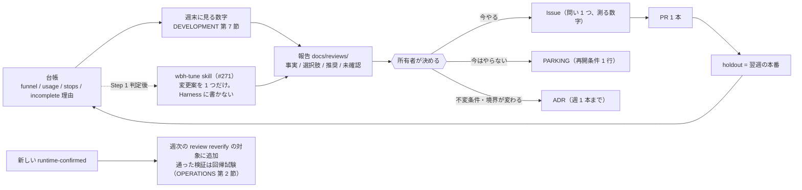

# software factory としてのこの repo（図解）

正本は [SPEC.md](SPEC.md)、[ADR](adr/)、[DEVELOPMENT.md](DEVELOPMENT.md)。この文書は「開発の流れ」を software factory の語で図にしたもので、規則は増やさない。食い違えば正本が勝つ。語の出典と、この repo に既にある要素の対照は [reviews/2026-10-15-software-factory-and-meta-harness.md](reviews/2026-10-15-software-factory-and-meta-harness.md)。

software factory とは、人間が意図と制約を書き、agent が 1 工程ずつ実装と検証をして証拠を残し、人間が merge と release だけを判断する運用モデル。必要な要素は 5 つ。**作業列**、**人間所有の憲章**、**fail-closed なゲートと run ごとの証拠**、**人間だけが merge**、**運転結果を Issue と回帰に戻す monitor / tune**。

## 1. 2 つのループ

この repo には 2 つのループがある。製品ループ（Harness が脆弱性を探し、人間が提出する）と工場ループ（AI が Harness を直し、人間が merge する）。製品ループの図は [DESIGN-DIAGRAMS.md](DESIGN-DIAGRAMS.md)。この文書は工場ループを描く。

人間の判断点は製品ループに 2 つ（提出前レビュー、外部行動の承認。不変条件 6）、工場ループに 1 つ（merge と憲章の変更）。

## 2. 作業列と状態（triage ラベル）

仕事は全部 GitHub Issue に入る（[agents/issue-tracker.md](agents/issue-tracker.md)）。状態はラベル 5 つ（[agents/triage-labels.md](agents/triage-labels.md)）。

「1 週間に答える問いは 1 つ」（DEVELOPMENT 第 3 節）。問いが無い間は PR を作らず、報告（`docs/reviews/`）だけを依頼する。

## 3. 1 Issue → 1 PR の流れとゲート

緑の CI は「壊れていない」であって「できた」ではない。「できた」は PR 本文の「測った数字」で示す。数字の無い探索変更は merge されない（DEVELOPMENT 第 5 節）。

## 4. 憲章（charter）: agent が自分で広げてはいけないもの

| 要素 | この repo での置き場 |
| --- | --- |
| 自律度 | 製品ループは無人（対象選定の承認なし、不変条件 6）。工場ループは AI が PR を作り、merge は人間か委任された AI |
| 守る path（`owner-approved` が要る） | `docs/adr/`、`docs/SPEC.md`、`trust-boundary-v1.md`、`policy/campaign.json`、`policy/programme-scope.md`、`programme-impacts.ts`、`judges.ts`（DEVELOPMENT 第 5 節） |
| 委任された AI がラベルを付ける path | 上記の守る path、prompt の目的文、`policy/selection.json`、`.claude/skills/`、出力契約の雛形、Verifier の victim 契約。出典対照表と委任 comment を付ける |
| 凍結しているもの | 不変条件、モジュール境界、判定器の集合、選定方針の構造。既定promptは所有者決定による v7 → v8 一本化を例外とする（ADR 0033）（DEVELOPMENT 第 2 節） |
| 完了の定義 | Step 1: quota 1 週分を人手 0、scope 内 Finding 全件 export、review batch 1 回（最終設計 第 10 節） |
| 停止条件 | 製品: runner の 6 停止理由。工場: open PR が 3 本を超えたら新しい実装 PR を出さない（第 5 節） |
| 作らないもの | 最終設計 第 13 節。自動 prompt 探索、自己改変する harness、第 2 の orchestrator（[報告](reviews/2026-10-15-software-factory-and-meta-harness.md) 第 4 節） |
| 憲章自体の変更 | 報告 → 所有者の決定 → ADR（週 1 本まで）→ PR。AI は提案だけで、採否は人間（DEVELOPMENT 第 6 節） |

## 5. 逆圧（back-pressure）

人間の読む量が生産速度の上限で、agent の数ではない。上限を超えたら生産を止める。

```mermaid
flowchart LR
  subgraph DEV["工場ループ"]
    P["open PR（Draft 含む）"] -->|"> 3 本"| STOP1["新しい実装 PR を出さない<br/>先に merge か close"]
  end
  subgraph REV["製品ループ"]
    Q["review queue"] -->|batch 上限 3 件| STOP2["所有者が decide --minutes で記録"]
    Q -->|"週 15 件超"| STOP3["PARKING の低価値保留を再開"]
    RUN["runner"] -->|"6 停止理由<br/>operator / errors / no-progress / programme-stale / exhausted / legacy-history-missing"| STOP4["止まって通知。人間が再開"]
  end
```

2026-10-14 は 1 日で PR が 13 本出て、翌日 open が 19 本になった。これが規則を足した理由（#272）。

## 6. monitor と tune（人間ゲート付きの meta-harness）

harness のコードを機械が探索する meta-harness は、評価 1 回が最大 120 分の Trial と本番 quota を使い、当たり率の信号が 0 のままなので、ここでは回せない。回すのは「台帳を読んで、週に 1 つの変更案を数字付きで出し、人間が採否を決める」形だけ。

## 7. 要素と実体の対照

| 要素 | 実体 |
| --- | --- |
| 作業列 | GitHub Issues、5 ラベル、`gh` の手順（agents/issue-tracker.md） |
| 憲章 | DEVELOPMENT 第 2・5・6 節、最終設計 第 8・13 節、adr-guard の path 列挙 |
| 文脈 | AGENTS.md、GLOSSARY.md、ADR、LESSONS.md、knowledge/experiments.md |
| spec | Issue 本文（振る舞い、受入条件）。大きな変更は報告 → 決定 → ADR |
| 実装 run | branch 1 本、PR 1 本、500 行以内、5 項目 |
| 検証 | CI 4 本、PR の「測った数字」、探索は 3 Trial |
| review と delivery | 人間の merge、`owner-approved`、ruleset strict |
| 証拠の保持 | 台帳（digest 参照）、Private Evidence（Git 外）、experiments.md |
| monitor | 週末の数字、`docs/reviews/` の日付付き報告、#270 型の Issue 化 |
| tune | PARKING、ADR 週 1 本、wbh-tune（#271、Step 1 判定後） |
| 逆圧 | open PR 3 本、review batch 3 件、runner の 6 停止理由 |
