# システム図解（2026-10-16 版）

> **2026-10-19 時点で図と違う点**（図は描いた日の記録。正本は SPEC と ADR）: (1) 探索は既定で Lab を付けず（`discovery.lab: none`、PR #365）、検証は後から Finding 単位に Lab を立てて `verify next`（Codex Verifier）か `verify next --handoff`（skill `wbh-verify`、ADR 0035）で行う。(2) 新規探索は `wp2shell-bounty-v8` だけで、Root＋最大 4 子、wall 120 分・最低 60 分。`provider-cyber-policy` で止まった Root は操作者の `campaign resume` で同じ Trial の segment として再開する（ADR 0033、0036）。(3) 選定は主帯 100k–1M を mirror の paying class 件数・最終記録の新しさ・install で順位付けし、尽きたら cascade 50k → 30k → ≥1M（ADR 0037）。(4) Programme Boundary 外と判別の付きにくい 5 分類は `finding-parked`（ADR 0032）。(5) 入口索引と coverage は削除（ADR 0034）。(6) `owner-approved` は委任済みの AI が付ける（ADR 0032 の 2026-10-18 節）。

正本は [SPEC](SPEC.md) と [ADR](adr/)。食い違えば正本が勝つ。この文書は規則を足さない。所有者が全体と細部の動きを図で追えるように、3 段のズームで描く。流れ図は [ARCHITECTURE](ARCHITECTURE.md)、境界と統治は [DESIGN-DIAGRAMS](DESIGN-DIAGRAMS.md)、開発ループは [FACTORY](FACTORY.md) にあり、ここでは重ねない。

- 第 1 段: 全体 1 枚
- 第 2 段: 部品ごとの動き（シーケンス図 6 枚）
- 第 3 段: データと状態（4 枚）
- 配置図: コンテナとネットワーク 1 枚

各図の下の「根拠」は、描くときに読んだ正本の節とコードの場所。用語は [GLOSSARY](../GLOSSARY.md) と同じ。

## 第 1 段: 全体 1 枚

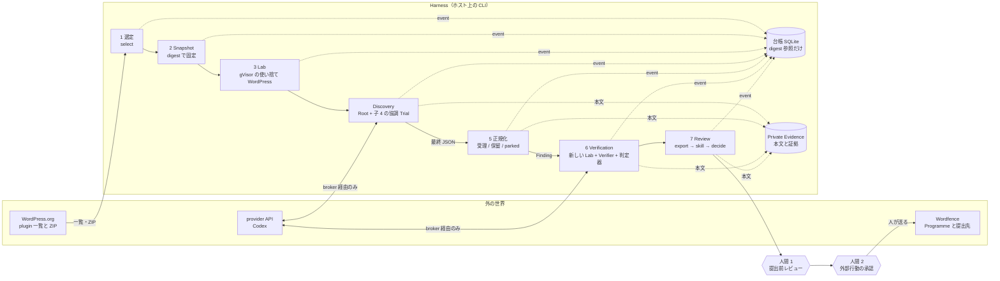

読み方: 実線は対象と候補が進む道、点線は記録。外へ出る線は「broker 経由の provider」と「人が送る提出」の 2 本だけ。Harness 自身は何も送らない。

根拠: SPEC §2（不変条件 1・2・7・8）、§3（流れ）、§4（モジュール境界）。

## 第 2 段: 部品ごとの動き

### 2.1 対象 1 件の `campaign run`

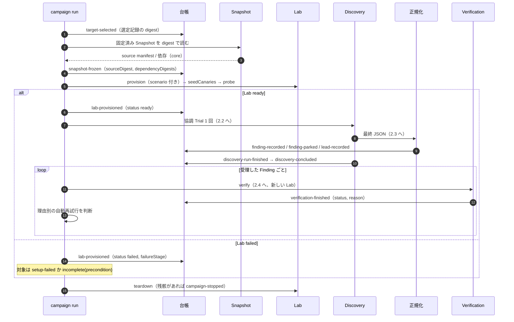

根拠: SPEC §3、§6、§7。`src/cli/pipeline.ts` 400〜770 行。

### 2.2 協調 Trial の中身（Root + 子 4）

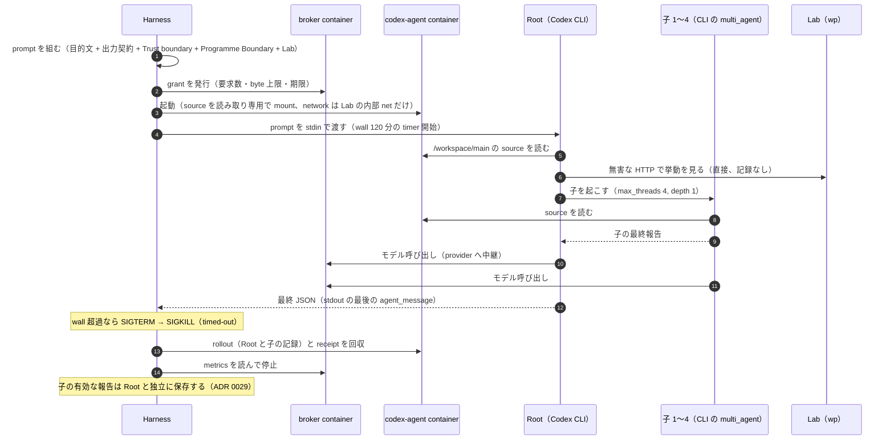

読み方: 子は Harness が起こすのではなく、Codex CLI の `multi_agent` が起こす。Harness は後から各ラウンドの子の rollout を読み、有効な報告をすべて個別に保存する。Root が wall で止まっても子の報告は残る。rollout が保存上限を超えた場合は、保存できた報告を残して Trial を `incomplete(evidence)` にする。

根拠: SPEC §6、ADR 0029。`src/discovery/codex-native-agent-runtime.ts` 1039〜1457 行、`src/infrastructure/native-model-process.ts` 63〜80 行、`src/discovery/recover-agent-reports.ts`。

### 2.3 候補の正規化（受理・保留・parked）

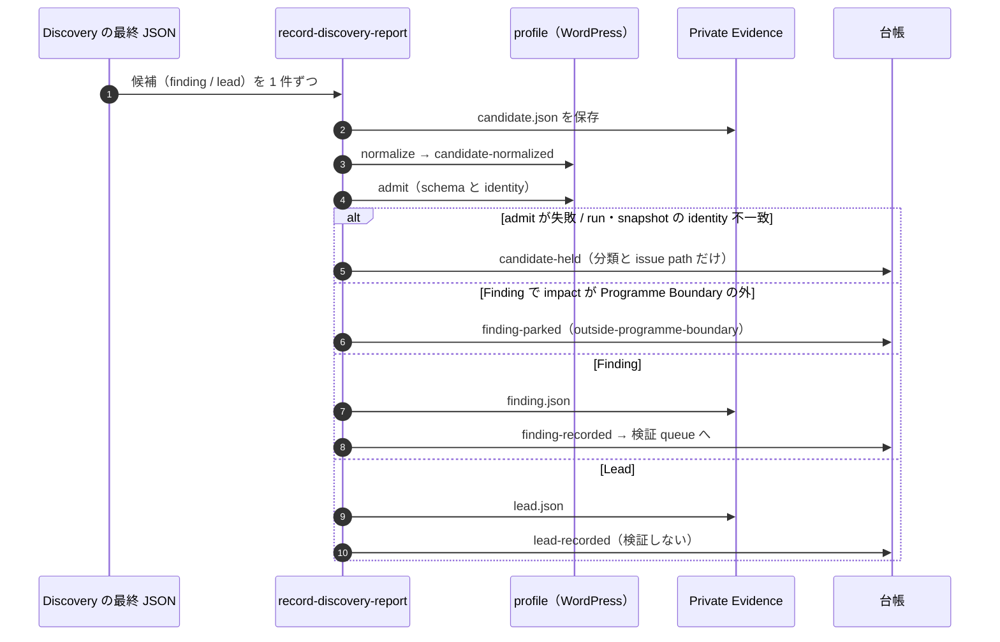

読み方: 出力境界で候補を捨てない。通らないものは保留として本文を残す（ADR 0018）。parked は台帳と Private Evidence に残るが、検証と review には行かない。

根拠: ADR 0018、ADR 0019、AGENTS.md「受理した Finding のうち impact が Programme Boundary の外」。`src/discovery/record-discovery-report.ts` 78〜299 行、`src/profiles/wordpress/discovery/programme-impacts.ts`。

### 2.4 検証 1 回（新しい Lab、Verifier、判定器）

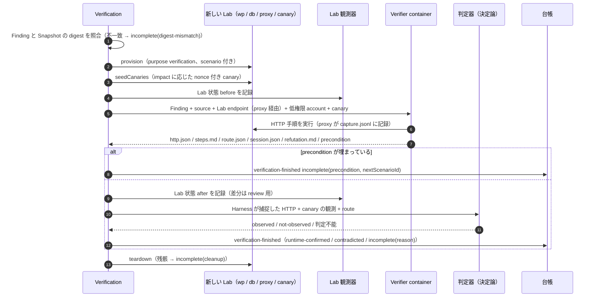

読み方: 証明は canary の回収だけ。Verifier の自己申告や画面は証明にしない。`contradicted` は修正版の負の対照が揃ったときだけで、それ以外の不一致は `incomplete(observation)`。再試行は理由ごとに回数が決まる。

根拠: SPEC §2（不変条件 3〜5）、§7、ADR 0022、ADR 0026。`src/verification/index.ts` 258〜619 行、`src/profiles/wordpress/verification/codex-verifier.ts`、`judges.ts` 1355〜1412 行、`src/cli/pipeline.ts` 125〜149 行。

### 2.5 `continuous run` の 1 周

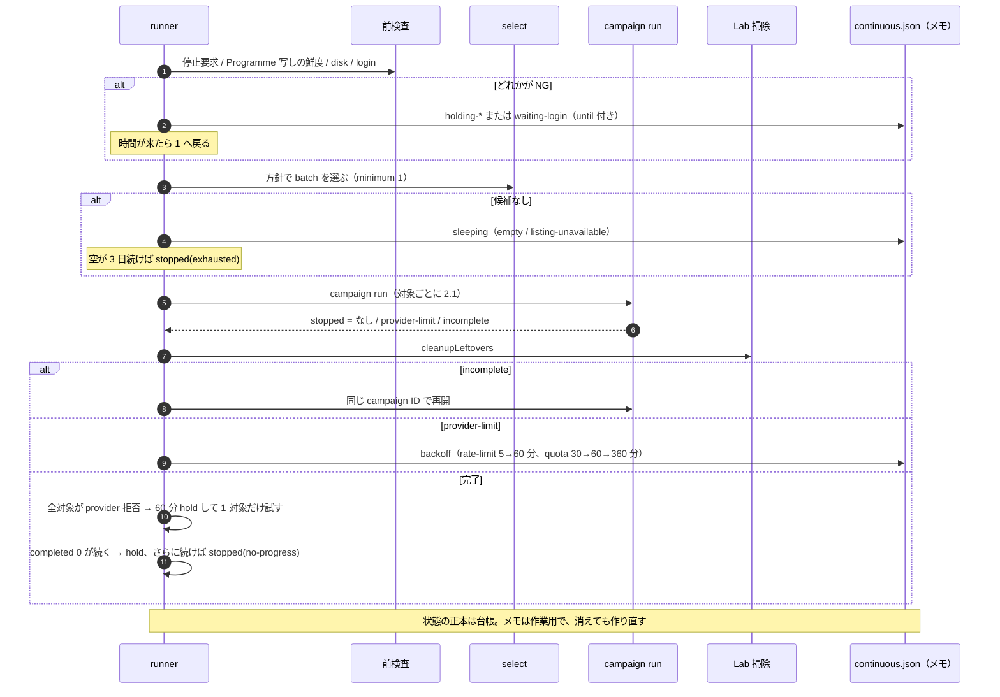

停止理由は 6 つ: `operator`、`errors`、`no-progress`、`programme-stale`、`exhausted`、`legacy-history-missing`（`missing-floor-policy` は方針の `cascade` に置き換えて削除、ADR 0037 追記）。保守（Lab 掃除、再起動）は人手介入に数えない。

根拠: 最終設計（2026-10-14）§3.1〜3.2、§7。`src/cli/continuous.ts`（PR #262〜#269 で修正中の部分を含む）。

### 2.6 週末のレビューと提出

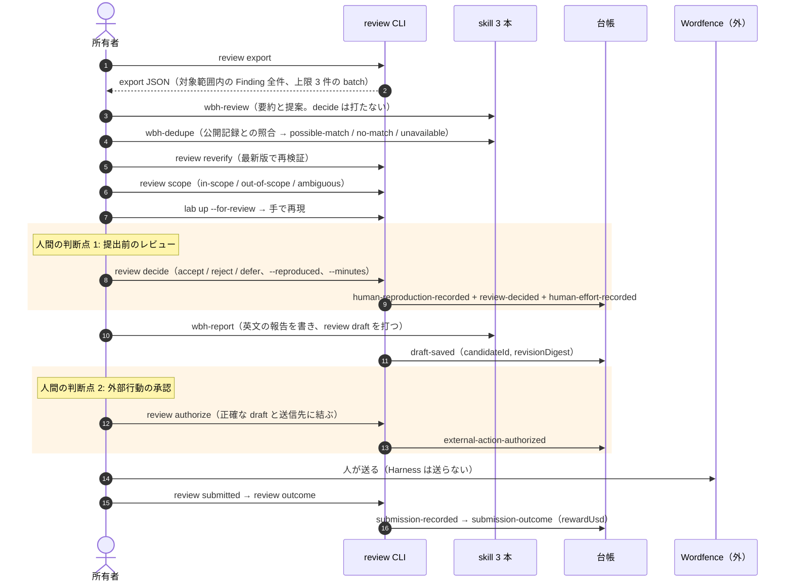

根拠: SPEC §2（不変条件 6・7）、§8、OPERATIONS §3。`src/review/index.ts`、`.claude/skills/wbh-review` / `wbh-dedupe` / `wbh-report`。

## 第 3 段: データと状態

### 3.1 データの置き場

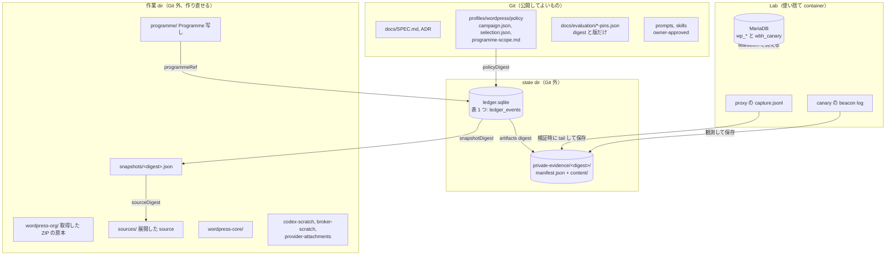

台帳に入るのは分類、理由、digest だけ。本文（候補、HTTP 記録、画面、認証情報、未公開の発見）は Private Evidence に置き、Git には入れない。Lab の中身は検証のたびに消える。

根拠: SPEC §2（不変条件 8）、§9。`src/ledger/index.ts` 684〜730 行、`src/infrastructure/private-artifact-store.ts`、`src/cli/wordpress-host.ts` 171〜180 行。

### 3.2 台帳 event の関係（これが「DB 図」）

表は `ledger_events` 1 つで、列は `sequence`、`identity`（一意）、`campaign_id`、`event_type`、`finding_id`、`input_digest`、`event_json`。関係は event の中の参照欄で表す。

```mermaid
flowchart LR
  TS[target-selected<br/>selectionId, promptVariant]
  SB[selection-batch-bound<br/>policyDigest, selectionIds]
  SF[snapshot-frozen<br/>sourceDigest, dependencyDigests]
  LP[lab-provisioned<br/>labId, scenario, status]
  RS[discovery-run-started<br/>runId, runKind explore/child,<br/>parentRunId, prompt/objective/contract digest]
  RF[discovery-run-finished<br/>runId, outcome, reason, usage, wallTimeMs]
  DC[discovery-concluded<br/>stoppedBy]
  CN[candidate-normalized / held<br/>runId, candidateKind, candidateIndex]
  FR[finding-recorded<br/>findingId, runId, derivedFromFindingId]
  FP[finding-parked<br/>findingId, reason]
  LR[lead-recorded<br/>leadId, runId, trialId]
  VR[verifier-run-finished<br/>findingId, runId, receiptDigest]
  VF[verification-finished<br/>verificationId, findingId, retryOf,<br/>result.status / reason, evidenceDigest,<br/>reproductionPackageDigest]
  RD[review-decided<br/>findingId, decision]
  SA[scope-assessed<br/>findingId, programmeId, status]
  DS[draft-saved<br/>candidateId, revisionDigest]
  EA[external-action-authorized<br/>candidateId, revisionDigest, destination]
  SR[submission-recorded<br/>findingId, candidateId]
  SO[submission-outcome<br/>candidateId, outcome, rewardUsd]
  TK[target-skipped<br/>selectionId, stage, reason]

  SB -->|selectionIds| TS
  TS -->|snapshotDigest| SF
  SF --> LP
  LP -->|labId| RS
  RS -->|runId| RF
  RS -->|parentRunId| RS
  RF --> DC
  RS -->|runId| CN
  CN --> FR
  CN --> FP
  CN --> LR
  FR -->|findingId| VR
  FR -->|findingId| VF
  VF -->|retryOf| VF
  VF --> RD
  VF --> SA
  SA --> DS
  DS -->|revisionDigest| EA
  EA -->|candidateId| SR
  SR --> SO
  TS -.->|freeze / discovery / verification で| TK
```

全 event が共通に持つのは `schemaVersion`、`identity`、`campaignId`、`snapshotDigest`、`occurredAt`、`artifacts[{kind, digest}]`。`artifacts` の digest は Private Evidence に実在しないと追記できない。同じ `identity` を同じ内容で追記すると無視、違う内容なら conflict。台帳は追記専用。

根拠: SPEC §9。`src/ledger/index.ts` 15〜460 行（event schema）、684〜730 行（表と追記規則）。

### 3.3 Finding の一生

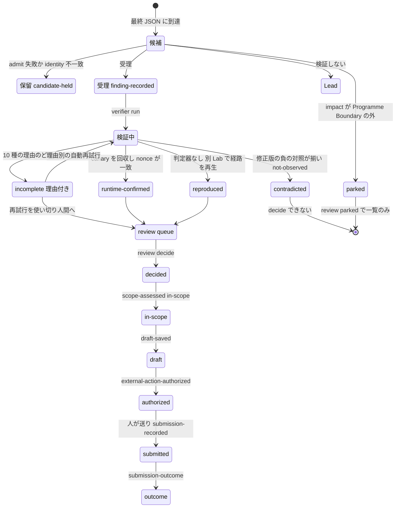

- incomplete の理由 10 種: provision、precondition、recipe、provider、sandbox、observation、evidence、cleanup、digest-mismatch、no-judge。
- 自動再試行: recipe と observation は同じ Lab Setup で合計 3 回まで。provision と provider は 2 回まで。precondition は scenario が変わったときだけ。他は人間へ。
- decide は accept / reject / defer。outcome は triaged / resolved / duplicate / informative / not-applicable / rejected。

`ledger funnel` の数字との対応: 最終JSON到達＝候補、受理＝受理＋Lead、保留＝保留、parked＝parked、raw＝受理（Finding のみ）、verifier通過＝検証に 1 回以上届いた、confirmed / reproduced / contradicted / incomplete＝最新の検証結果、reviewed＝decided、in-scope、submitted、outcome。`incomplete` は陰性ではない（不変条件 4）。

根拠: SPEC §2（不変条件 3・4）、§7、§8、ADR 0018、ADR 0022、ADR 0031。`src/verification/reproduction-package.ts` 30〜85 行、`src/cli/pipeline.ts` 125〜149 行、`src/review/index.ts`、`src/cli/index.ts` 455〜509 行（funnel）。

### 3.4 対象と run の一生

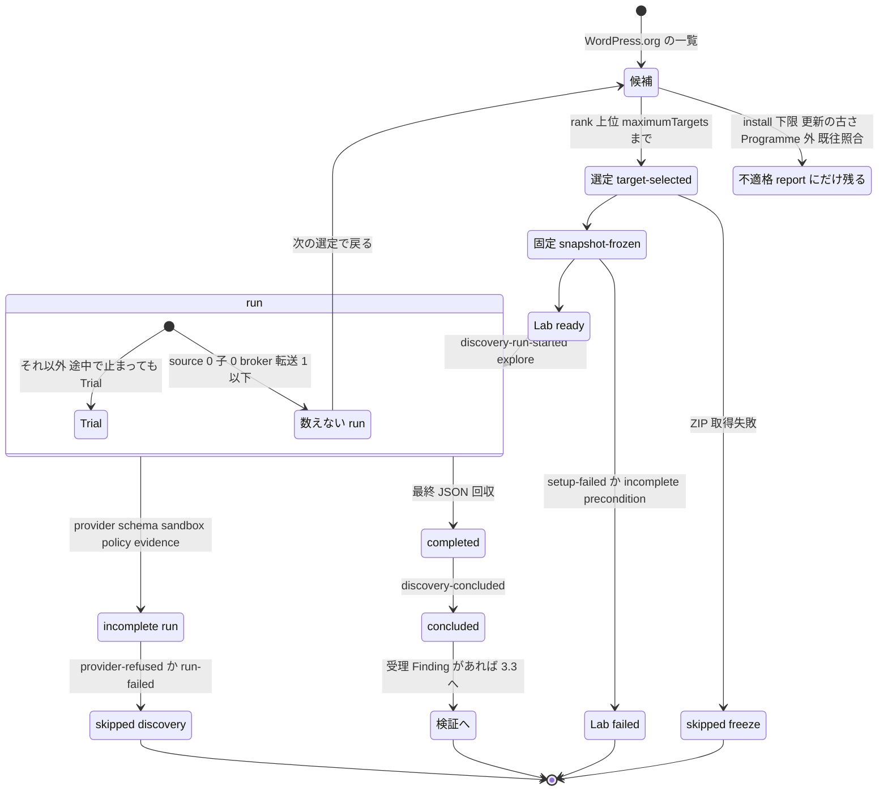

- `discovery-concluded` の stoppedBy: no-new-finding / max-runs / output-boundary / plans-exhausted。provider-limit と incomplete は concluded にせず、再開できる。
- 「数えない run」は Root が source を 1 件も読まず、子を起こさず、broker 転送が 1 以下で終わった run。その対象だけが次の選定で戻る。

`revisitPolicy: never` では、Trial に数えた対象は二度と選ばない。数えない run の対象だけが戻る。現行方針（ADR 0037 の 2026-10-19 追記）は `version-increased` ＋ `minimumDaysSinceTrial: 90` で、版が上がり 90 日経った対象も戻る。

根拠: SPEC §6、最終設計 D2 / P5、ADR 0029。`src/profiles/wordpress/selection/ledger-exclusions.ts` 103〜117 行、`src/discovery/campaign.ts` 623〜693 行、`src/cli/pipeline.ts` 732〜745 行。

## 配置図: コンテナとネットワーク

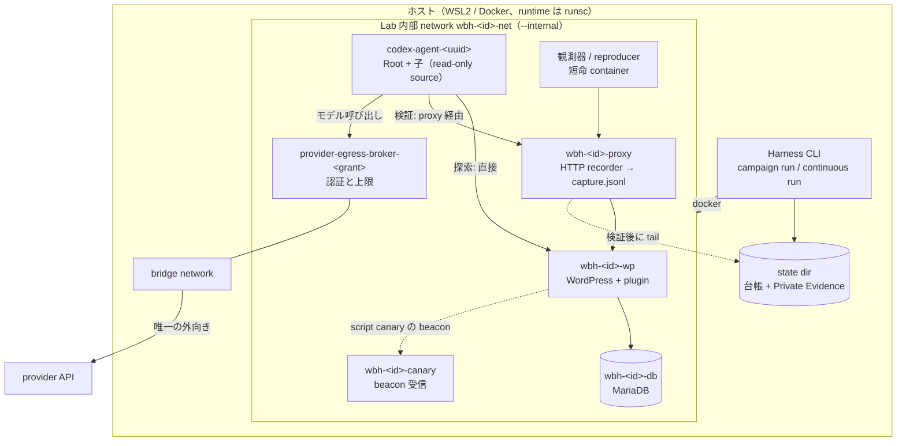

- 各 container は `--runtime=runsc`、`--read-only`、`--cap-drop=ALL`、`--pull=never`。image は 6 種とも digest で固定。
- Lab の network は `--internal`。外へ出られるのは broker だけで、broker は `bridge` にも繋がる。agent の base URL は broker 固定、web 検索は無効。
- ホストへの port 公開は無し。`lab up` で手で見るときだけ `wbh-<id>-host` が 127.0.0.1 に公開する。
- 探索の agent は wp に直接届く（記録なし）。検証の Verifier は proxy を通り、HTTP が記録される。判定器が読むのはこの記録だけ。

根拠: SPEC §2（不変条件 2）、§6、§7。`src/profiles/wordpress/lab/container-startup.ts`、`src/discovery/codex-gvisor-sandbox.ts` 560〜782 行、`src/discovery/provider-credential-egress-broker.ts` 423〜839 行。

## 図に出る言葉を平易に

正式な定義は [GLOSSARY](../GLOSSARY.md) と SPEC §15。ここでは「何のためにあるか」を一言で書く。

| 言葉 | 平易に言うと |
| --- | --- |
| digest | ファイルや記録の内容から計算した指紋（SHA-256）。内容が 1 文字でも変わると別の値になるので、「同じものを見ているか」を確かめるのに使う |
| Snapshot | 調べる plugin の source を、版と digest で固定したもの。探索・検証・レビューが同じ中身を見るための「凍結した写し」 |
| Lab | gVisor で隔離した使い捨ての WordPress 環境。対象 plugin を実際に動かす場所で、終わったら消す |
| gVisor / runsc | Google 製の container 隔離技術。container とホスト OS の間に「見せかけの kernel」を置き、container から本物の kernel に直接触れさせない。runsc はその起動コマンド |
| broker | provider（モデル API）への通り道を 1 本に絞る中継 container。認証情報を持ち、要求数と byte 数の上限を数える。agent はここ以外に外へ出られない |
| Root / 子 | 協調 Trial で動く agent。Root が全体を見て、最大 4 つの子に分担を振る。どちらも同じ container の中で動く |
| Trial | 1 回の探索の試み。Root と最大 4 子で 1 Trial。source を読まずに終わった run は Trial に数えない |
| Finding | 「この入口からこの影響に至る」という、source 上の根拠付きの未確認の主張。検証して初めて結果になる |
| Lead | 根拠はあるが、影響までの道に未解決の部分が残る手がかり。検証はしない |
| 保留（held） | 出力の形が契約に合わず、受理できなかった候補。捨てずに本文を残す |
| parked | 受理したが、報奨 Programme の対象外の影響だった Finding。検証とレビューには進めない |
| Programme Boundary | 報奨 Programme（Wordfence）が「対象」と定める範囲を写した文章。版と digest で固定 |
| Trust boundary | 「誰の権限までを信頼の内側とするか」を人間が書いた宣言。contributor 以上の権限は内側 |
| 入口索引 | source から機械的に拾った「外から呼べる入口」の一覧。経路は指示しない。ADR 0034 で生成 code を削除し、旧 Trial の記録にだけ現れる |
| Verifier | Finding を実際の Lab で再現してみる agent。手順（recipe）を書き、HTTP を実行する。証明はしない |
| 判定器（judge） | Harness が持つ決定論の検査。Verifier の自己申告ではなく、Harness が捕捉した HTTP と canary の観測だけを見て結果を出す |
| canary / nonce | Lab にわざと置いておく目印（canary）。毎回違う使い捨ての値（nonce）を埋め、その値が外に出てきたり変わったりしたら「実際に届いた」と分かる。囮（おとり）と合い言葉の組み合わせ |
| proxy / recorder | 検証中の HTTP を記録する中継。Verifier の通信はここを通るので、判定器は「実際に送られたもの」を読める |
| 負の対照（negative control） | 修正版の plugin で同じ手順を再生し、効果が出ないことを確かめる作業。これが揃ったときだけ `contradicted` と言える |
| scenario（通常機能シナリオ） | 検証に必要な「ふだんの利用状態」を Lab に作る手順。版と digest で固定。足りないと `incomplete(precondition)` |
| runtime-confirmed / contradicted / incomplete | 検証結果の 3 値。確認できた / 反証できた / 判断に足る材料が無い。incomplete は陰性ではない |
| reproduced | 判定器が無い種類の Finding で、別の Lab で手順を再生できたときの結果。負の対照は未成立 |
| 台帳（ledger） | 追記専用の SQLite。何が起きたかの記録で、本文は持たず digest で指す |
| Private Evidence | 本文（候補、HTTP 記録、画面、認証情報、未公開の発見）を置く Git 外の保管先。台帳から digest で参照 |
| funnel | 台帳から出す「段ごとの件数」。候補 → 受理 → 検証 → 確認 → レビュー → 提出 → 結果と、各段で何件残ったかを 1 行で示す |
| review export | 人間がレビューする材料を 1 つの JSON にまとめた出力。skill はこれだけを読む |
| skill | 所有者または AI session が使う手順書付きの AI 補助。レビュー、重複照合、報告文、検証（`wbh-verify`）の 4 本。台帳を直接は書かない |
| continuous run | 選定から検証までを対象 5 件ずつ繰り返す無人運転。止まるのは決められた 6 つの理由だけ |
| owner-approved | agent に渡る文章と判定器などの重要 path に付ける印。これが無いと merge しない。2026-10-18 以降は委任済みの AI が差分を確認して付ける |

## 図と正本の対応

| 図 | 正本 | 用語（GLOSSARY） |
| --- | --- | --- |
| 第 1 段 | SPEC §2、§3、§4 | Campaign、Trial、Finding、Private Evidence |
| 2.1 | SPEC §3、§6、§7 | Target Snapshot、Lab、VerificationResult |
| 2.2 | SPEC §6、ADR 0029 | Trial、Discovery run |
| 2.3 | ADR 0018、0019 | 保留候補、Finding、Lead |
| 2.4 | SPEC §7、ADR 0022、0026 | 通常機能シナリオ、Reproduction Package |
| 2.5 | 最終設計 §3、§7 | — |
| 2.6 | SPEC §8、OPERATIONS §3 | Submission Candidate |
| 3.1 | SPEC §9 | Private Evidence |
| 3.2 | SPEC §9 | — |
| 3.3 | SPEC §7、§8、ADR 0031 | VerificationResult |
| 3.4 | SPEC §6、最終設計 D2 | Trial |
| 配置図 | SPEC §2 不変条件 2 | Lab |

コードの行番号は 2026-10-16 の main 時点。ずれたら file 名で探す。
