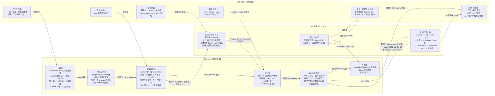

# システムの動き（2026-11-05 版）

この文書は、Harness がいまどう動いているかを 6 つの段で説明する。規則は足さない。正本は [SPEC.md](SPEC.md) と [ADR](adr/) で、食い違えばそちらが勝つ。各段の末尾に「正本」として、読んだ SPEC の節、ADR、コードの場所を並べる。用語は [GLOSSARY.md](../GLOSSARY.md) に合わせる。

読み方は 2 つある。全体を掴みたいなら第 1 節の図と第 2 節の表だけでよい。1 つの段を直したいなら、その段の節と「正本」の行を読む。

## 1. 全体の流れ

横が段、縦が持ち主である。対象は Harness の行を左から右へ流れる。下の行から上がってくるのは方針、宣言、承認、観測で、Harness はそれを判断の代わりに使う。

探索の結果は検証列へ進むが、提出の転帰は探索や選定へは戻さない。戻す先は、検証前選別（`wbh-screen`）の規則と Lab の基線だけである（ADR 0045）。

## 2. 6 つの段の一覧

| 段 | Harness が持つもの | AI が持つもの | 人間が持つもの |
| --- | --- | --- | --- |
| 1 選定 | 列挙、適格性、順序、batch、台帳の除外 | 無し | 方針 file の数値 |
| 2 Snapshot | 取得、依存の解決、digest、台帳 | 無し | 無し |
| 3 探索 | sandbox、ブローカー、制限時間と子の数、生成節、出力の保存 | 目的文とスキル。どこを読み、何を仮説にするか | trust 境界宣言、文の承認 |
| 4 出口 | 正規化、park、Lead の保存、seen before の表示 | 無し | 一覧を見る、restore |
| 5 検証 | Lab の供給、観測器、中継器、観測の記録 | 6 段のスキル。前提作り、照合、報告書 | Lab での観測。確定の根拠はこれだけ |
| 6 提出 | submitted と outcome の記録 | 報告書と form JSON、転帰の記録の代行 | 送信、転帰を伝える |

## 3. 段 1: 選定

ランナーは batch の始めに WordPress.org の人気順一覧を下限まで全件読み、作者とタグの除外、鮮度、台帳の除外を当てて適格な候補を並べる。順序はインストール数の帯（100 万 / 10 万 / 1 万）の高い方を先に、帯の中では stable 版の公開日が新しい順である。1 batch は 10 件で、台帳に数えた Trial が同じ版か上位の版を調べていれば外し、版が上がれば待たずに列へ戻す。探索の方法を変えて再開したときは、方針の `countTrialsFrom` に再開時刻を入れ、それより前の Trial を探索済みに数えない。凍結が `deferred` で止まった版は 7 日で再試行する。`invalid-archive` と Lab の供給失敗は版が上がるまで外す。

| Harness | AI | 人間 |
| --- | --- | --- |
| 列挙、適格性、帯と公開日の順序、batch、台帳の除外、選定レポート | 無し | 方針 file の数値（下限、鮮度、除外、帯、`countTrialsFrom`） |

- 設定の鍵: `ordering`、`orderingBands`、`minimumActiveInstallations`、`maximumUpdateAgeDays`、`maximumTargets`、`revisitPolicy.countTrialsFrom`、`excludedAuthors`、`excludedSlugs`、`pluginDependencySlugs`
- 台帳: `selection-batch-bound`、`selection-batch-discarded`、`target-selected`、`target-skipped`
- 正本: SPEC 第 3 節、ADR 0037（2026-10-28 追記、2026-11-01 追記 1〜6）、ADR 0047、`src/profiles/wordpress/selection/`、`src/profiles/wordpress/policy/selection.md`

## 4. 段 2: Snapshot

選ばれた slug と版から、plugin の zip、WordPress 本体、実行イメージに対応する PHP ソース、依存 plugin を版と digest で固定する。本体の版は方針に書かず、WordPress.org の最新安定版と Lab image の版が同じときだけ凍結する。依存は `Requires Plugins` ヘッダ、WooCommerce の版ヘッダ、方針の明示指定から決め、欠けていれば黙って省かず止める。主ファイルが `<slug>.php` でない plugin は、root 直下の唯一のヘッダを主ファイルに採る。

| Harness | AI | 人間 |
| --- | --- | --- |
| 取得、主ファイルの決定、依存の解決、digest、台帳 | 無し | 無し |

- 設定の鍵: `wordpressVersion`（開発と歴史的評価だけ）、`pluginDependencySlugs`、`pluginDependencyPins`
- 台帳: `snapshot-frozen`、`target-skipped`（stage `freeze`）
- 正本: SPEC 第 6 節、ADR 0033、ADR 0047、`src/snapshot/`、`src/profiles/wordpress/acquisition/`

## 5. 段 3: 探索

対象ごとに 1 回、Codex の Root と子が協調する Trial を gVisor の使い捨て sandbox で行う。Harness が渡すのは、固定したソース（読み取り専用）、人間が書いた trust 境界宣言、Programme Boundary、目的文、Harness が生成する節（`## Run parameters`、Finding / Lead の出力契約 v4、スキルの場所、`## Prior research`）だけである。評価対象の答え、PoC、公開履歴の中身は渡さない。外向き通信は認証ブローカー経由の provider API に限る。

リポジトリの wide 方針は `wp2shell-bounty-v26-wide` を既定にし、探索 Lab を付け、最低 60 分を指定する。制限時間の上限は 120 分、同時に生きる子はリポジトリの wide 方針で 3（基底の既定 4、設定可能な上限 8）である。v26 は 7 月 30 日方式の一つの目的文を Root に渡し、探索手順を持つスキルを既定で付けない。v23 / v24 / v25-wide と `wbh-audit-v1/v2` の六段階探索方式は `experimental/` に置き、起動可能な版を名指ししたときだけ使う。これは段 5 の提出前検証に使う六段のスキルとは別である。Claude runtime の share は 0 である。

リポジトリの wide 方針は `discovery.priorResearch: same-target` を指定し、同じ plugin の別 Snapshot の最新 Trial が封じた研究 file を `/workspace/research/prior/` に置く。同一 Snapshot の研究 file 全体はこの経路で渡さない。基礎の `recon-map.md` と `lab-setup.md` に加え、存在すれば `REGISTRY.md`、`assumptions/*.md`、`walks/*.md` と Lab の保存先記録 `stores.json` を渡す（SPEC 第 6 節）。同一 Snapshot の再探索は既定で自動起動しない。どこを読むか、何を仮説にするか、子に何を任せるかは Root が決める。Harness は舵を取らない。稼働中のランナーの Git 外設定と、このリポジトリの既定は別に確認する。

止まった Root は、同じ Snapshot と残りの制限時間で新しい sandbox に再開できる。Codex の `provider-limited` と死んだ持ち主の `interrupted` は自動で、それ以外は操作者の名指しで再開する。言い換えはしない。

| Harness | AI | 人間 |
| --- | --- | --- |
| sandbox、ブローカー、同時対象数、子の上限、制限時間、生成節、出力の全件保存、再開 | 目的文、スキル、読む順、仮説、子の使い方 | trust 境界宣言、目的文とスキルの承認（owner-approved は AI に委任） |

- 設定の鍵: `discovery.mode`、`promptId`、`discovery.skills`、`discovery.maxChildren`、`runWallTimeMinutes`、`discovery.priorResearch`、`discovery.lab`、`resources.maxConcurrentTargets`、`resources.maxConcurrentTargetsByRuntime`、`resources.memoryBudgetMiB`。live の上書きは `continuous concurrency`
- 台帳: `discovery-run-started`、`discovery-run-finished`、`thread-resume`、`discovery-report-recovered`、`child-report-recovered`
- 正本: SPEC 第 2 節（不変条件 1、2）と第 6 節、ADR 0029、ADR 0036、ADR 0039（2026-11-01 追記 19）、ADR 0048、`src/discovery/`、`src/profiles/wordpress/prompts/`、`src/cli/wordpress-session.ts`

## 6. 段 4: 出口

Root と子が出した Finding と Lead は、出力境界で棄却せず、スキーマで正規化して受理するか保留する。受理した Finding のうち impact が Programme Boundary の外にある 5 種と、所有者が外した 5 種は `finding-parked` として台帳と Private Evidence に残し、検証列には入れない。文言からは判定しない。Lead は検証列に入らないが、`review leads` で人間が全件を見る。同じ対象の別の Snapshot で同じ経路を見ていれば、review 列に `seen before` を表示する。判定はしない。

| Harness | AI | 人間 |
| --- | --- | --- |
| 正規化、保留、park、Lead の保存、seen before の表示 | 無し | `review parked` / `review leads` を見る、`review restore` で戻す |

- 設定の鍵: `programmeBoundary`
- 台帳: `candidate-normalized`、`candidate-held`、`candidate-rejected`、`finding-recorded`、`finding-parked`、`finding-park-restored`、`lead-recorded`、`discovery-concluded`
- 正本: SPEC 第 8a・8b 節、ADR 0018、ADR 0019、ADR 0032（2026-10-17 節）、ADR 0038（追記 13、17）、`src/profiles/wordpress/discovery/programme-impacts.ts`

## 7. 段 5: 検証

対象範囲内の Finding は検証の結果に関係なく全件がレビュー列に出る。AI は 6 段のスキルで進める。段 1 `wbh-screen`（公式規則で明白に外れるものだけ分ける）、段 1b `wbh-source-check`（固定ソースだけで成立 / 不成立 / 未決）、段 2 群（同じ経路をまとめる）、Lab の前の `wbh-dedupe`（possible-match なら Lab を立てない）、段 3 `wbh-verify`（Lab の通常機能で前提を作り、攻撃者の位置だけで route を実行する）、段 4 `wbh-dedupe`、段 5 `wbh-destination`、段 6 `wbh-report`。中間判断は `review decide --by ai` で記録する。

Harness は `verify next --handoff` で Finding 単位の Lab を立てる。Lab は host ごとに 1 台で、基線は `hosting-default-v3`（Wordfence が受理する入口は攻撃面として残す）。外部サービスに繋がる Lab は `--egress-plan` で宛先ごとの中継器を置き、`setup-done` の後に消す。Harness が持つのは観測器（HTTP 捕捉、Lab 状態の差分、Lab browser）と記録だけで、判定器と canary は無い。確定の根拠は、名指しした人間が review Lab で記録した `review observe` の match と `review decide --reproduced match` だけである。人間はコマンドを打たず、会話で見たことを述べ、AI が `--by <人間>` で記録する。環境、手順、観測、証拠の不足は `incomplete` にする。Finding と検証結果の Snapshot digest が違えば `incomplete` にする。

| Harness | AI | 人間 |
| --- | --- | --- |
| Lab の供給と lease、基線、中継器、観測器、捕捉、観測の記録 | 6 段のスキル、前提作り、照合、提出先、報告書、`--by ai` の中間判断 | Lab での観測。AI が記録を代行する |

- 設定の鍵: 検証 profile の `lab`、`--egress-plan <path>`、`--hold-minutes`
- 台帳: `lab-provisioned`、`verification-lab-failed`、`verification-finished`、`manual-observation-lab-ready`、`manual-observation-recorded`、`human-reproduction-recorded`、`review-item-opened`、`review-decided`
- 正本: SPEC 第 2 節（不変条件 3、4、5）と第 7 節、ADR 0026、ADR 0035、ADR 0038、ADR 0040、ADR 0046、`src/lab/`、`src/verification/`、`src/review/`、`.claude/skills/wbh-*/SKILL.md`。SPEC は第 7 節で判定器と canary の語を使うが、コードには無い（ADR 0040）

## 8. 段 6: 提出と転帰

観測が match の Finding について、AI が `wbh-report` で英語の報告書と form 入力用の JSON を Private Evidence に作る。送信は人間が自分のブラウザと拡張機能で行い、Harness は送信しない。人間が「送った」と言えば AI が `review submitted` を記録し、転帰のメール本文を会話に貼れば AI が `review outcome` を記録する。外部送信には、正確な Submission Candidate、文案の版、送信先に結び付いた承認（`review authorize`）が要る。台帳は追記専用で digest 参照しか持たず、報告書の本文、HTTP 記録、画面画像は Git 外の Private Evidence に置く。

転帰は `wbh-screen` の規則と Lab の基線へ戻す。選定と探索には戻さない。

| Harness | AI | 人間 |
| --- | --- | --- |
| 承認、submitted、outcome の記録。送信はしない | 報告書、form JSON、記録の代行 | 送信、転帰を伝える |

- 台帳: `draft-saved`、`external-action-authorized`、`submission-recorded`、`submission-recorded-externally`、`submission-outcome-recorded`
- 正本: SPEC 第 2 節（不変条件 7、8）と第 8 節、ADR 0038、`.claude/skills/wbh-report/SKILL.md`、`.claude/skills/wbh-submit/SKILL.md`、`src/review/`

## 9. 人間の判断点

人間の判断点は 2 つだけである（不変条件 6）。

1. 提出前のレビュー。Lab で自分の目で観測し、再現したかを述べる。
2. 外部行動の承認。送信先と文案の版を結び付けて承認する。

対象選定の承認と、未検証候補の採否は置かない。権限や対象範囲を広げるときだけ、明示の承認が要る。2026-10-31 以降、人間はコマンドを打たず、観測と承認は会話で述べ、AI が本人の名で記録する。AI が自分で打った観測は根拠にしない。

## 10. 変えない 5 つ

ADR 0045 で凍結した。提案も出さない。

1. 不変条件 1〜8（SPEC 第 2 節）。
2. Harness は制御だけを持つ。探索と検証の中身はプロンプトとスキルが持つ（AGENTS.md の責務）。
3. 確定は人間の Lab 観測だけ。判定器と canary は戻さない（ADR 0040）。
4. 探索プロンプトの文面。消すだけは許す。
5. 設計の変更は月 1 回。同じ分母で数字を取ってから次を決める。

## 11. 数字の見方

分母は 1 つで、Codex 1 時間あたりの Lab 発火数と Wordfence の結果（受理、重複、対象外）である。Finding の数は文面で動くので、採否の根拠にしない。agent 入力を変える PR は本番の同じ選定帯で旧版と新版を交互に回し、[DEVELOPMENT.md](DEVELOPMENT.md) 第 5 節の 6 段で採否を決める。手順は [docs/agents/measurement.md](agents/measurement.md)、台帳の読み方は [docs/agents/ledger-reading.md](agents/ledger-reading.md)、本番の監視は [docs/agents/production-monitoring.md](agents/production-monitoring.md) にある。

## 12. 動かし方の要点

- ランナーは `continuous run --config <campaign> --selection <selection> --campaign-prefix <prefix> --resume` で動き、batch の境界で止まる（`continuous stop`）。同時対象数は `continuous concurrency [<n>] [--runtime codex] --config <path>` で上書きし、次の対象の開始から効く。
- 1 件だけ回すときは `campaign run <slug> --campaign <id> --config <path> --selection <path>` に、`candidateSlugs` と `pinnedVersions` を持つ手動の方針を渡す。本番の台帳と混ぜないため state dir を分ける。
- 止まった Root は `campaign resume --campaign <id> --run <runId> --config <path>`。
- 検証は `verify next --config <path> --handoff <dir> [--egress-plan <path>]`、レビューは `review export` / `review observe` / `review decide` / `review restore` / `review parked` / `review leads` / `review submitted` / `review outcome`。
- 設定は Git 外（`~/.config/wordpress-bounty-harness/`）、台帳と Private Evidence も Git 外（`~/.local/state/`）に置く。

詳しい手順は [OPERATIONS.md](OPERATIONS.md) にある。

## 13. 置き場

| 物 | 場所 | 誰が書く |
| --- | --- | --- |
| 規則と理由 | `docs/SPEC.md`、`docs/adr/` | AI が書き、所有者が確かめる |
| 目的文、生成節の雛形、trust 境界宣言、Programme Boundary | `src/profiles/wordpress/prompts/`、`src/profiles/wordpress/policy/` | AI。merge には owner-approved（委任） |
| 探索スキル（sandbox に置く） | `src/profiles/wordpress/prompts/skills/` | 同上 |
| 検証と提出のスキル | `.claude/skills/wbh-*/` | 同上 |
| 選定方針の雛形 | `src/profiles/wordpress/policy/selection.json` | AI |
| 本番の campaign / selection / host 設定 | `~/.config/wordpress-bounty-harness/`（Git 外） | AI。鍵と認証情報は所有者 |
| 台帳 | `<state>/ledger.sqlite`（Git 外、追記専用） | Harness |
| Private Evidence（Finding 本文、捕捉、報告書、診断） | `<state>/private-evidence/<digest>/`（Git 外） | Harness とスキル |
| ランナーの状態 | `<state>/continuous-<prefix>.{pid,json,stop}`、`<state>/continuous.concurrency*` | Harness と操作者 |
| 調べて報告した文書 | `docs/reviews/`（正本ではない） | AI |
| 過去 4 世代の知識 | `docs/knowledge/` | 取り込み済み。足さない |

探索の失敗（制限時間、provider、broker、スキーマ）は理由付きの `incomplete` で、候補 0 件には数えない。検証の失敗も `incomplete` で、`contradicted` にも棄却にもしない。どちらも台帳に理由が残り、`ledger funnel --campaign <id>` で段ごとの数を読める。
