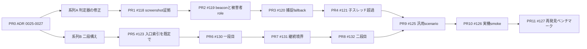

# 2026-10-11 実装計画: 判定器の修正と二段構え探索への移行

Codex に渡す作業計画。設計の正本は ADR（#129 で追加する 0025〜0027）と SPEC。根拠は [設計レビュー](2026-10-11-harness-completeness-review.md)、prompt 本文は [下書き](2026-10-11-two-stage-prompts-draft.md)。この文書は順番と各 PR の範囲を決めるもので、所有者が読んで採用したら [IMPLEMENTATION-PLAN.md](../IMPLEMENTATION-PLAN.md) をこの内容で置き換える。

## 全体の規則（全 PR 共通）

- PR 1 本は問い 1 つ。本文は PR テンプレートの 5 項目（問い、変えたこと、変えなかったこと、測った数字、消し方）を日本語で埋める。目安 500 行。
- `pnpm check` を通す。探索に触る PR は開発セット（TranslatePress 3.2.6 / 3.3.1、修正版 3.3 / 3.3.2）で最低 3 Trial の数字を貼る。
- prompt と scenario に対象固有の語（関数名、option 名、URL、画面名）を入れない。PR 本文でこの点を自己申告する。
- SPEC / ADR と食い違う変更は、先に ADR を書く。
- 新 prompt は新 ID で追加し、旧 ID と digest pin を残す。
- Private Evidence に置くもの（payload、HTTP 本文、recipe、画面画像）を Git とテスト fixture に入れない。

## 順番

系列 A と系列 B は独立なので別 branch で並行できる。PR9 以降は両系列が merge された後。

## 事前の確認（コードを書く前に 1 時間で確かめる）

| 確認 | 方法 | 結果で変わること |
| --- | --- | --- |
| Codex CLI が同じコンテナ内で前の thread を再開できるか（`codex exec resume` 相当） | 探索コンテナ 1 つで 2 回目の `codex exec` を試す | 可なら PR7 は再開で実装。不可なら「前の報告＋残り入口」を文脈として渡す新 thread で実装し、台帳に `continuation.mode` を残す |
| gVisor 内の Playwright で screenshot が撮れるか | 既存の観測器 script に `page.screenshot` を足して 1 回動かす | 不可なら PR1 は描画器の要求緩和（beacon 観測記録で代替）に切り替える |
| recorder コンテナを 2 つの internal network に同時参加させられるか | `docker network connect` を runsc コンテナで試す | 不可なら PR3 は WordPress 側で送信元 IP を制限する方式にする |

## 系列 A: 判定器と証拠の修正

### PR0 ADR 0025〜0027（#129）

- 書くもの: `docs/adr/0025-two-stage-discovery-with-harness-continuation.md`、`0026-generic-lab-scenarios-no-verifier-browser.md`、`0027-contributor-out-of-scope-and-rediscovery-as-wiring-proof.md`。
- 直すもの: SPEC 第 6 節（構成、停止規則、prompt）、第 7 節（Verifier に渡すもの）、第 10 節（評価）、AGENTS.md の要約、ADR 0014 / 0016 / 0020 の「置き換え」注記。
- コードなし。

### PR1 Stored XSS 判定の証拠に screenshot を加える（#118）

- 変えるもの:
  - `src/profiles/wordpress/lab/index.ts` の観測器 script と `visit` が訪問ごとに PNG を返す。
  - 判定器が PNG を Private Evidence に保存し、route の `evidence` に `{ kind: "screenshot", path }` を加える（`judges.ts` の証拠一覧）。
  - 再現パッケージ描画器の要求はそのまま。`reproduce.py` が browser 手順を手順として出力する。
- テスト: browser 手順を含む route で判定器が observed → `verification-finished` が `runtime-confirmed` になる（fixture に `screen.png` を手で足さない）。負の対照で `incomplete(evidence)` にならない。
- 数字: TranslatePress 3.2.6 の既知経路を人間が書いた recipe で Verifier に通した結果（confirmed か、理由付き incomplete か）。
- 消し方: 観測器の screenshot 行と evidence の 1 項目を外す。

### PR2 beacon の受理条件と被害者 role（#119）

- 変えるもの:
  - beacon 受信器が「script 実行由来」と判定できる要求だけを有効 beacon として記録し、それ以外は `non-script` として別に記録する。観測器側の判定は有効 beacon の差分だけを数える。
  - 被害者 role が攻撃者と同じアカウントになる場合は `victimRole: "self"` を conditions に記録し、`scope-policy.ts` で `out` にする。Lab が第二の低権限アカウントを用意できる場合はそれを被害者に使う。
- テスト: 有効 beacon のみで observed になる。`self` が scope で `out` になる。
- 数字: PR1 と同じ既知経路で confirmed が維持されること。
- 消し方: 受信器の判定条件を元に戻す 1 関数。

### PR3 HTTP 捕捉の fallback を閉じる（#120）

- 変えるもの:
  - `judges.ts` の捕捉空時の fallback を `incomplete(evidence)` に統一し、次の手に「recorder 経由で再実行」を書く。
  - WordPress と DB を recorder だけが到達できる network に置き、recorder が Verifier 側 network と両方に参加する（事前確認の結果で方式を選ぶ）。
  - `magicQuotes` を Lab が実測して記録。自己申告の条件に `selfReported: true` を付ける。
- テスト: fake runner で recorder を外すと `incomplete(evidence)`。ledger の `evidenceCapture` が `agent-authored` にならない。
- 消し方: fallback 関数と network 設定を戻す。

### PR4 子スレッド超過で Root 報告を失わない（#121）

- 変えるもの: `codex-native-agent-runtime.ts` の超過判定を「run 無効」から「超過分の子を記録しない」に変え、receipt に `childThreadsObserved` / `childThreadsAdmitted` を追加。
- テスト: 4 子の rollout fixture で Root 報告と 3 子が残る。
- 数字: 実機 1 run で Codex CLI の thread 再利用の有無をコメントに残す。

## 系列 B: 二段構えの探索

### PR5 入口索引を既定で渡す（#123）

- 変えるもの: `cli/wordpress.ts` で `assignment` 無しでも `buildWordPressSourceIndex` と入口列挙を実行し、prompt 末尾に `## Entry points` を付ける。分担（partition）は付けない。索引 digest を `CampaignInput` と `discovery-run-started` に記録。無効化は campaign 設定 `entryIndex: false`（台帳に残す）。
- テスト: 既定で節が付く、無効化で付かない、digest が一致する。
- 数字: 開発セットで索引あり／なし各 3 Trial。uniqueFilesRead、wall、Finding、Lead、runtime-confirmed。

### PR6 一段目のスクリーニング Trial（#130）

- 変えるもの:
  - prompt asset `screening-v1.md`（下書き第 1 節）を `prompts/index.ts` に登録、`WORDPRESS_OBJECTIVE_ONLY_PROMPT_IDS` に追加、digest pin。
  - `PlannedTrial` と台帳 event に `stage: "screening" | "deep-dive"` を追加（旧 event は `undefined` のまま読める）。
  - 一段目の停止規則: Trial 1 回。候補なしは `campaign-stopped.reason = screened-no-candidate`、対象を `unexplored` に分類。
  - Finding / Lead schema の `labObservations` が `none` を受理する。
  - `campaign run` の既定を一段目にする。二段目は PR8 まで起動しない。
- テスト: stage の記録、停止理由、`none` の受理。
- 数字: 開発セットで各 3 Trial。候補が出た対象の割合、索引の examined 率、wall 中央値、Finding / Lead、失敗理由。

### PR7 継続境界（#131）

- 変えるもの:
  - 報告受領後に Harness が `unexamined` と索引を比較し、「残り入口があり、壁時計が下限（既定 30 分）未満」なら 1 回だけ継続メッセージ（下書き第 3 節）を同じコンテナへ差し込む。方式は事前確認で決める（thread 再開か新 thread）。
  - 台帳 event に `continuation: { injected, mode, reason, remainingMinutes, entriesHandedBack }`。
  - 継続で増えた Finding / Lead に `continuationOrdinal: 1` を付ける。
- テスト: 差し込み条件の境界（残り入口 0、下限超過、2 回目は差し込まない）。
- 数字: 開発セット 3 Trial。差し込み発火回数、差し込み後に増えた Finding / Lead。

### PR8 二段目の深掘り Trial（#132）

- 変えるもの:
  - prompt asset `deep-dive-v1.md`（下書き第 2 節）を登録、digest pin。
  - Harness が `## Unresolved questions` 節を生成: 一段目の Finding の `claim`、Lead の `summary` と `missingEdge`、`unexamined` の一覧。recipe、payload、HTTP 本文は含めない。
  - campaign 設定に `deepDive: { trigger: "finding-or-lead", budgetShare: 0.3 }` を追加。
  - pipeline: 一段目の結果が条件を満たす対象だけ同じ Snapshot で二段目を起動。一段目の記録が無い対象では拒否。
  - 子スレッド超過は PR4 の挙動に従う。
- テスト: trigger の判定、節の生成内容（除外項目が入らない）、拒否条件。
- 数字: 開発セット 3 Trial。一段目の Lead のうち確認か反証に至った数、runtime-confirmed、継続回数、wall、usage。

## 両系列の後

### PR9 汎用 Lab scenario（#125）

- 変えるもの: `ledger incomplete-reasons`（名称は任意）で `incomplete` の理由と次の手を集計。上位から plugin 非依存の scenario を 2〜3 件 `lab/scenarios.ts` に追加し、digest pin。Finding の設定前提との照合で不足時に scenario ID が次の手に出る。
- テスト: 集計の形、scenario の照合。
- 数字: 追加前後で同じ Finding を再検証し、confirmed に転じた件数。

### PR10 実機 smoke（#126）

- 変えるもの: `scripts/smoke-real-lab.mjs` が TranslatePress 3.3.1 の既知経路の recipe で新 Lab を立て、confirmed と 3.3.2 の contradicted を確認して exit code を返す。PR1〜PR2 の後は 3.2.6 の経路も加える。別 campaign ID に記録。
- 文書: `docs/OPERATIONS.md` に手順と週 1 の頻度。CI には入れない。

### PR11 再発見ベンチマーク（#127）

- 変えるもの: `scripts/benchmark-catalog.mjs` が Wordfence mirror と WordPress.org から 7 件の記録 ID、CVE、公開日、影響版上限、次の版、zip の有無を生成し、Git 外 manifest に保存。Git には digest と版だけ。修正版 zip を取得して digest 固定。
- 実行: 各 case を一段目 1 Trial → 条件を満たせば二段目 → 検証 → 修正版で負の対照。結果を `docs/evaluation/` に日付付きで記録し、SSA は cutoff 前公開として別区間。
- 所有者の確認: TranslatePress 3.2.6 の対象記録、Smash Balloon の外部依存の扱い。

## 各 PR の「消し方」の共通形

新 prompt は asset 登録の 1 行と pin を消す。stage、continuation、entryIndex は campaign 設定の既定を旧値に戻せば旧経路に戻り、台帳の新項目は optional なので旧 event と混在して読める。判定器の変更（PR1〜PR3）は関数単位で戻せるが、戻すと設計レビュー第 3 節の欠陥が再発する。
