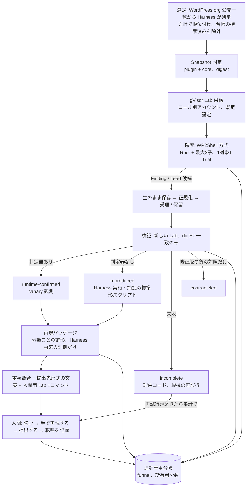
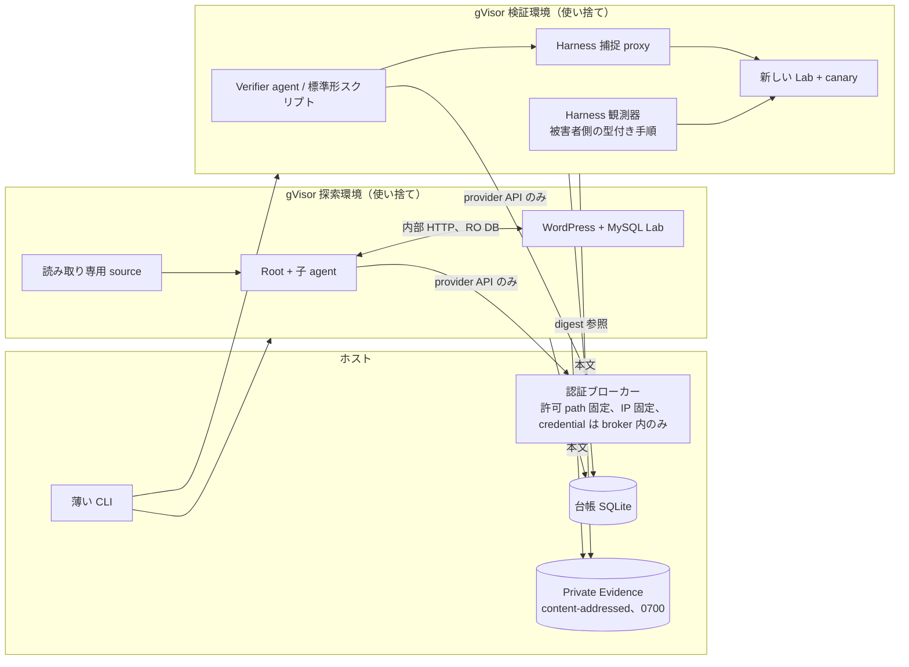
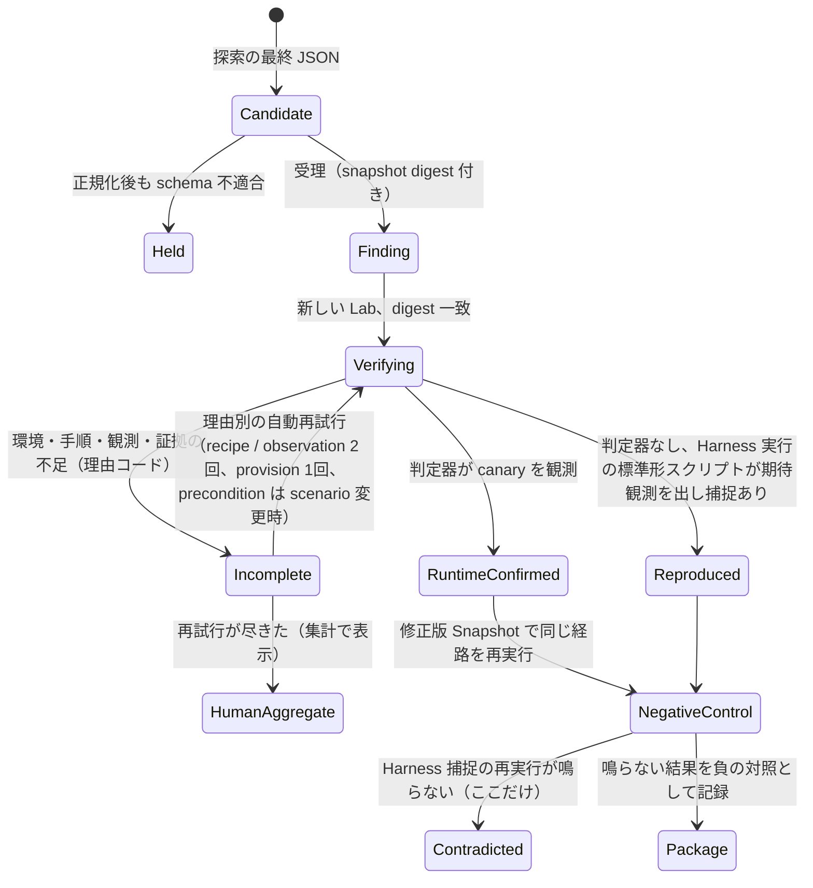
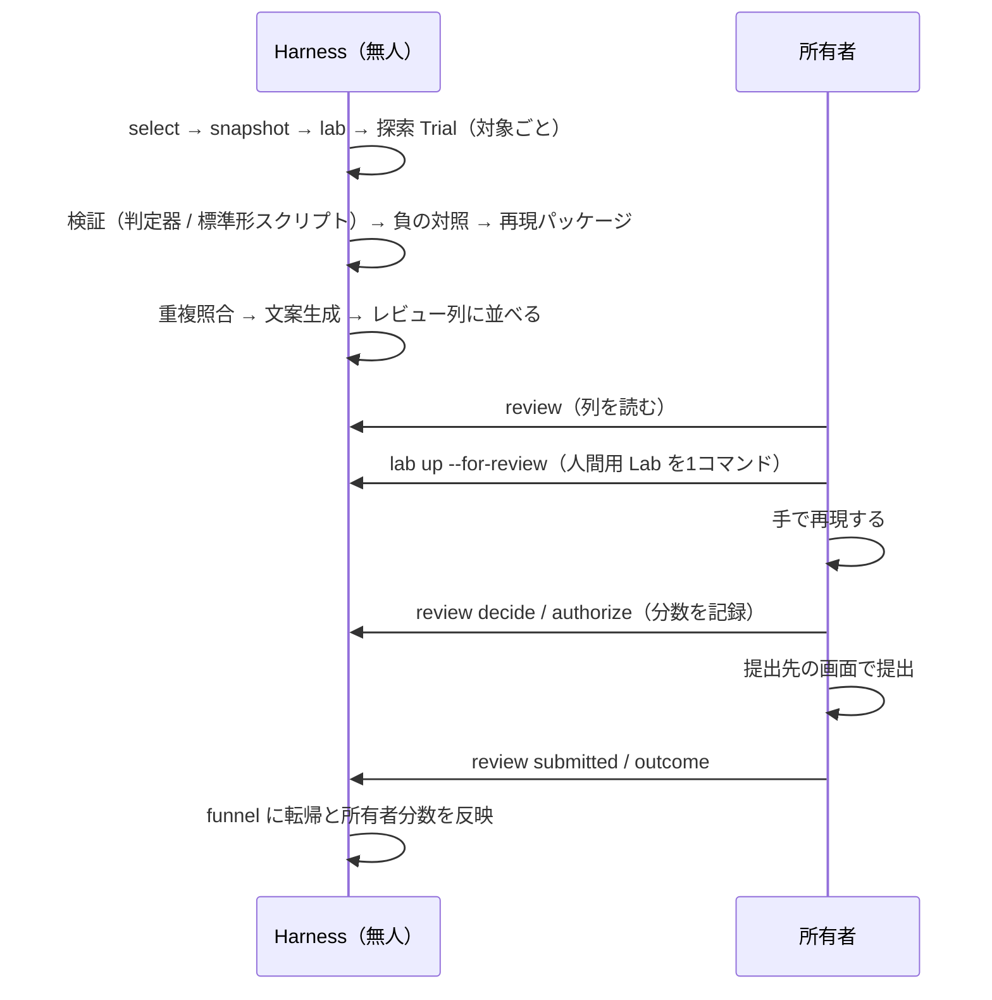

# 全体詳細仕様 v1（2026-10-11、所有者決定の反映版）

位置づけ: 本日の決定（WP2Shell 方式へ戻す、人間の作業を3つに限る、選定を自動化、ADR 0028）を SPEC v0.18 と ADR 0001〜0028 の上に重ねた「次の正本の下書き」。正本は SPEC と ADR で、この文書と食い違えば正本が勝つ。#138 の設計 PR で SPEC へ取り込む。

## 1. 目的と前提

- 目的: WordPress プラグインの未知脆弱性を見つけ、Wordfence / Patchstack へ提出して報奨を得る。旧ハーネス（長い探索 prompt、Root＋subagent、所有者が候補を読んで手で再現）で報奨実績があり、本設計はその改善。
- 所有者の作業は3つだけ: 再現パッケージと文案を読む、手順を自分の手で再現する、提出して転帰を記録する。選定、探索、検証、Lab 構築、重複照合、文案生成は Harness。
- 収益式: 対象数 × 当たり率 × in-scope 率 × 非重複率 × 平均報奨 − 費用。測るのは提出転帰と、提出1件あたりの所有者分数。
- 開発セット: 所有者発見の公開7件（Stored XSS 4、SQLi 2、アカウント乗っ取り 1、すべて未認証）。再発見は配線と判定能力の証明であり、未知の発見率ではない。

## 2. 不変条件（変えない）

1. 探索へ渡すのは固定 source、人間が書いた trust 境界、Programme Boundary、Lab、時点で切った公開履歴（カタログ）だけ。答え、PoC、再現手順は渡さない。
2. 対象の実行は gVisor（runsc）の使い捨て環境だけ。外向きは認証ブローカー経由の provider API だけ。弱い隔離へ暗黙に切り替えない。
3. `runtime-confirmed` は Harness 所有の決定論的判定器だけが出す。
4. 検証の失敗は `incomplete`。`contradicted` にも棄却にもしない。
5. 判定は Finding と検証が同じ Snapshot digest を持つときだけ。
6. 人間の判断点は「提出前レビュー」と「外部行動の承認」の2つ。選定と候補採否に人間を置かない。
7. 外部送信は正確な Submission Candidate、文案の版、送信先に結び付いた承認があるときだけ。Harness は送信しない。
8. 台帳は追記専用で digest 参照だけ。本文は Git 外の Private Evidence。

ADR 0028 で加える補足: `reproduced` は Harness が実行し Harness が捕捉した標準形スクリプトの観測だけを根拠にし、`runtime-confirmed` とは別の状態として扱う。

## 3. 全体の流れ

## 4. 実行境界

規則: 探索環境に canary を置かない（検証時に Harness が発行）。Verifier にブラウザも管理者セッションも渡さない。被害者側の操作は Harness 観測器が型付き手順で行う。

## 5. モジュールと契約

| モジュール | 公開インターフェース | 所有する記録 | 失敗時 |
| --- | --- | --- | --- |
| `selection` | `select(policy)` | 選定方針（人間が編集）、スコア内訳、除外理由、観測日時 | 取得不能・stale は eligible にしない |
| `snapshot` | `freeze`、`verify(digest)` | Target / Dependency Snapshot、manifest | 不正 archive を拒否 |
| `lab` | `provision`、`seedCanaries`、`observe`、`teardown` | Lab Setup digest、canary 台帳、ロール認証情報（Lab 内のみ） | runsc 不在・image 不一致で起動しない |
| `discovery` | `run(campaignInput)` | Trial、Root / 子の run 記録、usage、Finding / Lead の digest | provider / schema / sandbox 失敗は typed receipt。成果を失わない |
| `verification` | `verify(finding, snapshot, lab)` | 結果4状態、判定器証拠、再現パッケージ ref、attempt | 前提不一致・観測失敗は `incomplete` |
| `review` | `queue`、`decide`、`assessScope`、`draft`、`authorize` | 判断、scope 評価、文案の版、承認、所有者分数 | 承認無しに admit しない |
| `ledger` | `append`、`read`、`funnel` | 型付き event、digest 参照 | 同一 identity 異内容は conflict |
| `evaluation` | `funnel`、`prospective` | 再発見結果、提出転帰 | 判定不能を成功にしない |

契約（Zod、版付き）: `TargetSelection`、`CampaignInput`、`Finding v1`、`Lead v1`、`VerificationResult v1`（`runtime-confirmed` / `reproduced` / `contradicted` / `incomplete`）、`ReproductionPackage`（雛形版・digest・出自）、`ReviewDecision`、`SubmissionCandidate`、`HumanEffort`、`LedgerEvent`。

## 6. 探索の仕様（#138、#143）

- 構成: 対象ごとに Root＋最大3子の協調 Trial を1回。prompt は `wp2shell-bounty-v2`（後に v3）。短い `short-objective-managed-v4` は比較 arm として残す。
- 入力: 固定 source、trust 境界宣言（contributor 以上と管理者の明示設定は信頼側）、Programme Boundary、Lab HTTP endpoint と低権限認証情報、RO DB アカウント、入口索引（固定 source 由来のカタログ。分担や経路は指示しない）、任意で時点を切った公開履歴カタログ。
- 出力: Finding / Lead（0件可）、入口索引の examined / unexamined。生のまま保存し、正規化して受理、通らなければ保留（`candidate-held`）。schema 失敗は0件の正常完了にしない。
- Harness が持つもの: 人数上限、隔離、wall 上限、broker の要求数・本文上限、記録、停止。Trial 数と wall 上限と停止規則は #138 の ADR で明記する。二段構えの 30/90 分、7:3、継続差し込みは使わない。
- prompt の規則: 本文を変えたら版を上げ digest を pin する。対象固有の名前、PoC、「必ずある」「最低 N 時間」は入れない。出力契約は Harness が schema から生成する節として渡す（v3 で適用）。
- 塞ぐ穴: 子スレッド超過で Root 報告が消える（#121）、未知 item type で run 全体が失敗（#142）、wall 到達時に報告を回収しない。

## 7. 検証の仕様（#139、#140、#141）

- 判定器（Harness 所有、決定論的）: 実行 canary、SQL canary、ファイル canary、option canary、主体（セッション）canary、保存スクリプト canary（被害者文脈は Harness 観測器）、機微対象 canary。成功条件は SPEC §8b の表のまま。Verifier には「どの canary を狙うか」の identity（表名、path、option 名、object id、ユーザー名）を渡し、値は渡さない。
- `reproduced` の条件: Harness が新しい Lab で標準形スクリプト（標準ライブラリ + `requests`、入口と出口は Harness が固定）を実行し、Harness 捕捉の HTTP と構造化出力が受理基準の「期待する観測」を含む。捕捉が無い、または出力が合わないときは `incomplete`。
- `contradicted` は修正版の負の対照だけ。原 Finding に対する Verifier の反証文は `incomplete(observation)` の補助資料。
- scope 評価に使う条件（主体のロール、既定設定）は Harness の観測から出す。自己申告を使わない。
- `incomplete(no-judge)` は `reproduced` の経路へ進むため発生しない。

## 8. 再現パッケージと人間レビュー（ADR 0028）

雛形の骨格（全分類で同じ順番）:

1. 受理基準の充足欄（Wordfence / Patchstack それぞれ。満たす / 満たさない / 判定不能）
2. 期待する観測と実際の観測（Harness 捕捉、canary 観測、画面画像）
3. 修正版での負の対照
4. 手順（遠隔の視点。HTTP とブラウザ操作だけ。WP-CLI など server 側操作を成立条件にしない）
5. Lab の再構築情報（版、digest、有効化した設定、ロール）

- 各項目に出自 `harness-captured` / `agent-authored` を付け、agent 作成物は補助ファイルへ。人間が判断と再現に使うのは Harness 由来の項目だけ。
- 人間の列: `runtime-confirmed`、`reproduced`、再試行が尽きた `incomplete` の集計。`contradicted` は件数のみ。
- 人間の3作業: 読む → 手で再現する（全件必須。Lab は Harness が setup manifest から1コマンドで起動）→ 提出して転帰を記録。
- 文案は Harness が雛形と Harness 由来の証拠から提出先の形式で生成。人間は直してよいが新しい証拠を文章で足さない。重複照合は提出前に Harness（Wordfence mirror、Patchstack、WPScan。照合元と時刻を記録。stale を「重複なし」にしない）。
- 記録: `human-effort-recorded { action: read | reproduce | submit | outcome, minutes }`。funnel に「提出1件あたりの所有者分数」「提出1件あたりに開いた Finding 数」。基準値は旧ハーネスでの所有者の見積り、目標は半分。

## 9. 選定の仕様（#144）

- 候補: WordPress.org の公開一覧（人気順・タグ順）から Harness が列挙。取得日時と取得元を記録。
- 除外: 対象外資産（指定作者、配布停止、ベンダー側 service）、install 下限（方針 JSON が正本）、台帳にある探索済み対象と未公開 Finding を持つ対象。
- 順位: 方針ファイルの重み（install、更新の生存、攻撃面タグ、High Threat 面）。公開履歴の扱いは ADR 1本で1規則に決め、SPEC・OPERATIONS・`selection.md`・コードを同じ文にする（現状は3文書で逆）。
- 再訪: 版が上がった、または prompt 版が変わったときだけ。条件は方針ファイルに置く。
- 出力: 3〜5 件、スコア内訳と除外理由付き。2回続けて実行したとき同じ対象を返さない。

## 10. 台帳と Private Evidence

- event（core）: `target-selected`、`snapshot-frozen`、`lab-provisioned`、`discovery-run-started / finished`、`finding-recorded`、`lead-recorded`、`candidate-held`、`verification-finished`（4状態、attempt、retryOf）、`review-decided`、`scope-assessed`、`draft-saved`、`external-action-authorized`、`submission-recorded`（destination、revision digest）、`submission-outcome`、`human-effort-recorded`。
- 規則: 追記のみ（DB 側に UPDATE / DELETE 禁止の trigger を置く）。全 event に snapshot digest。Finding を参照する全 event で台帳が digest 一致を検査する。同時 writer は待つ（timeout）。`nextStep` など自由文は台帳に入れず Private Evidence へ。
- Private Evidence: content-addressed、0700 / 0600、Git 作業ツリー内への配置を拒否。参照されない artifact を列挙する `evidence gc --dry-run`。
- funnel: 探索 run → 最終 JSON 到達 → 受理 / 保留 → 検証 4状態 → レビュー → in-scope → 提出 → 転帰。campaign 別・分類別。非 cache 入力 1M token あたりと agent wall 1時間あたりの confirmed + reproduced、所有者分数。

## 11. 評価

- 7件の再発見（#127）: 新方式で各 case を回し、候補が出た段階、検証で落ちた段階と理由、`runtime-confirmed` / `reproduced`、修正版の負の対照、人間が開いた Finding 数を台帳と日付付き文書に残す。到達目標は TranslatePress 以外で Stored XSS 1件以上と SQLi 1件以上。探索に答えを渡さない。
- 本番: 提出転帰（triaged / resolved / duplicate / informative / rejected）、報奨額、所有者分数。四半期ごとに後日公開 advisory と照合する前向き評価。
- prompt 比較（v2 / v3 / v4）は同じ対象・予算で各3 Trial。区間が重なれば「判定不能」。held-out と統計比較は既定にしない。

## 12. 運用の流れ（週次）

## 13. Issue と到達条件（milestone「本番運用 v1」、13件）

| 順 | Issue | 内容 |
| --- | --- | --- |
| ① | #139 | `contradicted` を修正版の負の対照に限定 |
| ② | #138 + #142 | WP2Shell 方式へ戻す ADR と実装。設定の union 化、巨大関数の分割 |
| ③ | #121 | 子スレッド超過で Root 報告を失わない |
| ④ | #140 | 分類ごとの受理基準と再現パッケージ雛形（Stored XSS、SQLi、ATO から） |
| ⑤ | #127 | 7件の再発見ベンチマーク（新方式。`runtime-confirmed` と `reproduced` を数える） |
| ⑥ | #141 | ADR 0028 の実装（`reproduced`、人間用 Lab 1コマンド、所有者分数） |
| ⑦ | #95、#96、#144 | 文案生成、重複照合、選定の自動化 |
| ⑧ | #143 | prompt v3（出力契約を Harness 生成へ） |
| ⑨ | #100 | 最新版3対象の本番探索（対象は `select` が返す） |
| 並行 | #126 | 実 Lab の週次 smoke |

到達条件: #127 で TranslatePress 以外の Stored XSS 1件以上と SQLi 1件以上が `runtime-confirmed` または `reproduced`。最新版3対象で選定から文案生成までが人手なしで通り、所有者の作業が「読む・再現する・提出する」だけになる。

## 14. 止めたもの・残課題

- 止めた: 二段構え（screening → deep-dive）、Harness 継続、評価の統計比較、review 承認ワークフローの拡張、文書統合。提出が出るまで触らない。
- 残課題（提出後に戻る）: `incomplete` の理由別再試行の精緻化（#107）、汎用 Lab scenario（#125）、選定順位の実測改善（#97）、ADR frontmatter の統一と SPEC の縮約、文書の最小集合化。
- 所有者に要るもの: 旧ハーネスでの「提出1件あたりの自分の分数」の見積り1行（#141 の基準値）、公開履歴を選定でどう扱うかの一言（#144 の ADR）、ADR 0028 の accept。
