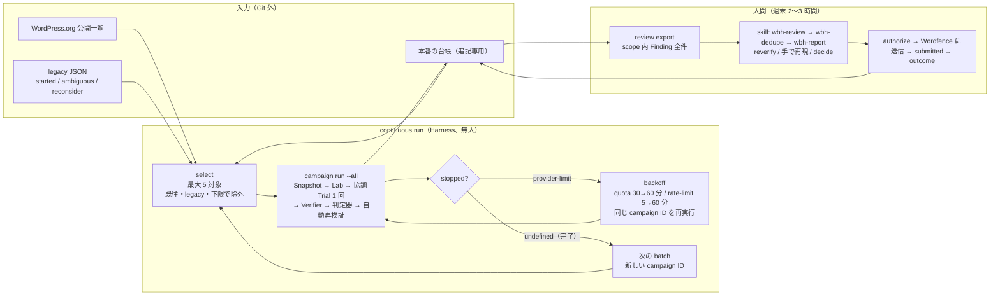
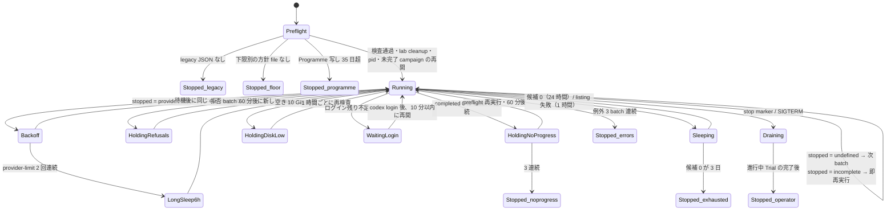
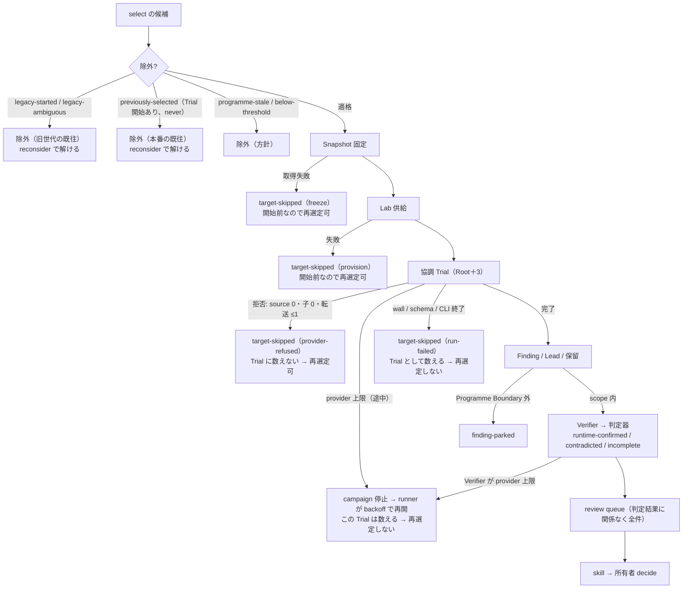
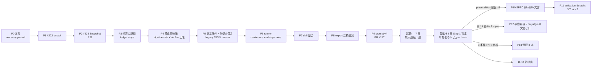
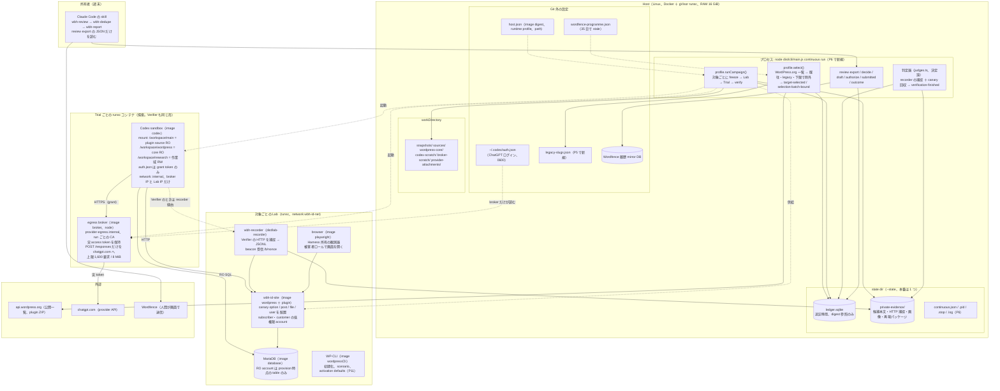
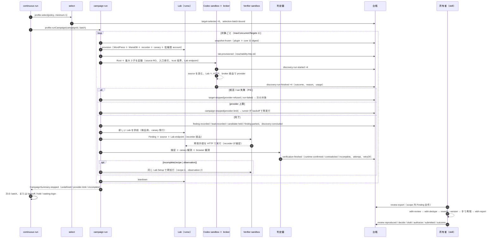

# 最終設計（2026-10-14、実装仕様版）

所有者の依頼「最終設計を出してほしい。自分では決め切れない。この通りに作ればバグバウンティを回し続けられる状態にしたい」に答える。この文書は決定の列挙ではなく、PR ごとの実装仕様、設定の正本、1 週間の無人運転の手順、Step 1 完了の判定手順、変更禁止の線まで持つ。所有者が第 14 節に答えた時点で有効になり、以後は変えた行だけを更新する。

不変条件（SPEC §2 の 8 項目）とモジュール境界は変えないので新しい ADR は要らない。SPEC §4 / §6 / §8 / §8a / §8b / §12 の文言、ADR 0016 / 0020 / 0022 / 0026 / 0029 / 0032 の該当行への追記、DEVELOPMENT §2 / §3 / §5 / §6 / §7 の変更は `owner-approved` を要し、最初の PR（P0）にまとめる。DEVELOPMENT §2「Step 1 完了まで既存 ADR を変えない」は、上記 6 本の該当行に限って所有者が解除する（第 14 節 4）。

調べ方: [2026-10-14 のレビュー](2026-10-14-overbuild-and-gaps-review.md)、読み手 4 本（#229 branch の runner、provider 拒否と第 2 経路、Lab 前提、人間レビュー経路）、角度の違う提案 2 本（Step 1 最短、所有者時間最小）、初稿に対する反証 2 本（規則、code）、確定案に対する検証 5 本（規則、code、完全性 ×2、候補供給量 ×2）。対象は `main` d214de0 と branch `codex/issue-229-batch-pin` c5d0ef3、関連 branch 8 本、GitHub Issue #215 / #220 / #224 / #229 の本文と comment。実機、provider、`pnpm check`、WordPress.org の API（proxy が拒否）は動かしていない。行数と供給量はすべて見積り。

所有者の確定事項（2026-10-14）: `cyber_policy` 拒否（#220）は一時的な問題。#215 の既往照合は「判別不能 slug の保留」までで、全 slug の保留ではない。方向性は正しいが、いらない機能と厳しすぎる制約がある。徹底してよい。

## 0. 決めたこと（10 行）

1. `c5d0ef3`（#229）と #227 / #228 / #215 の branch は merge しない。参照用に残し、外側ループは `main` から約 300 行で新しく書く（D3）。
2. 探索 provider は Codex のまま。拒否と run 失敗は campaign を止めず、その対象を飛ばして次へ進む。Opus arm は数値の引き金付きで寝かせる（D1）。
3. 既往照合は、旧世代 DB と既知の旧 `--state` 台帳から 1 回だけ作る Git 外 JSON（started / ambiguous）と、本番の台帳で行う。JSON は `continuous run` の起動前提。監査 manifest、registry、承認 JSON は作らない（D2）。
4. 「source を 1 件も読まず、子を起動せず、broker 転送 1 以下で終わった run」は Trial に数えない。その slug は再選定できる。途中まで走った Trial は Trial として数え、再選定しない（D2 / D4）。
5. quota と rate-limit は人間を呼ばず、上限なしの backoff で同じ campaign を再開する。ログイン失効も人間を待つが runner は終了しない（D4）。
6. 候補の供給量が無人運転を決める。列挙の深さ（`popularPages` の上限 5 → 20）を上げ、起動前に legacy JSON と列挙可能集合の交差を測ってから下限を所有者が選ぶ（D3）。
7. Lab は「plugin の通常の有効化設定」を Harness 所有の型付き setup が入れてよい。precondition 理由の集計で頻出が確認できたときに、選択可能な option として入れる（D5）。
8. 人間レビューは skill 3 本と `review export` の整合を直す。手動再現の省略と `no-judge` の提出経路は所有者の答え（第 14 節 6 / 7）を待つ（D6）。
9. `owner-approved` は ADR・SPEC・trust 境界宣言・Programme Boundary・policy・判定器に限って path を明示列挙し、prompt 目的文と selection.json は委任済みの AI がラベルを付ける。配線・runtime・選定の PR は異なる slug の初回 3 Trial、agent 入力を変える PR は再発見 case の 3 Trial で測る（D8）。
10. 既定 prompt は起動前に v4（PR #217）へ切り替えて分母を 1 本にする。無人運転は P6 が merge された翌営業日に起動し、判定は起動＋7 日。初提出は 11-14（D10）。

## 1. 変えないもの

- SPEC §2 の不変条件 8 項目。対象の実行は gVisor 内だけ、`runtime-confirmed` は判定器だけ、外向き通信は broker 経由の provider API だけ、Harness は送信しない、台帳は digest 参照だけ。
- 主経路: 対象ごとに Root＋最大 3 子の協調 Trial を 1 回、wall 上限 60 分（ADR 0029）。無人運転の週は既定 1 本（v4）だけを回し、arm 比較（#201 の事前登録）は回さない。比較 arm は SPEC §6 のまま起動可能に残す。
- 判定器の集合と成功条件。攻撃者位置は未認証と subscriber / customer のみ。
- 人間の判断点: 提出前レビュー、外部行動の承認、同じ slug の追加 Trial の承認（ADR 0032 Q6）。Step 1 は初回 Trial だけを回すので、追加 Trial の承認経路はまだ作らない。
- 判断の要る工程は skill、決定論の処理と自律ループは Harness（ADR 0031）。
- 台帳の event 型。新しい event 型は足さない。停止理由は既存の `discovery-run-finished.reason / reasonDetail / providerLimit`、`target-skipped.stage / reason`（#223 が enum を拡張。そこに `provider-refused` / `run-failed` を足す）、`campaign-stopped.reason`（`operator` / `provider-limit` / `incomplete`）で表す。
- 同時実行: 無人運転の最初の週は `maxConcurrentTargets: 1`、`maxConcurrentRuns: 1`、`memoryBudgetMiB: 10240`（SPEC §6「最初は Trial を 1 つずつ」）。2 に上げるのは 1 週の数字を見てから。
- install 下限（ADR 0032 Q4、所有者が data で決めた値）。runner は無人で下げない。所有者が `--selection` で選ぶ。

## 2. 到達目標と期日

固定の日付は最上段だけ。以下は相対で動く。

| 期日 | 到達点 | 測る数字（第 10 節のコマンド） |
| --- | --- | --- |
| 10-16（木） | 所有者が legacy JSON を作り、列挙可能集合との交差件数を記録する（第 7.1 節 5） | started / ambiguous 件数、下限別の残り候補数 |
| P6 merge の翌営業日（目標 10-20） | P0〜P9 が merge。所有者が下限を選び `continuous run` を起動 | 起動 1 回 |
| 起動 ＋ 7 日（目標 10-27） | Step 1 完了条件: quota 1 週分を人手 0 で回り切り、Programme Boundary 内の Finding が全件 `review export` に届く | 人手介入 0 回、開始した初回 Trial 数、completed、quota 待ちの回数と合計時間、停止理由の内訳 |
| 起動 ＋ 8 日（目標 10-28） | Step 1 の判定（第 10 節）。所有者が skill 3 本で最初のレビュー batch を完了 | batch の件数、`decide --minutes` の合計、accept / reject / defer の内訳 |
| 判定 ＋ 1 週 | 条件を満たせば Lab の通常設定（D5）が選択可能 option として merge | precondition 理由の件数の前後比、判定器が結論を出した件数 |
| 11-14 | 初提出 1 件（最新版で確認済み、重複なし、承認付き） | 提出 1、所有者の分数 |
| 12 月以降 | 月 USD 1,000 の測定開始 | 提出転帰と報奨額 |

DEVELOPMENT §2 の期日 10-24 は、P0〜P9 の 10 本が 1 週間で入らない見込み（code 反証）のため「起動＋8 日」に置き換える（第 14 節 1）。

## 3. 最終形

### 3.1 流れ

```
continuous run（src/cli/continuous.ts、約 300 行、main から新規）
  起動時: stale な pid と前回の stop marker を消す → host preflight（runtime check と同じ関数）
          → legacy JSON の有無、ログイン残り時間、Programme 写しの transcribedAt、disk 空きを検査
          → lab cleanup --remove → pid file
          → 台帳に未完了の campaign（prefix 一致、targets か skipped が残る）があれば同じ ID で再開
          → 最新の selection-* batch が未束縛なら、select をやり直さずその batch を新 campaign ID で走らせる
  ループ:
    周回前検査: disk 空き（10 GiB 未満なら holding-disk-low、1 時間ごと）、Programme 写し（35 日で programme-stale、残り 7 日で警告）
    profile.select(policy, {minimum: 1})         # WordPress.org pool から最大 5 対象。台帳と legacy JSON で既往を除く
      selected が空: sourceStatus が unavailable / stale（WordPress.org 側の失敗・429）→ 1 時間後に再試行（候補 0 に数えない）
                    available で適格 0 → 24 時間眠って再試行。3 日続けば 停止(exhausted)
      runCampaign に渡す campaign 設定の selectionPolicyPath は --selection と同じ file に差し替える（policy digest 照合のため）
    profile.runCampaign(campaignId, batch, {retryIncompleteVerifications: 再実行時 true})
      対象ごとの失敗（Lab、Snapshot、run 失敗、provider 拒否）は campaign 内で target-skipped になり次の対象へ（P4）
    batch 終了後: cleanupLeftovers({remove: true, excludeReviewLabs: true}) を呼び、消した件数を status に出す
    周回ごとに 1 行（campaignId、stopped、skipped 件数、所要、lastError 先頭 200 字）を continuous.log に追記
    CampaignSummary.stopped で分岐:
      undefined        → 完了。次の batch へ（新しい campaign ID）
      provider-limit   → providerLimit が quota なら 30 分から、rate-limit なら 5 分から、倍々で上限 60 分の backoff。
                         上限なし。同じ campaign ID を再実行。provider-limit が 2 回連続なら次の再実行まで 6 時間眠る
      incomplete       → 即時に同じ campaign ID を再実行（P4 の後はほぼ出ない）
    例外: その batch を諦め理由を status に残し、次の batch へ。3 batch 連続なら 停止(errors)
    拒否 (target-skipped provider-refused) が batch 内の全対象で起きた batch が 1 つ: 60 分眠り、次は 1 対象だけの probe batch
      probe が completed なら通常の 5 対象に戻す（拒否 run は Trial に数えないので、同じ slug が自然に最上位へ戻る）
    provider 以外の理由で全対象が skipped の batch: no-progress と同じ hold。例外の batch 間は最低 10 分空ける
    探索 Trial が 1 本も completed にならなかった batch が 2 連続: host preflight をやり直し 60 分眠る（holding-no-progress）。3 連続で 停止(no-progress)
    ログイン残り時間 < 次 batch の見込み時間: waiting-login。10 分ごとに auth.json を読み直し、有効になれば再開（終了しない）
    stop marker / SIGINT / SIGTERM: 進行中の Trial を drain して停止（台帳に campaign-stopped(operator)）
  状態が running 以外へ入る・出るごとに 1 行を <state>/continuous.log に追記し、--notify <command> があれば同じ 1 行を渡す
review export（scope 内 Finding 全件、判定結果に関係なく）
  → skill: wbh-review → wbh-dedupe → wbh-report（所有者の Claude Code）
  → 所有者: review reproduced / decide / authorize / 送信 / submitted / outcome
```

### 3.2 runner の状態（`continuous status` が出すもの）

| 状態 | 意味 | 導出元 |
| --- | --- | --- |
| `running(campaignId)` | pid が生きていて stop marker が無い | pid file、`continuous.json` |
| `backoff(step, until, providerLimit)` | provider 上限の後、待機中 | `continuous.json` |
| `holding-refusals(until)` / `holding-no-progress(until)` / `holding-disk-low(until)` | 拒否 3 batch 連続 / completed 0 の batch 2 連続 / disk 10 GiB 未満の後、待機中 | 同上 |
| `sleeping(until, reason)` | 候補 0（`empty`）または listing 失敗（`listing-unavailable`）で待機中 | 同上 |
| `waiting-login(expiredAt)` | ログイン失効。所有者の `codex login` を 10 分ごとに待つ | 同上 |
| `stopped(reason)` | `operator` / `errors` / `no-progress` / `programme-stale` / `exhausted` / `legacy-history-missing` / `missing-floor-policy` | 同上 |
| 集計（今日と今週） | Trial 開始数（`runKind: explore`）、completed、provider-limited、provider-refused、run-failed、Lab 失敗、焼いた Trial 数、raw Finding、`review` queue、`parked`、unsettled（開始記録だけの Trial）、消した Lab 残骸 | 台帳（`ledger funnel --since`、`ledger stops --since`、`review parked --since`） |

`continuous.json` は runner の作業メモ（`{campaignId, backoffStep, nextRunAt, consecutiveRefusalBatches, consecutiveNoProgressBatches, consecutiveEmptyDays, consecutiveErrorBatches, consecutiveProviderLimits}`）で、台帳ではない。消しても次の起動で作り直せる。campaign ID の連番は台帳の `campaign-*` ID を prefix と UTC 日付で前方一致検索した最大値＋1。状態の正本は台帳。

### 3.3 図解

全体の流れ。人間が触るのは右端の 2 箱だけ。



runner の状態機械。quota、拒否、ログイン失効、disk では終了しない。



対象（slug）1 件の運命。再選定できるのは「Trial に数えない run」と「開始前の失敗」だけ。



PR の依存と日程。P10 以降は条件付き。



## 4. 決定の詳細

### D1 provider: Codex のまま、拒否は飛ばして続ける

- 決定: branch `codex/provider-policy-diagnostics`（4cc66b1、+103 行）を merge し、`cyber_policy` を `reasonDetail = provider-cyber-policy` として台帳に残す。branch が OPERATIONS に足す段落「同じ構成で未実施対象を次々に起動せず」は本設計の文言（拒否された対象は `target-skipped(provider-refused)` として Trial に数えず、次の対象へ進む。同じ対象は次の選定で自然に戻る）に書き換えて同じ PR に含める。#220 の受入条件 2「provider が許可する構成・対象範囲を確認するまで、同じ構成で未実施対象を自動消費しない」はこれと衝突するので、所有者が Issue に「拒否は記録して次対象へ進む」と comment して改定する（第 14 節 8）。
- 現行の `src/cli/pipeline.ts:562-575` は、`reason=provider` で `providerLimit` の無い失敗（拒否）と run 失敗（wall、schema、CLI 終了）を `requestStop("incomplete")` で campaign 全体の停止にし、`campaign run` は provider 上限も incomplete も exit 3 を返す（`index.ts:773`）。P4 でこれを対象単位の `target-skipped` に変える。provider 上限（`providerLimit` あり）だけは campaign 停止のまま残し、runner が再開する。runner の判定は exit code ではなく `CampaignSummary.stopped` と台帳の `campaign-stopped.reason` / `target-skipped.reason` で行い、連続回数は campaign ID 単位で数える。
- 拒否で runner を止めない。拒否が batch 内の全対象で起きた batch が 1 つ出たら provider 全体の hold とみなし、60 分眠って次は 1 対象だけの probe batch を流す。probe が completed なら通常の 5 対象に戻す。hold までに消費する枠は 5 ＋ 1 で、拒否 run は Trial に数えないので同じ slug が最上位に戻り、報奨は失わない。無駄になるのは Lab 供給だけ。終了は operator の stop だけ。拒否を避ける目的の prompt の言い換えはしない。
- Verifier も同じ購読を使う。Verifier が provider 上限（`providerLimit` あり）を返したら、P4 で探索と同じ `requestStop("provider-limit")` に乗せて campaign を止め、runner の backoff 後に同じ campaign ID で再開する。再開時の検証は `reason = provider` を attempts に関係なく 1 回だけ自動再試行する（`shouldAutomaticallyRetryVerification` に `provider: sameLabSetup && attemptsForReason < 2`。ADR 0022 への 1 行は P0）。Verifier の拒否（`providerLimit` なし）は `incomplete(provider)` として残り、Finding は #185 の規則で review queue に届く。
- 集計: `ledger stops [--campaign <id>] [--since <ISO>]`（約 80 行）を足し、`ledger funnel` と `review parked` にも `--since` を足す。`discovery-run-finished.outcome × reason × reasonDetail × providerLimit`、`target-skipped.stage × reason`、`lab-provisioned.status × failureStage`、`campaign-stopped.reason` を既存フィールドだけで group by する。拒否率の分母は `runKind: explore` の `discovery-run-started`、分子は `provider-cyber-policy` かつ開始 60 秒以内。
- Opus arm（`codex/opus-55-discovery`、+2,718 行）は PARKING のまま。再開条件を「Step 1 完了後」から「無人運転の初回 Trial が 15 本以上あり、拒否率 30% 以上、または拒否 hold が週 2 回以上」に書き換える。再開するときは Claude 側の拒否分類（約 100 行）を先に入れ、2 provider を同じ物差しで比べてから arm を campaign 設定で明示する。拒否時の自動切替はしない（不変条件 2）。PR #225 は draft のままラベルを維持しない。
- 理由: 所有者が「一時的」と判断した。#220 は同一対象で拒否 → 再試行で成功しており、拒否は決定論的でない。

### D2 既往照合: legacy JSON を起動前提に、本番の台帳と合わせて見る

- 決定: 「同じ対象」は slug で判定する（#215 の 10-14 追加条件）。`selection.json` の `revisitPolicy` を `{"kind": "never"}` にする（`ledger-exclusions.ts:10-12` に既にある値）。版や prompt 版が変わっても再選定しない。
- 旧世代の履歴は Git 外 JSON 1 つで照合する。使い捨て script `scripts/export-legacy-slugs.mjs`（約 120 行）が、(a) 旧研究 DB（sqlite）から Trial 開始の記録がある slug を `started`、選定だけで開始の有無が判別できない slug を `ambiguous` に分け、(b) 引数で列挙した既知の旧 `--state` ディレクトリの台帳から `discovery-run-started`（`runKind: explore`）の slug を `started` に畳み込み、(c) 現行方針で列挙可能な集合（`select --dry-run` 相当）との交差件数を下限 100,000 / 50,000 / 30,000 ごとに標準エラーに出して、JSON を標準出力に書く。本番の台帳には触れない。

```json
{ "schemaVersion": 1, "sourceDigest": "sha256:...", "exportedAt": "2026-10-16T00:00:00Z",
  "sources": ["/abs/old-research.sqlite", "/abs/old-state-1", "/abs/old-state-2"],
  "started": ["slug-a", "slug-b"], "ambiguous": ["slug-c"], "reconsider": [] }
```

- `started` は除外理由 `legacy-started`、`ambiguous` は `legacy-ambiguous` として除外し、どちらにも無い slug は初回として開始する。`reconsider` に書いた slug は `legacy-*` と `previously-selected` を無視して再選定できる（一時障害で焼かれた slug を所有者が戻す口。所有者だけが書く）。host 設定に `legacyHistory: {"file": "/abs/path.json"}` を足し、`select` のたびに読んで `schemaVersion` と slug の形式を zod で検査し、digest と件数を選定レポートに載せる。
- JSON は `continuous run` の起動前提。無ければ `stopped(legacy-history-missing)` で起動しない。`select` 単体の開発用途だけ `legacyHistory: unavailable` を記録して進める。理由: 旧世代の監査で 530 slug 中 497 が開始済み、10-13 の標準選定の上位 5 件は全件既往だった（#215 comment）。照合なしの 1 週は quota の大半を既往 slug に使い、しかも `never` でそれらを本番でも永久除外にする。
- 既往の基準を `target-selected` から探索開始（`discovery-run-started`、`runKind: explore`、Trial 単位）に変える。選定されたが Trial が始まらなかった対象（Lab 失敗、Snapshot 失敗）は再選定できる。
- 「Trial に数えない run」の定義: Root が source を 1 件も読まず（receipt の `observed.filesRead = 0`）、子を起動せず、broker 転送が 1 以下で終わった run。SPEC §6「候補 0 件の正常完了にしない」の裏側として、SPEC §6 と ADR 0029 に 1 文を足す（P0、`owner-approved`）。この定義で #220 の実測（tool call 0、source 読取 0、子 0）と、quota 待ちの再実行で最初の要求が 429 になった run（`discovery-run-started` は provider 応答の前に書かれる）は Trial 未開始となり再選定できる。途中まで走って provider 上限や wall で止まった Trial は Trial として数え、再選定しない（SPEC §6「同一対象の自動追加 Trial はしない」のまま）。承認は要らない。quota 待ちの再実行ごとに 1 対象分の Snapshot と Lab 供給が無駄になるが、slug は失わない。backoff を quota は 30 分から始めるのはこの無駄を抑えるため。
- 作らない: 4 source の全数監査 manifest、writer 停止時刻、失効 registry、`trial bootstrap / coverage-import / approve`、承認 JSON と trialOrdinal の結び付け（`repeat-trial-gate.ts` 841 行）。別 state ディレクトリによる抜け道は「本番 state は 1 つ」という運用規則で止める（#215 受入条件「機械的に防げない境界は運用で止める」）。
- 同じ slug の追加 Trial の承認（L2）は、所有者が実際に 2 回目を求めるまで作らない。`main` の ADR 0032 Q6 行はまだ「初回 Finding があれば自動 +2 Trial」なので、P0 で「runBudget と自動 +2 を削除。同 slug の 2 回目以降は 1 Trial ごとに所有者が事前承認。承認の形式は 2 回目を求めるときに決める」に直す。

### D3 外側ループと候補の供給

- 決定: `src/cli/continuous.ts` を新規に書き、`continuous run | stop | status` を足す。中身は第 3 節だけ。runner は `runCli` を繰り返し呼ばない（呼ぶたびに台帳の DB を開いて閉じない）。1 つの `state` を作り `environment.profile.select` と `profile.runCampaign` を直接呼び、`CampaignSummary.stopped` で分岐する。
- campaign の完了を示す台帳 event は無い。runner は「同じ ID で再実行して `targets` と `skipped` が空なら完了」という `campaign run` の冪等性に依存する。`status` の unsettled も同じ判定で数える。再起動後は台帳から prefix 一致の未完了 campaign を拾い、同じ ID で再開する。
- 起動時に、最新の `selection-*` batch が `selection-batch-bound` されていなければ `select` をやり直さず、その batch を新しい campaign ID で束縛して走らせる（crash や例外の後に未束縛 batch が孤児化し、その slug が `never` で永久除外されるのを防ぐ）。campaign ID の prefix は `selection-` で始まってはならない。
- `c5d0ef3` 系（journal 525、owner 212、reconcile 446、stop 84、control 133、claims 564、scope 21、recovery 131、gate 841 の src 約 2,960 行と test 約 3,100 行、#227 の在庫 768 行と child-assessment 446 行、#228 の Lab 側変更）は merge も rebase もしない。branch から cherry-pick するのは #222、#223、拒否の記録、v4（PR #217）の commit だけで、その際も `policy/campaign.json` と `policy/selection.json` の他の変更（30,000 cohort、`maximumTargets: 1`）は除外する。
- **候補の供給量が無人運転を決める。** 供給量の推定（第 12 節）: 現行の列挙器は `popularPages` の schema 上限 5（`contracts.ts:102`、人気順位 250 位まで）と `maxCandidates` 500 の round-robin 打ち切りで、下限 100,000 の適格 slug を約 95 件しか見ず、下限を 50,000 / 30,000 に下げても人気順位 250 位より下は見えないので各 +5〜25 件しか増えない。pool 全体には下限 100,000 で約 410 件（除外作者・365 日更新後）、50,000 で約 700 件、30,000 で約 1,000 件ある。したがって下限のラダーではなく**列挙の深さ**を上げる: P5 で `popularPages` の schema 上限を 5 → 20（`contracts.ts:102`、`enumerator.ts:279-283`）、`maxCandidates` の上限定数を 500 → 2,000 に上げ、方針を `popularPages: 10`、`pagesPerTag: 1`、`maxCandidates: 1000`（10 × 50 ＋ 8 × 50 ＝ 900 枠、打ち切りなし）にする。これで下限 100,000 の列挙可能集合は約 410 件、1 日 5 対象で約 12 週。下限を変えずに供給を増やせる。`select` の HTTP は 18 要求で、現行の 20 要求と同じ桁。
- legacy JSON の大きさが残りの不確定要素。Opus branch の調査では、旧世代の保守的な和集合 833 slug を除くと頁 5・cap 500 で下限 100,000 の新規は 1 件だった。深さを上げた列挙でも `started ∪ ambiguous` が数百件なら残りは数十件になり得る。そのため export script は交差件数を下限別に出し（上の (c)）、所有者は起動前にその数字を見て下限を選ぶ（第 7.1 節 5、第 14 節 3）。
- 下限の選び方: 残り候補が 35 件（1 週分）以上ある最も高い下限を選ぶ。`selection.json` と兄弟 file `selection.50000.json` / `selection.30000.json`（同じ構造で下限だけ違う写し。`id` は `wordpress-selection-2026-10-20-50000` のように下限付き）を置き、`continuous run --selection <path>` で選ぶ。`campaign run` は campaign 設定の `selectionPolicyPath` と policy digest が一致する選定 batch しか使わない（`wordpress.ts:439, 480-484`）ので、runner は in-process で渡す campaign 設定の `selectionPolicyPath` を `--selection` の file に差し替え、起動時に両者が同じ file か検査する。runner は無人で下げない（ADR 0032 Q4 は所有者の値）。`exhausted` で止まったら所有者が次の下限で起動し直す（1 コマンド。人手に数える）。戻す規則は置かない（下限は起動ごとの所有者の選択）。兄弟 file が無ければ起動時に `missing-floor-policy` で止まる。
- `select` の最小件数: 現行は適格 3 件未満で失敗する（`wordpress.ts:1297`）。runner 経由では `--minimum 1` を渡し、適格 1 件以上なら走らせる。下限未満しか無いときは throw ではなく空の選定と理由を返す。
- 停止: `continuous stop` は state dir に `continuous.stop` を書く。runner は各周回の前と `runCampaign` の戻りで marker を見る。`runCampaign` に `stop?: () => boolean` を足し（現行に外から止める引数は無い）、pipeline の worker loop の次対象取得前と `runDiscoveryCampaign` の新 Trial 開始前で見て Trial 単位で drain する（子の成果は保存される。ADR 0029）。`campaign-stopped.reason` の enum に `operator` を足す（既存 event の enum 拡張、新 event 型ではない）。これで「台帳が状態源」と整合する（＋60 行、P4）。SIGINT / SIGTERM も同じ経路。終了時に pid file を消す。起動時は死んだ pid の file と前回の stop marker を消してから始める（消さないと再起動直後に止まる）。
- 通知: 状態が `running` 以外へ入る・出るごとに 1 行（状態名と件数だけ。Finding の中身は書かない）を `<state>/continuous.log` に追記し、`--notify <command>` があれば同じ 1 行を標準入力で渡す（`mail`、ntfy への `curl` など所有者が選ぶ）。systemd の `OnFailure=` でも同じコマンドを呼ぶ（LESSONS 5「人間に見えない成果は無いのと同じ」）。
- crash 後: 終了記録のない Trial と Lab の Docker 資源は、起動時と各 batch の終了後の `cleanupLeftovers({remove: true, excludeReviewLabs: true})` と `status` の unsettled 件数で見る。`cleanupLeftovers` にレビュー用 Lab（`lab up --for-review` が立てた session）を除く filter を足す（+15 行。所有者がレビュー中に runner が再起動しても Lab を消さない）。残骸が 0 にならなければ `holding-no-progress` に合流する。自動復旧はそれ以上作らない（LESSONS 8）。ADR 0032 Q18 で止めたのは外側 cron の quota tick で、in-process の backoff は別物である旨を OPERATIONS に書く。
- 理由: 3 branch が `main.ts` / `wordpress.ts` / `pipeline.ts` を同時に変えており、割って rebase するより `main` の `select` と `campaign run --all`（同じ ID で再開）を呼ぶ方が小さい。第 2 の journal は SPEC §4「単一の追記専用台帳」と二重になる。

### D4 quota、rate-limit、ログイン、その他の失敗

- 決定: `runCampaign` が `provider-limit` で止まったら、runner は直近の `discovery-run-finished.providerLimit`（または Verifier の `verification-finished`）を読む。`quota` なら 30 → 60 分、`rate-limit` なら 5 → 10 → 20 → 40 → 60 分の backoff で同じ campaign ID を再実行する。60 分に達した後は 60 分ごと。`provider-limit` で終わった実行が 2 回連続なら、次の再実行まで 6 時間（定数）眠り、焼いた Trial 数を `status` に出す。上限回数は置かない。人間は呼ばない。
- provider 上限で止まった Trial の対象は、campaign 内では消費済み（`campaign.ts:353-370` の再開ロジックは変えない）。D2 の「Trial に数えない run」に当たるものだけが次の `select` で再選定される。SPEC §4 discovery 行の「自動 retry しない」と §6「provider 上限では新規 Trial を止め…未消費の対象を再開する」は、「runner が backoff 後に同じ campaign ID で再開する。Trial に数えない run の対象は次の選定で戻る」に P0 で書き換える。
- 対象単位の失敗（Lab provision、Snapshot 取得、run 失敗、拒否）は P4 以降すべて `target-skipped` で次の対象へ進む。版の変化では skip しない（固定 Snapshot で探索を続け、提出直前の `review reverify --version` で吸収する。SPEC §8）。
- ログイン: ChatGPT の access token は broker が更新しない。runner は batch 開始前に残り時間を見て、`LOGIN_MARGIN = maximumTargets × (runWallTimeMinutes ＋ Verifier wall 30 分 × 3 ＋ 15 分)` に足りなければ `waiting-login` に入り 10 分ごとに `auth.json` を読み直す。所有者が host で `codex login` をやり直せば再開する（runner の再起動は要らない）。これは第 8.2 節の保守で、人手介入に数えない。初日の測定で token の寿命が 8 日未満なら、その週のうちに「batch 開始前に host 側で Codex CLI の認証更新を呼ぶ」を P6 の追補として入れる（refresh token は broker に渡さない）。
- runner 全体を止めるのは、stop、`programme-stale`（35 日超は選定全体を止める系統的事象。runner は `wordfenceProgrammeTranscriptionPath` の `transcribedAt` を周回前に直接読む）、`exhausted`、`legacy-history-missing`、`missing-floor-policy`、例外 3 batch 連続（`errors`）、completed 0 の batch 3 連続（`no-progress`）の 7 つだけ。

### D5 Lab: 通常の有効化設定を Harness が入れる（条件付き）

- 決定: SPEC §8b の `lab` 行「設定は既定のまま」を次に差し替える。「plugin の通常の有効化設定（管理者が普通に行う初期設定）は Harness 所有の setup が型付き手順で入れてよい。権限付与、`default_role` / `siteurl` / `home` / `admin_email` / `users_can_register` 等の options-update 対象の変更、危険設定は不可。実行前後の状態差分を Private Evidence に残す」。SPEC §8a の「Labは既定設定で供給し」と ADR 0020 に同趣旨の 1 文を補い、ADR 0026 には決定を変えない追記 1 段落。Verifier にブラウザと管理者セッションを渡さない線は変えない。これは Programme Boundary の執行箇所（Wordfence「最新版・既定設定」）なので `owner-approved` と ADR 凍結の部分解除が要る（P10）。
- 前提条件: ADR 0026 / SPEC §7 の規則どおり、無人運転の第 1〜2 週の `incomplete(precondition)` を `scripts/report-wordpress-preconditions.mjs` で集計し、activation 既定値で埋まる種類が 3 件以上あるときだけ P10 / P11 を出す。満たさなければ見送る。
- 実装（P11）: setup の boolean `lab.ordinaryActivationDefaults: true | false`（既定 `false`）を campaign 設定に持たせ、scenarioId を占有しない（precondition 再試行の scenario 切替と共存する）。異なる slug の初回 3 Trial と再発見 case の 3 Trial（agent 入力を変えるため、D8）の数字を取った後、`policy/campaign.json` の既定を `true` にする（policy なので `owner-approved`）。
- PHP は WordPress コンテナ内で独立に実行する: `php /harness/activation-defaults.php`。先頭で `define('WP_ADMIN', true)` し `wp-load.php` を読み、管理者ユーザーを `wp_set_current_user` して `do_action('admin_init')` を 1 回発火、`get_registered_settings()` の各 option について `get_option` が false のものだけ `add_option(default)`。WP-CLI の `eval` は `is_admin()` が false になるので使わない。実行後に `default_role`、`users_can_register`、`siteurl`、`home`、`admin_email`、管理者ユーザー数が実行前と同じことを検査し、違えば provision を `incomplete`（`failureStage` は既存の `seed`、理由は Private Evidence）で返す（throw しない。不変条件 4）。setup 全体に 120 秒の上限。外向き HTTP は Lab の network で遮断されているので失敗して返る。
- 登録済み shortcode を載せた公開ページは activation default ではなく初期データなので入れない（Step 2 の候補）。activation 既定値由来の設定は Finding の `configurationPrecondition` と報告書の Environment に `activation-defaults` と書き、`default` とは区別する。scope 評価の `defaultOrCommonSettings` は Harness が Lab Setup digest から埋める（`false` の Lab は `default`、`true` の Lab は `activation-defaults` で、いずれも true）。
- 探索 Lab と検証 Lab は同じ setup digest で立つので両方に入れる。再現パッケージの Lab 再構築情報（`reconstructionFor`）に 1 分岐を足す。既存の 8 adapter と既存 scenario は変更しない。新規追加も止める。対象固有の関数名・クラス名・installer 名は使わず、WordPress 標準 API だけに頼る。
- 理由: 本番第 3 周の `incomplete(precondition)` は「管理者による対象固有の設定状態」で、既定設定のままでは埋まらない。Wordfence が却下するのは管理者の「誤設定」前提であり、通常の有効化設定ではない。対象ごとに adapter を書く作業は週 5 対象のループに追いつかない。

### D6 人間レビュー経路

- 決定（P7）: skill 3 本の参照フィールド名を export に合わせる（`evidence.*` → `privateEvidence.*`、`stateDiff.settings` → `labStateDiff.summary.settings`、約 10 行）。skill は提案だけを出し、`decide` は所有者が自分で打つ（不変条件 6）。`wbh-dedupe` の手順に「提出直前に `history status` を打ち、stale なら旧環境で更新」を 1 行足す。OPERATIONS §3 の冒頭に skill の起動順と所有者が打つコマンドの表（約 20 行）と、1 件あたりの所要分の見積り（reverify 30、手再現 40、skill 30）、batch の上限（3 件。超える分は defer）。`.claude/skills/` は adr-guard の対象なので、変更後の全文と日本語訳と出典対照表を貼り、委任 comment 付きで AI がラベルを付ける。
- 決定（P8）: `review export` の `review` 節に nullable で互換追加する: `humanReproduction: {result, minutes, recordedAt} | null`、`latestReverification: {verificationId, status, basis, recordedAt} | null`（`derivedFromFindingId` が同じ `finding-recorded` と `verification-finished` の join）、`latestDraft: {digest, revision, preparedBy, programme} | null`、`decision: {decision, reasonCode, duplicate, decidedAt} | null`、`scopeAssessments: [{assessmentId, programme, verdict}]`、`labSetup: {digest, ordinaryActivationDefaults}`。review-decision / draft / scope の artifact は store から読む。literal は `review-export/v1` のまま。src 約 110 ＋ test 約 70。
- 手動再現: SPEC §8 / §12、ADR 0016 / 0028 は「人間が自分の手で再現してから査読」を 2026-10-11 の所有者決定として記録していたが、所有者は 2026-10-14 に「判定器が確認し、最新版の reverify が緑の Finding は証拠を読むだけでよい。`no-judge` は手で再現する」に変えた（第 14 節 6）。P12 で SPEC §8 / §12、ADR 0016 / 0032、OPERATIONS §3、`wbh-report` の前提を書き換える。
- `no-judge` の提出経路: 現行の `review reproduced` / `scope` / `draft` は `incomplete` の Finding を拒む（`src/cli/index.ts:920-926, 982-989, 995-1012`）。判定器の無い分類（`content-deletion`、`rfi`）は人間が手で再現しても提出に辿れない。所有者の決定（第 14 節 7）により、P12 で「`incomplete(no-judge)` かつ人間再現が `match` の Finding を scope / draft が受理し、人間再現を evidence basis にする」口を足す（約 60 行、SPEC §8 の 1 文、ADR 0032 に 1 行）。
- 重複照合: Harness 側はローカル Wordfence mirror のみ。#231（日次更新）は Step 1 では作らない。
- `incomplete` だけの batch でも、所有者が decide まで打てば Step 1 の「1 回の batch」とみなす。

### D7 削除と凍結

今から足さない（凍結）: `eval score / keys / rubric / compare` と `advisory.ts`、起動可能な探索 prompt の追加、plugin 固有 Lab adapter、`review open`、週次 smoke 専用の replay Verifier、`assignment` mode、旧 arm の examples。PARKING に凍結の札を足す（P0）。`review scope` は `draft` の前提条件、`review dedupe` は `wbh-dedupe` が呼ぶので凍結しない。`review reproduced` は D6 のまま使う。`eval prospective`、`readiness`、funnel は SPEC §4 の `evaluation` 境界と §10 の前向き評価なので残す。

merge しない（branch は参照用に残し、Issue は PARKING 1 行で閉じる）: `codex/issue-229-batch-pin`、`codex/issue-227-inventory-slice`、`codex/issue-228-cross-campaign-claims`（再開条件: 第 2 provider が実動、または実機で連続運転が 2 回止まった）、`codex/repeat-trial-approval`、`codex/low-value-impact-gate`（566 行。review queue はほぼ空で `finding-parked` で足りる）。#126 の週次 smoke は「既知 Finding に `review reverify` を 1 回（campaign ID は `smoke-<YYYYMMDD>`）」に置き換えて閉じる。#230（下限の方針版）は `--selection` の運用で代えて閉じる。

起動可能な探索 prompt: `wp2shell-bounty-v4`（既定、P9）、`wp2shell-bounty-v3`、`wp2shell-bounty-v2`、`short-objective-managed-v4`、`wp2shell-whitebox-v1.7`。他 10 版は digest 照合専用 archive とし、campaign 設定の `promptId` では拒否する（P13、本文 file は残す）。#201 の A/B 事前登録は Step 1 の間は回さない（第 14 節 9）。

Step 1 合格後に消す（P13、3 本、削除行は 500 行の目安に数えない。第 10 節の 3 条件すべて合格が前提）: (a) replay Verifier（`smoke-replay-*.ts` 662、`scripts/smoke-real-lab.mjs` 564、test 225、`judges.ts` / `wordpress.ts` / `index.ts` の配線、OPERATIONS §2 の smoke 節、`campaign-real-lab-smoke.json`。約 1,600 行）。(b) `assignment` mode（`wordpress.ts:183-248`、`entry-points.ts` の分担計画、test 6 本。旧台帳 event の分担 digest を読む互換 test は残す）。(c) examples 28 本のうち本番用 3 本とそれが参照する `selection.json` 2 本と `campaign.json` 1 本の計 6 本を残して 22 本を消し、`examples.test.ts` の該当 8 ケースと README / TRANSLATEPRESS-BENCHMARK の参照を直す。`eval score / keys / rubric / compare` と `advisory.ts`、prompt の起動可否 flag（約 40 行）も (c) に含める。

理由: 無人運転の週は削除の churn で実機の測定を乱さない。足さないことは今日から守る。所有者の 10-13 決定（ADR 0032 Q27「整理は Step 2」）と、SPEC §4 のモジュール境界を変えない線に整合する。

### D8 緩める制約

| 制約 | 変更後 | 場所 |
| --- | --- | --- |
| `owner-approved` ラベルの対象 path | 残す（所有者本人が付ける）: `docs/adr/`、`docs/SPEC.md`、`src/profiles/wordpress/prompts/trust-boundary-v1.md`（不変条件 1「人間が書いた」）、`src/profiles/wordpress/policy/campaign.json`（Programme Boundary）、`src/profiles/wordpress/policy/programme-scope.md`、`src/profiles/wordpress/discovery/programme-impacts.ts`、`src/profiles/wordpress/verification/judges.ts`（成功条件。現在は対象外なので足す）。残す（委任済みの AI が出典対照表＋委任 comment 付きで付ける）: `prompts/` の目的文、`policy/selection.json`、`.claude/skills/`、出力契約の雛形、Verifier の victim 契約。出典に無い要素を足さない規則は維持 | DEVELOPMENT §5 / §6、`check.yml`（約 20 行） |
| 探索に触る PR は開発セット 3 Trial | 二段にする。agent 入力を変える PR（prompt 本文、契約節、Lab setup）は再発見 case（ADR 0027）で最低 3 Trial の completed と source 根拠付き候補の有無を記録する。配線・runtime・選定の PR は runner が流した異なる slug の初回 3 Trial の completed・wall・停止理由で足りる。未 merge branch で本番 runner を回すときは campaign ID に branch 名を含め、本番の分母に混ぜない | DEVELOPMENT §5、OPERATIONS §2 |
| quota 後は人間の `resume` | backoff 付き自動再開（D4） | SPEC §4 / §6、OPERATIONS §2 |
| 拒否・run 失敗で campaign 全体が止まる | 対象単位の skip（D1、P4） | SPEC §6、OPERATIONS §2 |
| 既往照合は全数監査が済むまで初回も保留 | JSON 1 つ（旧 DB ＋ 旧 state 台帳）を起動前提にして照合、ambiguous だけ保留、`reconsider` で解ける（D2） | OPERATIONS §2 |
| 列挙は人気順位 250 位・候補 500 件まで | `popularPages` の上限 20、候補 2,000 件まで。方針は 10 / 1 / 1,000（D3） | `contracts.ts`、enumerator、`selection.json` |
| Lab は既定設定のまま | 通常の有効化設定は Harness が入れる（D5、条件付き） | SPEC §8a / §8b、ADR 0020 / 0026 追記 |
| 週の問い 1 つ・PR 1 本 | 10-14〜11-04 の 3 週だけ、問いは 1 つのまま PR を複数本（各 500 行以内、削除行は数えない）出してよい、と DEVELOPMENT に 1 行書く | DEVELOPMENT §3 / §5 |
| 同じ slug の追加 Trial は自動 +2 | 1 Trial ごとに所有者が事前承認。形式は 2 回目を求めるときに決める | ADR 0032 Q6 |

所有者の決定（第 14 節）: 再試行回数は実装どおり（ADR 0032 の行を直す）、手動再現の省略は採用、`no-judge` の提出経路は作る、Reflected XSS の見直し時期は「半年後」のまま。

緩めない: 攻撃者位置、`runtime-confirmed` の出し手、gVisor 必須、Harness は送信しない、台帳は digest のみ、install 下限の無人変更なし、週の問い 1 つ。

### D9 モデル配分

| 用途 | モデル | 理由 |
| --- | --- | --- |
| 本番の探索（Root＋3）と Verifier | Codex `gpt-6-sol`（Daybreak Blue、ChatGPT 購読、broker 経由）。model ID は host 設定の runtime profile | 所有者の決定。拒否は一時的。Verifier は `codex-verifier.ts` のまま |
| Codex の quota | 本番 Trial だけに使う。開発作業には使わない | 週 quota が Step 1 の完了条件そのもの |
| Opus arm（寝かせる） | Claude Opus 5.5、Claude Agent SDK、API key、broker 経由 | D1 の引き金が引かれたときだけ。従量課金なので月 USD 1,000 の収支に直結する |
| 開発: 設計文書、反証、PR レビュー | 最上位の Claude（Mythos、無ければ Opus） | 判断の質が結果を決める工程。PR を書いたモデルと別のモデルがレビューする。agent に渡る文章の対照表には書いた model 名を 1 行添える（LESSONS 12） |
| 開発: P0〜P13 の実装 | 所有者の Claude Code（Opus 5.5） | PR 1 本につき agent 1 つ、500 行の予算を守る。既存 commit の移植（P1〜P3、P9）も同じ |
| 開発: フィールド名の修正、文書の表、test の書き換え | Sonnet 級 | 機械的で安い |
| 人間レビューの skill 3 本 | 所有者の Claude Code（Opus 5.5） | ADR 0031。本人のローカル token に限る購読条件にも合う |

### D10 週の問いと順序

| 週 | 問い | PR（依存順） |
| --- | --- | --- |
| 10-14〜10-20 | 最小ループは quota・拒否・対象失敗・ログイン失効をはさんでも人手 0 で回る形になったか（`pnpm check` と故障注入 test） | P0 文言 → P1 #222 → P2 #223 → P3 拒否の記録 → P4 停止意味論 → P5 選定除外・列挙の深さ → P6 runner → P7 skill 整合 → P8 export → P9 prompt v4 |
| 起動 → ＋7 日 | quota 1 週分を人手 0 で回り切るか。止まった理由は何か | 実機運転（触らない）。修正は止まった理由に対する小 PR のみ |
| 判定 → ＋1 週 | 所有者のレビュー batch は何件を何分で判断できたか。precondition 理由の集計で頻出の種類は何か | Step 1 の判定（第 10 節）。所有者のレビュー batch。条件を満たせば P10 SPEC §8a / §8b の文言、P11 activation defaults |
| 〜11-14 | 最初の提出候補 1 件を所有者の何分で送れるか | P12（所有者が第 14 節 6 / 7 に yes のとき）。初提出。Step 1 合格なら P13 整理 3 本 |

順序の理由: P2（#223）は `pipeline.ts` の skip と `target-skipped.reason` の enum を変えるので、P4 より先に入れないと衝突する。P4 が無いと最初の拒否で campaign が止まり、無人運転の 1 週は測れない。P6 は P4 と P5 の意味論に依存する。P9 を起動前に入れるのは、PR #217 が owner-approved 済みで 3 Trial 記録を持ち、後で切り替えると分母が 2 本になるため。

#220 の拒否が続いた場合: 無人運転の週の数字は `target-skipped(provider-refused)` の件数と hold の回数になり、Step 1 の完了条件は「拒否を除く対象で 1 週回る」に読み替える（第 14 節 8）。

## 5. 実装仕様（PR ごと）

各 PR は DEVELOPMENT §5 の 5 項目（問い、変えたこと、変えなかったこと、測った数字、消し方）を日本語で埋める。追加行 500 以内（削除行は数えない）。`pnpm check` と `pnpm build` を通す。

### P0 文言（約 80 行、`owner-approved` は所有者本人、最初に merge）

- SPEC §4 discovery 行「自動 retry しない」→「provider 上限は campaign を止め、runner が backoff 後に同じ campaign ID で再開する。対象単位の失敗は `target-skipped` で次の対象へ進む」。
- SPEC §6 停止規則: 同じ内容に書き換え、「Root が source を 1 件も読まず、子を起動せず、broker 転送 1 以下で終わった run は Trial に数えず、その対象は次の選定で戻る」を足す。「同一対象の自動追加 Trial はしない」は残す。同時実行「最初は 1 つずつ」はそのまま。
- ADR 0029: 同じ 1 文を「帰結」に足す。ADR 0022: 「Verifier の `provider` 上限は同じ Lab Setup で 1 回自動再試行」を 1 行足す。
- ADR 0032: Q6 行を「runBudget と #189 の自動 +2 Trial を削除。同じ slug の 2 回目以降は 1 Trial ごとに所有者が事前承認する。承認の形式は所有者が 2 回目を求めるときに決める」に。「ADR 0022 への修正」の行を実装どおり（recipe 2、observation 2、provision 1、precondition は scenario 変更時）に直す（第 14 節 5）。Q2 は触らない。status を accepted にする。
- DEVELOPMENT §2: 期日「2026-10-24」→「runner 起動＋8 日」。「Step 1 完了まで既存 ADR を変えない」に「ADR 0016 / 0020 / 0022 / 0026 / 0029 / 0032 の該当行は本設計のために所有者が解除した」と 1 行。§3 / §5: 10-14〜11-04 の 3 週は問い 1 つで PR 複数本（各 500 行以内、削除行は数えない）を認める 1 行。§5: 3 Trial の二段の規則、`owner-approved` の path 列挙、agent に渡る文章の全文＋日本語訳＋出典対照表。§7: `eval score --keys` の行を消す。
- OPERATIONS §1: 保守として人手に数えないもの（第 8.2 節）。§2: 「上限での停止」を runner の再開に書き換え（cron の quota tick と in-process backoff の区別を 1 行）。「複数 batch の継続運転」節を P6 の仕様に差し替え。「同じ plugin の追加探索 Trial の承認」節を「所有者が 2 回目を求めたときに設計する」1 行に。単一 host・単一運用者・本番 state 1 つ・硬い総 token 枠は置かない・未 merge branch の Trial は本番の分母に混ぜない、の前提を書く。週次 smoke を「既知 Finding に `review reverify` を 1 回（campaign ID は `smoke-<YYYYMMDD>`）」に。systemd unit の雛形（第 7.1 節 8）。
- PARKING: Opus の再開条件を D1 の数値に。#227 / #228 / #229 / #215 / #126 / #230 の扱いと再開条件。`eval score / keys / rubric / compare`、replay Verifier、`assignment`、examples、`review open` の凍結。
- `check.yml`: adr-guard を D8 の path 列挙に（`judges.ts` を足す。約 20 行）。

### P1 #222 Lab の umask 修正（162 行、既存 commit の移植）

- `origin/codex/issue-222-lab-umask` の 448129b を cherry-pick。`wordpress-initialization.ts`（+11）と test 2 本。
- 測る数字: 無人運転の週の Lab provision 失敗のうち、source 読取不可によるものが 0 件。

### P2 #223 Snapshot 取得の修正（762 行を 2 本に割る）

- `origin/codex/issue-223-source-freeze` を 2 PR に割る: (a) `pipeline.ts` の skip と `target-skipped.reason` の enum 拡張、失敗した選定の結び付け（約 300 行）。(b) Snapshot 再利用と source 不一致の分類（約 450 行）。(b) の接続 timeout は Node 同梱の `fetch` と `AbortSignal.timeout` で付け、`undici` の直接依存は外す（依存を増やさない。ADR 0008）。P4 は (a) の enum を使う。
- 測る数字: `target-skipped stage=freeze` の件数と理由内訳。

### P3 拒否の記録と `ledger stops`（約 220 行）

- (a) `origin/codex/provider-policy-diagnostics` 4cc66b1 を cherry-pick（+37 runtime、+64 test）。OPERATIONS の追記段落は D1 の文言に書き換える。agent 入力を変えないので探索 PR ではない（PR 本文に明記）。
- (b) `ledger stops [--campaign <id>] [--since <ISO>]`（約 80 行）。既存フィールドだけで組む。`ledger funnel` と `review parked` に `--since <ISO>`（約 30 行）。

```
discovery-run-finished  outcome=failed            reason=provider  reasonDetail=provider-cyber-policy  count=3  explore=3  within60s=3
discovery-run-finished  outcome=provider-limited  reason=provider  providerLimit=quota                 count=2
target-skipped          stage=discovery  reason=provider-refused   count=3
target-skipped          stage=freeze     reason=source-unavailable count=1
lab-provisioned         status=failed    failureStage=seed         count=0
campaign-stopped        reason=provider-limit                      count=2
```

- 受入試験: 台帳 fixture に拒否 / quota / skip の event を入れ、group by の件数が一致する。既存 event 型を変えない。

### P4 停止意味論（約 200 行）

- `src/cli/pipeline.ts:562-575`: `discovery-run-finished` が `reason=provider` かつ `providerLimit` なし（拒否）、または run 失敗（wall、schema、CLI 終了、broker policy）のとき、`requestStop("incomplete")` せず `target-skipped(stage: discovery, reason: provider-refused | run-failed)` を追記して次の対象へ進む。`providerLimit` ありのときだけ従来どおり campaign を止める。
- Verifier の `verification-finished` が `incomplete(provider)` かつ `providerLimit` ありのときも `requestStop("provider-limit")` で campaign を止める。再開時の検証ループで `reason = provider` は `sameLabSetup && attemptsForReason < 2` で 1 回自動再試行（`shouldAutomaticallyRetryVerification` に 1 分岐）。
- `target-skipped.reason` の enum（P2 (a) で拡張済み）に `provider-refused`、`run-failed` を足す。
- pipeline の対象ループに stop 検査点を 1 箇所足す（+15 行。P6 の drain に使う）。
- 受入試験（故障注入、TEST-STRATEGY）: (1) 拒否 1 対象 → skip して次の対象の Trial が始まる。(2) wall 到達 → skip。(3) quota → campaign 停止、`stopped = provider-limit`、未消費の対象が残る。(4) 再実行で未消費から再開し二重登録しない。(5) stop 検査点で対象境界に止まる。(6) Verifier の quota → campaign 停止、再開時に 1 回だけ再検証。
- 測る数字: `ledger stops` の `provider-refused` / `run-failed` の件数。

### P5 選定除外と列挙の深さ（約 480 行）

- (a) `ledger-exclusions.ts`（+100〜130）: 既往の基準を `discovery-run-started`（`runKind: explore`、Trial 単位）に。除外理由の union に `legacy-started`、`legacy-ambiguous` を足す。入力に `legacyHistory: {started, ambiguous, reconsider: Set<string>; digest: string} | "unavailable"`。「Trial に数えない run」（receipt の `observed.filesRead = 0`、子 0、broker 転送 ≤ 1）しか持たない slug と、`target-selected` だけで探索開始の無い slug は `previously-selected` を付けない。`reconsider` の slug は `legacy-*` と `previously-selected` を無視する。それ以外の開始済み slug は `never` で除外。
- (b) `wordpress-host.ts`（+15）と `wordpress.ts`（+40）: host 設定の `legacyHistory: {file}` を `select` のたびに読み、`schemaVersion` と slug の形式を zod で検査し、digest と件数を選定レポートに載せる。無ければ `unavailable`（`continuous run` は起動しない。P6）。`select --minimum <n>`（既定 3、runner は 1）と、下限未満しか無いときの空の選定（`wordpress.ts:1295-1298` の throw を「`target-selected` を書かず `selected: []` と全 `excluded` を返す」に。約 8 行）。
- (c) 列挙の深さ: `contracts.ts:102` の `popularPages` 上限を 5 → 20、`contracts.ts:106` と `enumerator.ts:277-283` の `maxCandidates` 上限を 500 → 2,000。`selection.json` を `revisitPolicy: {"kind":"never"}`、`popularPages: 10`、`pagesPerTag: 1`、`maxCandidates: 1000`、`id: wordpress-selection-2026-10-20` に。兄弟 file `selection.50000.json` と `selection.30000.json`（下限だけ違う写し）。policy の変更なので委任済みの AI が `owner-approved` を付ける。policyDigest が変わると束縛済み batch を再開できない（`wordpress.ts:482, 522`）ので、この PR は batch の境界で入れる。
- (d) `scripts/export-legacy-slugs.mjs`（約 120 行）: D2 の仕様。交差件数を下限別に標準エラーへ。
- 受入試験: (1) legacy の slug が理由付きで除外される。(2) `reconsider` の slug は除外されない。(3) JSON 無しで `select` が進み、レポートに `unavailable`。(4) 拒否で source 0・子 0 の run しか持たない slug は再選定され、途中まで走った provider-limited の slug は再選定されない（Root＋3 の 1 Trial は attempts 1）。(5) Finding 1 件以上の slug は再選定されない。(6) Lab 失敗で開始しなかった slug は再選定される。(7) 版が上がっても `never` で再選定されない。(8) 下限未満の候補だけなら空の選定と理由が返る。(9) `--minimum 1` で適格 1 件の batch が作れる。(10) `popularPages: 10` で 10 頁分の slug が cap で切られずに列挙される。
- 測る数字: `select` 1 回あたりの適格数と所要秒、legacy で除外した件数、再選定の件数。

### P6 最小 runner `continuous run | stop | status`（約 500 行、test 込み）

- 新規 `src/cli/continuous.ts`（約 300 行）。配線 `src/cli/index.ts`（+25）、`CliProfile` に `hostStatus(state, {configPath})`（ログイン残り時間、Programme 写しの `transcribedAt`、disk 空き、`cleanupLeftovers` を返す。+30）。test 約 200 行。
- CLI:

```
harness continuous run    --host <path> --state <dir> --config <campaign.json> --selection <selection.json> [--campaign-prefix <text>] [--notify <command>]
harness continuous stop   --state <dir>
harness continuous status --state <dir>
```

- 定数（file 先頭、設定にしない）: `BACKOFF_RATE_LIMIT_MINUTES = [5, 10, 20, 40, 60]`、`BACKOFF_QUOTA_MINUTES = [30, 60]`、`QUOTA_LONG_SLEEP_HOURS = 6`、`REFUSAL_HOLD_MINUTES = 60`、`MAX_CONSECUTIVE_REFUSAL_BATCHES = 3`、`MAX_CONSECUTIVE_NO_PROGRESS_BATCHES = 2`（3 で停止）、`MAX_CONSECUTIVE_ERROR_BATCHES = 3`、`EMPTY_SLEEP_HOURS = 24`、`EMPTY_DAYS_BEFORE_EXHAUSTED = 3`、`LISTING_UNAVAILABLE_RETRY_MINUTES = 60`、`LOGIN_POLL_MINUTES = 10`、`LOGIN_MARGIN = maximumTargets × runWallTimeMinutes × 2`、`MIN_FREE_GIB = 10`、`DISK_RECHECK_MINUTES = 60`、`SELECT_MINIMUM = 1`。
- 起動時: 死んだ pid の file と前回の stop marker を消す。host preflight。legacy JSON が無ければ `legacy-history-missing`。`--selection` の兄弟 file が無ければ `missing-floor-policy`。Programme 写しが 35 日に達していれば `programme-stale`、残り 7 日未満なら警告。`cleanupLeftovers({remove: true})`。pid file `continuous.pid`（既存 pid が生きていれば起動しない）。台帳の未完了 campaign（prefix 一致）を同じ ID で再開。未束縛の `selection-*` batch があれば束縛して走らせる。
- 1 周回: 周回前検査（disk、Programme 写し、ログイン）→ `profile.select(policy, {minimum: 1})` → `selected` が空なら理由で分岐（第 3.1 節）→ `profile.runCampaign`（同じ ID の再実行では `retryIncompleteVerifications: true`）→ `cleanupLeftovers` → `stopped` で分岐。campaign ID は `<prefix>-<YYYYMMDD（UTC）>-<連番>`（連番は台帳の前方一致検索、prefix が `selection-` で始まれば拒否）。拒否 batch の判定は、その campaign の `target-skipped` が全件 `provider-refused` のとき。no-progress の判定は、その campaign の explore Trial に `completed` が 0 件のとき。
- 停止: stop marker、SIGINT / SIGTERM → campaign の stopSignal で drain → `campaign-stopped(operator)` が台帳に残る → pid file を消す。
- 通知: 状態遷移ごとに 1 行を `<state>/continuous.log` に追記し、`--notify` があれば標準入力で渡す。本文は状態名と件数だけ。
- `status`: 第 3.2 節の表。台帳の読み取りは `ledger funnel --since` / `stops --since` / `review parked --since` の関数を再利用し、raw / queue / parked の 3 数を 1 行に出す（第 10 節の 2 行目を status 1 回で判定できる）。
- `createContinuousRunner({select, runCampaign, cleanupLeftovers, clock, sleep, signals, pidAlive, statfs, readAuth, programmeObservedAt, io})` を export し、受入試験はこの関数に注入して書く。TEST-STRATEGY の表に「`continuous run` と `continuous.json`: 注入した stopped 列から backoff・hold・停止理由が台帳と status に正しく出る」を 1 行足す（P0）。
- `continuous status` は `stopped(*)` のとき終了コード 1 を返す。`continuous.json` に `lastError`（先頭 200 字）を持たせ status に出す。
- 書かないもの: journal、owner lease、claim、crash reconciliation、新しい台帳 event、install 下限の自動変更。
- 受入試験: (1) `provider-limit` + rate-limit → 5, 10, 20, 40, 60, 60 分で同じ campaign ID。(2) `provider-limit` + quota → 30, 60 分、2 回連続で 6 時間。(3) `undefined` → 新しい campaign ID、連番は台帳から。(4) 拒否 batch 3 連続 → 60 分 hold して新しい batch、停止しない。(5) completed 0 の batch 2 連続 → preflight と 60 分 hold、3 連続で `no-progress`。(6) 候補 0 が 3 日 → `exhausted`。(7) stop marker で対象境界の後に止まり `campaign-stopped(operator)` が残る。(8) pid が生きていれば二重起動しない。死んだ pid と stale marker は消して起動する。(9) ログイン残り不足で `waiting-login`、`auth.json` 更新後 10 分以内に再開。(10) 35 日超で `programme-stale`。(11) legacy JSON 無しで `legacy-history-missing`、兄弟 file 無しで `missing-floor-policy`。(12) 未束縛 batch と未完了 campaign を再開する。(13) listing unavailable は候補 0 と区別され 1 時間後に再試行。(14) disk 10 GiB 未満で `holding-disk-low`。(15) 状態遷移ごとに log 1 行と notify 1 回。
- 測る数字: 無人運転の週の人手介入回数（目標 0）、Trial 開始 / completed / provider-limited / provider-refused / run-failed の件数、scope 内 Finding 数と `review` queue ＋ `parked` 件数の一致。

### P7 skill 3 本の整合と OPERATIONS §3 の表（約 80 行、全文＋日本語訳＋対照表、委任 comment 付きラベル）

- `.claude/skills/wbh-review|wbh-dedupe|wbh-report/SKILL.md`: フィールド名の修正（`evidence.*` → `privateEvidence.*`、`stateDiff.settings` → `labStateDiff.summary.settings`、`finding.id` → `findingId`、`discovery.promptVariant` → `finding.promptVariant`）、`decide` は所有者が打つ、`wbh-dedupe` に `history status` の 1 行。skill は `verification.status` で分岐し、`incomplete` のときは scope と for-review を呼ばず decide と非公開 note だけで終える。`wbh-report` の前提（`review reproduced --result match`）は変えない。
- OPERATIONS §3 冒頭に起動順の表: `review export` → `wbh-review` → `wbh-dedupe` → WordPress.org の plugin 頁で最新版を確認（export の `target.versions.latestObserved` があればそれ）→ `review reverify --version <最新版>` → `review scope`（`wordfence in-scope` のものだけ先へ）→ `lab up --for-review` で手で再現 → `review reproduced --result match --minutes <n>` → `wbh-report` → `review draft` → `review authorize --to wordfence` → 送信 → `review submitted` → `review outcome`。1 件あたりの所要分の見積り（reverify 30、手再現 40、skill 30）と batch の上限 3 件（超える分は defer）。RAM 16 GiB 未満の host では batch の前に `continuous stop`、後に `continuous run`（第 8.2 節の保守）。runner を再起動する前に `lab down`。
- 受入試験: skill 本文の参照が `reviewExportV1Schema` の key 一覧から生成した許可集合に含まれることを test で確認。
- 測る数字: skill が export の読み取りで止まった回数 0。1 件あたりの所有者の分数（`decide --minutes` の中央値）。

### P8 `review export` の互換追加（約 180 行）

- D6 の仕様に加え、`target.versions.latestObserved: {version, observedAt} | null` を足す（export 時に WordPress.org の plugin 情報を slug 単位で 1 回観測。既存 enumerator の fetch を再利用。失敗時 null。台帳の `latestKnown` は週内の更新を知らないため）。
- 受入試験: 既存の export fixture がそのまま通る（互換）。各項目が台帳 event と artifact から埋まる。artifact 欠落と観測失敗は `null`。

### P9 既定 prompt を v4 に切り替える（PR #217 をそのまま、起動前に merge）

- PR #217（owner-approved 済み、`docs/reviews/2026-10-13-critical-high-v4-development-trials.md` の 3 Trial 記録あり）を merge する。`prompts/index.ts` に登録、`policy/campaign.json` と `policy/selection.json` の `promptId` を v4 に、SPEC §4a / §6 の既定名を更新。30,000 cohort と `maximumTargets: 1` の変更が同居していれば除外する。
- 条件: 起動前に merge し、無人運転の分母を v4 1 本にする。

### P10 SPEC §8a / §8b と ADR 0020 / 0026 の文言（約 20 行、`owner-approved` は所有者本人、条件付き）

- D5 の文言。前提条件（precondition 理由の集計で頻出 3 件以上）を満たしたときだけ出す。

### P11 activation defaults（約 440 行、条件付き）

- `src/profiles/wordpress/lab/ordinary-activation-defaults.ts`（約 70 行）と PHP 本文（文字列定数、digest 固定、約 70 行）。`wordpress-initialization.ts` の `installPlugins` 直後に、campaign 設定 `lab.ordinaryActivationDefaults` が true のときだけ実行（+10）。`state-capture.ts` の前後差分を Private Evidence に残す既存経路を使い、事後検査の違反は provision `incomplete`（`failureStage: seed`）。`reconstructionFor` に 1 分岐。campaign 設定 schema に `lab.ordinaryActivationDefaults`（既定 false）。scope 評価の `defaultOrCommonSettings` を Lab Setup から埋める（+20）。scenarios / pins 15 行。test 150〜200 行。
- 受入試験は 2 群: fake docker で `pnpm check` に乗せるもの（(3) 事後検査の失敗で provision が `incomplete`、(5) false のとき setup digest が従来と同じ）と、runsc host での統合試験（(1) 既定値の無い plugin で no-op、(2) 既存 option を上書きしない、(4) 120 秒の上限で止まる。`scripts/` に 1 本置き、結果は `docs/evaluation/` の日付付き文書に記録）。
- 測る数字: precondition 理由の件数の前後比（`scripts/report-wordpress-preconditions.mjs`）、判定器が結論を出した件数、異なる slug の初回 3 Trial と再発見 case の 3 Trial（Trial 数、completed、Finding・Lead、wall 中央値、失敗内訳）。
- 設計時の確認: `is_admin()` 依存の plugin 1 件で `admin_init` が既定値を登録することを Lab で 1 回確かめてから書く。

### P12 手動再現の省略と `no-judge` の口（所有者が第 14 節 6 / 7 に yes。実施する）

- 手動再現の省略: 新しい記録は要らない。Harness の再実行の事実は既存の `verification-finished`（最新版 `reverify`、`runtime-confirmed`）に残っており、P8 の `latestReverification` が export に出す。SPEC §8 の 1 文と §12 の 2 文、ADR 0016 の帰結の 1 文、ADR 0032 に 1 行、OPERATIONS §3 の表の 1 行、`wbh-report` の前提と PoC の出典（「人間の手順、または reverify の Harness 捕捉 HTTP と再現パッケージ」）の 2 行（約 30 行、`owner-approved` は所有者本人）。
- `no-judge` の口: `review reproduced` / `scope` / `draft` が `incomplete(no-judge)` かつ人間再現 `match` の Finding を受理し、人間再現を evidence basis にする（`src/cli/index.ts` と `src/review/index.ts`、約 60 行 ＋ test）。SPEC §8 の 1 文、ADR 0032 に 1 行。
- `review reproduced` は `no-judge` の種別で使い続ける。

### P13 整理（3 本、Step 1 合格後）

- D7 の (a) replay Verifier、(b) `assignment` mode、(c) examples と `eval score / keys / rubric / compare` と `advisory.ts` と prompt の起動可否 flag。各 PR で `pnpm check`、`pnpm build`、CI の smoke が通る。第 10 節の 3 条件すべて合格が前提。不合格なら送る。

## 6. 設定の正本

- `selection.json`（P5 後）: `revisitPolicy: {"kind":"never"}`、`promptVariant: wp2shell-bounty-v4`（P9）、`popularPages: 10`、`pagesPerTag: 1`、`perPage: 50`、`maxCandidates: 1000`、`minimumActiveInstallations: 100000`、`maximumTargets: 5`、他は現状。`selection.50000.json` / `selection.30000.json` は下限だけ違う写し。schema の上限は `popularPages ≤ 20`、`maxCandidates ≤ 2000`。
- `campaign.json`: `promptId: wp2shell-bounty-v4`（P9）。`resources: {maxConcurrentRuns: 1, maxConcurrentTargets: 1, memoryBudgetMiB: 10240}`（P0 で policy を直す。所有者本人の `owner-approved`）。`runWallTimeMinutes: 60`。`lab.ordinaryActivationDefaults: false`（P11 後に存在）。
- host 設定（Git 外）: 既存キーに `legacyHistory: {"file": "/abs/legacy-slugs.json"}` を足す。
- state ディレクトリ: 本番は 1 つ。runner の作業メモは `<state>/continuous.json`、`continuous.pid`、`continuous.stop`、`continuous.log`。
- host の資源: RAM 16 GiB 以上（Root＋3 の sandbox 8 GiB ＋ broker 0.5 GiB ＋ Lab 2 件 ＋ レビュー用 Lab 1 件）。16 GiB 未満なら、所有者はレビュー batch の間 `continuous stop` で runner を止める。disk は `workDirectory` と state に 10 GiB 以上の空きを保つ（runner が検査）。Docker の log driver は `daemon.json` で `max-size: 50m`、`max-file: 3`。
- 定数は P6 の列挙どおり。設定にしない。

## 7. 1 週間の無人運転（runbook）

### 7.1 起動前（10-16〜起動日、所有者 60 分）

1. `pnpm install && pnpm build`。
2. `codex login` をやり直し、`harness runtime check --config campaign.json` の `ChatGPT login valid until` を読む。残り時間が 8 日未満なら、その時刻を所有者のカレンダーに入れる（runner はその時刻で `waiting-login` に入り、`codex login` 1 回で再開する。第 8.2 節の保守として人手に数えない）。
3. Wordfence Programme の写し（`wordfence-programme.json`）の観測日が判定日時点で 35 日以内であることを確認。超えるなら今日写し直す。
4. `harness history status`。stale なら旧環境で mirror を更新（提出時に要る。選定には使わない）。
5. **legacy JSON を作る（必須、10-16 まで）**: 旧環境で `node scripts/export-legacy-slugs.mjs --db <旧 DB> --state <旧 state 1> --state <旧 state 2> ... --policy src/profiles/wordpress/policy/selection.json > /abs/legacy-slugs.json`。既知の旧 `--state` ディレクトリ（同 host の 22〜30 個、PR #216 の一覧）をすべて渡す。標準エラーに出る「下限 100,000 / 50,000 / 30,000 の残り候補数」を記録し、35 件以上ある最も高い下限の方針 file を起動に使う。どの下限でも 35 件未満なら、`ambiguous` の件数を見て第 14 節 3 の判断（ambiguous を保留し続けるか）を所有者が下す。host 設定に path を書く。
6. ディスク: Private Evidence と `workDirectory`（snapshots / sources / codex-scratch / broker-scratch / provider-attachments）の空きが「1 Trial の増分（初日に実測、第 9 節）× 週の見込み Trial 数 × 2」以上、最低 20 GB。`select` は選んだ対象を全件 freeze するので、走らなかった batch の source も残る。`docker system df` を記録。`daemon.json` の log 上限を確認。
7. `harness lab cleanup --config campaign.json --remove`。
8. 本番は専用 checkout（または `dist` の写し）で動かし、`pnpm build` は `continuous stop` の後だけ行う（無人運転の週に本番 host で build すると mount される `dist/discovery` / `dist/lab-recorder` だけが新版になる）。起動は systemd user unit（`loginctl enable-linger <user>`、`WorkingDirectory=<本番 checkout の絶対 path>`、`Restart=on-failure`、`RestartSec=300`、`TimeoutStopSec=4500`、`KillMode=mixed`、`OnFailure=<notify unit>`、環境変数 `WBH_HOST_CONFIG` / `WBH_STATE_DIRECTORY`）。unattended-upgrades の自動 reboot を無効にする。`ExecStart=<path>/dist/cli/main.js continuous run --config <abs>/campaign.json --selection <abs>/<選んだ方針 file> --campaign-prefix prod --notify <command>`。stdout は journald（回転あり）。
9. 初日の測定（第 9 節）を `docs/evaluation/<起動日>-day1.md` に記録する（所有者または AI。数字だけ、Finding の中身は書かない）。

### 7.2 運転中（所有者は触らない）

- 見たいときだけ `harness continuous status --state <state>`。1 画面に runner の状態と今週の件数、raw / queue / parked が出る（LESSONS 5）。状態遷移は `--notify` で届く。
- runner が止まる理由は 7 つ（`operator`、`errors`、`no-progress`、`programme-stale`、`exhausted`、`legacy-history-missing`、`missing-floor-policy`）。`waiting-login` は `codex login` で戻る。`exhausted` のときだけ所有者が次の下限の方針 file で起動し直す（選定方針の数値の変更で所有者の判断。人手に数える）。それ以外で止まっていたら、それは週の問いの答え（止まった理由）になる。`ledger stops --since <起動日>` を貼って Issue にする。
- 止めたいときは `harness continuous stop --state <state>`。進行中の Trial が終わってから止まる。

### 7.3 週末（判定日、所有者 2〜3 時間）

1. `harness continuous status`、`harness ledger stops --since <起動日>`、`harness ledger funnel --since <起動日>`、`harness ledger usage` を記録し、第 10 節の判定をする。`scripts/report-wordpress-preconditions.mjs` で precondition 理由を集計し、D5 の前提条件を見る。
2. RAM 16 GiB 未満なら `harness continuous stop`（保守）。`harness review` で queue を見る。上位 3 件を batch にし、残りは defer。各 Finding について `harness review export --campaign <id> --finding <id> > /tmp/x.json`。
3. Claude Code で `wbh-review`（読む）→ `wbh-dedupe`（公開情報で照合。`history status` が stale なら mirror を更新してから）→ WordPress.org の plugin 頁で最新版を確認し `harness review reverify ... --config campaign.json --version <最新版>` → `lab up --for-review` で手で再現し `harness review reproduced --result match --minutes <n>` → `wbh-report`（英語報告書の下書き。研究者名と AI 関与の開示文は所有者が決める）→ `harness review draft --programme wordfence`。
4. `harness review decide --decision accept|reject|defer --reason <code> --minutes <n>` を自分で打つ。
5. 提出するものだけ、Programme 写しの日付を確認し `harness review authorize --to wordfence` → Wordfence の画面で送信 → `harness review submitted` → 後日 `review outcome`。送信先は Wordfence のみ（Patchstack は PARKING）。
6. 止めていたら `harness continuous run` で再開（保守）。

## 8. 変更禁止の線と、変える手順

### 8.1 線

- 変えない: 第 1 節の全部、P6 の定数、`selection.json` の構造、判定器の成功条件、Programme Boundary の impact 分類、既定 prompt（P9 以外）、install 下限の無人変更。
- 数値を変えてよいもの: `selection.json` の頁数・鮮度（選定レポートに残す）。install 下限は所有者が `--selection` で選ぶ。backoff と連続上限は実機で 2 回止まった後に、止まった理由の数字を付けて変える。
- 変えるときの手順: 週の問い 1 つ → 数字 → PR（500 行以内）。agent に渡る文章は全文＋日本語訳＋出典対照表を貼る。D8 の path 列挙だけ `owner-approved`。
- 作らない: 第 13 節。

### 8.2 人手に数えない保守

Step 1 の「人手介入 0」の判定で、次は介入に数えない: 1 日 1 回の `continuous status`（見ない運用では停止に 1 週間気付けない。`--notify` が届いていれば省ける）、ChatGPT の再ログイン（`waiting-login` からの再開）、Programme 写しの月 1 回の更新、提出前の Wordfence mirror 更新、`docker system prune`（`-a` を付けない。付けたら pin 済み image を digest で pull し直してから起動）、`lab cleanup`、レビュー batch の前後の `continuous stop` / `run`（RAM 16 GiB 未満の host）。それ以外の操作（`exhausted` 後の下限変更、`reconsider` の追加、設定変更、手動の `campaign run`、Issue の修正 PR）は介入に数える。

## 9. 初日に測ること（設計の前提の確認）

- ChatGPT ログインの残り時間（7.1 の 2）。
- legacy JSON の started / ambiguous 件数と、下限別の残り候補数（7.1 の 5）。選んだ下限。
- `select` 1 回の適格数と所要秒（`popularPages` 10、`maxCandidates` 1,000 で HTTP 18 要求）。WordPress.org の 429 の有無。
- 1 Trial の非 cache token（第 3 周は対象あたり約 50 万）と、週 quota で回る対象数。
- 1 Trial あたりの disk 増分（`workDirectory` の各 dir と Private Evidence、MB）。7.1 の 6 の式に使う。
- Lab コンテナ（WordPress / MySQL / browser）の実メモリ（`docker stats`）。第 6 節の 16 GiB は見積りで、`--memory` の指定は reproducer の 256m しか無い。
- `admin_init` の副作用（P11 の前に、無害な plugin 2 件で setup 時間を測る）。
- 記録先は `docs/evaluation/<起動日>-day1.md`（7.1 の 9）。

## 10. Step 1 完了の判定（起動＋8 日に所有者が打つ）

| 条件 | コマンド | 合格 |
| --- | --- | --- |
| quota 1 週分を人手 0 で回り切った | `continuous status`、`ledger stops --since <起動日>` | runner の停止理由が `operator` だけ、または `waiting-login` からの自動再開のみ。第 8.2 節の保守以外の介入 0 回。Trial 開始数（explore、「Trial に数えない run」を除く）≥ 10。quota 待ちの合計時間を記録 |
| scope 内 Finding が全件 `review export` に届く | `continuous status` の raw / queue / parked | raw ＝ queue ＋ parked |
| 所有者が skill で 1 回の batch を完了 | `review decide` の件数と `--minutes` の合計 | batch（上限 3 件）の全件に decide がある。所要分を記録 |

拒否が続いた週は、1 行目を「拒否を除く対象で回り切った」と読み替えるかを所有者が決める（第 14 節 8）。不合格なら、落ちた条件の数字をそのまま次週の問いにする。設計は変えない。

## 11. 残るリスク

- 候補が尽きる: 列挙の深さを上げた後の下限 100,000 の列挙可能集合は約 410 件（推定）だが、legacy JSON の `started ∪ ambiguous` が数百件なら残りは数十件に落ちる。起動前の交差件数で下限を選び、それでも 35 件未満なら所有者が ambiguous の扱いを決める（第 14 節 3）。供給量の推定はネットワーク不可のため 10-13 の集計からの外挿で、初日に実測する。
- 拒否が一時的でなかった場合、週の答えは「拒否 hold で Trial が進まなかった」になる。D1 の引き金で判断する。
- ChatGPT ログインの寿命が 1 週間より短ければ、`waiting-login` で所有者の `codex login` を待つ。待ち時間は無人運転の時間から失われる。
- legacy JSON が起動日までに揃わなければ、起動と判定が同じ日数ずれる。
- pid file と stop marker は journal より保証が弱い。単一 host・単一運用者の前提と systemd unit の雛形を OPERATIONS に書く（P0）。
- `admin_init` の発火で plugin 固有の副作用が起き、provision が遅くなる・失敗する恐れがある。120 秒上限と `incomplete(seed)` で判定には混ざらない。
- D5 の前提条件（頻出 3 件以上）が満たされなければ P10 / P11 は出ず、precondition の壁は残る。そのときは次の週の問いになる。
- `no-judge` の分類は、所有者が第 14 節 7 に no なら提出に辿れない。初提出は判定器のある分類（Stored XSS、SQLi、ATO、file 系、options-update）に限られる。
- WordPress.org の tag 一覧の並び順は人気順と仮定した。違えば tag 由来の候補はさらに減る（popular 10 頁の深掘りには影響しない）。
- 行数と所要時間はすべて見積りで、実測ではない。

## 12. 確定案向け検証の結果

- code lens（13:00）: 決定 D1〜D10 は維持。実装の正確さに関する 8 点を反映（runner は `profile.select` / `runCampaign` を直接呼ぶ、`maxCandidates` の上限も上げる、下限変更は `--selection` の上書き、`select` の下限未満 throw を空の選定に変える、provider 上限 2 回連続で 6 時間眠る、未束縛 batch の束縛し直し、`via-reverify` の新記録は不要、拒否率の分母は `runKind: explore`）。
- 規則 lens（13:10）: 1 件を refute として採った。「legacy JSON が無ければ進む」は #215 の 10-14 追加受入条件の否定であり、実測（530 slug 中 497 が既往、標準選定の上位 5 件が全件既往）から照合なしの週は quota を既往に使う。JSON を起動前提にした。他に反映: 再選定の根拠を「Trial に数えない run」の定義に置き換え、install 下限の無人変更をやめ、評価モジュールの `prospective` / funnel を残し、`owner-approved` の path を明示列挙（trust 境界宣言と Programme Boundary は残す）、3 Trial を二段に、v4 を起動前に merge、再試行回数・手動再現・Reflected XSS を所有者の問いに戻し、#220 の受入条件の改定を所有者の comment に、Verifier の拒否・上限の扱いを D1 に、#126 を閉じる。
- 候補供給量（13:25、2 本、ネットワーク不可のため 10-13 の集計と列挙器の code からの推定）: 現行の列挙は `popularPages` の schema 上限 5（人気順位 250 位）と `maxCandidates` 500 の打ち切りで、下限 100,000 の適格 slug を約 95 件しか見ない。下限を 50,000 / 30,000 に下げても各 +5〜25 件。pool 全体には 100,000 で約 410 件、50,000 で約 700 件、30,000 で約 1,000 件（除外作者・365 日更新後）。legacy 833 slug 規模を除くと頁 5・cap 500 では 100,000 で 1 件。→ D3 を「下限のラダー」から「列挙の深さ（`popularPages` 上限 20、方針 10 / 1 / 1,000）＋ 起動前の交差測定で所有者が下限を選ぶ」に変えた。`select` の最小 3 件の規則は runner では 1 にした。
- 完全性 critic（13:25）: 反映した点は、Verifier の provider 上限で campaign を止めて再開時に 1 回再検証、`waiting-login`（終了しない）、通知の 1 行（`--notify`、`continuous.log`、`OnFailure`）、disk 空きの周回前検査、各 batch 後の `cleanupLeftovers`、completed 0 の batch の hold、stale な pid / stop marker の掃除、再起動後の未完了 campaign の再開、systemd unit の具体、Programme 写しは `transcribedAt` を直接読む、`ledger funnel` / `review parked` の `--since` と status の raw / queue / parked、`reconsider`、attempts は Trial 単位、レビュー batch の上限 3 件と所要分の見積り、runner の stop / run を保守に数える、相対日付、最新版は WordPress.org の頁で確認、`no-judge` の提出経路を所有者の問いに、`defaultOrCommonSettings` は Lab Setup から Harness が埋める、初日の測定の記録先。
- 完全性 critic 2 本目（13:35、第 3 稿に対して）: 決定は維持。反映した点は、拒否 hold を「全対象拒否の batch 1 つで 60 分 hold → 1 対象の probe」に変えて消費枠を 15 → 6 に、quota 待ちの再実行で最初の要求が 429 の run も「Trial に数えない」に明記（Step 1 の Trial 数からも除く）、`--selection` と campaign 設定の `selectionPolicyPath` の policy digest 照合（runner が in-process で差し替え、起動時に検査、policy id に下限）、`select` の `sourceStatus` で unavailable / stale を候補 0 と区別、例外 batch 間の 10 分、`runCampaign` の `stop` 引数と `campaign-stopped.reason: operator` の enum 拡張（＋60 行）、`cleanupLeftovers` のレビュー用 Lab 除外、`LOGIN_MARGIN` に Verifier wall、`status` の非 0 終了コードと 1 日 1 回の status を保守に、skill の対照表 2 行追加と `verification.status` 分岐、起動順に `review scope`、export に `target.versions.latestObserved`、P2 (b) の `undici` を外す、本番 checkout の分離と `WorkingDirectory`、`continuous.log` と `lastError`、disk 増分と Lab メモリの初日測定、`createContinuousRunner` の注入 seam と TEST-STRATEGY の 1 行、P11 の受入試験を単体と統合に分ける。
- 検証はこれで全部届いた。以後は所有者の答えで変えた行だけを更新する。

## 13. やらないこと

- 拒否を避けるための prompt の言い換え、無断の再 Trial、拒否時の provider 自動切替。
- `c5d0ef3` 系 branch の merge と rebase。旧世代 DB の全数監査、manifest、registry。
- 第 2 の journal、owner lease、host 共通 claim、crash 復旧の自動化（実機で 2 回止まるまで）。新しい台帳 event 型。
- 硬い総 token 枠（契約上保証できない。`2026-10-14-issue-229-hard-usage-cap-feasibility.md`）。
- 無人運転の週に arm 比較を回す、新しい判定器、Patchstack 第 2 送信先、plugin 固有 adapter、`low-value-impact-gate`、install 下限の無人変更。
- #231 の日次更新、L2 の承認経路、Reflected XSS の見直し（半年後まで）。
- Codex の quota を開発作業に使うこと。
- 文書の大整理（Step 2）。

## 14. 所有者の決定（2026-10-14、10 個すべて回答済み）

所有者は 2026-10-14 に次のとおり答えた。この文書はこの時点で有効になり、以後は変えた行だけを更新する。

| # | 問い | 答え | 設計への反映 |
| --- | --- | --- | --- |
| 1 | この文書を決定として採用し、期日を「起動＋8 日」に置き換える | **yes** | 全体 |
| 2 | 「source を読まず、子を起動せず、broker 転送 1 以下の run は Trial に数えない」を SPEC §6 と ADR 0029 に足す | **yes** | D2 / D4、P0 |
| 3 | legacy JSON を 10-16 までに作る。誰が作るか | **yes、AI が作る**（所有者は旧環境の path を渡し、件数を確認する） | D2、P5、7.1 の 5 |
| 4 | P0 / P9 / P10 / P12 に所有者本人が `owner-approved` を付け、ADR 凍結を該当行に限って解除する | **yes** | P0 |
| 5 | 再試行回数の正本 | **(a) 実装どおり**。ADR 0032 の行を直す。code は触らない | P0（P4 の observation / provision の変更は不要） |
| 6 | 手動再現の省略（判定器確認済みは reverify の緑で代える、`no-judge` は手で） | **yes** | D6、P12 |
| 7 | `no-judge` の Finding を人間再現で提出に進める口を作る | **yes** | D6、P12（約 60 行） |
| 8 | #220 の受入条件 2 を改定する comment を残し、拒否が続いた週は「拒否を除く対象で回り切った」と読む | **yes** | D1、第 10 節 |
| 9 | #201 の A/B 事前登録を Step 1 の間は中止 | **yes** | D7、PARKING |
| 10 | Reflected XSS の見直し時期を変えるか | **no（半年後のまま）** | ADR 0032 Q2 は触らない。D8 の「答え待ち」行を閉じる |

決定を受けて確定した点: P12 は実施する（文言 約 30 行 ＋ `no-judge` の口 約 60 行、`owner-approved` は所有者本人）。ADR 0032 の再試行行は実装（recipe 2、observation 2、provision 1、precondition は scenario 変更時）に合わせて直し、status を accepted にする。legacy JSON の作成は AI の作業として P5 に含める（旧研究 DB と旧 `--state` ディレクトリの絶対 path を所有者が渡す）。

### 14.1 次の作業（この順）

1. 親 Issue #238 と子 Issue を作った（#239 P0、#240 P3＋P4、#241 P5、#242 P6、#243 P7＋P8、#244 P10＋P11、#245 P12、#246 P13。既存の #222 P1、#223 P2、#214 P9 はそのまま使う）。#227 / #228 / #229 / #215 / #126 / #230 / #224 を PARKING の理由付きで閉じ、#107 / #118 / #185 / #186 / #188 を完了として閉じた（2026-10-14）。
2. P0（正本の文言）の PR を branch `claude/p0-canonical-wording` から出した。所有者が読んで `owner-approved` を付ける（1 時間）。
3. P1〜P9 を依存順に出す。所有者が旧環境の path を渡し、AI が legacy JSON を作る。
4. P6 merge の翌営業日に起動。起動＋8 日に第 10 節の判定。

## 15. 機能の棚卸しと処置（file 単位）

いまある機能を src のディレクトリ単位で並べ、本設計での処置を付ける。行数は 2026-10-14 の `wc -l`。処置は 4 種: **残す**（本番ループが使う）、**変更**（P0〜P13 で手を入れる）、**凍結**（足さない。Step 1 合格後に消す）、**消す**（P13 で削除）。**新規** は本設計で作るもの。

| 領域 | file（行数） | 何をしているか | 処置 |
| --- | --- | --- | --- |
| 選定 | `profiles/wordpress/selection/wordpress-selection.ts`（348）、`wordpress-org-candidate-enumerator.ts`（365）、`ledger-exclusions.ts`（168）、`contracts.ts`（201） | WordPress.org の人気順・タグ順を列挙し、install 数・鮮度・除外作者・台帳の既往で絞り、Snapshot を固定して `target-selected` を書く | **変更**（P5: 既往の基準、legacy JSON、`never`、列挙の深さ、`--minimum`） |
| Snapshot | `snapshot/index.ts`（157）、`acquisition/wordpress-org-target-source.ts`（545）、`zip-archive.ts`（364）、`wordpress-core-source.ts`（181）、`pinned-svn-source.ts`（108）、`materialized-sources.ts`（145）、`local-directory-target-intake.ts`（547）、`infrastructure/canonical-source-tree.ts`（180）、`private-artifact-store.ts`（434） | plugin ZIP と core を取得し、path / symlink / size を検査して digest 固定。Private Evidence は content-addressed | **残す**。`local-directory-target-intake`（開発セット用）は**凍結**。#223 の timeout 修正は**変更**（P2） |
| Lab | `profiles/wordpress/lab/index.ts`（989）、`lab-observation.ts`（714）、`wordpress-initialization.ts`（422）、`scenarios.ts`（432）、`state-capture.ts`（361）、`provision-input.ts`（357）、`container-startup.ts`（285）、`canary-placement.ts`（247）、`review-lab.ts`（158）、`host-exposure.ts` | runsc で WordPress ＋ MariaDB ＋ recorder ＋ browser を立て、canary と低権限 account を配置、HTTP 到達を検査、前後の状態差分を取る | **残す**。`cleanupLeftovers` にレビュー用 Lab の除外を**変更**（P6）。activation defaults は**新規**（P11、条件付き） |
| Lab の plugin 固有 adapter | `brizy-*.ts`、`relevanssi-search-index.ts`、`simply-schedule-booking.ts`、`user-registration*.ts`、`wp-members-adapter.ts`、`wpdiscuz-adapter.ts`、`download-*.ts`（計 748） | 再発見 case と本番 3 周で対象ごとに手書きした通常利用の状態 | **凍結**（足さない。既存 scenario の digest は変えない） |
| 探索 runtime | `discovery/codex-native-agent-runtime.ts`（1,613）、`codex-gvisor-sandbox.ts`（783）、`native-run-receipts.ts`（294）、`agent-runtime-profile.ts`（139）、`infrastructure/native-model-process.ts`（130） | Codex CLI を runsc 内で Root＋3 として起動し、transcript / rollout から usage・source 読取・失敗理由を receipt にする | **残す**。拒否の分類を**変更**（P3） |
| broker | `discovery/provider-credential-egress-broker.ts`（841）、`provider-credential-proxy.ts`（567）、`grant-tls.ts`（164）、`provider-private-credential.ts`（113） | run ごとの CA と grant token で sandbox と provider の間に入り、`POST /responses` だけを転送、件数と byte に上限 | **残す** |
| campaign / pipeline | `discovery/campaign.ts`（695）、`cli/pipeline.ts`（1,178）、`cli/wordpress.ts`（1,462）、`cli/wordpress-host.ts`（638）、`cli/index.ts`（1,409） | 選定 batch の束縛、freeze → Lab → Trial → 検証の対象ループ、provider 上限での停止と同じ ID の再開、有界の自動再検証、host preflight、CLI 配線 | **変更**（P4: 拒否・run 失敗の skip、Verifier 上限、stop 引数、`operator`。P6: `--selection`、`hostStatus`） |
| 候補の受理 | `profiles/wordpress/discovery/finding.ts`（135）、`lead.ts`（180）、`normalize-candidate.ts`（110）、`output-contract.ts`（42）、`programme-impacts.ts`（41）、`discovery/record-discovery-report.ts`（342） | 最終 JSON を schema で検査し、正規化して受理 / 保留 / parked に分ける。出力契約は schema から生成 | **残す** |
| 入口索引 | `profiles/wordpress/discovery/entry-points.ts`（479）、`storage-index.ts`（515） | 固定 source から登録入口と保存先を正規表現で列挙し、カタログとして Root に渡す | **残す**（カタログ部分）。分担計画（`assignment`）は**消す**（P13） |
| 候補の救済 | `discovery/reaccept-candidates.ts`（334）、`reaccept-cli.ts`（51）、`recover-agent-reports.ts`（176）、`scripts/recover-child-reports.mjs` | schema 失敗で落ちた候補を後から再受理する運用 script | **凍結** |
| 検証 | `verification/index.ts`（800）、`reproduction-package.ts`（314）、`profiles/wordpress/verification/judges.ts`（1,413）、`codex-verifier.ts`（695）、`reproduction-package.ts`（377）、`standard-reproducer.ts`（305）、`lab-state-diff.ts`（133） | 新しい Lab で Verifier を回し、recorder の捕捉と canary 回収を判定器が照合、再現パッケージを作る | **残す**。provider 理由の再試行を**変更**（P4） |
| 週次 smoke | `smoke-replay-recipe.ts`（455）、`smoke-replay-verifier.ts`（207）、`scripts/smoke-real-lab.mjs`（564） | 既知 Finding の 8 手順を再生する第 2 の検証経路 | **消す**（P13。`review reverify` 1 回で代える） |
| 台帳 | `ledger/index.ts`（1,509） | sqlite の追記専用 event、funnel / usage / runtime の集計 | **変更**（P3: `stops`、`--since`。P4: `campaign-stopped.reason` に `operator`） |
| review | `review/index.ts`（1,051）、`review/export.ts`（630） | queue、export、inspect / open / reproduced / decide / dedupe / scope / reverify / draft / authorize / submitted / outcome | **残す**。export は**変更**（P8）。`open` は**凍結** |
| 評価 | `evaluation/index.ts`（446）、`profiles/wordpress/advisory.ts`（174） | `prospective`（後日公開の advisory と照合）、`readiness`、funnel、Answer Key 採点、rubric、arm 比較 | `prospective` / `readiness` / funnel は**残す**。`score / keys / rubric / compare` と `advisory.ts` は**消す**（P13） |
| Wordfence 側 | `profiles/wordpress/wordfence-history/`（466）、`programme-intelligence/`（484）、`wordfence-programme/`（328）、`scope-policy.ts`（253）、`scope-facts.ts`（213） | 履歴 mirror の照合、Programme 写しの鮮度、scope 評価 | **残す** |
| prompt | 探索 15 版、Verifier 7 版、`trust-boundary-v1.md` | 版と digest を固定した目的文 | 起動可能は 5 版（v4、v3、v2、short-v4、whitebox-v1.7）、他 10 版は archive に**凍結**。Verifier は v7 のみ起動 |
| skill | `.claude/skills/wbh-review|wbh-dedupe|wbh-report` | 所有者が Claude Code で使うレビュー・照合・報告書 | **変更**（P7） |
| scripts | `preflight-root-three.mjs`、`report-wordpress-preconditions.mjs`、`copy-assets.mjs` | 実機 preflight、precondition 集計、build | **残す** |
| | `build-rediscovery-catalog.mjs`、`report-rediscovery-cases.mjs` | 再発見ベンチマーク | **凍結** |
| | `prepare-pilot-selection.mjs`、`preflight-unlimited-elements-sources.mjs` | 旧 pilot と個別 case の preflight | **消す**（P13） |
| examples | 28 本 | 旧 arm の campaign / selection 設定 | 6 本**残す**、22 本**消す**（P13） |
| 新規 | `cli/continuous.ts`（約 300）、`scripts/export-legacy-slugs.mjs`（約 120）、`lab/ordinary-activation-defaults.ts`（約 140、条件付き） | 外側ループ、旧世代の既往 JSON、通常の有効化設定 | **新規**（P6、P5、P11） |

本設計が足す code は約 1,100 行、変更は約 900 行、凍結は約 5,000 行、Step 1 合格後に消すのは約 3,000 行。`c5d0ef3` 系の約 15,000 行は merge しない。

### 15.1 配置図（実名）



### 15.2 1 対象のシーケンス（呼ぶ関数と台帳 event）


