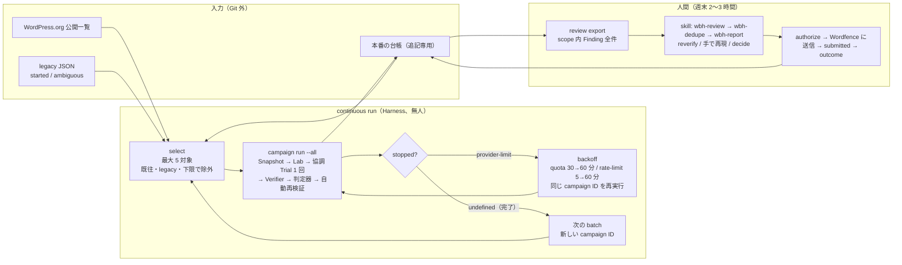
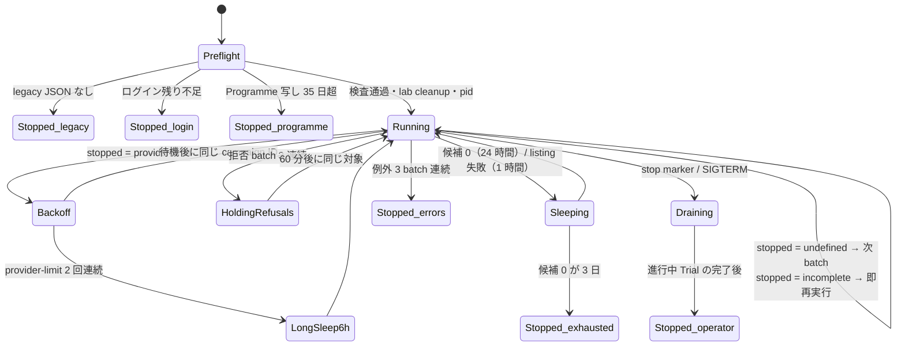
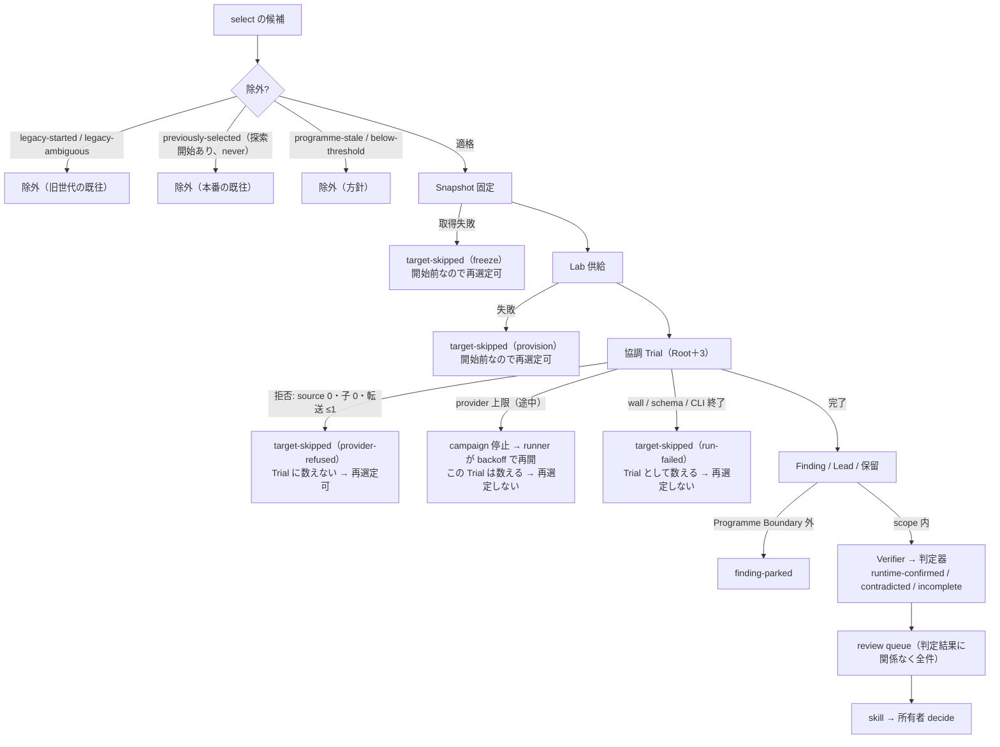
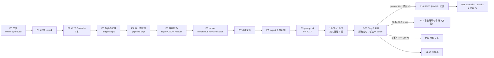

# 最終設計（2026-10-14、実装仕様版）

所有者の依頼「最終設計を出してほしい。自分では決め切れない。この通りに作ればバグバウンティを回し続けられる状態にしたい」に答える。この文書は決定の列挙ではなく、PR ごとの実装仕様、設定の正本、1 週間の無人運転の手順、Step 1 完了の判定手順、変更禁止の線まで持つ。所有者が第 14 節に答えた時点で有効になり、以後は変えた行だけを更新する。

不変条件（SPEC §2 の 8 項目）とモジュール境界は変えないので新しい ADR は要らない。SPEC §4 / §6 / §8 / §8a / §8b / §12 の文言、ADR 0016 / 0020 / 0026 / 0029 / 0032 の該当行への追記、DEVELOPMENT §2 / §3 / §5 / §6 / §7 の変更は `owner-approved` を要し、最初の PR（P0）にまとめる。DEVELOPMENT §2「Step 1 完了まで既存 ADR を変えない」は、上記 5 本の該当行に限って所有者が解除する（第 14 節 4）。

調べ方: [2026-10-14 のレビュー](2026-10-14-overbuild-and-gaps-review.md)、読み手 4 本（#229 branch の runner、provider 拒否と第 2 経路、Lab 前提、人間レビュー経路）、角度の違う提案 2 本（Step 1 最短、所有者時間最小）、初稿に対する反証 2 本（規則、code）、確定案に対する検証 4 本（規則、code、完全性、候補供給量）。対象は `main` d214de0 と branch `codex/issue-229-batch-pin` c5d0ef3、関連 branch 8 本、GitHub Issue #215 / #220 / #224 / #229 の本文と comment。実機、provider、`pnpm check` は動かしていない。行数はすべて見積り。

所有者の確定事項（2026-10-14）: `cyber_policy` 拒否（#220）は一時的な問題。#215 の既往照合は「判別不能 slug の保留」までで、全 slug の保留ではない。方向性は正しいが、いらない機能と厳しすぎる制約がある。徹底してよい。

## 0. 決めたこと（10 行）

1. `c5d0ef3`（#229）と #227 / #228 / #215 の branch は merge しない。参照用に残し、外側ループは `main` から約 220 行で新しく書く（D3）。
2. 探索 provider は Codex のまま。拒否と run 失敗は campaign を止めず、その対象を飛ばして次へ進む。Opus arm は数値の引き金付きで寝かせる（D1）。
3. 既往照合は、旧世代 DB と既知の旧 `--state` 台帳から 1 回だけ作る Git 外 JSON（started / ambiguous）と、本番の台帳で行う。JSON は `continuous run` の起動前提。監査 manifest、registry、承認 JSON は作らない（D2）。
4. 「source を 1 件も読まず、子を起動せず、broker 転送 1 以下で終わった run」は Trial に数えない。その slug は再選定できる。途中まで走った Trial は Trial として数え、再選定しない（D2 / D4）。
5. quota と rate-limit は人間を呼ばず、上限なしの backoff で同じ campaign を再開する（D4）。
6. Lab は「plugin の通常の有効化設定」を Harness 所有の型付き setup が入れてよい（管理者権限の付与と重大 option の変更は不可）。precondition 理由の集計で頻出が確認できたときに、選択可能な option として入れる（D5）。
7. 人間レビューは skill 3 本と `review export` の整合を直す。手動再現の省略は 2026-10-11 の所有者決定を変えるので、所有者の答え（第 14 節 6）を待つ（D6）。
8. 本番ループに乗っていないものは今は足さず、Step 1 合格後の整理 PR 3 本で消す。評価モジュールの `prospective` と funnel は SPEC §4 の境界なので残す（D7）。
9. `owner-approved` は ADR・SPEC・trust 境界宣言・Programme Boundary・policy・判定器に限って path を明示列挙し、prompt 目的文と selection.json は委任済みの AI がラベルを付ける。配線・runtime・選定の PR は異なる slug の初回 3 Trial、agent 入力を変える PR は再発見 case の 3 Trial で測る（D8）。
10. 既定 prompt は起動前に v4（PR #217、owner-approved 済み、3 Trial 記録あり）へ切り替えて分母を 1 本にする。無人運転は 10-21 開始、Step 1 の判定は 10-28、初提出は 11-14（D10）。

## 1. 変えないもの

- SPEC §2 の不変条件 8 項目。対象の実行は gVisor 内だけ、`runtime-confirmed` は判定器だけ、外向き通信は broker 経由の provider API だけ、Harness は送信しない、台帳は digest 参照だけ。
- 主経路: 対象ごとに Root＋最大 3 子の協調 Trial を 1 回、wall 上限 60 分（ADR 0029）。無人運転の週は既定 1 本（v4）だけを回し、arm 比較（#201 の事前登録）は回さない。比較 arm は SPEC §6 のまま起動可能に残す。
- 判定器の集合と成功条件。攻撃者位置は未認証と subscriber / customer のみ。
- 人間の判断点: 提出前レビュー、外部行動の承認、同じ slug の追加 Trial の承認（ADR 0032 Q6）。Step 1 は初回 Trial だけを回すので、追加 Trial の承認経路はまだ作らない。
- 判断の要る工程は skill、決定論の処理と自律ループは Harness（ADR 0031）。
- 台帳の event 型。新しい event 型は足さない。停止理由は既存の `discovery-run-finished.reason / reasonDetail / providerLimit`、`target-skipped.stage / reason`（#223 が enum を拡張。そこに `provider-refused` / `run-failed` を足す）、`campaign-stopped.reason`（`operator` / `provider-limit` / `incomplete`）で表す。
- 同時実行: 無人運転の最初の週は `maxConcurrentTargets: 1`、`maxConcurrentRuns: 1`、`memoryBudgetMiB: 10240`（SPEC §6「最初は Trial を 1 つずつ」）。2 に上げるのは 1 週の数字を見てから。
- install 下限 100,000（ADR 0032 Q4、所有者が data で決めた値）。runner は無人で下げない。

## 2. 到達目標と期日

| 期日 | 到達点 | 測る数字（第 10 節のコマンド） |
| --- | --- | --- |
| 10-16（木） | 所有者が legacy JSON を作る（第 7.1 節 5） | JSON の started / ambiguous 件数 |
| 10-17（金） | P0〜P4 が merge（文言、#222、#223、拒否の記録、停止意味論） | `pnpm check` 緑 |
| 10-20（月） | P5〜P9 が merge（選定除外、runner、skill 整合、export、prompt v4）。所有者が `continuous run` を起動 | 起動 1 回 |
| 10-21〜10-27 | Step 1 完了条件: quota 1 週分を人手 0 で回り切り、Programme Boundary 内の Finding が全件 `review export` に届く | 人手介入 0 回、開始した初回 Trial 数、completed、quota 待ちの回数と合計時間、停止理由の内訳 |
| 10-28（火） | Step 1 の判定（第 10 節）。所有者が skill 3 本で最初のレビュー batch を完了 | batch の件数、`decide --minutes` の合計、accept / reject / defer の内訳 |
| 11-04 | 条件を満たせば Lab の通常設定（D5）が選択可能 option として merge | precondition 理由の件数の前後比、判定器が結論を出した件数 |
| 11-14 | 初提出 1 件（最新版で確認済み、重複なし、承認付き） | 提出 1、所有者の分数 |
| 12 月以降 | 月 USD 1,000 の測定開始 | 提出転帰と報奨額 |

DEVELOPMENT §2 の期日 10-24 は、P0〜P9 の 10 本が 1 週間で入らない見込み（code 反証）のため 10-28 に 4 日ずらす（第 14 節 1）。代わりに無人運転は 10-21 に必ず始める。legacy JSON が 10-20 までに揃わなければ起動を JSON 完成後に遅らせ、10-28 の判定も同じ日数ずらす。

## 3. 最終形

### 3.1 流れ

```
continuous run（src/cli/continuous.ts、約 220 行、main から新規）
  起動時: host preflight（runtime check と同じ関数）→ ログイン残り時間、Programme 写しの期限、legacy JSON の有無を検査
          → lab cleanup --remove → pid file
          → 最新の selection-* batch が未束縛なら、select をやり直さずその batch を新 campaign ID で走らせる
  ループ:
    profile.select(policy)                        # WordPress.org pool から最大 5 対象。台帳と legacy JSON で既往を除く
      selected が空: excluded の理由が全件 programme-stale → 停止(programme-stale)
                    listing が unavailable（WordPress.org 側の失敗）→ 1 時間後に再試行
                    それ以外 → 24 時間眠って再試行。3 日続けば 停止(exhausted)
    profile.runCampaign(campaignId, batch)        # Snapshot → Lab → 協調 Trial 1 回 → 検証と有界の自動再検証
      対象ごとの失敗（Lab、Snapshot、run 失敗、provider 拒否）は campaign 内で target-skipped になり次の対象へ（P4）
    CampaignSummary.stopped で分岐:
      undefined        → 完了。次の batch へ（新しい campaign ID）
      provider-limit   → providerLimit が quota なら 30 分から、rate-limit なら 5 分から、倍々で上限 60 分の backoff。
                         上限なし。同じ campaign ID を再実行（未消費の対象から再開する既存動作）。
                         provider-limit が 2 回連続なら次の再実行まで 6 時間眠る
      incomplete       → 即時に同じ campaign ID を再実行（P4 の後はほぼ出ない）
    例外（exit 1 相当）: その batch を諦め理由を status に残し、次の batch へ。3 batch 連続なら 停止(errors)
    拒否 (target-skipped provider-refused) が batch 内の全対象で起きた batch が 3 連続: 60 分眠って同じ対象で再試行（停止しない）
    stop marker / SIGINT / SIGTERM: 進行中の Trial を drain して停止（台帳に campaign-stopped(operator)）
    ログイン残り時間 < 次 batch の見込み時間: 停止(login-expiring)
review export（scope 内 Finding 全件、判定結果に関係なく）
  → skill: wbh-review → wbh-dedupe → wbh-report（所有者の Claude Code）
  → 所有者: review reproduced / decide / authorize / 送信 / submitted / outcome
```

### 3.2 runner の状態（`continuous status` が出すもの）

| 状態 | 意味 | 導出元 |
| --- | --- | --- |
| `running(campaignId)` | pid が生きていて stop marker が無い | pid file、`continuous.json` |
| `backoff(step, until, providerLimit)` | provider 上限の後、待機中 | `continuous.json` |
| `holding-refusals(until)` | 拒否 3 batch 連続の後、60 分待機中 | 同上 |
| `sleeping(until, reason)` | 候補 0（`empty`）または listing 失敗（`listing-unavailable`）で待機中 | 同上 |
| `stopped(reason)` | `operator` / `errors` / `login-expiring` / `programme-stale` / `exhausted` / `legacy-history-missing` | 同上 |
| 集計 | 今日と今週の Trial 開始数（`runKind: explore`）、completed、provider-limited、provider-refused、run-failed、Lab 失敗、Finding、`review` queue 件数、`parked` 件数、unsettled（開始記録だけの Trial）件数、焼いた Trial 数 | 台帳 |

`continuous.json` は runner の作業メモ（`{campaignId, backoffStep, nextRunAt, consecutiveRefusalBatches, consecutiveEmptyDays, consecutiveErrorBatches, consecutiveProviderLimits}`）で、台帳ではない。消しても次の起動で作り直せる。状態の正本は台帳。

### 3.3 図解

全体の流れ。人間が触るのは右端の 2 箱だけ。



runner の状態機械。止まる理由は 6 つで、quota と拒否では止まらない。



対象（slug）1 件の運命。再選定できるのは「Trial に数えない run」と「開始前の失敗」だけ。



PR の依存と日程。P10 以降は条件付き。



## 4. 決定の詳細

### D1 provider: Codex のまま、拒否は飛ばして続ける

- 決定: branch `codex/provider-policy-diagnostics`（4cc66b1、+103 行）を merge し、`cyber_policy` を `reasonDetail = provider-cyber-policy` として台帳に残す。branch が OPERATIONS に足す段落「同じ構成で未実施対象を次々に起動せず」は本設計の文言（拒否された対象は `target-skipped(provider-refused)` として未消費のまま残し、次の対象へ進む。同じ対象の再実行は再選定で行う）に書き換えて同じ PR に含める。#220 の受入条件 2「provider が許可する構成・対象範囲を確認するまで、同じ構成で未実施対象を自動消費しない」はこれと衝突するので、所有者が Issue に「拒否は記録して次対象へ進む」と comment して改定する（第 14 節 8）。
- 現行の `src/cli/pipeline.ts:562-575` は、`reason=provider` で `providerLimit` の無い失敗（拒否）と run 失敗（wall、schema、CLI 終了）を `requestStop("incomplete")` で campaign 全体の停止にし、`campaign run` は provider 上限も incomplete も exit 3 を返す（`index.ts:773`）。P4 でこれを対象単位の `target-skipped` に変える。provider 上限（`providerLimit` あり）だけは campaign 停止のまま残し、runner が再開する。runner の判定は exit code ではなく `CampaignSummary.stopped` と台帳の `campaign-stopped.reason` / `target-skipped.reason` で行い、連続回数は campaign ID 単位で数える。
- 拒否で runner を止めない。拒否が batch 内の全対象で起きた batch が 3 連続したら provider 全体の hold とみなし、60 分眠って同じ対象で再試行する。終了は operator の stop だけ。拒否を避ける目的の prompt の言い換えはしない。
- Verifier も同じ購読を使う。Verifier が拒否か上限を返した検証は `incomplete(provider)` として台帳に残り、Finding は #185 の規則で review queue に届く。runner は同じ campaign ID を再実行するとき `retryIncompleteVerifications: true`（既存の operator retry）を渡し、未検証の Finding を検証し直す。
- 集計: `ledger stops [--campaign <id>] [--since <ISO>]`（約 80 行）を足す。`discovery-run-finished.outcome × reason × reasonDetail × providerLimit`、`target-skipped.stage × reason`、`lab-provisioned.status × failureStage`、`campaign-stopped.reason` を既存フィールドだけで group by する。拒否率の分母は `runKind: explore` の `discovery-run-started`、分子は `provider-cyber-policy` かつ開始 60 秒以内。
- Opus arm（`codex/opus-55-discovery`、+2,718 行）は PARKING のまま。再開条件を「Step 1 完了後」から「無人運転の初回 Trial が 15 本以上あり、拒否率 30% 以上、または拒否 hold が週 2 回以上」に書き換える。再開するときは Claude 側の拒否分類（約 100 行）を先に入れ、2 provider を同じ物差しで比べてから arm を campaign 設定で明示する。拒否時の自動切替はしない（不変条件 2）。
- 理由: 所有者が「一時的」と判断した。#220 は同一対象で拒否 → 再試行で成功しており、拒否は決定論的でない。

### D2 既往照合: legacy JSON を起動前提に、本番の台帳と合わせて見る

- 決定: 「同じ対象」は slug で判定する（#215 の 10-14 追加条件）。`selection.json` の `revisitPolicy` を `{"kind": "never"}` にする（`ledger-exclusions.ts:10-12` に既にある値）。版や prompt 版が変わっても再選定しない。
- 旧世代の履歴は Git 外 JSON 1 つで照合する。使い捨て script `scripts/export-legacy-slugs.mjs`（約 100 行）が、(a) 旧研究 DB（sqlite）から Trial 開始の記録がある slug を `started`、選定だけで開始の有無が判別できない slug を `ambiguous` に分け、(b) 引数で列挙した既知の旧 `--state` ディレクトリの台帳から `discovery-run-started`（`runKind: explore`）の slug を `started` に畳み込んで、標準出力に書く。本番の台帳には触れない。

```json
{ "schemaVersion": 1, "sourceDigest": "sha256:...", "exportedAt": "2026-10-16T00:00:00Z",
  "sources": ["/abs/old-research.sqlite", "/abs/old-state-1", "/abs/old-state-2"],
  "started": ["slug-a", "slug-b"], "ambiguous": ["slug-c"] }
```

- `started` は除外理由 `legacy-started`、`ambiguous` は `legacy-ambiguous` として除外し、どちらにも無い slug は初回として開始する。host 設定に `legacyHistory: {"file": "/abs/path.json"}` を足し、`select` のたびに読んで `schemaVersion` と slug の形式を zod で検査し、digest と件数を選定レポートに載せる。
- JSON は `continuous run` の起動前提。無ければ `stopped(legacy-history-missing)` で起動しない。`select` 単体の開発用途だけ `legacyHistory: unavailable` を記録して進める。理由: 旧世代の監査で 530 slug 中 497 が開始済み、10-13 の標準選定の上位 5 件は全件既往だった（#215 comment）。照合なしの 1 週は quota の大半を既往 slug に使い、しかも `never` でそれらを本番でも永久除外にする。
- 既往の基準を `target-selected` から探索開始（`discovery-run-started`、`runKind: explore`）に変える。選定されたが Trial が始まらなかった対象（Lab 失敗、Snapshot 失敗）は再選定できる。
- 「Trial に数えない run」の定義: Root が source を 1 件も読まず（receipt の `observed.filesRead = 0`）、子を起動せず、broker 転送が 1 以下で終わった run。SPEC §6「候補 0 件の正常完了にしない」の裏側として、SPEC §6 と ADR 0029 に 1 文を足す（P0、`owner-approved`）。この定義で #220 の実測（tool call 0、source 読取 0、子 0）は Trial 未開始となり再選定できる。途中まで走って provider 上限や wall で止まった Trial は Trial として数え、再選定しない（SPEC §6「同一対象の自動追加 Trial はしない」のまま）。承認は要らない。
- 作らない: 4 source の全数監査 manifest、writer 停止時刻、失効 registry、`trial bootstrap / coverage-import / approve`、承認 JSON と trialOrdinal の結び付け（`repeat-trial-gate.ts` 841 行）。別 state ディレクトリによる抜け道は「本番 state は 1 つ」という運用規則で止める（#215 受入条件「機械的に防げない境界は運用で止める」）。
- 同じ slug の追加 Trial の承認（L2）は、所有者が実際に 2 回目を求めるまで作らない。`main` の ADR 0032 Q6 行はまだ「初回 Finding があれば自動 +2 Trial」なので、P0 で「runBudget と自動 +2 を削除。同 slug の 2 回目以降は 1 Trial ごとに所有者が事前承認。承認の形式は 2 回目を求めるときに決める」に直す。

### D3 外側ループ: `main` から約 220 行

- 決定: `src/cli/continuous.ts` を新規に書き、`continuous run | stop | status` を足す。中身は第 3 節だけ。runner は `runCli` を繰り返し呼ばない（呼ぶたびに台帳の DB を開いて閉じない）。1 つの `state` を作り `environment.profile.select` と `profile.runCampaign` を直接呼び、`CampaignSummary.stopped` で分岐する。
- campaign の完了を示す台帳 event は無い。runner は「同じ ID で再実行して `targets` と `skipped` が空なら完了」という `campaign run` の冪等性に依存する。`status` の unsettled も同じ判定で数える。
- 起動時に、最新の `selection-*` batch が `selection-batch-bound` されていなければ `select` をやり直さず、その batch を新しい campaign ID で束縛して走らせる（crash や例外の後に未束縛 batch が孤児化し、その slug が `never` で永久除外されるのを防ぐ）。campaign ID の prefix は `selection-` で始まってはならない（選定 batch の見分けに使われる）。
- `c5d0ef3` 系（journal 525、owner 212、reconcile 446、stop 84、control 133、claims 564、scope 21、recovery 131、gate 841 の src 約 2,960 行と test 約 3,100 行、#227 の在庫 768 行と child-assessment 446 行、#228 の Lab 側変更）は merge も rebase もしない。branch から cherry-pick するのは #222、#223、拒否の記録、v4（PR #217）の commit だけで、その際も `policy/campaign.json` と `policy/selection.json` の他の変更（30,000 cohort、`maximumTargets: 1`）は除外する。
- 候補の補充は `select` の既存の仕組み。`selection.json` の `popularPages` と `pagesPerTag` を 2 → 5 に上げ、列挙の上限 `maxCandidates`（`contracts.ts:106`、`enumerator.ts:277` の 500）も 1,500 に上げる（頁数だけ上げても pool は増えない）。`select` の所要時間（HTTP 回数が 3 倍）は初日に測る。在庫 cursor は持たない（毎回先頭から列挙し、台帳の既往と legacy JSON で飛ばす）。
- 候補が尽きたら runner は `exhausted` で止まる。install 下限 100,000 は所有者が data で決めた値（ADR 0032 Q4）なので runner は無人で下げない。所有者が `selection.50000.json`（同じ構造で下限だけ違う写し。P5 で置く）を選んで `continuous run --selection` で起動し直す 1 コマンドで足りる。下限の扱いを方針版で変える #230 はこの運用で代える。
- 停止: `continuous stop` は state dir に `continuous.stop` を書く。runner は各周回の前と `runCampaign` の戻りで marker を見る。進行中の campaign には既存の stopSignal を渡し、Trial 単位で drain する（子の成果は保存される。ADR 0029）。campaign 側は `campaign-stopped(operator)` を台帳に残すので「台帳が状態源」と整合する。pipeline の対象ループに stop の検査点を 1 箇所足す（+15 行）。SIGINT / SIGTERM も同じ経路。終了時に pid file を消す。
- crash 後: 終了記録のない Trial と Lab の Docker 資源は、runner 起動時の `lab cleanup --remove` と `status` の unsettled 件数で見る。自動復旧は実機で 2 回止まるまで作らない（LESSONS 8）。ADR 0032 Q18 で止めたのは外側 cron の quota tick で、in-process の backoff は別物である旨を OPERATIONS に書く。
- 理由: 3 branch が `main.ts` / `wordpress.ts` / `pipeline.ts` を同時に変えており、割って rebase するより `main` の `select` と `campaign run --all`（同じ ID で再開）を呼ぶ方が小さい。第 2 の journal は SPEC §4「単一の追記専用台帳」と二重になる。

### D4 quota、rate-limit、その他の失敗

- 決定: `runCampaign` が `provider-limit` で止まったら、runner は直近の `discovery-run-finished.providerLimit` を読む。`quota` なら 30 → 60 分、`rate-limit` なら 5 → 10 → 20 → 40 → 60 分の backoff で同じ campaign ID を再実行する。60 分に達した後は 60 分ごと。`provider-limit` で終わった実行が 2 回連続なら、次の再実行まで 6 時間（定数）眠り、焼いた Trial 数を `status` に出す。上限回数は置かない。人間は呼ばない。
- provider 上限で止まった Trial の対象は、campaign 内では消費済み（`campaign.ts:353-370` の再開ロジックは変えない）。D2 の「Trial に数えない run」に当たるものだけが次の `select` で再選定される。SPEC §4 discovery 行の「自動 retry しない」と §6「provider 上限では新規 Trial を止め…未消費の対象を再開する」は、「runner が backoff 後に同じ campaign ID で再開する。Trial に数えない run の対象は次の選定で戻る」に P0 で書き換える。
- 対象単位の失敗（Lab provision、Snapshot 取得、run 失敗、拒否）は P4 以降すべて `target-skipped` で次の対象へ進む。版の変化では skip しない（固定 Snapshot で探索を続け、提出直前の `review reverify --version` で吸収する。SPEC §8）。
- runner 全体を止めるのは、stop、`login-expiring`、`programme-stale`（35 日超は選定全体を止める系統的事象）、`exhausted`、`legacy-history-missing`、例外 3 batch 連続（`errors`）の 6 つだけ。

### D5 Lab: 通常の有効化設定を Harness が入れる（条件付き）

- 決定: SPEC §8b の `lab` 行「設定は既定のまま」を次に差し替える。「plugin の通常の有効化設定（管理者が普通に行う初期設定）は Harness 所有の setup が型付き手順で入れてよい。権限付与、`default_role` / `siteurl` / `home` / `admin_email` / `users_can_register` 等の options-update 対象の変更、危険設定は不可。実行前後の状態差分を Private Evidence に残す」。SPEC §8a の「Labは既定設定で供給し」と ADR 0020 に同趣旨の 1 文を補い、ADR 0026 には決定を変えない追記 1 段落。Verifier にブラウザと管理者セッションを渡さない線は変えない。これは Programme Boundary の執行箇所（Wordfence「最新版・既定設定」）なので `owner-approved` と ADR 凍結の部分解除が要る（P10）。
- 前提条件: ADR 0026 / SPEC §7 の規則どおり、無人運転の第 1〜2 週の `incomplete(precondition)` を `scripts/report-wordpress-preconditions.mjs` で集計し、activation 既定値で埋まる種類が 3 件以上あるときだけ P10 / P11 を出す。満たさなければ見送る（11-04 は期日ではなく条件付き）。
- 実装（P11）: setup の boolean `lab.ordinaryActivationDefaults: true | false`（既定 `false`）を campaign 設定に持たせ、scenarioId を占有しない（precondition 再試行の scenario 切替と共存する）。異なる slug の初回 3 Trial と再発見 case の 3 Trial（agent 入力を変えるため、D8）の数字を取った後、`policy/campaign.json` の既定を `true` にする（policy なので `owner-approved`）。
- PHP は WordPress コンテナ内で独立に実行する: `php /harness/activation-defaults.php`。先頭で `define('WP_ADMIN', true)` し `wp-load.php` を読み、管理者ユーザーを `wp_set_current_user` して `do_action('admin_init')` を 1 回発火、`get_registered_settings()` の各 option について `get_option` が false のものだけ `add_option(default)`。WP-CLI の `eval` は `is_admin()` が false になるので使わない。実行後に `default_role`、`users_can_register`、`siteurl`、`home`、`admin_email`、管理者ユーザー数が実行前と同じことを検査し、違えば provision を `incomplete`（`failureStage` は既存の `seed`、理由は Private Evidence）で返す（throw しない。不変条件 4）。setup 全体に 120 秒の上限。外向き HTTP は Lab の network で遮断されているので失敗して返る。
- 登録済み shortcode を載せた公開ページは activation default ではなく初期データなので入れない（Step 2 の候補）。activation 既定値由来の設定は Finding の `configurationPrecondition` と報告書の Environment に `activation-defaults` と書き、`default` とは区別する。
- 探索 Lab と検証 Lab は同じ setup digest で立つので両方に入れる。再現パッケージの Lab 再構築情報（`reconstructionFor`）に 1 分岐を足す。既存の 8 adapter と既存 scenario は変更しない。新規追加も止める。対象固有の関数名・クラス名・installer 名は使わず、WordPress 標準 API だけに頼る。
- 理由: 本番第 3 周の `incomplete(precondition)` は「管理者による対象固有の設定状態」で、既定設定のままでは埋まらない。Wordfence が却下するのは管理者の「誤設定」前提であり、通常の有効化設定ではない。対象ごとに adapter を書く作業は週 5 対象のループに追いつかない。

### D6 人間レビュー経路

- 決定（P7）: skill 3 本の参照フィールド名を export に合わせる（`evidence.*` → `privateEvidence.*`、`stateDiff.settings` → `labStateDiff.summary.settings`、約 10 行）。skill は提案だけを出し、`decide` は所有者が自分で打つ（不変条件 6）。`wbh-dedupe` の手順に「提出直前に `history status` を打ち、stale なら旧環境で更新」を 1 行足す。OPERATIONS §3 の冒頭に skill の起動順と所有者が打つコマンドの表（約 20 行）。`.claude/skills/` は adr-guard の対象なので、変更後の全文と日本語訳と出典対照表を貼り、委任 comment 付きで AI がラベルを付ける。
- 決定（P8）: `review export` の `review` 節に nullable で互換追加する: `humanReproduction: {result, minutes, recordedAt} | null`、`latestReverification: {verificationId, status, basis, recordedAt} | null`（`derivedFromFindingId` が同じ `finding-recorded` と `verification-finished` の join）、`latestDraft: {digest, revision, preparedBy, programme} | null`、`decision: {decision, reasonCode, duplicate, decidedAt} | null`、`scopeAssessments: [{assessmentId, programme, verdict}]`。review-decision / draft / scope の artifact は store から読む（既存の finding / http / refutation の読み方と同じ）。literal は `review-export/v1` のまま。src 約 100 ＋ test 約 70。
- 手動再現: SPEC §8 / §12、ADR 0016 / 0028 は「人間が自分の手で再現してから査読」を 2026-10-11 の所有者決定として記録しており、ADR 0031 もこれを反転していない。本設計では変えない。`review reproduced --result match` は必須のまま、`wbh-report` の前提も変えない。所有者が第 14 節 6 に yes と答えたときだけ P12（文言だけ）を出す。
- 重複照合: Harness 側はローカル Wordfence mirror のみ。#231（日次更新）は Step 1 では作らない。
- `incomplete` だけの batch でも、所有者が decide まで打てば Step 1 の「1 回の batch」とみなす。

### D7 削除と凍結

今から足さない（凍結）: `eval score / keys / rubric / compare` と `advisory.ts`、起動可能な探索 prompt の追加、plugin 固有 Lab adapter、`review open`、週次 smoke 専用の replay Verifier、`assignment` mode、旧 arm の examples。PARKING に凍結の札を足す（P0）。`review scope` は `draft` の前提条件、`review dedupe` は `wbh-dedupe` が呼ぶので凍結しない。`review reproduced` は D6 のまま使う。`eval prospective`、`readiness`、funnel は SPEC §4 の `evaluation` 境界と §10 の前向き評価なので残す。

merge しない（branch は参照用に残し、Issue は PARKING 1 行で閉じる）: `codex/issue-229-batch-pin`、`codex/issue-227-inventory-slice`、`codex/issue-228-cross-campaign-claims`（再開条件: 第 2 provider が実動、または実機で連続運転が 2 回止まった）、`codex/repeat-trial-approval`、`codex/low-value-impact-gate`（566 行。review queue はほぼ空で `finding-parked` で足りる）。#126 の週次 smoke は「既知 Finding に `review reverify` を 1 回（campaign ID は `smoke-<YYYYMMDD>`）」に置き換えて閉じる。

起動可能な探索 prompt: `wp2shell-bounty-v4`（既定、P9）、`wp2shell-bounty-v3`、`wp2shell-bounty-v2`、`short-objective-managed-v4`、`wp2shell-whitebox-v1.7`。他 10 版は digest 照合専用 archive とし、campaign 設定の `promptId` では拒否する（P13、本文 file は残す）。#201 の A/B 事前登録は Step 1 の間は回さない（第 14 節 9）。

Step 1 合格後に消す（P13、3 本、削除行は 500 行の目安に数えない。第 10 節の 3 条件すべて合格が前提）: (a) replay Verifier（`smoke-replay-*.ts` 662、`scripts/smoke-real-lab.mjs` 564、test 225、`judges.ts` / `wordpress.ts` / `index.ts` の配線、OPERATIONS §2 の smoke 節、`campaign-real-lab-smoke.json`。約 1,600 行）。(b) `assignment` mode（`wordpress.ts:183-248`、`entry-points.ts` の分担計画、test 6 本。旧台帳 event の分担 digest を読む互換 test は残す）。(c) examples 28 本のうち本番用 3 本とそれが参照する `selection.json` 2 本と `campaign.json` 1 本の計 6 本を残して 22 本を消し、`examples.test.ts` の該当 8 ケースと README / TRANSLATEPRESS-BENCHMARK の参照を直す。`eval score / keys / rubric / compare` と `advisory.ts`、prompt の起動可否 flag（約 40 行）も (c) に含める。

理由: 無人運転の週は削除の churn で実機の測定を乱さない。足さないことは今日から守る。所有者の 10-13 決定（ADR 0032 Q27「整理は Step 2」）と、SPEC §4 のモジュール境界を変えない線に整合する。

### D8 緩める制約

| 制約 | 変更後 | 場所 |
| --- | --- | --- |
| `owner-approved` ラベルの対象 path | 残す（所有者本人が付ける）: `docs/adr/`、`docs/SPEC.md`、`src/profiles/wordpress/prompts/trust-boundary-v1.md`（不変条件 1「人間が書いた」）、`src/profiles/wordpress/policy/campaign.json`（Programme Boundary）、`src/profiles/wordpress/policy/programme-scope.md`、`src/profiles/wordpress/discovery/programme-impacts.ts`、`src/profiles/wordpress/verification/judges.ts`（成功条件。現在は対象外なので足す）。残す（委任済みの AI が出典対照表＋委任 comment 付きで付ける）: `prompts/` の目的文、`policy/selection.json`、`.claude/skills/`、出力契約の雛形、Verifier の victim 契約。出典に無い要素を足さない規則は維持 | DEVELOPMENT §5 / §6、`check.yml`（約 20 行） |
| 探索に触る PR は開発セット 3 Trial | 二段にする。agent 入力を変える PR（prompt 本文、契約節、Lab setup）は再発見 case（ADR 0027）で最低 3 Trial の completed と source 根拠付き候補の有無を記録する。配線・runtime・選定の PR は runner が流した異なる slug の初回 3 Trial の completed・wall・停止理由で足りる。未 merge branch で本番 runner を回すときは campaign ID に branch 名を含め、本番の分母に混ぜない | DEVELOPMENT §5、OPERATIONS §2 |
| quota 後は人間の `resume` | backoff 付き自動再開（D4） | SPEC §4 / §6、OPERATIONS §2 |
| 拒否・run 失敗で campaign 全体が止まる | 対象単位の skip（D1、P4） | SPEC §6、OPERATIONS §2 |
| 既往照合は全数監査が済むまで初回も保留 | JSON 1 つ（旧 DB ＋ 旧 state 台帳）を起動前提にして照合、ambiguous だけ保留（D2） | OPERATIONS §2 |
| Lab は既定設定のまま | 通常の有効化設定は Harness が入れる（D5、条件付き） | SPEC §8a / §8b、ADR 0020 / 0026 追記 |
| 週の問い 1 つ・PR 1 本 | 10-14〜11-04 の 3 週だけ、問いは 1 つのまま PR を複数本（各 500 行以内、削除行は数えない）出してよい、と DEVELOPMENT に 1 行書く | DEVELOPMENT §3 / §5 |
| 同じ slug の追加 Trial は自動 +2 | 1 Trial ごとに所有者が事前承認。形式は 2 回目を求めるときに決める | ADR 0032 Q6 |

所有者の答え待ち（本設計では変えない。第 14 節）: 再試行回数の正本（実装か ADR 0032 か）、手動再現の省略、Reflected XSS の見直し時期。Reflected XSS の引き金を変えるなら「runner が異なる slug の初回 Trial を 20 本以上回した後の連続 4 週で、Programme Boundary 内の提出候補（accept）が週 1 件未満」とし、出口となる Patchstack 第 2 送信先の PARKING 行と同時に判断する。

緩めない: 攻撃者位置、`runtime-confirmed` の出し手、gVisor 必須、Harness は送信しない、台帳は digest のみ、install 下限の無人変更なし、週の問い 1 つ。

### D9 モデル配分

| 用途 | モデル | 理由 |
| --- | --- | --- |
| 本番の探索（Root＋3）と Verifier | Codex `gpt-6-sol`（Daybreak Blue、ChatGPT 購読、broker 経由）。model ID は host 設定の runtime profile | 所有者の決定。拒否は一時的。Verifier は `codex-verifier.ts` のまま |
| Codex の quota | 本番 Trial だけに使う。開発作業には使わない | 週 quota が Step 1 の完了条件そのもの |
| Opus arm（寝かせる） | Claude Opus 5.5、Claude Agent SDK、API key、broker 経由 | D1 の引き金が引かれたときだけ。従量課金なので月 USD 1,000 の収支に直結する |
| 開発: 設計文書、反証、PR レビュー | 最上位の Claude（Mythos、無ければ Opus） | 判断の質が結果を決める工程。PR を書いたモデルと別のモデルがレビューする。agent に渡る文章の対照表には書いた model 名を 1 行添える（LESSONS 12） |
| 開発: P0〜P13 の実装 | 所有者の Claude Code（Opus 5.5） | PR 1 本につき agent 1 つ、500 行の予算を守る。既存 commit の移植（P1〜P3、P9）も同じ |
| 開発: フィールド名の修正、文書の表、test の書き換え | Sonnet 級 | 機械的で安い |
| 人間レビューの skill 3 本 | 所有者の Claude Code（Opus 5.5） | ADR 0031。本人のローカル token に限る購読条件にも合う |

### D10 週の問いと順序

| 週 | 問い | PR（依存順） |
| --- | --- | --- |
| 10-14〜10-20 | 最小ループは quota・拒否・対象失敗をはさんでも人手 0 で回る形になったか（`pnpm check` と故障注入 test） | P0 文言 → P1 #222 → P2 #223 → P3 拒否の記録 → P4 停止意味論 → P5 選定除外 → P6 runner → P7 skill 整合 → P8 export → P9 prompt v4 |
| 10-21〜10-27 | quota 1 週分を人手 0 で回り切るか。止まった理由は何か | 実機運転（10-21 起動、触らない）。修正は止まった理由に対する小 PR のみ |
| 10-28〜11-03 | 所有者のレビュー batch は何件を何分で判断できたか。precondition 理由の集計で頻出の種類は何か | Step 1 の判定（第 10 節）。所有者のレビュー batch。条件を満たせば P10 SPEC §8a / §8b の文言、P11 activation defaults |
| 11-04〜11-14 | 最初の提出候補 1 件を所有者の何分で送れるか | P12（所有者が第 14 節 6 に yes のとき、文言だけ）。初提出。Step 1 合格なら P13 整理 3 本 |

順序の理由: P2（#223）は `pipeline.ts` の skip と `target-skipped.reason` の enum を変えるので、P4 より先に入れないと衝突する。P4 が無いと最初の拒否で campaign が止まり、無人運転の 1 週は測れない。P6 は P4 と P5 の意味論に依存する。P9 を起動前に入れるのは、PR #217 が owner-approved 済みで 3 Trial 記録を持ち、後で切り替えると分母が 2 本になるため。

#220 の拒否が続いた場合: 無人運転の週の数字は `target-skipped(provider-refused)` の件数と hold の回数になり、Step 1 の完了条件は「拒否を除く対象で 1 週回る」に読み替える（第 14 節 8）。

## 5. 実装仕様（PR ごと）

各 PR は DEVELOPMENT §5 の 5 項目（問い、変えたこと、変えなかったこと、測った数字、消し方）を日本語で埋める。追加行 500 以内（削除行は数えない）。`pnpm check` と `pnpm build` を通す。

### P0 文言（約 70 行、`owner-approved` は所有者本人、最初に merge）

- SPEC §4 discovery 行「自動 retry しない」→「provider 上限は campaign を止め、runner が backoff 後に同じ campaign ID で再開する。対象単位の失敗は `target-skipped` で次の対象へ進む」。
- SPEC §6 停止規則: 同じ内容に書き換え、「Root が source を 1 件も読まず、子を起動せず、broker 転送 1 以下で終わった run は Trial に数えず、その対象は次の選定で戻る」を足す。「同一対象の自動追加 Trial はしない」は残す。同時実行「最初は 1 つずつ」はそのまま。
- ADR 0029: 同じ 1 文を「帰結」に足す。
- ADR 0032: Q6 行を「runBudget と #189 の自動 +2 Trial を削除。同じ slug の 2 回目以降は 1 Trial ごとに所有者が事前承認する。承認の形式は所有者が 2 回目を求めるときに決める」に。「ADR 0022 への修正」の行は第 14 節 5 の答えに従う（(a) 実装に合わせて行を直す、または (b) 行はそのままで P4 と同じ PR で `pipeline.ts:105-109` を observation 1 / provision 0 に直す）。status を accepted にする。
- DEVELOPMENT §2: 期日 10-24 → 10-28（無人運転は 10-21 開始）。「Step 1 完了まで既存 ADR を変えない」に「ADR 0016 / 0020 / 0026 / 0029 / 0032 の該当行は本設計のために所有者が解除した」と 1 行。§3 / §5: 10-14〜11-04 の 3 週は問い 1 つで PR 複数本（各 500 行以内、削除行は数えない）を認める 1 行。§5: 3 Trial の二段の規則、`owner-approved` の path 列挙、agent に渡る文章の全文＋日本語訳＋出典対照表。§7: `eval score --keys` の行を消す。
- OPERATIONS §1: 保守として人手に数えないもの（第 8.2 節）。§2: 「上限での停止」を runner の再開に書き換え（cron の quota tick と in-process backoff の区別を 1 行）。「複数 batch の継続運転」節を P6 の仕様に差し替え。「同じ plugin の追加探索 Trial の承認」節を「所有者が 2 回目を求めたときに設計する」1 行に。単一 host・単一運用者・本番 state 1 つ・硬い総 token 枠は置かない・未 merge branch の Trial は本番の分母に混ぜない、の前提を書く。週次 smoke を「既知 Finding に `review reverify` を 1 回（campaign ID は `smoke-<YYYYMMDD>`）」に。
- PARKING: Opus の再開条件を D1 の数値に。#227 / #228 / #229 / #215 / #126 / #230 の扱いと再開条件。`eval score / keys / rubric / compare`、replay Verifier、`assignment`、examples、`review open` の凍結。
- `check.yml`: adr-guard を D8 の path 列挙に（`judges.ts` を足す。約 20 行）。

### P1 #222 Lab の umask 修正（162 行、既存 commit の移植）

- `origin/codex/issue-222-lab-umask` の 448129b を cherry-pick。`wordpress-initialization.ts`（+11）と test 2 本。
- 測る数字: 無人運転の週の Lab provision 失敗のうち、source 読取不可によるものが 0 件。

### P2 #223 Snapshot 取得の修正（762 行を 2 本に割る）

- `origin/codex/issue-223-source-freeze` を 2 PR に割る: (a) `pipeline.ts` の skip と `target-skipped.reason` の enum 拡張、失敗した選定の結び付け（約 300 行）。(b) Snapshot 再利用と source 不一致の分類、`undici` 依存（約 450 行）。P4 は (a) の enum を使う。
- 測る数字: `target-skipped stage=freeze` の件数と理由内訳。

### P3 拒否の記録と `ledger stops`（約 190 行）

- (a) `origin/codex/provider-policy-diagnostics` 4cc66b1 を cherry-pick（+37 runtime、+64 test）。OPERATIONS の追記段落は D1 の文言に書き換える。agent 入力を変えないので探索 PR ではない（PR 本文に明記）。
- (b) `ledger stops [--campaign <id>] [--since <ISO>]`（約 80 行）。既存フィールドだけで組む。

```
discovery-run-finished  outcome=failed            reason=provider  reasonDetail=provider-cyber-policy  count=3  explore=3  within60s=3
discovery-run-finished  outcome=provider-limited  reason=provider  providerLimit=quota                 count=2
target-skipped          stage=discovery  reason=provider-refused   count=3
target-skipped          stage=freeze     reason=source-unavailable count=1
lab-provisioned         status=failed    failureStage=seed         count=0
campaign-stopped        reason=provider-limit                      count=2
```

- 受入試験: 台帳 fixture に拒否 / quota / skip の event を入れ、group by の件数が一致する。既存 event 型を変えない。

### P4 停止意味論（約 170 行）

- `src/cli/pipeline.ts:562-575`: `discovery-run-finished` が `reason=provider` かつ `providerLimit` なし（拒否）、または run 失敗（wall、schema、CLI 終了、broker policy）のとき、`requestStop("incomplete")` せず `target-skipped(stage: discovery, reason: provider-refused | run-failed)` を追記して次の対象へ進む。`providerLimit` ありのときだけ従来どおり campaign を止める。
- `target-skipped.reason` の enum（P2 (a) で拡張済み）に `provider-refused`、`run-failed` を足す。
- pipeline の対象ループに stop 検査点を 1 箇所足す（+15 行。P6 の drain に使う）。
- 第 14 節 5 で (b) を選んだときは、ここで `pipeline.ts:105-109` の自動再検証を observation 1 / provision 0 に直す。
- 受入試験（故障注入、TEST-STRATEGY）: (1) 拒否 1 対象 → skip して次の対象の Trial が始まる。(2) wall 到達 → skip。(3) quota → campaign 停止、`stopped = provider-limit`、未消費の対象が残る。(4) 再実行で未消費から再開し二重登録しない。(5) stop 検査点で対象境界に止まる。
- 測る数字: `ledger stops` の `provider-refused` / `run-failed` の件数。

### P5 選定除外: 既往の基準、legacy JSON、`revisitPolicy: never`、Trial に数えない run、候補 pool（約 420 行）

- (a) `ledger-exclusions.ts`（+90〜120）: 既往の基準を `discovery-run-started`（`runKind: explore`）に。除外理由の union に `legacy-started`、`legacy-ambiguous` を足す。入力に `legacyHistory: {started: Set<string>; ambiguous: Set<string>; digest: string} | "unavailable"`。「Trial に数えない run」（receipt の `observed.filesRead = 0`、子 0、broker 転送 ≤ 1）しか持たない slug と、`target-selected` だけで探索開始の無い slug は `previously-selected` を付けない。それ以外の開始済み slug は `never` で除外。
- (b) `wordpress-host.ts`（+15）と `wordpress.ts`（+30）: host 設定の `legacyHistory: {file}` を `select` のたびに読み、`schemaVersion` と slug の形式を zod で検査し、digest と件数を選定レポートに載せる。無ければ `unavailable`（`continuous run` は起動しない。P6）。
- (c) `selection.json`: `revisitPolicy: {"kind":"never"}`、`popularPages: 5`、`pagesPerTag: 5`、`maxCandidates: 1500`（`contracts.ts:106` と `enumerator.ts:277` の上限定数も 1,500 に）、`id: wordpress-selection-2026-10-20`。`selection.50000.json` と `selection.30000.json` は下限だけ違う写し。policy の変更なので委任済みの AI が `owner-approved` を付ける。
- (d) `wordpress.ts:1295-1298` の下限未満 throw を「`target-selected` を書かず `selected: []` と全 `excluded` を返す」に変える（約 8 行 ＋ test）。runner が理由で分岐できるようにする。
- (e) `scripts/export-legacy-slugs.mjs`（約 100 行）: D2 の仕様。
- 受入試験: (1) legacy の slug が理由付きで除外される。(2) JSON 無しで `select` が進み、レポートに `unavailable`。(3) 拒否で source 0・子 0 の run しか持たない slug は再選定され、途中まで走った provider-limited の slug は再選定されない。(4) Finding 1 件以上の slug は再選定されない。(5) Lab 失敗で開始しなかった slug は再選定される。(6) 版が上がっても `never` で再選定されない。(7) 下限未満の候補だけなら空の選定と理由が返る。
- 測る数字: `select` 1 回あたりの適格数と所要秒、legacy で除外した件数、再選定の件数。

### P6 最小 runner `continuous run | stop | status`（約 480 行、test 込み）

- 新規 `src/cli/continuous.ts`（約 220 行）。配線 `src/cli/index.ts`（+25）、`campaign run --selection <path>`（index.ts +6、wordpress.ts +10）、`CliProfile` に `hostStatus(state, {configPath})`（ログイン残り時間と Programme 写しの期限を返す。+20）。test 約 200 行。
- CLI:

```
harness continuous run    --host <path> --state <dir> --config <campaign.json> --selection <selection.json> [--campaign-prefix <text>]
harness continuous stop   --state <dir>
harness continuous status --state <dir>
```

- 定数（file 先頭、設定にしない）: `BACKOFF_RATE_LIMIT_MINUTES = [5, 10, 20, 40, 60]`、`BACKOFF_QUOTA_MINUTES = [30, 60]`、`QUOTA_LONG_SLEEP_HOURS = 6`（provider-limit 2 回連続）、`REFUSAL_HOLD_MINUTES = 60`、`MAX_CONSECUTIVE_REFUSAL_BATCHES = 3`、`MAX_CONSECUTIVE_ERROR_BATCHES = 3`、`EMPTY_SLEEP_HOURS = 24`、`EMPTY_DAYS_BEFORE_EXHAUSTED = 3`、`LISTING_UNAVAILABLE_RETRY_MINUTES = 60`、`LOGIN_MARGIN = maximumTargets × runWallTimeMinutes × 2`。
- 起動時: host preflight。legacy JSON が無ければ `legacy-history-missing`。ログイン残り時間が `LOGIN_MARGIN` 未満なら `login-expiring`。Programme 写しが 35 日に達していれば `programme-stale`、今週中に達するなら警告。`lab cleanup --remove` 相当。pid file `continuous.pid`（既存 pid が生きていれば起動しない）。未束縛の `selection-*` batch があれば束縛して走らせる。
- 1 周回: campaign ID は `<prefix>-<YYYYMMDD>-<連番>`（prefix が `selection-` で始まれば拒否）。`profile.select` → `selected` が空なら理由で分岐（第 3.1 節）→ `profile.runCampaign`（同じ ID の再実行では `retryIncompleteVerifications: true`）→ `stopped` で分岐。拒否 batch の判定は、その campaign の `target-skipped` が全件 `provider-refused` のとき。
- 停止: stop marker、SIGINT / SIGTERM → campaign の stopSignal で drain → `campaign-stopped(operator)` が台帳に残る → pid file を消す。
- `status`: 第 3.2 節の表。台帳の読み取りは `ledger funnel` / `stops` の関数を再利用。
- `sleep`、`clock`、`signals`、`pidAlive` は引数で注入し、受入試験はそれで書く。
- 書かないもの: journal、owner lease、claim、crash reconciliation、新しい台帳 event、install 下限の自動変更。
- 受入試験: (1) `provider-limit` + rate-limit → 5, 10, 20, 40, 60, 60 分で同じ campaign ID。(2) `provider-limit` + quota → 30, 60 分、2 回連続で 6 時間。(3) `undefined` → 新しい campaign ID。(4) 拒否 batch 3 連続 → 60 分 hold して同じ対象、停止しない。(5) 候補 0 が 3 日 → `exhausted` で停止。(6) stop marker で対象境界の後に止まり `campaign-stopped(operator)` が残る。(7) pid が生きていれば二重起動しない。(8) ログイン残り不足で `login-expiring`。(9) 35 日超で `programme-stale`。(10) legacy JSON 無しで `legacy-history-missing`。(11) 未束縛 batch を束縛して走らせる。(12) listing unavailable は候補 0 と区別され 1 時間後に再試行。
- 測る数字: 無人運転の週の人手介入回数（目標 0）、Trial 開始 / completed / provider-limited / provider-refused / run-failed の件数、scope 内 Finding 数と `review` queue ＋ `parked` 件数の一致。

### P7 skill 3 本の整合と OPERATIONS §3 の表（約 70 行、全文＋日本語訳＋対照表、委任 comment 付きラベル）

- `.claude/skills/wbh-review|wbh-dedupe|wbh-report/SKILL.md`: フィールド名の修正、`decide` は所有者が打つ、`wbh-dedupe` に `history status` の 1 行。`wbh-report` の前提（`review reproduced --result match`）は変えない。
- OPERATIONS §3 冒頭に起動順の表: `review export` → `wbh-review` → `wbh-dedupe` → `review reverify --version <最新版>` → `lab up --for-review` で手で再現 → `review reproduced --result match --minutes <n>` → `wbh-report` → `review draft` → `review authorize --to wordfence` → 送信 → `review submitted` → `review outcome`。
- 受入試験: skill 本文に export の実フィールド名以外の参照が無いことを grep の test で確認。
- 測る数字: skill が export の読み取りで止まった回数 0。1 件あたりの所有者の分数（`decide --minutes` の中央値）。

### P8 `review export` の互換追加（約 170 行）

- D6 の仕様。受入試験: 既存の export fixture がそのまま通る（互換）。各項目が台帳 event と artifact から埋まる。artifact 欠落は `null`。

### P9 既定 prompt を v4 に切り替える（PR #217 をそのまま、起動前に merge）

- PR #217（owner-approved 済み、`docs/reviews/2026-10-13-critical-high-v4-development-trials.md` の 3 Trial 記録あり）を merge する。`prompts/index.ts` に登録、`policy/campaign.json` と `policy/selection.json` の `promptId` を v4 に、SPEC §4a / §6 の既定名を更新。30,000 cohort と `maximumTargets: 1` の変更が同居していれば除外する。
- 条件: 10-20 の起動前に merge し、無人運転の分母を v4 1 本にする。

### P10 SPEC §8a / §8b と ADR 0020 / 0026 の文言（約 20 行、`owner-approved` は所有者本人、条件付き）

- D5 の文言。前提条件（precondition 理由の集計で頻出 3 件以上）を満たしたときだけ出す。

### P11 activation defaults（約 420 行、条件付き）

- `src/profiles/wordpress/lab/ordinary-activation-defaults.ts`（約 70 行）と PHP 本文（文字列定数、digest 固定、約 70 行）。`wordpress-initialization.ts` の `installPlugins` 直後に、campaign 設定 `lab.ordinaryActivationDefaults` が true のときだけ実行（+10）。`state-capture.ts` の前後差分を Private Evidence に残す既存経路を使い、事後検査の違反は provision `incomplete`（`failureStage: seed`）。`reconstructionFor` に 1 分岐。campaign 設定 schema に `lab.ordinaryActivationDefaults`（既定 false）。scenarios / pins 15 行。test 150〜200 行。
- 受入試験: (1) 既定値の無い plugin で no-op。(2) 既存 option を上書きしない。(3) 事後検査の失敗で provision が `incomplete`。(4) 120 秒の上限で止まる。(5) false のとき setup digest が従来と同じ。
- 測る数字: precondition 理由の件数の前後比（`scripts/report-wordpress-preconditions.mjs`）、判定器が結論を出した件数、異なる slug の初回 3 Trial と再発見 case の 3 Trial（Trial 数、completed、Finding・Lead、wall 中央値、失敗内訳）。
- 設計時の確認: `is_admin()` 依存の plugin 1 件で `admin_init` が既定値を登録することを Lab で 1 回確かめてから書く。

### P12 手動再現の省略（文言だけ、約 30 行、所有者が第 14 節 6 に yes のとき）

- 新しい記録は要らない。Harness の再実行の事実は既存の `verification-finished`（最新版 `reverify`、`runtime-confirmed`）に残っており、P8 の `latestReverification` が export に出す。したがって P12 は SPEC §8 の 1 文と §12 の 2 文（「判定器が確認し、最新版の reverify が緑の Finding は、人間は証拠を読んで査読する。`no-judge` は手で再現する」）、ADR 0016 の帰結の 1 文、ADR 0032 に 1 行、OPERATIONS §3 の表の 1 行、`wbh-report` の前提と PoC の出典（「人間の手順、または reverify の Harness 捕捉 HTTP と再現パッケージ」）の 2 行だけ。`owner-approved` は所有者本人。
- `review reproduced` は `no-judge` の種別で使い続ける。

### P13 整理（3 本、Step 1 合格後）

- D7 の (a) replay Verifier、(b) `assignment` mode、(c) examples と `eval score / keys / rubric / compare` と `advisory.ts` と prompt の起動可否 flag。各 PR で `pnpm check`、`pnpm build`、CI の smoke が通る。第 10 節の 3 条件すべて合格が前提。不合格なら送る。

## 6. 設定の正本

- `selection.json`（P5 後）: `revisitPolicy: {"kind":"never"}`、`promptVariant: wp2shell-bounty-v4`（P9）、`popularPages: 5`、`pagesPerTag: 5`、`perPage: 50`、`maxCandidates: 1500`、`minimumActiveInstallations: 100000`、`maximumTargets: 5`、他は現状。`selection.50000.json` / `selection.30000.json` は下限だけ違う写し。
- `campaign.json`: `promptId: wp2shell-bounty-v4`（P9）。`resources: {maxConcurrentRuns: 1, maxConcurrentTargets: 1, memoryBudgetMiB: 10240}`（P0 で policy を直す。所有者本人の `owner-approved`）。`runWallTimeMinutes: 60`。`lab.ordinaryActivationDefaults: false`（P11 後に存在）。
- host 設定（Git 外）: 既存キーに `legacyHistory: {"file": "/abs/legacy-slugs.json"}` を足す。
- state ディレクトリ: 本番は 1 つ。runner の作業メモは `<state>/continuous.json`、`continuous.pid`、`continuous.stop`。
- host の資源: RAM 16 GiB 以上（Root＋3 の sandbox 8 GiB ＋ broker 0.5 GiB ＋ Lab 2 件 ＋ レビュー用 Lab 1 件）。16 GiB 未満なら、所有者はレビュー batch の間 `continuous stop` で runner を止める。
- 定数は P6 の列挙どおり。設定にしない。

## 7. 1 週間の無人運転（runbook）

### 7.1 起動前（10-16〜10-20、所有者 40 分）

1. `pnpm install && pnpm build`。
2. `codex login` をやり直し、`harness runtime check --config campaign.json` の `ChatGPT login valid until` を読む。残り時間が 8 日未満なら、その時刻を所有者のカレンダーに入れる（runner はその前に `login-expiring` で止まり、再ログイン 1 回が週内に要る。第 8.2 節の保守として人手に数えない）。
3. Wordfence Programme の写し（`wordfence-programme.json`）の観測日が 10-28 時点で 35 日以内であることを確認。超えるなら今日写し直す。
4. `harness history status`。stale なら旧環境で mirror を更新（提出時に要る。選定には使わない）。
5. **legacy JSON を作る（必須、10-16 まで）**: 旧環境で `node scripts/export-legacy-slugs.mjs --db <旧 DB> --state <旧 state 1> --state <旧 state 2> ... > /abs/legacy-slugs.json`。既知の旧 `--state` ディレクトリ（同 host の 22〜30 個、PR #216 の一覧）をすべて渡す。host 設定に path を書く。started / ambiguous の件数を記録する。無ければ runner は起動しない。
6. ディスク: Private Evidence と `workDirectory/snapshots` / `sources` の空きが 20 GB 以上（`select` は選んだ対象を全件 freeze するので、走らなかった batch の source も残る）。`docker system df` を記録。
7. `harness lab cleanup --config campaign.json --remove`。
8. `harness continuous run --host host.json --state <state> --config campaign.json --selection src/profiles/wordpress/policy/selection.json --campaign-prefix prod` を systemd user service（`Restart=no`、`KillMode=mixed`、`TimeoutStopSec` は対象数 × 60 分）か `nohup` で起動。

### 7.2 運転中（所有者は触らない）

- 見たいときだけ `harness continuous status --state <state>`。1 画面に runner の状態と今週の件数、`review` queue の件数が出る（LESSONS 5）。
- runner が止まる理由は 6 つ（`operator`、`errors`、`login-expiring`、`programme-stale`、`exhausted`、`legacy-history-missing`）。`exhausted` のときだけ所有者が `--selection selection.50000.json` で起動し直す（これは選定方針の数値の変更で、所有者の判断。人手に数える）。それ以外で止まっていたら、それは週の問いの答え（止まった理由）になる。`ledger stops --since <起動日>` を貼って Issue にする。
- 止めたいときは `harness continuous stop --state <state>`。進行中の Trial が終わってから止まる。

### 7.3 週末（10-28、所有者 2〜3 時間）

1. `harness ledger stops --since 2026-10-21`、`harness ledger funnel --campaign <各 ID>`、`harness ledger usage` を記録し、第 10 節の判定をする。`scripts/report-wordpress-preconditions.mjs` で precondition 理由を集計し、D5 の前提条件を見る。
2. `harness review` で queue を見る。各 Finding について `harness review export --campaign <id> --finding <id> > /tmp/x.json`。
3. Claude Code で `wbh-review`（読む）→ `wbh-dedupe`（公開情報で照合。`history status` が stale なら mirror を更新してから）→ `harness review reverify ... --config campaign.json --version <最新版>`（最新版で成立するか）→ `lab up --for-review` で手で再現し `harness review reproduced --result match --minutes <n>` → `wbh-report`（英語報告書の下書き。研究者名と AI 関与の開示文は所有者が決める）→ `harness review draft --programme wordfence`。
4. `harness review decide --decision accept|reject|defer --reason <code> --minutes <n>` を自分で打つ。
5. 提出するものだけ、Programme 写しの日付を確認し `harness review authorize --to wordfence` → Wordfence の画面で送信 → `harness review submitted` → 後日 `review outcome`。送信先は Wordfence のみ（Patchstack は PARKING）。

## 8. 変更禁止の線と、変える手順

### 8.1 線

- 変えない: 第 1 節の全部、P6 の定数、`selection.json` の構造、判定器の成功条件、Programme Boundary の impact 分類、既定 prompt（P9 以外）、install 下限の無人変更。
- 数値を変えてよいもの: `selection.json` の頁数・鮮度（選定レポートに残す）。install 下限は所有者が `--selection` で選ぶ。backoff と連続上限は実機で 2 回止まった後に、止まった理由の数字を付けて変える。
- 変えるときの手順: 週の問い 1 つ → 数字 → PR（500 行以内）。agent に渡る文章は全文＋日本語訳＋出典対照表を貼る。D8 の path 列挙だけ `owner-approved`。
- 作らない: 第 13 節。

### 8.2 人手に数えない保守

Step 1 の「人手介入 0」の判定で、次は介入に数えない: ChatGPT の再ログイン（token の寿命が 1 週より短いとき 1 回）、Programme 写しの月 1 回の更新、提出前の Wordfence mirror 更新、`docker system prune`、`lab cleanup`。それ以外の操作（`exhausted` 後の下限変更、設定変更、手動の `campaign run`、Issue の修正 PR）は介入に数える。

## 9. 初日に測ること（設計の前提の確認）

- ChatGPT ログインの残り時間（7.1 の 2）。8 日未満なら第 2 週の問いに「token の寿命を runner が越える方法」を足す。候補は、runner が batch 開始前に host 側で Codex CLI の認証更新を呼ぶこと（refresh token は broker に渡さない。不変条件 2 は保たれる）。
- legacy JSON の started / ambiguous 件数と、`select` の適格数（下限 100,000 で 1 日 5 件に足りるか）。足りなければ所有者が 50,000 を選ぶ。
- `select` の所要秒（`maxCandidates` 1,500、頁数 5 で HTTP 回数が 3 倍）。
- 1 Trial の非 cache token（第 3 周は対象あたり約 50 万）と、週 quota で回る対象数。
- `admin_init` の副作用（P11 の前に、無害な plugin 2 件で setup 時間を測る）。
- 候補供給量の実測（WordPress.org の公開一覧を下限 100,000 / 50,000 / 30,000 で数えた値。検証の結果を第 12 節に転記する）。

## 10. Step 1 完了の判定（10-28 に所有者が打つ）

| 条件 | コマンド | 合格 |
| --- | --- | --- |
| quota 1 週分を人手 0 で回り切った | `continuous status`、`ledger stops --since 2026-10-21` | runner の停止理由が `operator` だけ。第 8.2 節の保守以外の介入 0 回。Trial 開始数（explore）≥ 10。quota 待ちの合計時間を記録 |
| scope 内 Finding が全件 `review export` に届く | `ledger funnel --campaign <各 ID>` の raw Finding 数と、`review --campaign <id>` の件数 ＋ `review parked` の件数 | raw ＝ queue ＋ parked |
| 所有者が skill で 1 回の batch を完了 | `review decide` の件数と `--minutes` の合計 | queue の全件に decide がある。所要分を記録 |

拒否が続いた週は、1 行目を「拒否を除く対象で回り切った」と読み替えるかを所有者が決める（第 14 節 8）。不合格なら、落ちた条件の数字をそのまま次週の問いにする。設計は変えない。

## 11. 残るリスク

- 候補が尽きる: 下限 100,000 と `never`、legacy 除外（497 / 530 が既往）では適格な新規 slug が少ない可能性が高い（Opus branch の調査では 100,000 で 1 件、30,000 で 3 件）。初日の測定で分かり、`exhausted` なら所有者が 50,000 を選ぶ。
- 拒否が一時的でなかった場合、週の答えは「拒否 hold で Trial が進まなかった」になる。D1 の引き金で判断する。
- ChatGPT ログインの寿命が 1 週間より短ければ、再ログイン 1 回が週内に要る（第 8.2 節）。
- legacy JSON が 10-20 までに揃わなければ、起動と判定が同じ日数ずれる。
- pid file と stop marker は journal より保証が弱い。単一 host・単一運用者の前提を OPERATIONS に書く（P0）。
- `admin_init` の発火で plugin 固有の副作用が起き、provision が遅くなる・失敗する恐れがある。120 秒上限と `incomplete(seed)` で判定には混ざらない。
- D5 の前提条件（頻出 3 件以上）が満たされなければ P10 / P11 は出ず、precondition の壁は残る。そのときは第 3 週の問いになる。
- 無人運転の週に Verifier が quota や拒否に当たると、Finding の検証が次の周回まで遅れる。
- 行数と所要時間はすべて見積りで、実測ではない。

## 12. 確定案向け検証の結果

- code lens（13:00）: 決定 D1〜D10 は維持。実装の正確さに関する 8 点を反映（runner は `profile.select` / `runCampaign` を直接呼ぶ、`maxCandidates` の上限も上げる、下限変更は `--selection` の上書き、`select` の下限未満 throw を空の選定に変える、provider 上限 2 回連続で 6 時間眠る、未束縛 batch の束縛し直し、`via-reverify` の新記録は不要、拒否率の分母は `runKind: explore`）。
- 規則 lens（13:10）: 1 件を refute として採った。「legacy JSON が無ければ進む」は #215 の 10-14 追加受入条件の否定であり、実測（530 slug 中 497 が既往、標準選定の上位 5 件が全件既往）から照合なしの週は quota を既往に使う。JSON を起動前提にした。他に反映: 再選定の根拠を「Trial に数えない run」の定義に置き換え、install 下限の無人変更をやめ、評価モジュールの `prospective` / funnel を残し、`owner-approved` の path を明示列挙（trust 境界宣言と Programme Boundary は残す）、3 Trial を二段に、v4 を起動前に merge、再試行回数・手動再現・Reflected XSS を所有者の問いに戻し、#220 の受入条件の改定を所有者の comment に、Verifier の拒否・上限の扱いを D1 に、#126 を閉じる。
- 残る 2 本（完全性 critic、候補供給量の実測）は走行中。結果が届いたら「変えた行」をここに足し、供給量の実測を第 11 節に転記する。決定を覆す指摘が無ければ本文は変えない。

## 13. やらないこと

- 拒否を避けるための prompt の言い換え、無断の再 Trial、拒否時の provider 自動切替。
- `c5d0ef3` 系 branch の merge と rebase。旧世代 DB の全数監査、manifest、registry。
- 第 2 の journal、owner lease、host 共通 claim、crash 復旧の自動化（実機で 2 回止まるまで）。新しい台帳 event 型。
- 硬い総 token 枠（契約上保証できない。`2026-10-14-issue-229-hard-usage-cap-feasibility.md`）。
- 無人運転の週に arm 比較を回す、新しい判定器、Patchstack 第 2 送信先、plugin 固有 adapter、`low-value-impact-gate`、install 下限の無人変更。
- #231 の日次更新、L2 の承認経路、Reflected XSS の見直し（所有者の答えまで）。
- Codex の quota を開発作業に使うこと。
- 文書の大整理（Step 2）。

## 14. 所有者に残る判断

この文書で決め切ったので、残るのは次の 9 つだけ。すべて yes / no（5 だけ 2 択）で答えられる。

1. この文書を「決定」として採用する（期日 10-24 → 10-28、無人運転 10-21 開始を含む）。
2. 「Root が source を 1 件も読まず、子を起動せず、broker 転送 1 以下で終わった run は Trial に数えない」を SPEC §6 と ADR 0029 に足す（その slug は承認なしに再選定できる）。
3. legacy JSON を 10-16 までに作る（旧 DB と既知の旧 `--state` 台帳から。AI に実行を許可するか、所有者が自分で行う）。無ければ runner は起動しない。
4. P0 / P9 / P10 / P12 の文言変更に所有者本人が `owner-approved` を付け、DEVELOPMENT §2 の ADR 凍結を ADR 0016 / 0020 / 0026 / 0029 / 0032 の該当行に限って解除する。prompt 目的文・`selection.json`・skill は委任済みの AI がラベルを付ける。
5. 再試行回数の正本: (a) 実装どおり（recipe 2、observation 2、provision 1、precondition は scenario 変更時）にして ADR 0032 の行を直す、または (b) ADR 0032 どおり（observation 1、provision 0）に実装を直す。
6. 2026-10-11 の「手動再現は全件必須」を「判定器が確認し最新版の reverify が緑の Finding は証拠を読むだけでよい（`no-judge` は手で）」に変えるか。yes なら P12。
7. Reflected XSS の見直し時期（ADR 0032 Q2「半年後」）を D8 の引き金に変えるか。変えるなら Patchstack 第 2 送信先の PARKING 行と同時に判断する。
8. #220 の受入条件 2「同じ構成で未実施対象を自動消費しない」を「拒否は記録して次対象へ進む」に改定する comment を Issue に残す。拒否が続いた週の Step 1 判定を「拒否を除く対象で回り切った」と読み替える。
9. #201 の A/B 事前登録（再発見 case 5 × 2 arm）を Step 1 の間は中止する。

それ以外は AI が進め、週の問いの数字で報告する。
