# モバイル表示用ハーネス図解

スマホ向けの単一HTML版：[ハーネス全体図解](harness-map.html)。5章を切り替えて読めるカード形式で、本文を拡大・検索・選択できる。

幅320px、各画像の表示上の高さ約921px以下に分割した版。2026-10-14時点の設計・実装照合。

状態ラベル：`main` は現行、`Draft` は未マージPR、`設計案` は未実装の提案、`課題` は現行との差、`人間` は人の判断点、`将来` は後続段階。

## 全体像

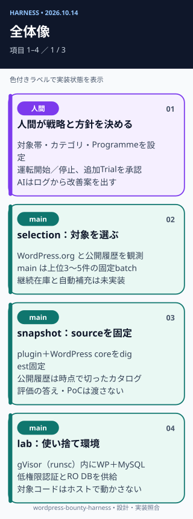

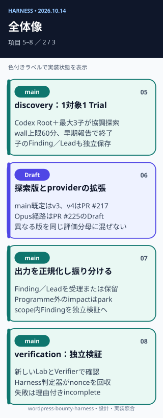

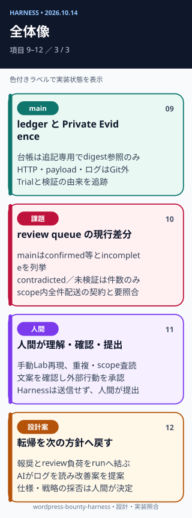

## 対象選定

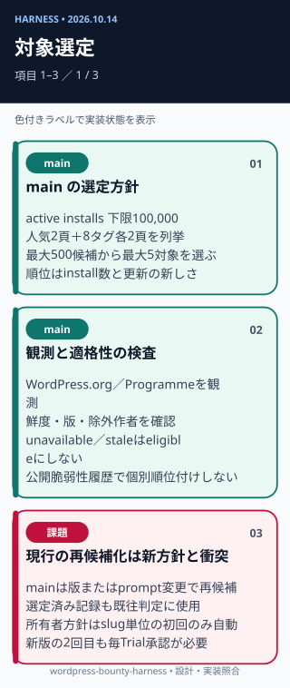

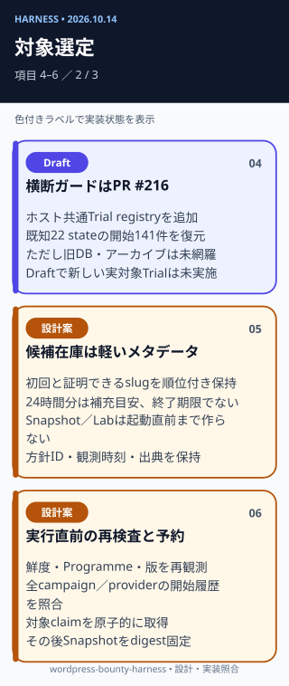

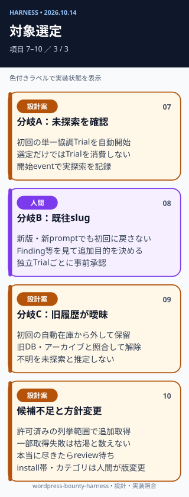

## 並列実行

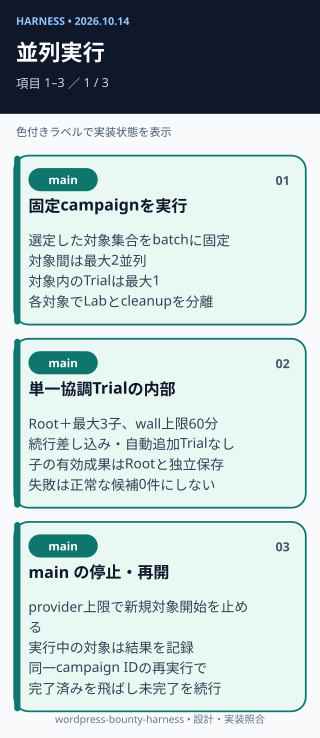

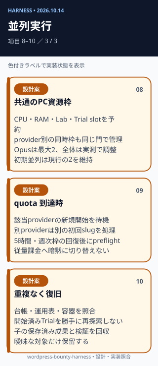

## 検証と判定

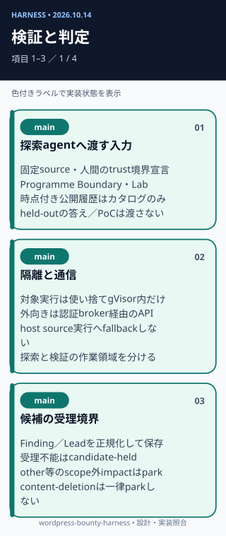

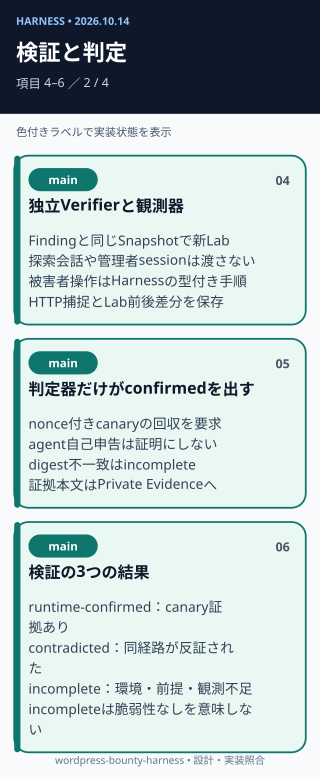

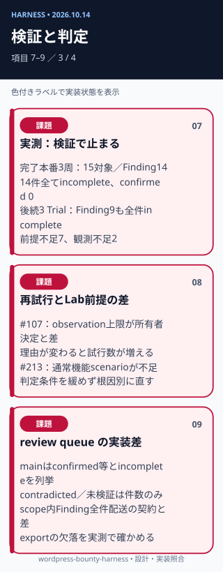

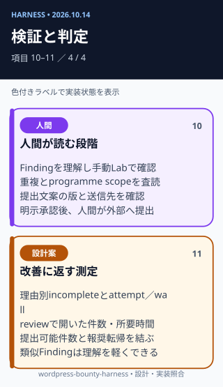

## 継続運転

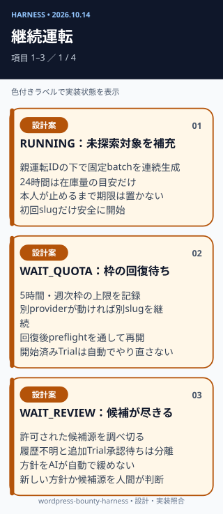

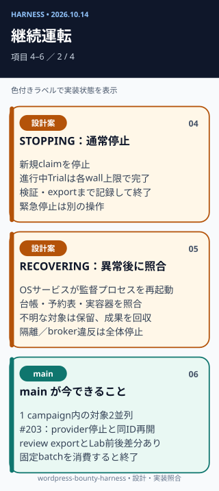

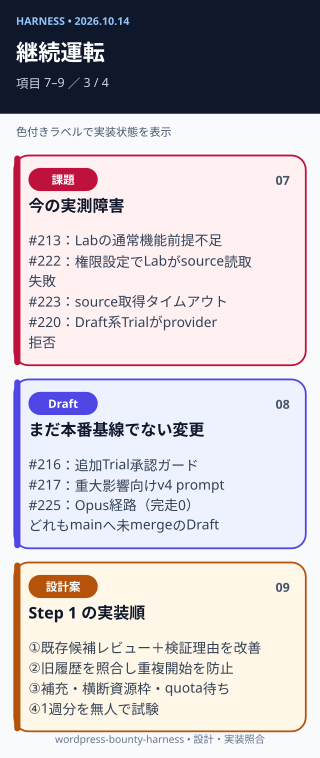

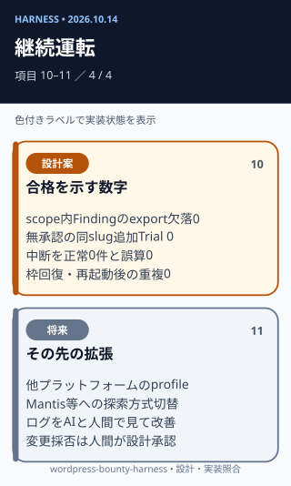

元の縦長版は同じディレクトリの `01-overview.svg` から `05-continuous.svg` に保存している。
