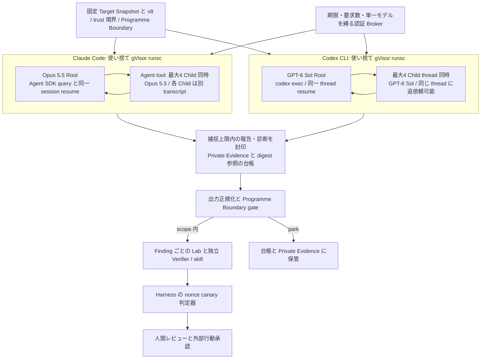
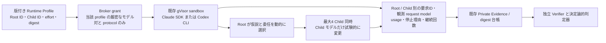

# Multi-Agent 探索アーキテクチャの監査と比較計画（2026-10-20）

本書は調査報告であり、設計の正本ではない。現時点の比較基準は **Root と同等モデルの Child、単一協調 Trial、v8 の動的委任**である。Claude Child の「約3分」は観測された中央値に近いが、固定の寿命制限ではない。Codex Child の同一スレッドへの追依頼は実記録で確認できた。モデルの軽量化や Claude Child の再開が未知の重大脆弱性の発見を増やす証拠はまだない。本書の改善順位は検証の順序案であり、設計の採否は別途判断する。[SPEC.md:5–9](../SPEC.md#L5)、[DEVELOPMENT.md:19–24](../DEVELOPMENT.md#L19)、[LESSONS.md:7–18](../LESSONS.md#L7)、[PARKING.md:24](../PARKING.md#L24)

判断対象は、未知の重大な Programme Boundary 内脆弱性を継続して発見し、人間の受理・報奨につなげられるかである。トークンや実装量は、その目的に影響するときだけ評価する。既知の再発見、source 根拠付き候補、独立判定器の確認、人間の受理を別の段階として数える。前の会話にある固定 Hunter、Task Queue、Argus の10動詞からの設計案は背景の仮説として扱い、現行の正本と v8 の実動を優先する。[SPEC.md:5–9](../SPEC.md#L5)、[ADR 0027:11–24](../adr/0027-contributor-out-of-scope-and-rediscovery-as-wiring-proof.md#L11)、[ADR 0034:11–15,35–37](../adr/0034-harness-control-only-deletions.md#L11)

## 1. As-Is アーキテクチャ図

現行 Trial は対象 Snapshot ごとに一つ、v8 の Root と最大4体の同時 Child、最低60分の能動探索と120分の wall 上限を持つ。Child 数は累積4体ではなく同時数である。両 runtime とも探索の分担は Root が選び、Harness は人数・時間・隔離・保存・正規化を扱う。[SPEC.md:78–96](../SPEC.md#L78)、[wp2shell-bounty-v8.md:7–27](../../src/profiles/wordpress/prompts/wp2shell-bounty-v8.md#L7)、[claude-runner.ts:17–53](../../src/discovery/claude-runner.ts#L17)、[codex-native-agent-runtime.ts:1967–1999](../../src/discovery/codex-native-agent-runtime.ts#L1967)、[ADR 0034:11–15,35–37](../adr/0034-harness-control-only-deletions.md#L11)

図の後段は探索から独立している。対象は `runsc` 内だけで動き、外向き通信は認証 Broker 経由の provider API に限定される。範囲外の Finding は出口で park し、判定は Snapshot digest 一致と Harness 所有の決定論的な nonce canary 観測に限る。未公開の候補・payload・HTTP 記録・認証情報を Git に置かない。[SPEC.md:12–20,78–96](../SPEC.md#L12)、[claude-gvisor-sandbox.ts:212–225,317–353](../../src/discovery/claude-gvisor-sandbox.ts#L212)、[codex-gvisor-sandbox.ts:759–773](../../src/discovery/codex-gvisor-sandbox.ts#L759)

## 2. 観測事実：実装、記録、公開仕様

### 実装と仕様

| 観測した事実 | 根拠と限界 |
| --- | --- |
| 指定された `src/discovery/claude-session.ts` は現 checkout に存在しない。Claude セッション処理は Runner と sandbox / runtime にある。 | [claude-runner.ts:100–144](../../src/discovery/claude-runner.ts#L100)、[claude-gvisor-sandbox.ts:305–369](../../src/discovery/claude-gvisor-sandbox.ts#L305)。ファイル検索 `rg --files src/discovery` で確認。 |
| Claude Root は `persistSession: true` と `resume: sessionId` で、最低時間まで同一セッションを繰り返す。Child start/stop hook は ID・種類・最終文・transcript path を記録する。Child ID を指定した再開処理は Runner にない。 | [claude-runner.ts:55–72,100–144](../../src/discovery/claude-runner.ts#L55)。Agent SDK / CLI は画像内で 0.3.296 / 2.1.296 に固定。[Claude Dockerfile:7–9](../../containers/development-set/claude/Dockerfile#L7) |
| Claude Child 専用の180秒 timeout も `maxTurns` も設定されていない。sandbox の timeout は Trial 全体にかかる。 | [claude-runner.ts:107–128](../../src/discovery/claude-runner.ts#L107)、[claude-gvisor-sandbox.ts:361–369](../../src/discovery/claude-gvisor-sandbox.ts#L361)。現行ソースでの否定的確認であり、CLI 内部の未文書化制限を証明するものではない。 |
| Claude の `completed` は、transcript が封印され、モデル一致と解析可能な Child 報告があれば成立する。Stop hook の記録は必須ではない。 | [claude-native-agent-runtime.ts:680–780](../../src/discovery/claude-native-agent-runtime.ts#L680)、[対応テスト:540–572](../../tests/discovery/claude-native-agent-runtime.test.ts#L540)。調査が論理的に完遂したという意味ではない。 |
| Codex Root は `codex exec resume` のたびに同じ thread ID を要求する。Child は独立の rollout / thread ID を持ち、同一 Child thread への追依頼を CLI が扱う。 | [minimum-active-runner.ts:25–85](../../src/discovery/minimum-active-runner.ts#L25)、[codex-native-agent-runtime.ts:1939–1999](../../src/discovery/codex-native-agent-runtime.ts#L1939)、[Codex 公式 Subagents](https://learn.chatgpt.com/docs/agent-configuration/subagents#orchestration-and-thread-controls)。 |
| Codex の停止をまたぐ segment 再開は Root thread を復元する。旧 Child の session file と封印 digest は持ち越すが、回収器は旧 Child ID を新規 run として数えない。旧 Child へ再依頼できるか・実際に起きたかは未確認。Claude runtime は現在 `run.resume` を受け付けない。 | [ADR 0036:22–32](../adr/0036-operator-resume-after-provider-refusal.md#L22)、[codex-native-agent-runtime.ts:1839–1861,1950–1961](../../src/discovery/codex-native-agent-runtime.ts#L1839)、[claude-native-agent-runtime.ts:333–355](../../src/discovery/claude-native-agent-runtime.ts#L333)。Trial 内の Child 追依頼と segment をまたぐ Root 再開を混同しない。 |
| Claude Agent SDK は general-purpose / custom Child の ID と同じ Root session を使う再開を説明する。Claude Code 公式は Child の独立 transcript と compaction を説明する。 | [Agent SDK: Resume subagents](https://code.claude.com/docs/en/agent-sdk/subagents#resume-subagents)、[Claude Code: Resume subagents](https://code.claude.com/docs/en/sub-agents#resume-subagents)。Explore / Plan built-in は one-shot。仕様上の可能性は現 Runner の採用実績と別である。 |

### 本番記録の読み取り専用集計

2026-10-20 の読取時点で、Git 外の `ledger.sqlite` の `discovery-run-started` / `discovery-run-finished` を `(campaignId, runId)` で結び、`configuration.promptVariant=wp2shell-bounty-v8`、明示 runtime、`runKind=child` の終了済み run を対象にした。Claude は終了済みの `opus-prod-20261019-{1..4}`、`opus-prod-20261020-{1,2}`、`prod-20261019-{8,9,10}`、Codex は進行中の `prod-20261020-3` を除く終了済み5 campaign（`prod-20261019-{8,9,10}`、`prod-20261020-{1,2}`）である。台帳の `wallTimeMs` は Child の**観測寿命**であり、開始・終了 `occurredAt` 差ではない。Claude では transcript の最初と最後の時刻、Codex では `session_meta` から最後の `task_complete` までを使う。後者には追依頼を待つ時間も入り得るため、能動探索時間と呼ばない。Child の種類・追依頼・再開・compaction は封印済み診断 JSONL を読み取り専用で型・ID・時刻のみ集計した。候補本文、攻撃経路、payload、HTTP 記録、認証情報は表示・転記していない。[ledger event schema:70–96,157](../../src/ledger/index.ts#L70)、[Child event 記録:80–136](../../src/discovery/recover-agent-reports.ts#L80)、[Claude の時刻:730–765](../../src/discovery/claude-native-agent-runtime.ts#L730)、[Codex の時刻:665–724](../../src/discovery/codex-native-agent-runtime.ts#L665)

| runtime / cohort | Child run | `completed` / その他 | 観測寿命 p10 / 中央値 / p90 | 再利用の実記録 |
| --- | ---: | ---: | ---: | --- |
| Claude Code / Opus 5.5 | 432 | 399 / 33 | 1.53 / 3.33 / 6.53分 | Child `agentId` の stop→start 再使用 0。Agent 呼出436回に明示的 resume 0。 |
| Codex / GPT-6 Sol | 151 | 147 / 4 | 4.82 / 53.94 / 58.14分 | 151 rollout 全てに同一 thread 内の複数 `task_started`。138件で `task_complete` 後に Root から同じ Child へ追依頼。 |

モデル名は宣言された runtime profile と Broker 許可の ID を表す。Codex CLI の応答モデル ID は JSON にないため、実応答の内部モデル版を断定しない。[agent-runtime-profile.ts:50–75,198–215](../../src/discovery/agent-runtime-profile.ts#L50)、[ADR 0007:6](../adr/0007-record-model-execution-fields-per-run.md#L6)

Claude は44件の Root 診断に Child start 432件、Stop 416件。Child type は全件 `general-purpose` で、245件は3分超、14件は10分超、3件は30分超、最長50.82分だった。Stop 欠落16件は全て失敗（provider refusal 12、rate limit 3、model 不許可1）で、`completed` 399件は全て Stop を持つ。Child ごとの観測はファイル一意数中央値6、tool call 中央値34だった。31/44 Root が Child を起動し、28/44 Root は累積4体超を起動した。[Claude hook:55–72](../../src/discovery/claude-runner.ts#L55)、[Claude Child receipt:680–779](../../src/discovery/claude-native-agent-runtime.ts#L680)

Codex の Root 診断37件では `spawn_agent` 163回、`followup_task` 2706回を観測し、追依頼のうち2505回は当該 Root が捕捉した Child の `agentPath` と一致した。Child 151件すべてで診断の `session_meta.id` と台帳の Child `runId`、`agent_path` と台帳の Child path が一致し、同一 thread の `task_started` は中央値19回（p10 4、p90 28、最大40）。138/151件では `task_complete` 後に Root から同じ path 宛の message があった。Child ごとの観測はファイル一意数中央値87、tool call 中央値229。**これらは同じ thread の継続を示すが、各追依頼が別の脆弱性仮説かは本文を分類していない。** 異なる対象、時期、runtime、Root の委任粒度、provider 状態を揃えた比較ではないので、寿命や読取数の差をモデル性能や発見率の因果効果と読まない。[Codex Child rollout の同定:641–725](../../src/discovery/codex-native-agent-runtime.ts#L641)、[Child 回収:1939–2075](../../src/discovery/codex-native-agent-runtime.ts#L1939)、[ledger event schema:70–96,157](../../src/ledger/index.ts#L70)

Codex の層化した Child 30件では、Root の初回 `spawn_agent` と Child path は30/30で一意に対応した。しかし封印済み rollout の初回委任文は暗号化された内容しかなく、現在の回収器と receipt も委任本文を保存しない。この30件について方式 A / B の実際の割合は**判定不能30件**である。追依頼回数は測れても、委任内容や仮説の独立性をその回数から推定しない。委任の実態まで将来測る必要があれば、判断コードにはせず、機密の扱いを保った Private Evidence の観測契約を別途検討する。[Codex Child rollout の回収項目:641–725](../../src/discovery/codex-native-agent-runtime.ts#L641)、[receipt schema:59–95](../../src/discovery/native-run-receipts.ts#L59)、[SPEC.md:12–20](../SPEC.md#L12)

同 cohort の Root は Claude 44件中 `completed` 23、provider rate limit 18、provider refusal 3。Codex 37件中 `completed` 29、cyber policy 5、Broker 要求上限1、provider limit 1、CLI exit 1だった。Child の終了分布も Claude は schema 17、refusal 12、rate limit 3、model 不許可1、Codex は schema 4である。停止事情の異なる集団を寿命だけで比べられない。[ledger event schema:70–96,157](../../src/ledger/index.ts#L70)、[Claude の failure 判定:744–752](../../src/discovery/claude-native-agent-runtime.ts#L744)、[Codex の failure 判定:2008–2042](../../src/discovery/codex-native-agent-runtime.ts#L2008)

Codex の上記「同一 Child 継続」は**一つの segment 内**で確認した。既存 segment の Child rollout は復元されるが、次 segment の回収器はその thread ID を既観測として除外する。旧 Child が次 segment でさらに働けるなら更新分の証拠回収が欠ける可能性があり、ここは再開機能の実機確認項目である。現時点で停止をまたぐ Child 継続の成功例として数えない。[ADR 0036:29–32](../adr/0036-operator-resume-after-provider-refusal.md#L29)、[codex-native-agent-runtime.ts:1839–1861,1950–1961](../../src/discovery/codex-native-agent-runtime.ts#L1839)

探索成果の基準値として、v8 の既知5対象はすべて Root / Child が Sol で、4 Trial が `completed`、1 Trial は schema error だった。TranslatePress では3件が後段の判定器で `runtime-confirmed` になったが、公開 CVE との厳密な同一性と未知の発見率は未評価である。過去の別 prompt の配線 Trial では、Root の wall 到達後にも Child 由来 Finding が判定器まで届いた。Child 自身の推論品質が成果に効く可能性がある。[v8 既知5対象:9–35](../evaluation/2026-10-19-v8-five-target-rediscovery.md#L9)、[配線 Trial:18–27](../evaluation/2026-10-16-wiring-gate-measurement.md#L18)

## 3. 原因分析：Claude の短命 Child と Codex の長命 Child

**「Claude は Child を約3分で終了させる」という制約は確認できず、実測でも否定される。** 3分超が245/432件、最長50.82分で、現 Runner の明示タイマーは Trial 全体に限る。公式 SDK の Child 制御は `maxTurns` や同時数などを説明し、同じ Child の再開も説明するが、固定3分を記載しない。[claude-runner.ts:107–144](../../src/discovery/claude-runner.ts#L107)、[claude-gvisor-sandbox.ts:361–369](../../src/discovery/claude-gvisor-sandbox.ts#L361)、[Agent SDK: AgentDefinition と再開](https://code.claude.com/docs/en/agent-sdk/subagents#agentdefinition-configuration)

より直接的な説明は **協調の使い方の差** である。Claude の現 Runner は Root に `Agent` を与え、Child が報告を返した後に Root が次の Child を起動する運用を観測した。既存 Child の ID を使う追依頼は記録されていない。Codex では Root が `followup_task` で既存 Child thread に反復して依頼し、同じ thread の文脈が残っていた。Claude 公式は `SendMessage` と SDK の `Agent` 再開の両経路を説明するが、現 Runner の許可ツールは `SendMessage` を含まない。**その不在だけを再開不能の根拠にはしない**。SDK の session ID と Child ID を利用できるかは、現行版・実機・Broker と併せて試す必要がある。[claude-runner.ts:17–19,45–72,100–144](../../src/discovery/claude-runner.ts#L17)、[Codex 公式: orchestration](https://learn.chatgpt.com/docs/agent-configuration/subagents#orchestration-and-thread-controls)、[Claude Agent SDK: 再開](https://code.claude.com/docs/en/agent-sdk/subagents#resume-subagents)

Claude Child が「調査を完了して返した」か「途中で Root に返した」かは、現在の `completed` 数だけでは答えられない。Stop のない16件は失敗と特定できたが、Stop がある399件でも報告が形式的に成立したという意味で、source の攻撃経路を十分追ったとの判定ではない。各 Child の最後の調査・報告・Root の次の依頼を、Private Evidence 内で同じ ID ごとに読む必要がある。Codex の長い Child も一つの連続作業とは限らず、複数の turn を同じスレッドに積み重ねた wall である。[claude-native-agent-runtime.ts:737–765](../../src/discovery/claude-native-agent-runtime.ts#L737)、[codex-native-agent-runtime.ts:2044–2069](../../src/discovery/codex-native-agent-runtime.ts#L2044)

補助監査として、Claude `completed` 399件から9 campaign を層化し、Child ID の SHA256 順で30件を抽出した。30件全ての正規化報告で `unexamined` は非空、11件に Lead、1件に Finding があり、26件では Stop 後に Root が別 Agent を起動していた。初回委任文は Root 側と Child 側で30/30一致したが、機密本文を出力せずに型・IDだけを集計したため、方式 A / B の意味分類は**判定不能30件**である。`unexamined` は割り当てられた問いの未完了とは限らず、後続 Child が同じ仮説を継いだかも判定できない。保守的な分類は「割当調査の完遂を確認0、同じ割当の途中返却を確認0、判定不能30」である。安全な場所で委任・報告本文を意味判定する追加監査まで、短命化による失敗率や A / B 比率を推定しない。[Child report schema:64–90](../../src/discovery/codex-native-agent-runtime.ts#L64)、[Claude Child report 回収:737–765](../../src/discovery/claude-native-agent-runtime.ts#L737)、[Claude hook:55–72](../../src/discovery/claude-runner.ts#L55)

短命 Child は独立仮説と新鮮な文脈に向き、長命 Child は WordPress / PHP / 依存プラグインをまたぐ経路の追跡に向く、というのは**検証すべき仮説**である。長い履歴は圧縮や同一路線への固着で重要な前提を落とし得る。実際、Codex Child 151件中122件に `compacted` があり、合計269イベントだった。Claude Child 432件の診断には compact / summary 型イベントは0件だった。これは圧縮が起きた証拠であって品質低下の証拠ではない。圧縮前後の新規経路と Finding の根拠品質を測る。Claude Child の transcript は Root と独立して残り、Child 自身の圧縮イベントを記録できる。[Claude Code: transcript と compaction](https://code.claude.com/docs/en/sub-agents#auto-compaction)、[Codex rollout の保存:1939–1999](../../src/discovery/codex-native-agent-runtime.ts#L1939)、[Cloudflare の長文脈上の経験](https://blog.cloudflare.com/build-your-own-vulnerability-harness/)、[LESSONS.md:7](../LESSONS.md#L7)

現時点では短命・長命のどちらが重大脆弱性に有利か決められない。Claude の Child を機械的に長くする案も、Codex の Child を機械的に短くする案も採用せず、Child の追依頼前後で新しい source-grounded 経路が生まれたかを評価する。[v8:15–25](../../src/profiles/wordpress/prompts/wp2shell-bounty-v8.md#L15)、[LESSONS.md:7,18](../LESSONS.md#L7)

## 4. モデル性能評価と探索方針の分担

### Root / Child の5構成

| 構成 | 現時点の判断 | 知りたい差と主な危険 |
| --- | --- | --- |
| Claude A: Opus 5.5 / Opus 5.5 | 現行の基準。維持する。 | 長い Child を許すだけで成果が増えるとは限らない。現状の短い wave と後段の確認実績を基準化する。 |
| Claude B: Opus 5.5 / Sonnet 5.5 | Step 1 後の有力な比較候補。 | 子が独立仮説・WordPress 依存経路・反証を担う場合の見落としを測る。Claude profile と Broker は現状この組合せを拒否する。 |
| Claude C: Opus 5.5 / Haiku 5.5 | 優先度を下げる。狭い source 確認で B が同等なら検討。 | Child の単独発見や複合 chain が失われる危険が高い。Haiku を固定の分類担当にしない。 |
| Codex A: GPT-6 Sol / GPT-6 Sol | 現行の基準。維持する。 | 長い Child thread が本当に新しい経路を追加したか、追依頼後の寄与を測る。 |
| Codex B: GPT-6 Sol / GPT-6 Luna | Step 1 後、混在の実機 preflight を通せば最初のモデル単独比較に適する。 | 子だけ Luna にして source 根拠・厳密な chain・独立確認が落ちないかを測る。Daybreak Blue と CLI の許可も確認する。 |

これは速度・価格の順位表ではない。現行 profile は Claude Root / Child を Opus に固定し、Codex は協調 admission で Sol と Root / Child のモデル・effort 一致を要求する。[agent-runtime-profile.ts:50–75,198–215](../../src/discovery/agent-runtime-profile.ts#L50)。OpenAI と Anthropic のモデル選定資料は、Luna / Haiku を範囲の明確な作業、Sol / Opus を複雑な推論の出発点とするが、未知の WordPress 脆弱性の Recall は測っていない。[OpenAI model selection](https://developers.openai.com/api/docs/guides/model-selection)、[Anthropic model choice](https://platform.claude.com/docs/en/about-claude/models/choosing-a-model)

Codex は現在サブスクリプション認証なので、Luna Child への変更をそのまま API 料金削減と換算しない。比較するのは provider quota 下で完走する対象数と、対象当たりの有効な成果である。混在により Root と Child の誤りが分散する可能性はあるが、全 Child を軽量化すれば Child 側の独立発見を同時に失う可能性もある。異なる source-grounded 経路の和集合と重複、判定器の結果で確かめる。[SPEC.md:265–276](../SPEC.md#L265)、[Cloudflare の異モデル観測](https://blog.cloudflare.com/build-your-own-vulnerability-harness/)、[v8:7–21](../../src/profiles/wordpress/prompts/wp2shell-bounty-v8.md#L7)

Root が強くても Child の能力は不要にならない。v8 は Child に独立した着眼点と経路の反証を期待し、Child の有効な Finding / Lead は Root の最終報告と独立に保存する。新しい仮説を作る、別コンポーネントへ因果をつなぐ、既存仮説を壊す仕事は高い能力を要する可能性がある。限定されたコード経路の事実確認は軽量モデルでも成り立つ可能性がある。ただし「軽量モデルに限定確認だけを割り当てる」自動 dispatch は作らず、Root がその都度決める。[wp2shell-bounty-v8.md:7–25](../../src/profiles/wordpress/prompts/wp2shell-bounty-v8.md#L7)、[ADR 0029:12,37](../adr/0029-single-wp2shell-cooperative-trial.md#L12)、[ADR 0034:11–15](../adr/0034-harness-control-only-deletions.md#L11)

軽量 Child の想定上の取りこぼしは次のとおりで、**現行モデルの実測差ではない**。ここを source-grounded Finding と独立判定で比べる。[SPEC.md:62–73](../SPEC.md#L62)、[v8:3,23–25](../../src/profiles/wordpress/prompts/wp2shell-bounty-v8.md#L3)

| 重大経路 | 失いやすいかもしれない推論上のつながり |
| --- | --- |
| SQLi | 非同期 / 動的な入力変換、認可境界、クエリ組立て、実際に到達する DB sink の連鎖。 |
| Stored XSS | 保存時の変換と、別ロールの後続表示 context・発火条件をまたぐ連鎖。 |
| ATO | token の発行・照合・期限・対象ユーザーと、低権限または未認証の到達条件。 |
| RCE | upload / write / include などの複数段と、通常設定で実行に達する前提。 |
| 複合 chain | 単独では範囲外に見える一段から、範囲内の最終効果へつなぐ必要条件。 |

公開資料の外挿範囲は狭い。Anthropic の旧 Opus 4.5 System Card の**難しい情報検索**では、Opus Root + Opus Child 92.3%、同 Root + Haiku Child 87.0%、同 Root + Sonnet Child 85.4%、Opus 単独74.8%だった。弱い Child でも並列性が効く一方、同じ Root で Child の差も残る例であり、5.5 や脆弱性探索の値ではない。[Opus 4.5 System Card, §2.7, pp.23–25](https://assets.anthropic.com/m/64823ba7485345a7/Claude-Opus-4-5-System-Card.pdf#page=24)。Anthropic の別の旧モデル・欠陥探索評価は、14の公開 Python package・約2160万 token に130件の欠陥を植え込んだ内部試験で、安い worker への委任が時間と費用を下げた一方、スコアは10～12ポイント低下した。植え込み欠陥の結果は未知の WordPress 脆弱性の Recall ではない。課題とモデルが違うため、この二つの効果量を合算しない。[Anthropic cost / intelligence, 脚注8](https://platform.claude.com/docs/en/about-claude/models/optimizing-for-cost-and-intelligence#orchestrator-strategy-delegate-bulk-work)

Anthropic Research の Opus 4 lead + Sonnet 4 Child は単独 Opus 4 を内部 web 調査で上回ったが、Opus Child との直接比較でもセキュリティ評価でもない。Cloudflare は異なるモデルが異なるバグ集合を見つけると報告するが、Root / Child の性能配分は測っていない。Wordfence は複数 provider を使う研究・triage を紹介するが、自己申告の AI 利用率を発見率に読み替えられない。混在による多様性は可能性であり、同一 Snapshot の対照実験で確かめる。[Anthropic Research](https://www.anthropic.com/engineering/multi-agent-research-system)、[Cloudflare](https://blog.cloudflare.com/build-your-own-vulnerability-harness/)、[Wordfence](https://www.wordfence.com/blog/2026/04/the-increasing-role-of-ai-in-vulnerability-research/)

前の会話の数値も一次資料で確認した。OpenAI の SEC-Bench Pro は GPT-6 Sol 66.3%、Luna 34.2%で、2026年5月版の V8 / SpiderMonkey の**既知の検証済み脆弱性183件**を使い、独自の root-cause 判定を行う単体モデル評価である。Child を Luna にした場合の WordPress / PHP の未知脆弱性発見率へ32.1ポイント差を換算できないが、Codex B の Recall 低下を警戒する関連証拠にはなる。[GPT-6 Astra System Card, §10.1.2, §11.8.1.2.2](https://deploymentsafety.openai.com/gpt-6-astra)。Anthropic は Haiku 5.5 を coding と明確に定義された作業の subagent として説明する。これも複合的な脆弱性仮説の生成力を保証しない。[Anthropic Haiku 5.5](https://www.anthropic.com/claude/haiku)

### Root と Child の仮説分担

| 方式 | 効果を期待する状況 | 失敗し得る点 | この Harness との関係 |
| --- | --- | --- | --- |
| A 仮説委任 | Root が特定の経路を見つけ、Child に反証や不足箇所の追跡を頼む。 | Root の初期仮説に探索が集中し、Child の独立発見を失う。 | 個別の手として利用可能。 |
| B 探索領域分担 | 別の攻撃面やコンポーネントを Child が読み、各自が仮説を立てる。 | 領域の境界で chain が切れ、引き継ぎが足りない。 | 個別の手として利用可能。固定の SQLi / XSS 担当を常設しない。 |
| C 動的ハイブリッド | 独立探索、仮説検証、対抗監査を Root が結果に応じて切り替える。 | Root の統合不足や重複した探索を観測する必要がある。 | **v8 が既に要求している動き**。今回同じ指示を追加しない。 |

v8 は多様な方法の開始、approach family の登録、重複時の再配分、行き詰まりの印付け、独立経路、対抗監査、複数ラウンドを明記する。したがって C を「新方式」として Harness に実装したり、prompt に重複追加したりする提案はしない。実記録で Root / Child の仮説生成、Child 間の重複、再配分後の新規経路を人が分類し、文面と実際の乖離を先に測る。[wp2shell-bounty-v8.md:7–25](../../src/profiles/wordpress/prompts/wp2shell-bounty-v8.md#L7)、[ADR 0034:11–15,35–37](../adr/0034-harness-control-only-deletions.md#L11)

## 5. To-Be アーキテクチャ図（将来、モデル混在に効果が出た場合のみ）

直ちに移行する To-Be はない。Step 1 の間は As-Is のまま運転する。次図は、モデル単独比較が効果を示した場合の**最小変更境界**であり、新 Orchestrator や探索 dispatch を含まない。[DEVELOPMENT.md:19–24,63](../DEVELOPMENT.md#L19)、[LESSONS.md:18](../LESSONS.md#L18)

現 profile は Root と Child の ID 欄を持ち、正規 JSON digest を検証するが、Claude は Opus literal、Codex の協調 admission は Sol と同一モデル・effort を要求する。変更時は許可された対を版と digest に固定し、既存 Trial の resume に別 profile を混ぜない。Codex CLI JSON は応答モデル ID を返さないため、要求 ID と観測できる rollout / Broker request model を記録し、応答側が不明なら `unavailable` とする。usage も provider が返さない項目を埋めない。[agent-runtime-profile.ts:18–36,50–75,89–117,136–168,198–215](../../src/discovery/agent-runtime-profile.ts#L18)、[ADR 0007:6](../adr/0007-record-model-execution-fields-per-run.md#L6)、[ADR 0036:20–32](../adr/0036-operator-resume-after-provider-refusal.md#L20)

profile は既存の `requestedModelId` / `subagent.modelId` を使えるため、新しい探索 Orchestrator 型は不要である。Claude のモデル型と Codex 協調 admission を厳密な許可対へ広げ、profile digest を再計算する。Broker grant は現在 schema v1 の単数 `model` なので、モデル対を認可する契約に変える際は版を進め、既存の単数 grant / receipt を履歴として読めるまま残す。run receipt には要求 ID と Child ID、取得できた usage が既にあり、混在実験ではその実測値を Root / Child 別・モデル別に集計する。[agent-runtime-profile.ts:18–36,50–75,136–168](../../src/discovery/agent-runtime-profile.ts#L18)、[provider-credential-egress-broker.ts:60–80](../../src/discovery/provider-credential-egress-broker.ts#L60)、[native-run-receipts.ts:59–75,225–281](../../src/discovery/native-run-receipts.ts#L59)

Broker は現在 `PROVIDER_MODEL` が一つで、request の `model` がそれと違えば403にする。Claude credential は Opus / Messages に結び付く。混在を試すなら、**profile digest に結び付いた厳密な2モデル**だけを grant で許可し、要求ごとの model ID・usage・拒否理由を残す。無制限の model allowlist や別の外向き通信路は認めない。[provider-credential-egress-broker.ts:42–80,446–459,693–703](../../src/discovery/provider-credential-egress-broker.ts#L42)、[provider-credential-proxy.ts:357–365,469–475](../../src/discovery/provider-credential-proxy.ts#L357)、[ADR 0009:6](../adr/0009-route-provider-credentials-through-bounded-egress-broker.md#L6)

Claude では現 sandbox が `ANTHROPIC_MODEL`、Haiku 系 fallback、`CLAUDE_CODE_SUBAGENT_MODEL` を同一 ID にしている。公式の Child model 優先順位は per-invocation、定義、環境変数、親であり、環境変数だけで全 Child を保証できない。現行 CLI 版で使える `CLAUDE_CODE_SUBAGENT_MODEL_FORCE=1` は general-purpose Child を指定モデルに固定する候補だが、fork 等の例外があるため実機で確かめる。実記録の Agent 呼出436回中2回に明示的な model 指定があり、Child の `model-not-admitted` も1件ある。ただし、その指定が拒否の原因とは照合できていない。現 Claude 回収器は Child transcript に model 観測が0件でも不一致とは判定しない。混在時は各 Child の model 観測を必須にし、全 turn を宣言値と照合する。Codex では CLI に `agents.default_subagent_model` の設定口があるが、明示 spawn の上書きもある。**現 Codex 回収器は各 `turn_context` の model / effort / access を最後の値で上書きし、その値だけを照合するため、混在時は全 turn・provider request の model を記録して検査する必要がある。** Root の要求 model も Broker request と照合する。[claude-gvisor-sandbox.ts:317–359](../../src/discovery/claude-gvisor-sandbox.ts#L317)、[claude-native-agent-runtime.ts:720–752](../../src/discovery/claude-native-agent-runtime.ts#L720)、[Claude Code model priority / force](https://code.claude.com/docs/en/sub-agents#run-every-subagent-on-one-model)、[Codex subagent settings](https://learn.chatgpt.com/docs/agent-configuration/subagents#global-settings)、[codex-native-agent-runtime.ts:682–686,2013–2021](../../src/discovery/codex-native-agent-runtime.ts#L682)

回帰確認は、許可外モデル・effort・protocol・fallback の遮断、要求 ID・観測できる request / rollout model・usage の Root / Child 別記録、子数・時間、Snapshot の read-only mount と digest、`runsc`、Broker の認証情報非露出、Finding と判定結果の digest 一致、独立 Verifier と canary 判定を対象にする。応答モデルや usage が観測できなければ `unavailable` と記す。transcript / rollout の捕捉上限を超えた場合は証拠不足の `incomplete` にする。モデル差を測るために、これらの安全境界は変えない。[SPEC.md:12–20](../SPEC.md#L12)、[ADR 0007:6](../adr/0007-record-model-execution-fields-per-run.md#L6)、[claude-gvisor-sandbox.ts:41–43,121–153,212–225](../../src/discovery/claude-gvisor-sandbox.ts#L41)、[codex-gvisor-sandbox.ts:68–71,199–285](../../src/discovery/codex-gvisor-sandbox.ts#L68)

## 6. 改善候補の優先順位

| 優先 | 候補と条件 | 期待する効果 | 主なリスク・変更範囲 |
| --- | --- | --- | --- |
| 0 | **現行構成の継続と読み取り専用監査**。観測できる Child の追依頼、compaction、後段の確認を集計し、平文を安全に読める範囲で委任種類・独立仮説・重複・最終報告を人が分類する。 | v8 の動的分担と短命 Child の引き継ぎを確かめる。 | Codex 初回委任文は現記録では暗号化され判定不能。Private Evidence の機密を Git に出さず、欠測を明示する。Harness の探索判断コードは不要。[v8:7–25](../../src/profiles/wordpress/prompts/wp2shell-bounty-v8.md#L7)、[Codex 回収項目:641–725](../../src/discovery/codex-native-agent-runtime.ts#L641)、[SPEC.md:12–20](../SPEC.md#L12) |
| 1 | Step 1 後、**Codex A 対 B**を子モデルだけ変えて試す。profile / Broker / CLI / receipt の preflight が前提。 | 子の発見品質を保ったまま provider 制限を減らし、対象当たりの確認済み成果を増やせるか分かる。 | Sol Child が担っていた独立仮説・chain を Luna が見落とす可能性。認証と model 境界の修正は慎重に行う。[profile:198–215](../../src/discovery/agent-runtime-profile.ts#L198)、[OpenAI model selection](https://developers.openai.com/api/docs/guides/model-selection) |
| 2 | 同じく **Claude A 対 B**。Codex 比較とは別の問いにする。 | Opus Root / Sonnet Child が候補品質を保つか測れる。 | Broker と SDK Child 設定の追加検証が必要。旧モデルの他課題の数値を流用しない。[profile:50–75](../../src/discovery/agent-runtime-profile.ts#L50)、[Anthropic cost / intelligence](https://platform.claude.com/docs/en/about-claude/models/optimizing-for-cost-and-intelligence#orchestrator-strategy-delegate-bulk-work) |
| 3 | Claude の**同一 Child 再開**を別実験で試す。現行 Child の未完了な chain と引き継ぎ損失が実証された場合だけ。 | 長い WordPress / PHP / 依存プラグイン chain の追跡を継続できる可能性。 | compaction と同一路線への固着、別 agent の独立性喪失。Agent ID / session の寿命を実機確認し、v8 の委任判断は Root に残す。[Agent SDK resume](https://code.claude.com/docs/en/agent-sdk/subagents#resume-subagents)、[claude-runner.ts:100–144](../../src/discovery/claude-runner.ts#L100) |
| 4 | Claude C（Haiku Child）と委任文の改訂は、上記で明確な不足が出た後に個別に検討。 | 特定の限定作業には有効かもしれない。 | Child の自発的な新規経路と重大 chain の Recall を落とすおそれ。prompt を変えるなら新しい版・digest・出典対照と開発 Trial が必要。[DEVELOPMENT.md:51–56](../DEVELOPMENT.md#L51)、[ADR 0029:37](../adr/0029-single-wp2shell-cooperative-trial.md#L37) |

この順序は、Step 1 のレビュー batch と本番周回を妨げず、過去に失敗した入口索引、task-plan / dispatch、coverage 判定、固定クラス担当を復活させない。[DEVELOPMENT.md:19–30](../DEVELOPMENT.md#L19)、[PARKING.md:24](../PARKING.md#L24)、[ADR 0034:11–15,23–37](../adr/0034-harness-control-only-deletions.md#L11)

## 7. 比較実験計画：構成、指標、採用・撤回条件

**段階0：現行 v8 を観測する。** まず同一 Child の再利用回数、起動数、観測寿命と `task_started`→`task_complete` 区間（待機が混じり得る turn 時間）、Root・Child 別 model ID と usage、compaction、provider 停止理由を再集計する。平文を安全に読める場合だけ、Child の最終報告を「経路が完結」「具体的な未解決条件を Root に返した」「探索途中で切れた」に人が分類し、重複した経路を source の起点・sink・前提で束ねる。委任文も、具体的経路を渡す A、攻撃面から Child に仮説を立てさせる B、同じ Trial で切り替える C に分類する。現保存形式の Codex 初回委任文は暗号化されているため、分類不能として欠測を報告する。公開レポートには集計値と方法だけを書き、本文や秘密情報は Private Evidence に残す。観測したファイル読取数を理解度や coverage と呼ばない。[claude-native-agent-runtime.ts:730–769](../../src/discovery/claude-native-agent-runtime.ts#L730)、[codex-native-agent-runtime.ts:641–725,2044–2069](../../src/discovery/codex-native-agent-runtime.ts#L641)、[ADR 0034:11–15](../adr/0034-harness-control-only-deletions.md#L11)

**段階1：実機 preflight。** `gpt-6-luna` と Daybreak Blue の併用、Claude Sonnet 5.5 の OAuth / Messages 許可、CLI / SDK の Child model 選択と上書き、Broker のモデル対制限を、固定の無害な開発 Snapshot で確認する。拒否時は新しい Trial に自動 fallback せず `incomplete` とし、Root と全 Child の**全 turn / provider request** で観測できる model が宣言した profile と一致したときだけ比較に入れる。応答モデル ID が得られない場合はその限界を明示する。配線変更の PR を将来作るなら、異なる slug の初回3 Trial の completed、wall、停止理由という既存ゲートを満たす。[DEVELOPMENT.md:51](../DEVELOPMENT.md#L51)、[ADR 0007:6](../adr/0007-record-model-execution-fields-per-run.md#L6)、[agent-runtime-profile.ts:89–117,198–215](../../src/discovery/agent-runtime-profile.ts#L89)、[codex-native-agent-runtime.ts:682–686](../../src/discovery/codex-native-agent-runtime.ts#L682)、[provider-credential-proxy.ts:357–365](../../src/discovery/provider-credential-proxy.ts#L357)

**段階2：開発対象で一軸比較。** Codex A/B を先に、Claude A/B は別に測る。各 pair は**同じ runtime / Broker build**、同じ対象 Snapshot、WordPress / PHP / 依存 source、v8 digest、trust 境界、Programme Boundary、Lab の有無、Root model / effort、Child effort、最大4同時、60分下限 / 120分上限、Broker 条件、検証器を揃え、profile の **Child model だけ**を変える。既知公開事例は held-out 公開日以降の情報・PoC・解答を探索へ入れない。少なくとも異なる3 slug の初回 Trial は配線確認であり、優劣を統計的に決める標本数ではない。同じ slug・版で独立 Trial を反復して paired 比較するときは、各2回目以降について ADR 0032 が求める所有者の事前承認を得る。run 順を釣り合わせ、試行ごとの `incomplete` を別に扱う。[SPEC.md:12–20](../SPEC.md#L12)、[DEVELOPMENT.md:51](../DEVELOPMENT.md#L51)、[ADR 0032:31,152](../adr/0032-owner-decisions-on-constraints-2026-10-13.md#L31)、[ADR 0027:11–24](../adr/0027-contributor-out-of-scope-and-rediscovery-as-wiring-proof.md#L11)

**段階3：未知対象で前向き追跡。** 一つの本番対象に新規 Trial を重ねず、同時期の対象を版・規模・依存数・選定層で分け、その層の中で乱数により構成を割り付ける。割付は別 campaign 設定とオフラインの層化記録で行い、Harness に比較 arm mode・assignment・dispatch を戻さない。公開済み7件の再発見率は配線の補助指標に限定する。未知脆弱性の真の Recall は全バグ集合が不明なので測れない。実運用では、対象当たりの独立確認済みの重大経路、最終受理と報奨、試行終了後の追跡期間、provider 上限下で完走できた対象数を主指標とする。[SPEC.md:5–9,23–25](../SPEC.md#L5)、[ADR 0027:11–24](../adr/0027-contributor-out-of-scope-and-rediscovery-as-wiring-proof.md#L11)、[ADR 0034:61–69](../adr/0034-harness-control-only-deletions.md#L61)、[Cloudflare: false-negative の限界](https://blog.cloudflare.com/build-your-own-vulnerability-harness/)

共通の記録表は次を使う。raw Finding の増加だけで採用しない。[SPEC.md:62–73](../SPEC.md#L62)、[v8 評価:24–35](../evaluation/2026-10-19-v8-five-target-rediscovery.md#L24)

| 段階 | 指標と読み方 |
| --- | --- |
| 探索 | 範囲内で source に起点・境界・sink・到達前提の根拠がある独立 Finding 数と人手による品質、Child 独自の新規経路、Root / Child 間と Child 間の重複。 |
| 既知評価 | 公開事例との経路一致を人が確認した再発見率。候補の存在だけを一致にしない。未知発見率の代理にしない。 |
| 検証・最終 | 独立 Verifier の `runtime-confirmed` / `incomplete` / `contradicted`、人間レビューでの受理、提出後の採否・報奨。判定器と Snapshot digest の規則は固定。 |
| 運転 | Child の一意 ID 数、実動時間、同 ID の追依頼回数、compaction 回数、モデル別 usage、provider 制限・拒否・schema / evidence / wall 停止理由。`incomplete` を正常な候補0件に混ぜない。 |

**採用条件**は、配線と安全境界の preflight に合格したうえで、対応する対象で重大経路の source 根拠・既知再発見・独立 `runtime-confirmed` の低下が観測されず、前向き本番で対象当たりの受理・報奨、または quota 内の独立確認済み重大経路が改善することである。非劣性の許容幅と追跡期間は段階0で測る基準構成の run 間変動を見て、比較開始前に固定する。差の区間推定がその幅内と判定できるまで「同等」としない。単回の既知事例や候補数だけでは採らない。**撤回条件**は、基準構成が繰り返し見つける重大経路を試験構成が見落とす、Child 由来の有効な chain が明らかに減る、`incomplete` や provider 停止が増える、または Broker / gVisor / Snapshot / 判定境界を守れないこと。差が曖昧なら現行を維持し、対象数と追跡期間を増やして再評価する。[SPEC.md:12–20](../SPEC.md#L12)、[DEVELOPMENT.md:51–63](../DEVELOPMENT.md#L51)、[LESSONS.md:13–18](../LESSONS.md#L13)

探索方針 A/B/C と Child 寿命はモデル比較へ混ぜない。段階0で C の実践不足が確認された場合だけ、Step 1 後に Root が選ぶ委任文の差を別の一軸実験として提案する。v8 本文を変えるなら旧版と digest を残し、出典対照、`owner-approved` の委任手続き、開発 Trial の数字を満たす。[wp2shell-bounty-v8.md:7–27](../../src/profiles/wordpress/prompts/wp2shell-bounty-v8.md#L7)、[DEVELOPMENT.md:51–56](../DEVELOPMENT.md#L51)、[ADR 0032 の委任改訂](../adr/0032-owner-decisions-on-constraints-2026-10-13.md)
