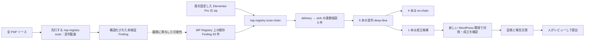

# Austin Ginder の「徹底探索」を一次資料から再構成する（2026-10-24）

## 問いと資料の範囲

問いは「少数の対象をどう選ぶか」ではなく、**一つのプラグインをどう深く調べたか**である。主資料は Austin Ginder 本人の [2026-07-07 の基盤パイプライン記事][austin-july] と [2026-08-21 の連鎖探索事例記事][austin]。発見された欠陥の構造は [Patchstack の技術解説][patchstack] と [Wordfence の公表][wordfence] で照合した。Austin が着想を得た [Searchlight Cyber の wp2shell 探索記録][searchlight] は、**Austin 自身のスキルの仕様ではない**ものとして区別する。

この文書の「事実」は上記資料が明記すること、「推論」は資料を組み合わせて得た設計上の読み、「未公開」は本文やリンクから確認できないことを指す。脆弱性の成立条件や検証結果を探索エージェントへ事前に渡すための文書ではない。

## 先に結論

**事実:** Austin は以前から別の `/wp-registry-scan` で対象の全 PHP ファイルを子エージェントに読み分けさせ、構造化された未検証 Finding を生成していた。8 月記事によると、Elementor Pro には WP Registry 上に 93 件の Finding がすでにあった。`/wp-registry-scan-chain` は、この既存の Finding から攻撃者が届く *delivery primitive* と危険な *sink* の組を作り、複数の子エージェントがそれぞれ連鎖の成立・不成立を調べる**別のスキル**である。この例では 5 つの連鎖仮説を並行実行し、4 つを捨て、1 つを残し、本人が求めたクリーンな WordPress 環境で確認した。[Austin の7月記事][austin-july]、[Austin の8月記事][austin]

**推論:** 深掘り段階の核は「全ファイルを最初から均等に読み直すこと」ではなく、**先行する監査の観測を、到達経路と最終影響の連鎖として再解釈し、仮説ごとに反証まで行うこと**にある。93 件の各 Finding と先行する `/wp-registry-scan` の実行記録との対応は未公開なので、すべてがそのコマンドの出力とは断定しない。5 仮説は一例の実行数であり、全経路を網羅したという証拠ではない。[Austin の7月記事][austin-july]、[Austin の8月記事][austin]

## 公開された探索の流れ

図の上流の `/wp-registry-scan` は 7 月記事、その下流の `/wp-registry-scan-chain`、5 本の並列作業、4 本の棄却、クリーン環境での再現、人による提出は 8 月記事の明示事項である。両記事は 93 件の出所を一件ずつ結び付けていないため、その線は推論として点線にした。**2 時間弱のセッションは既存 93 件の Finding がある状態から始まっており、対象をゼロから読み切った所要時間ではない。** `delivery → sink` を一つの仮説単位として置く図示は記事の記述を整理したもので、スキルの内部データ構造を表すものではない。[Austin の7月記事][austin-july]、[Austin の8月記事][austin]

| 段階 | 明示された作業 | 徹底探索上の意味と限界 |
| --- | --- | --- |
| 先行する全面監査 | 別コマンド `/wp-registry-scan` は並列の子エージェントで全 PHP ファイルを読み、構造化された未検証 Finding を生成した。[Austin の7月記事][austin-july] | これが 8 月の連鎖探索に先立つ候補蓄積。7 月記事は同一ビルドのハッシュ単位で一度監査する運用も説明する。Elementor Pro 4.2.0 の 93 件が具体的にいつ・何回の走査で生成されたかは未公開。 |
| 起点 | ユーザーが `/wp-registry-scan-chain /Users/austin/Downloads/elementor-pro-4.2.0.zip` を起動。既存 Registry にこの slug の Finding 93 件。[Austin の8月記事][austin] | 固定されたソースと過去の観測を同じ調査に投入。93 件の内訳、確度、重複、どこまで読まれたかは未公開。 |
| 仮説生成 | スキルが delivery と sink を組み、単独の sink の再監査ではない仮説を作る。[Austin の8月記事][austin] | 危険関数だけの検索で終わらず、「低権限の入力がここに届くか」を問う。組み合わせ生成規則やランキングは未公開。 |
| 並行深掘り | 5 本の chain deep-dive を並行実行し、4 本は不成立、1 本を残した。[Austin の8月記事][austin] | 重要なのは候補ごとに *prove or kill* すること。ただし「不成立」とするための証拠様式、子のモデル、各子の時間・ツール制限は未公開。 |
| 人の方向づけ | Austin はクリーンな SandyWP で実際に匿名利用者から成立するかを確認するよう明示した。[Austin の8月記事][austin] | エージェントのコードパスの自己申告を、そのまま最終結論にしなかった。スキルが初めから検証を必須にしていたか、本人の追加指示で初めて行ったかは不明。 |
| 再現 | 新しい WordPress に無料 Elementor と Pro を入れ、対照実行と攻撃実行でエンドツーエンド確認したと記述。[Austin の8月記事][austin] | 前提の作れる環境で実証した。ただし一つの脆弱性の確認であり、全仮説の動的検証ではない。 |
| 検証後 | 自社 fleet では 1,069 サイト中約 1.7% が必要条件を満たすと集計し、文案・証拠を作成。提出は本人が行った。[Austin: 会話抜粋、"Claude filled the Wordfence form"][austin] | 普及度調査と提出処理は探索とは別段階。約 1.7% は特定の前提を満たす率で、探索手法の検出率ではない。 |

## 「連鎖を探す」はこの事例で何を意味したか

**事実:** Austin は Searchlight の wp2shell から「低権限の経路がこの処理へどう届くか」と問う姿勢を採り、自分のスキルについては *delivery primitive* と *sink* の組を作ると説明する。Elementor Pro の成立例は長い gadget 連鎖ではなく、公開フォーム側の小さな検証上の欠陥とファイル処理の連鎖だった。[Austin の8月記事][austin]

**事実の技術照合:** Patchstack の解説によると、ファイルの検証と保存が同じ入力を別々に走査し、空エントリの扱いが一致しなかった。この差によって、本来の拡張子検査を通らないファイルが公開領域へ保存され得た。[Patchstack: "Two loops, two different rules"、"Conclusion"][patchstack]。ここから設計上読み取るべき点は、**一つの sink が危険というより、検証を通ったはずの入力と実際に sink が扱う入力が一致するか**を追ったことである。これは推論であり、Austin の五つの仮説の正確な中身を再構成したものではない。

**事実:** Austin 自身は「過去に低く見えた Finding の下に重要な連鎖があった」と振り返る。[Austin の8月記事][austin]。したがって「重大度の低い候補を即廃棄せず、ほかの primitive と組ませる」ことは、この事例から得られる実践上の示唆である。ただし、93 件のどのレコードが成立に寄与したかは示されていない。

## 実際の量と役割

Austin の記事が示す**単一 Claude Code セッション全体**は、2026-07-24 に Opus 4.8 で実行され、経過 1 時間 56 分、能動的エージェント時間 1 時間 21 分、本人の発話 8 回、ツール呼び出し 167 回だった。[Austin の8月記事][austin]。この数には探索後の Lab 確認、fleet 集計、報告準備も含まれ、**先行する `/wp-registry-scan` の労力を含まない**。探索だけで 167 回のツール呼び出しを使った、または 2 時間でゼロから全コードを監査したと読むのは誤りである。[Austin の7月記事][austin-july]、[Austin の8月記事][austin]

本人は着想、スキル化、検証要求、実環境での普及度確認、報告の最終判断と提出を担った。モデルはコードの調査、5 仮説の並行追跡、4 件の棄却、成立候補の再現、報告文案を担った。Wordfence へのログイン、フォーム内容のレビュー、動画添付、送信操作は本人が行った。[Austin の8月記事][austin]

「人が細かいコードレビューを逐一指示した」のではなく、「スキルで用意した探索の単位を起動し、途中で実証を要求した」という分担である。[Austin の8月記事][austin]。ただしスキル本文と全 transcript が未公開なので、Root と子が具体的にどう役割分担したかは断定できない。

## 公開されていないこと・再現可能性の限界

本人記事には、スキル全文、93 件の Finding、5 仮説の列挙、各子の途中出力、棄却理由、全 transcript、Registry からの取り出し条件、途中停止・再試行の規則、並行数を 5 にした根拠、Lab の詳細な構築手順は載っていない。93 件の生成に費やした時間・トークンも不明。Command Center は本人の**ローカル transcript を保管するツール**として紹介されているが、そのことは当該 transcript が公開されていることを意味しない。[Austin の7月記事][austin-july]、[Austin の8月記事][austin]、[Command Center の説明][command-center]

したがって、記事から確実に言えるのは**先行する全 PHP 監査の蓄積を使い、5 つの連鎖仮説を並列に追い、候補を実環境で再確認した一事例**である。先行監査は「全 PHP ファイルを読む」と本人は説明するが、「全入口から全 sink までの到達経路を網羅した」「前提条件を全種類調べた」「同じスキルで再現可能な検出率がある」とは言えない。これは公開情報の限界からの判断である。

報奨の解釈にも注意する。Austin は支払いを受けたが、本人記事では自身の報告が後に**既報の重複**と判明し、最初の報告者は Tin Pham だったと明記する。Wordfence は 2026-07-24 に Austin の報告を受けたとし、Patchstack は 2026-07-16 に Tin Pham の報告を受けたと記録する。[Austin: 冒頭の disclaimer][austin]、[Wordfence: 冒頭・タイムライン][wordfence]、[Patchstack: "Timeline"][patchstack]。この事例は探索の有効性を示すが、未知の脆弱性を最初に見つけた成功例として数えない。

## この事例から抽出できる探索の設計原則（推論）

1. **全ファイル監査の候補と連鎖探索を区別する。** Austin は `/wp-registry-scan` の構造化 Finding を `/wp-registry-scan-chain` の入力に再利用した。両者を一つの「2 時間の万能スキャン」として扱わない。[Austin 7月][austin-july]、[Austin 8月][austin]
2. **連鎖仮説を仕事の単位にする。** 「怪しい sink を読む」だけでなく、攻撃者の立場・届く経路・通過する防御・到達する効果を一つの仮説にまとめる。Austin の *delivery → sink* と、成立例の解説に基づく推論。[Austin][austin]、[Patchstack][patchstack]
3. **不成立にも証拠を要求する。** *prove or kill* と *rigorous no-chain* が本人の明示的な方針。ただし必要な証拠の形式は公開されていない。[Austin の8月記事][austin]
4. **複数の異なる経路を並行して追う。** 5 つの仮説を並走し、4 件を棄却した。これは仮説の多様性を保つ方法であって、5 本固定が最適だという根拠はない。[Austin の8月記事][austin]
5. **成立候補はクリーンな環境で対照と一緒に確認する。** 実証要求は本人の発話であり、探索の自己申告を越える判断点になった。[Austin: 会話抜粋、比較表][austin]
6. **ひとつの成功を過大一般化しない。** 有料報告につながった一事例であり、スキル全体の発見率、見逃し率、再現性は公開されていない。[Austin][austin]

これらは公開事例から抽出した**研究上の原則**であり、現在のリポジトリへそのまま機能追加すべき仕様ではない。とくに既存 Registry Finding を探索エージェントの入力にする部分は、当リポジトリの fixed source と時点を切った公開カタログだけを渡す契約に照らして別途検討が必要である。

[austin]: https://anchor.host/elementor-pro-rce-ai-direction/
[austin-july]: https://anchor.host/anyone-can-audit-wordpress/
[patchstack]: https://patchstack.com/articles/critical-unauthenticated-file-upload-to-rce-in-elementor-pro-plugin/
[wordfence]: https://www.wordfence.com/blog/2026/08/critical-arbitrary-file-upload-vulnerability-patched-in-elementor-pro-wordpress-plugin/
[searchlight]: https://www.slcyber.io/research/exploit-brokers-pay-500000-for-a-wordpress-rce-i-found-one-with-gpt5-6
[command-center]: https://commandcenter.run/
