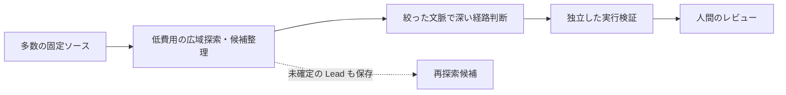

# Intruder 以降の AI 脆弱性探索アーキテクチャ（2026-10-24）

「調べて報告」の記録。基準は [Intruder の 2026-06-11 記事](https://www.intruder.io/research/a-0-day-vending-machine-no-mythos-necessary)。公開一次資料に書かれた実装・実験だけを「事実」とし、本リポジトリへの移植案は「推論」と区別する。各社・論文の件数は分母、確認水準、対象が異なり、横並びの発見率ではない。

## 先に答え

**Sonnet で広く選別し、Opus で深く判断する構成は、Intruder だけのものではない。** [OpenAnt の公開論文（2026-06-17）](https://arxiv.org/abs/2606.19149)は、露出判定を Sonnet 4、脆弱性検出と攻撃者視点の検証を Opus 4、動的試験の生成を Sonnet 4 と明記する。[HackerOne の運用記事（2026-10-01）](https://www.hackerone.com/blog/how-model-evolution-reshaped-ai-security-agents)は、広域作業を高速な balanced model、検証・最終判断・調整を深い推論モデルにする分担を、2026 年 8 月までの社内評価結果として説明する。ただし、ある検証エージェントでは Opus から Sonnet に戻した方が精度を保って速かったとも記す。**モデルは名前で固定せず、役割ごとに測る**のがこの資料からの結論である。

これは公開方式の**共通形を表した図**で、本リポジトリの実装図ではない。`C` の Opus 判定や自己申告は、当 Harness の `runtime-confirmed` にはならない。[SPEC §2](../SPEC.md)に従い、同一 Snapshot の隔離 Lab と Harness 所有の nonce canary 判定だけを確認根拠にする。

## 公開資料の比較

| 公開日・一次資料 | 公開された工程とモデル分担 | 実績として読める範囲・Intruder との差 |
| --- | --- | --- |
| **2026-06-11 基準** [Intruder: A 0-day vending machine](https://www.intruder.io/research/a-0-day-vending-machine-no-mythos-necessary) | Joern が WordPress の非認証入口から code slice を作り、Sonnet が一次選別、Opus が悪用可能性を調べ、後段のエージェントが Docker 上で試す。 | 上位 200 プラグインを投入し、Creative Mail の SQLi を報告。ただし同じ問題は別研究者も独立に報告しており、論文型の同条件比較や全プラグインでの採択率は公開していない。 |
| **2026-06-17** [OpenAnt 論文](https://arxiv.org/abs/2606.19149)・[公開リポジトリ](https://github.com/knostic/OpenAnt) | AST と到達性で分析単位を減らし、**Sonnet 4** が露出分類、**Opus 4** が検出と攻撃者視点の検証、**Sonnet 4** が動的試験を生成。 | Intruder より多段で、モデル役割が論文に明記される。論文の WordPress **本体**の行は 12,177 関数→到達可能 393→露出 93→候補 67→モデル検証通過 20→動的再現 13。これは著者の実験値で、WordPress **プラグイン**の未知 bounty 採択 13 件ではない。論文実験の Sonnet/Opus 4 と、2026-10-24 に読める README の既定値「検出相に Opus 4.6、それ以外に Sonnet 4」は時点が違う。README は PHP を beta とし、CLI 初期化例は Go/Python のみなので、プラグイン群へ即投入できるとは確認できない。 |
| **2026-07-29** [Shopify: Building an agentic harness that outlasts the model](https://shopify.engineering/building-an-agentic-harness-that-outlasts-the-model) | 大きなアプリを関連ファイル群に分割し、Hunter を並列化。別モデルの Verifier は候補ごとに逐次で実テストを作成・実行し、通常コードが重複や保存を処理する。モデル名は非公開。 | 80 超のアプリで、約 6 週に数千 scan、300 超の finding と自社報告。ただし軽重の内訳に defense-in-depth が含まれ、$400,000 は bounty の**相当額という社内換算**。Intruder の Joern 静的 slice より agent 主導の partition と実テスト oracle を強調。 |
| **2026-08-18** [Mandiant/Google: AVDH](https://cloud.google.com/blog/topics/threat-intelligence/staying-ahead-of-adversarial-ai-through-agentic-source-code-review) | Explorer と専門子が脅威モデルを作る。全対象ファイルの入口抽出は並列 Discovery agents が **Gemini Flash Lite** で行い、入口ごとに文脈を拡張。access control と data flow の仮説を複数の validation agent と synthesis agent に渡し、最後は人間が再現する。**後段の具体的モデル名は公開していない。** | 数千万行の環境、数千 pipeline、12 assigned CVE は著者の運用報告。Intruder の「静的 slice→Sonnet→Opus」より agent 分担と人間の検証ゲートが多い。特定モデルへの乗換え効果は切り分けられない。 |
| **2026-09-19** [Google AI Infrastructure: Mantis を使った継続検査](https://cloud.google.com/blog/topics/systems/using-ai-agents-to-secure-google-infrastructure/)・[Mantis 公開 repo](https://github.com/google/mantis) | 全履歴の一括探索ではなく変更ごとの軽量 scan、AST・call graph・domain rules による reachability triage、夜間の再検査。記事は具体的な LLM 名の役割分担を公開していない。 | 一部ケースで偽陽性率 3%、triage 精度 92% 超・1 分未満と著者が報告。差分を継続的に読む社内 CI 用なので、初見の WordPress プラグイン大量探索と分母が違う。 |
| **2026-09-29** [Quarkslab: From AI Agents to RCE](https://blog.quarkslab.com/from-ai-agents-to-rce-building-a-vulnerability-research-workflow.html) | code graph→recon→slicing→決定論的 taint/レンズ→agent triage→PoC→連鎖→実行。研究者が段間に入り、疑わしい経路を検査する。モデルの軽重分担は公開していない。 | FreeRDP で二つの問題を連鎖し RCE に到達した事例。Intruder と graph/slice は近いが、研究者が深掘りを選ぶ点、候補の中間成果を再利用可能にする点が異なる。 |
| **2026-09-23、10-19 更新** [Harness: How Harness orchestrates LLM security scanning](https://www.harness.io/blog/how-harness-orchestrates-llm-security-scanning)・[同社ベンチマーク（09-28、10-15 更新）](https://www.harness.io/blog/llmscanbench-q3-2026-choosing-the-right-approach-for-ai-vulnerability-discovery) | threat model→discovery→validation→attack-path analysis。初回全量の後は差分と旧 finding の再確認に絞り、固定の出力形と台帳を使う。ベンチでは GPT-5.5 と Opus 4.8 を**別々に**比較し、Sonnet→Opus 連結は示していない。 | 既知の脆弱アプリ 3 件の同社製品比較では、LLM 全量 scan の再試行によるばらつきと速度・費用差を示す。WordPress 未知探索やこの Harness での差分方式の有効性は測っていない。 |
| **2026-10-01** [HackerOne: How Model Evolution Has Reshaped Security AI Agents](https://www.hackerone.com/blog/how-model-evolution-reshaped-ai-security-agents) | 広域の batch scan / exploration / routing は balanced model、検証・最終判断・調整は深い推論モデルに割り振る。typed tool output、provider 交換層、硬い予算と停滞検出を持つ。専門別 fan-out を汎用 agent に減らした例も公開。 | **質問の Sonnet screening→Opus judgment に最も近い後発の運用記事。** ただし Opus を常に最終 Verifier とする主張ではなく、検証担当を Sonnet に下げても同等精度で速くなった業務もある。定量ベンチや WordPress bounty の実績値は公開していない。 |
| **2026-10-05、10-13 更新** [Intruder: Is AI pentesting as good as a human pentester?](https://www.intruder.io/blog/ai-pentesting-vs-human-pentesting) | 著者らの white-box AI pentester は、脆弱性分類ごとの狭い専門エージェントを減らし、広い役割と厳しい安全柵の組み合わせを選んだと説明。モデル名・前段/後段の詳細配線は非公開。 | **同じ Intruder の後続**だが、6 月記事の WordPress/Joern pipeline を更新した説明とは明記されていない。前者は製品の白箱侵入テスト、後者はプラグインの source-slice 調査として分けて読む。 |
| **2026-10-07** [AWS Security Blog Part 1](https://aws.amazon.com/blogs/security/building-your-ai-vulnerability-harness-part-1/)・[Part 2](https://aws.amazon.com/blogs/security/configuring-your-ai-vulnerability-harness-part-2-the-steering-file/)・[公開 steering file](https://github.com/aws-samples/sample-ai-vulnerability-harness-steering-file) | 既存 scanner の候補を、複数 scanner の一致→AST による構造照合→運用環境の到達性で絞る。発見後の判断の手順は steering file/skill に置き、AST/taint や実行環境はそのファイルだけでは提供されず、別途必要と明記する。モデル名ごとの分担は非公開。 | **初見の脆弱性探索器というより候補 triage 設計**。AWS の数値は小さな意図的脆弱アプリ 1 件での steering file 比較であり、全種の WordPress plugin に移せる精度ではない。 |

### WordPress に直接近い補助資料

[FPT IS の WordPress プラグイン/テーマ研究（2026-06-11、Intruder と同日）](https://fpt-is.com/en/insights/building-a-scalable-wordpress-vulnerability-hunting-framework-with-ai-assisted-analysis/)は、Semgrep→規則ベースの粗い整理→重複排除と過去判断の再利用→軽い AI grouped triage→文脈を広げた深い review→Claude Code を使うローカル再現を報告する。著者は Patchstack へ 31 件**提出**したと記すが、すべての採択や payout を意味しない。また、静的先行方式が business logic、保存先をまたぐ二次的影響、長い多段経路を見逃したとも明記する。これは「広域段だけを回せば十分」とは言えない直接の反例である。

### 方法を本人が公開した WordPress プラグイン研究者

ここでは、研究者本人の技術記事・講演資料・本人へのインタビューを優先した。特定の発見数は、公開資料の自己申告またはプログラム運営者の記載であり、同じ分母の検出率ではない。Dutafi は [FPT IS による氏名確認](https://fpt-is.com/en/two-young-fpt-cybersecurity-experts-rank-among-patchstacks-top-15-vulnerability-researchers-with-ai-assisted-approach/)では Bùi Đức Tài である。

| 研究者・一次資料 | 公開された探索の組み立て | 本 Harness と比較するときの要点 |
| --- | --- | --- |
| [Dutafi / Bùi Đức Tài（2026-06-10）](https://medium.com/@ductai126/how-i-structure-my-wordpress-vulnerability-hunting-workflow-0a236760096f) | プラグイン・テーマ収集→WordPress 特化 Semgrep→規則整理・過去判断との重複排除→軽い AI の grouped triage→文脈を広げた再評価→Claude Code のスキルでローカル検証。 | **大量探索の最も近い公開例**。Sonnet/Opus の具体名は書いていない。深い AI が高信頼とした候補も動的検証で偽陽性になった例と、業務ロジック・状態依存の認可・長い連鎖を見逃す限界を本人が記す。 |
| [Ananda Dhakal の講演スライド（2025）](https://dhakal-ananda.com.np/assets/talks/deepsec-2025-slides.pdf) | WordPress SVN の最新 revision と保存済み revision を比較→対象プラグインの変更と導入数を取得→5,000 導入以上の `trunk` にある PHP の追加行を危険関数で検索→研究者へ通知。 | **全量再走査と別の増分監視型**。スライド 69–70 は偽陽性とキーワード依存を課題とし、SAST と AI による絞り込みを次案に挙げる。 |
| [Eddie Zhang（2024-08-27）](https://projectblack.io/blog/cve-hunting-at-scale/)・[収集コード](https://github.com/prjblk/wordpress-audit-automation) | WordPress.org の多数のプラグインを取得→Semgrep の PHP 規則を適用→結果を SQL DB に保存→導入数と脆弱性種別で並べて短時間で人が確認→ローカルで試す。 | AI なしの**広域→候補→人間**の基準方式。本人は 14 CVE を挙げるが、現行 Trial との発見率比較にはならない。 |
| [Kinorth / João Pedro Soares de Alcântara（2025-03-05）](https://www.patchstack.com/articles/meet-joao-pedro-soares-de-alcantara-aka-kinorth/) | SVN の対象群を取得→プログラムの対象範囲で絞る→正規表現で多数のプラグインを横断探索し、候補を人が調べる。 | 速い**横断パターン探索**。インタビューの「275 件」は特定イベント期間の報告件数で、確認済み・報酬対象の件数と同一視しない。 |
| [Mat Rollings / stealthcopter（2024-05-21）](https://patchstack.com/articles/interview-with-mat-rollings-aka-stealthcopter/) | 開発者が書きそうな危険なコード片を先に想定→該当コードを横断検索→ヒットした対象を順に調べる。発見した欠陥から新しい検索パターンを作る。 | **仮説を横展開**する方式。静的規則だけで閉じず、個別対象での経路判断が残る。 |
| [Francesco Carlucci のインタビュー（2026-05-14）](https://melapress.com/hacker-mindset-inside-world-of-bug-bounties-and-wordpress-security-with-francesco-carlucci/) | 個別の監査で理解した新しい欠陥の仕組みを、関連するプラグイン群に横展開。ローカルのプラグイン群を検索し、実際の挙動を手で確かめる。 | **深掘りから広域へ戻す循環**の例。インタビューでは同じ機構の横断探索には、AI より正規表現の方が効率的な場合があると述べる。 |
| [hakluke / Luke Stephens（2022-04-04）](https://blog.wpsec.com/discovering-vulnerabilities-in-wordpress-plugins-at-scale) | 人気プラグイン 958 件を取得→`ripgrep`/正規表現で横断検索→ノイズを手で除く→ソースの文脈とローカル WordPress で確認する。 | 規則の見逃しや候補化の基準を見る教材。記事の「7 件」は**候補行**であり、確認済み脆弱性 7 件ではない。 |
| [Austin Ginder（2026-08-21）](https://anchor.host/elementor-pro-rce-ai-direction/) | 蓄積済みの Lead から入力経路と危険な処理の組を立て、Opus 4.8 で 5 本の連鎖仮説を並行調査し、使い捨て WordPress で再現した。 | **WP2Shell 型の深掘りに近い**。Elementor Pro の報奨金受領は本人記事にあるが、先行報告の後に重複だったと判明し、本人は初報告者ではないと明記する。 |
| [Mika / Kévin Mosbahi（2025-01-21）](https://www.patchstack.com/articles/interview-with-kevin-mosbahi-aka-mika/) | ソースを手で読み、アクセス制御と権限昇格に重点を置いて手で試す。自動化は少ないと述べる。 | 静的スクリーニングの負例が示せない**論理・状態の欠陥**を深く読む型。 |
| [Denver Jackson（2025-05-06）](https://patchstack.com/articles/interview-with-denver-jackson/) | 導入数が多く比較的単純または古いコードの対象を選ぶ→修正履歴と PHP を読む→認証・認可の設計を追う。 | **対象選定と既存修正を起点とする深掘り**。公開済みの既知答えを評価用 agent に渡す方法とは区別が必要。 |

個人名ではないが、[Night-Wolf Team の 2026-05-26 記事](https://blogs.night-wolf.io/ai-powered-vulnerability-hunting-in-wordpress-plugins-themes)は特に設計が近い。10 種の決定論的 scanner→8 並列の短命 triage 子 agent（1 件 10 tool call 上限）→動的検証→scanner 規則へ結果を戻す構成で、更新時は差分 scan に切り替える。著者は親も子も Opus 4.x を使い、Sonnet は間接的な経路を見逃したと記す。記事の確認件数は公開時点の自己申告として扱い、現行 Harness と直接の発見率比較はしない。

これらの公開資料は「全対象を同じ長時間 Trial で読む」以外に、**既存パターンの横展開**、**変更差分の監視**、**安い候補抽出**、**蓄積 Lead からの連鎖再探索**という別々の入口を示す。いずれも候補抽出の陰性が未知の欠陥の不存在を証明するとは述べていない。特に Dutafi の本人記事は、静的先行方式が多段・状態依存の欠陥を取りこぼすと認める。現行 v8 と比較するなら、広域 arm の候補・Lead を保持し、深掘り arm の独立探索も残すのが**推論**である。

## 現行 WordPress Harness に引くときの推論と限界

1. **モデル分担は交換可能な実験軸。** Intruder と OpenAnt は Sonnet→Opus の実例、HackerOne は balanced→deep の運用上の支持を示す。しかし [HackerOne](https://www.hackerone.com/blog/how-model-evolution-reshaped-ai-security-agents)自身、検証担当を Opus から Sonnet に下げた例も報告する。したがってモデル名ではなく、`Finding/Lead の source 根拠`, 1 対象あたりの wall・provider usage・失敗率、Lab 後の実確認数を同一条件で比べる。これは本リポジトリへの**推論**である。
2. **source-only の一次選別は「真偽判定」ではない。** Intruder/Quarkslab/OpenAnt の後段は動的試験を使う。[FPT IS](https://fpt-is.com/en/insights/building-a-scalable-wordpress-vulnerability-hunting-framework-with-ai-assisted-analysis/)も深い AI review 後の候補がローカル再現で偽陽性になった例を示す。現行の `runtime-confirmed` は [SPEC §2](../SPEC.md)どおり Harness 判定器だけが出す。広域 agent の否定結論で未知候補を黙って捨てる設計も、[ADR 0018](../adr/0018-hold-and-normalize-discovery-candidates.md)と衝突する。
3. **固定前処理は見逃しを作る可能性がある。** Intruder と OpenAnt は入口/到達性を前段で絞る。これらの数字は報告された事例の実績であって、本リポジトリの対象や Programme Boundary での recall ではない。もし比較するなら、v8 に入口索引や coverage を再投入せず、別の opt-in 実験 arm とし、初期候補と保留を全件記録して失われた候補を測る。これは [AGENTS.md](../../AGENTS.md)の「Harness は制御だけ」と [ADR 0034](../adr/0034-harness-control-only-deletions.md)に合わせた**推論**である。
4. **ハーネスと agent の境界は資料ごとに違う。** [AWS Part 2](https://aws.amazon.com/blogs/security/configuring-your-ai-vulnerability-harness-part-2-the-steering-file/)は判断手順を steering file/skill、AST・taint・runtime を機械の側と分ける。一方 [Mandiant AVDH](https://cloud.google.com/blog/topics/threat-intelligence/staying-ahead-of-adversarial-ai-through-agentic-source-code-review)は入口抽出や細かい段別 dispatch までシステムに持つ。[Shopify](https://shopify.engineering/building-an-agentic-harness-that-outlasts-the-model)も partition をオーケストレーターに持つ。本リポジトリは過去の失敗から入口索引/dispatch を削除したため、他社の前処理は**設計の参考**であって、現行方針にそのまま追加する根拠ではない。
5. **今は調査で止める。** [DEVELOPMENT §2, §5](../DEVELOPMENT.md) は検証から提出までの 6 段が通るまで探索改訂を後回しとし、探索入力を変える PR に開発 Trial 3 回以上を要求する。いまの `wp2shell-bounty-v8` と異なる screening/モデル配線の数値を同一分母に混ぜない。比較の問いを設定してから branch 上で試す。

## この調査で確認できなかったこと

- Sonnet screening→Opus deep が、**現行 v8 と同じ WordPress plugin 群・同じ時間/費用・同じ判定器**で優越するという公開比較。
- Mandiant の Flash Lite 後段、Shopify の Hunter/Verifier、Quarkslab と AWS の各段の具体的なモデル名。公開記事の役割名から Opus を推定しない。
- Intruder の 10 月の記事が、6 月の Creative Mail 調査 pipeline を置き換えたという記述。
- OpenAnt の論文にある WordPress **本体**の動的再現数を、プラグインの未知脆弱性、CVE、bounty 受理数へ変換する根拠。

