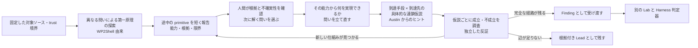

# WP2Shell 原記事から始める独立した深掘り探索案（2026-10-24）

状態: 調べて報告。現行 `wp2shell-bounty-v8` の変更案や実行可能な新規 Trial ではない。2026-10-24 の所有者追加方針により、徹底探索は**人間と AI の対話的研究**として考える。事実と、この文書で提案する設計を分ける。

## 問い

現行の v8 目的文を改稿するのではなく、[Searchlight Cyber の wp2shell 原記事][wp2shell]で**実際に起きた研究過程**を出発点に、一つの WordPress プラグインを徹底的に調べる独立した方式を考える。[Austin Ginder の Elementor Pro 記事][austin]は、途中で得た所見を連鎖仮説に変える方法の補助資料とする。対象の選び方はこの文書の論点ではない。

## 公開された事実

- wp2shell 記事は初期の目的プロンプト全文を公開している。多様な着眼点、最大 4 子、アプローチ系統の記録、停滞経路の扱い、独立した経路の維持、反証役、複数ラウンド、依存ソースの調査、最低 6 時間を指示した。対象に脆弱性があり認証前 RCE に至るという前提と `/flag` は、この事例固有の条件だった。[wp2shell]
- 公開プロンプトだけで最後まで無人探索したわけではない。エージェントが認証前 SQLi を報告した後、著者が通常の WordPress 環境で読み取りの成立を確かめるよう求め、その後に RCE へ発展できるかを**新たに質問**した。後者に約 4 時間を使い、全連鎖は 10 時間強で得られた。著者は翌日、結果を理解し報告を作った。初期探索の全 transcript や子ごとの指示は記事にない。[wp2shell]
- この事例の連鎖は、最初の欠陥で得た読み取り能力を、その後の別サブシステムの状態や権限へ接続して伸ばした。途中の制限を同じ欠陥の別の使い方で突破した場面もある。ここから言えるのは、**途中の primitive が見つかった時点で探索の問いを更新した**ことであり、記事の個別の gadget を別のプラグインへ移植できることではない。[wp2shell]
- Austin は wp2shell 型の長時間・並列探索を試し、実際の報告も得たが、高い影響でクリーンな PoC を通る成果は少なかったと書く。その後の非公開スキル `/wp-registry-scan-chain` は、既存の WP Registry 所見から delivery primitive と sink を組にして、子に連鎖の成立・不成立を調べさせた。Elementor Pro の例では既存の所見 93 件を背景に 5 つの仮説を並走し、4 つを棄却、1 つをクリーンな WordPress 環境で確認した。93 件は確認済み脆弱性の数ではない。スキル本文、5 仮説の一覧、棄却条件は公開されていない。[Austin の基盤監査][austin-july]、[Elementor Pro 記事][austin]

## 二つの記事から導く独立案（提案であり、著者らの実装仕様ではない）

1. **最初は異なる問いを維持する。** Root は固定ソースから複数の研究経路を選び、子の結論を早く混ぜない。ここは wp2shell の公開プロンプトに根拠がある。探索範囲や子への実際の指示内容は対象から決める。
2. **候補を一つ見つけても終了しない。** Root はそれが攻撃者に与える具体的な能力、成立前提、既存の防御、まだ足りない辺、反証の証拠を短い中間報告にする。人間は根拠を点検し、必要なら隔離 Lab で観測してから「その能力で次に何ができるか」と問い直す。記事でも著者が途中の SQLi を確かめた後、発展可能性を新たに質問した。この**人と AI の対話**が現行 v8 の単なる時間延長より重要な実験軸である。
3. **複数の連鎖仮説を作る。** 同じ Snapshot の探索中にエージェント自身が読んだソースと得た primitive から、到達手段と効果の組を作る。各仮説について「どの辺がまだ証明されていないか」を追う。Austin の既存 Registry 全文を新しい探索入力に与える案ではない。
4. **不成立を個別に確かめる。** 仮説を棄却するときは、その仮説のどの辺をどの事実で否定したかを残す。似た候補まで一括で消さない。新しい機構が現れた場合は、以前行き詰まった経路を再開できる。
5. **探索中の観測と最終判定を分ける。** 元記事の著者は途中で実環境確認を求めた。実験で Lab を使うとしても人間とエージェントの観測は次の研究質問を決める材料であり、現行リポジトリの `runtime-confirmed` は新しい Lab と nonce canary を使う Harness 判定器だけが出す。

人間の作業は全ファイルのレビューや全候補の採否ではない。中間報告で **(a) ソース上の根拠、(b) その時点で実証された能力、(c) まだ仮定の辺、(d) 次に答えると進捗が分かる問い** を見て、実証・反証・別の連鎖のどれへ進めるかを指示する。AI はコードを読み、複数の問いを試し、各仮説の成立・不成立の根拠を集める。対話の頻度は固定せず、意味のある中間成果や行き詰まりが出たときに行う。これは記事からの**提案**であり、著者らの非公開運用の復元ではない。

## 現行 v8 から独立させる意味と制約

[v8 目的文][v8]は、wp2shell 記事の**公開プロンプト**の主要な探索指示をすでにほぼ採っている。[v7 の出典対照][v7-source]もそれを記録している。したがって「記事から新しいプロンプトを作る」が文章の言い換えだけなら、別方式とは言えない。独立して調べる価値があるのは、**途中の primitive を実証・再評価し、問いを切り替えて同じ対象を掘り続ける研究過程**である。Austin の記事は、その次の問いを delivery と sink の組にする具体例になる。

現行の本番主経路は 1 対象 1 Trial、Root＋最大 4 子、最低 60 分・上限 120 分、探索 Lab は既定で無し。前の Trial の非公開 Finding を次の探索へ渡すことも、現行の探索入力契約にはない。人間の判断点も本番では提出前のレビューと外部行動の承認に限る。[SPEC §2, §6][spec]。したがって、この**対話型の研究実験を本番 v8 に暗黙に混ぜない**。記事の「初期 6 時間＋さらに約 4 時間」や、Austin の蓄積済み所見の再投入もそのまま採らない。複数セッションにまたがるなら、Snapshot と研究メモの扱いを明示的に決める必要がある。6 時間へ伸ばすだけの案は、過去の 5 時間超 run に有償成果がなかった[教訓][lessons]とも照合する。

検証から提出までの 6 段が通るまで探索方式の改訂を後回しにする、という現行の[開発順][development]を維持する。実装に進む場合は、独立した比較条件・prompt 版・digest と最低 3 開発 Trial の数字を付け、現行 v8 の分母と混ぜない。大きな探索構造の変更なら報告後に SPEC/ADR を改訂する。[開発規則][development]

## 評価したい問い

この独立案が増やすべき成果は、生の Finding/Lead 数ではなく、**同じ対象で最初の探索が見落とした、ソース根拠付きの重複しない完全経路**である。まずは、途中で見つかった primitive が何件あり、人間の問い直しで新たに調べられた辺が何本あるか、成立・不成立の根拠が残った仮説数、検証へ到達した経路数、人間の所要時間、provider 使用量を比べる。現時点でこの方式の発見率や費用対効果は不明である。

[wp2shell]: https://www.slcyber.io/research/exploit-brokers-pay-500000-for-a-wordpress-rce-i-found-one-with-gpt5-6
[austin]: https://anchor.host/elementor-pro-rce-ai-direction/
[austin-july]: https://anchor.host/anyone-can-audit-wordpress/
[v8]: ../../src/profiles/wordpress/prompts/wp2shell-bounty-v8.md
[v7-source]: 2026-10-18-wp2shell-bounty-v7.md
[spec]: ../SPEC.md
[lessons]: ../LESSONS.md
[development]: ../DEVELOPMENT.md
