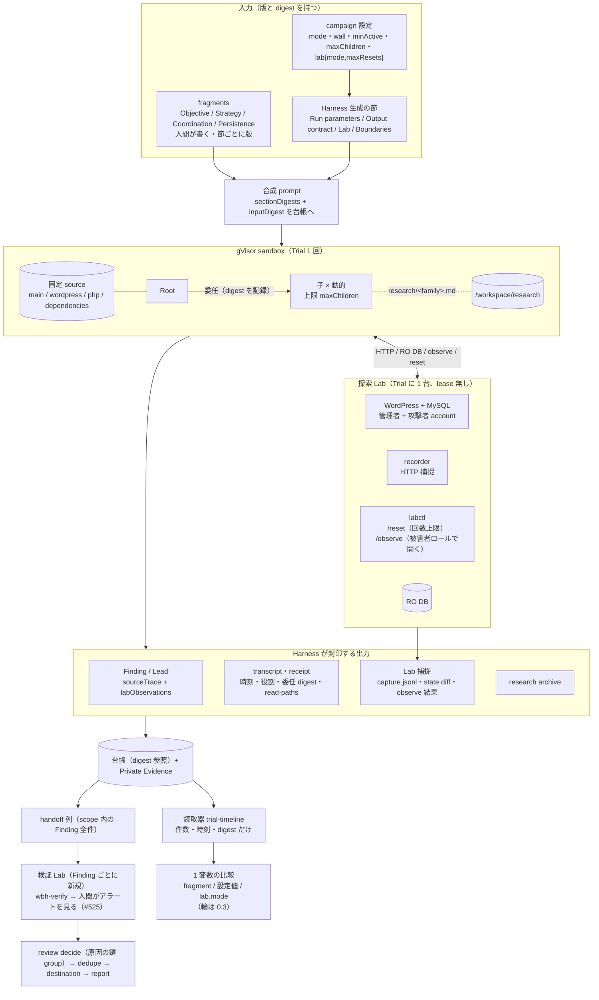
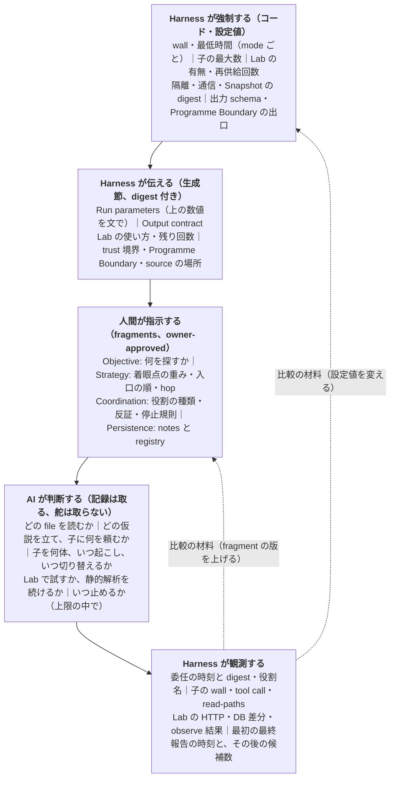
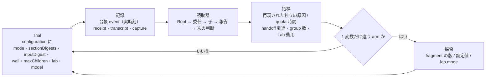
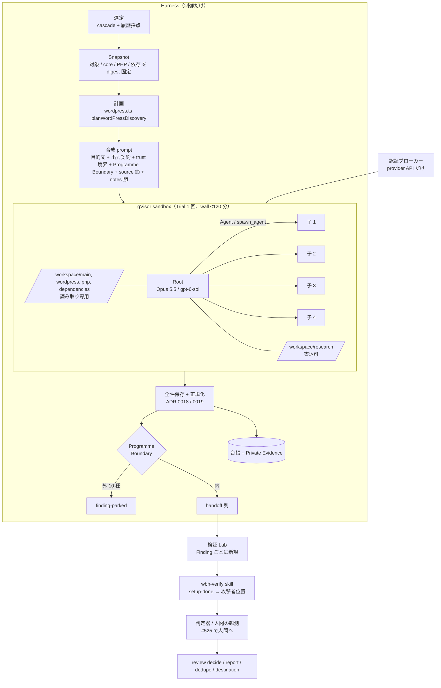
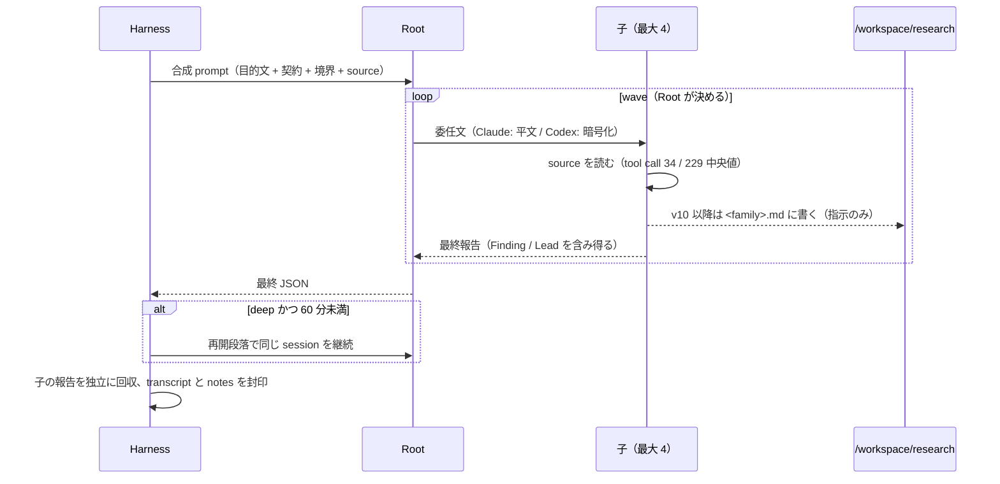
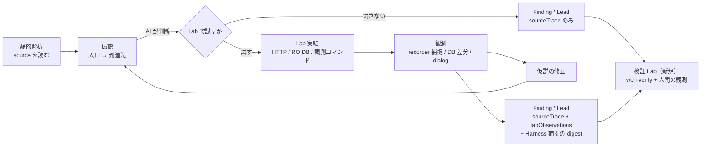
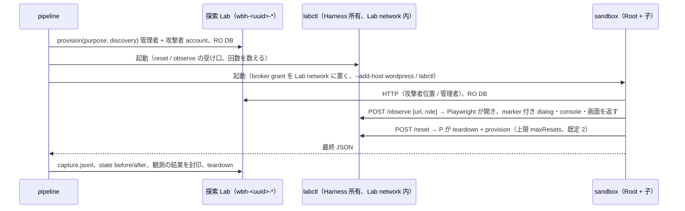
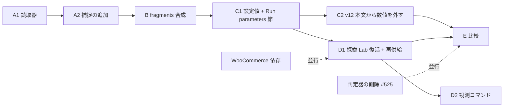

# 探索アーキテクチャの再設計と改善計画（2026-10-25）

「調べて報告」の記録。正本ではなく、SPEC・ADR・prompt・skill・コードを変えない。事実（origin/main `0d31bd9`、PR #521 / #524 の branch、本番台帳と Private Evidence の件数、公開一次資料）と、この文書の提案、所有者が同日の対話で決めた点を分けて書く。未公開 Finding の本文、payload、HTTP 記録は扱わない。

## 問い

所有者の問い（2026-10-25）は、prompt の性能改善ではなく、**AI の自由な探索を保ったまま、探索手法を 1 要素ずつ変えて測れる Harness にすること**である。要るのは 3 つ。

1. 探索中に Lab で仮説を実行して観測できること（静的解析で終わらない）。
2. 1 本の大きな prompt を責務ごとに分け、1 要素だけ変えて測れること。
3. 時間・子の数・Lab の予算のような数値を Harness の設定値として管理し、AI への指示と Harness の強制を区別すること。

あわせて、Root と子が実際に何をしたかを後から追えること。

## 先に答え

- **探索 Lab は配線の大半が残っている。** PR #485（10-24）は入口（schema の literal、`run.lab` の生成）だけを閉じた。ネットワークの配線、prompt の `## Lab` 節、台帳の `labAttached` / `labAccess`、Lab の `purpose: "discovery"` はそのままである。ADR 0003（探索は Lab で実行してよい）は廃止されていない。Phase D は「復活と、再供給・観測コマンド・捕捉の封印」であり、新しい抽象化ではない。
- **prompt の分解は file の分割と合成テストだけで足りる。** 合成結果が現行の v10 / v11-wide とバイト一致することをテストで固定すれば、挙動を変えずに節ごとの版と digest が取れる。Knowledge skill は今回作らない（LESSONS 1・2）。
- **Harness が今強制しているのは、子の同時数 4、最低時間（deep 60 分 / wide 0）、wall 上限、通信制限だけである。** 「80 tool call」「2 hop」「30 行以内」「研究 file」「wave の停止規則」は prompt の指示だけで、Harness は数えていない。所有者決定（本文書 §12）で、Harness が強制するのは子の最大数と時間と Lab 予算に限り、寿命や wave の構造は本文から外して AI に任せる。
- **子ごとの Finding / Lead は台帳に既にある。** 欠けているのは、全 event の時刻が Trial 開始時刻になっている点（#212）、Claude の `read-paths` が常に空な点、委任文の digest と役割名、Root の最初の最終報告の時刻である。Claude の Root transcript では委任文と子 id が平文で読める。Codex は委任文が暗号化されている。
- **順番は A（観測）→ B（分解）→ C（設定）→ D（探索 Lab）→ E（比較）。** 所有者の提案どおりで、依存関係を見ても入れ替える理由は無かった。WooCommerce 依存の推定は独立した PR として並行で出せる。

## 0. 全体図

3 枚で全体を掴む。詳細はそれぞれ §5〜§9 にある。

### 0.1 目標の形（Phase A〜D の後）



### 0.2 どの層が何を持つか



同じ数値を L1 と L3 の両方に持たない。L3 から数値を外し、L1 の値を L2 で伝えるのが Phase C である。

### 0.3 観測から比較へ回る輪



比較できる軸は、v8 と v11-wide（mode）、Static-only と Static+Dynamic（`lab.mode`）、固定専門 Hunter と動的分担（Coordination の fragment）、長命と短命（lifetime の fragment）、notes の有無（Persistence の fragment）。他の節の digest と設定値が同じことを台帳で示せるので、1 変数の比較になる。

## 1. 前提の照合（事実）

### 1.1 探索 prompt と mode

| 項目 | origin/main（`0d31bd9`） | PR #524（`wbh-v10-precedent`） | PR #521（`wbh-wide-mode`、#524 の上） |
| --- | --- | --- | --- |
| deep の目的文 | `wp2shell-bounty-v8`（27 行） | `wp2shell-bounty-v10`。v8 と 3 か所だけ違う（2 hop の成功条件、公開事例の頻度で重み付けした着眼点、80 tool call と研究 file の 2 段落） | 同じ |
| wide の目的文 | 無し | 無し | `wp2shell-bounty-v11-wide`。種別ごとの専門 agent 4 体を固定、入口を頻度順に、1〜2 hop、Root は振り向けも追加 round もしない、「Stop when」で終える。v10-wide は本番 `prod-20261025-1` で 32 Trial 回したので archived |
| mode | 無し | 無し | `discovery.mode`（deep / wide、既定 deep）。wall の既定 deep 120 / wide 20、最低時間 deep 60 / wide 0、再開段落の接頭辞を mode ごとに読む。台帳 `configuration.mode` |
| 所有者決定 | — | 本番で手応えを見る。開発セット Trial は取らない | 同じ。戻し方は v11-wide → v10-wide → v8 |

Issue #528（2026-10-25）は方向を PRISM 型（幅優先）に固定し、Argus 型（連鎖）は PARKING に置いた。同 Issue の項目 5 は「探索に Lab を付けるかは wide の候補の質を見てから決める」で、本文書の Phase D はその判断材料を開発 branch で作る位置付けにする（§12 Q1）。

### 1.2 Root と子の協調の形（本番、10-20 監査と 10-25 の集計）

| | Claude runtime | Codex runtime |
| --- | --- | --- |
| 子の起こし方 | Agent SDK の `Agent` tool。one-shot | `spawn_agent` で永続スレッド、`followup_task` で追依頼 |
| 同時数 | hook で 4（[`claude-runner.ts:22`](../../src/discovery/claude-runner.ts)） | `agents.max_threads=4`、`max_depth=1`（[`codex-native-agent-runtime.ts:1389`](../../src/discovery/codex-native-agent-runtime.ts)） |
| 子の寿命（中央値） | 3.3 分、tool call 34、file 6 | 53.9 分、tool call 229、file 87。同一スレッドの `task_started` 中央値 19 |
| 役割名 | hook は `agentType` を出すが保存しない。全件 `general-purpose` | `agent_role` は null |
| 委任文 | Root transcript の `Agent` tool_use に平文。`toolUseResult.agentId` で子 transcript に結べる | `spawn_agent.message` / `followup_task.message` は暗号化。`task_name`、`agent_path`、回数だけ読める |

出典: [multi-agent 監査](2026-10-20-multi-agent-discovery-audit.md)、[短命の子](2026-10-20-short-lived-discovery-agents.md)、[分解の報告 §1.2〜1.3](2026-10-25-discovery-prompt-decomposition.md)。

### 1.3 Finding / Lead の出力契約

- Harness が Zod schema から節を生成して渡す（ADR 0019、[`output-contract.ts`](../../src/profiles/wordpress/discovery/output-contract.ts)）。契約 v4 の digest はテストで pin していない（v1 / v2 は pin）。
- Finding には `claim`、`attackerPosition`、`impact`、`configurationPrecondition`、`brokenProperty`、`sourceTrace[]`（`min(1)`）、`existingControls`、**`labObservations`**（文字列、自己申告）、`privateRecipeReference` がある（[`finding.ts:32-78`](../../src/profiles/wordpress/discovery/finding.ts)）。Lead にも `labObservations` がある。
- 候補は出力境界で棄却せず、正規化して受理するか `candidate-held` にする（ADR 0018）。Programme Boundary 外は `finding-parked`。
- 子の Finding / Lead は子の `runId` で記録され、Root とは独立に保存される。本番台帳で child run 由来は `finding-recorded` 83、`finding-parked` 41、`lead-recorded` 977。

### 1.4 Private Evidence、台帳、Snapshot

- 台帳は `discovery-run-started`（`configuration` に `promptVariant` / `promptDigest` / `objectiveDigest` / `contractDigest` / `trustBoundaryVersion` / `sourcePack` / `labAccess` / `runtime`、branch では `mode`）と `discovery-run-finished`（`usage`、`observed{toolCalls, filesRead, uniqueFilesRead, labRequests, dbQueries}`、`researchArtifact`、`diagnosticArtifactDigest`）を持つ（[`ledger/index.ts:69-226`](../../src/ledger/index.ts)）。**wall、最低時間、子の上限、model、effort は configuration に無い**（receipt にだけある）。
- **全 event の `occurredAt` が Trial 開始時刻**である（[`execute-trial.ts:232-237`](../../src/discovery/execute-trial.ts)、本番 3,101 組すべて）。[ledger-reading.md:44](../agents/ledger-reading.md) が #212 として記録済み。
- transcript は 2 か所: `<work>/provider-attachments/<kind>-<hex>/content/` の diagnostic（Root と子の transcript）、findings、research と、`<state>/private-evidence/sha256:<hex>/content/` の receipt、read-paths、finding、lead。`/workspace/research` は Trial 単位の archive（mtime 無し）で封印し、再開時に復元する（[`resume-trial.ts:472-493`](../../src/discovery/resume-trial.ts)）。
- **Claude の `read-paths` は 1,206 件すべて空**。[`read-paths.ts:23-52`](../../src/discovery/read-paths.ts) が Codex の `CommandExecution` の形しか読まない。`observed.filesRead` は別の集計で 0 でない。
- Snapshot は対象、WordPress core、PHP、依存プラグインを版と digest で固定する。依存は `Requires Plugins` ヘッダー（[`plugin-dependency-source.ts:62`](../../src/profiles/wordpress/acquisition/plugin-dependency-source.ts)）と選定方針の明示指定（`pluginDependencySlugs`）だけ。ヘッダーの無い依存の欠落は #428 / #467。

### 1.5 gVisor Lab と検証 skill

- Lab は [`openWordPressLab().provision()`](../../src/profiles/wordpress/lab/index.ts) が `purpose: "discovery" | "verification"` を受けて立てる。container は `wbh-<uuid>-{net,site,db,wp,proxy,canary}`。host lease（1 host 1 枠、30 分待ち）は verification のときだけ取る。victim account の作成と canary の配置も verification のときだけ。
- **状態の復元機能は無い。** 検証は Finding ごと、attempt ごとに新規の Lab を立てて壊す（[`verification/index.ts:403-501`](../../src/verification/index.ts)）。
- handoff（`verify next --handoff`）は `lab.json` → `setup-done` → 基線と捕捉の開始 → `observation-ready` → `attack.json` → 6 file（`http.json, steps.md, route.json, session.json, refutation.md, precondition`）の順で、wall 30 分。recorder が HTTP を JSON Lines で捕捉し、DB 状態の before / after / diff を残し、Playwright の観測器が marker 付き dialog と画面を取る（#500 の軽い観測経路）。
- 判定器は [`judges.ts`](../../src/profiles/wordpress/verification/judges.ts) の 9 種。Issue #525 は判定器を外して人間が Lab でアラートを確かめる方針で、所有者は 2026-10-25 の対話で「判定器は残さない」と範囲を決めた（理由: alert は発火しているのに判定器が判定できない結果が多い）。10-23〜25 の PR #497〜#509 で、人間の観測（`manual-observation-lab-ready` / `manual-observation-recorded`、`review observe`、`lab up --for-review`）が台帳に入っており、これが確定の経路になる。

### 1.6 探索 Lab の今（事実）

| 層 | 状態 | 場所 |
| --- | --- | --- |
| campaign 設定 | `discovery.lab` は `z.literal("none")`。#485 で「Attached discovery Labs are retired」 | [`wordpress-session.ts:76-79`](../../src/cli/wordpress-session.ts) |
| 計画 | `lab: {mode:"none"}` と `labAccess.database: "none"` を固定で書く。`planWordPressDiscovery` は Lab を受け取ると throw | [`wordpress.ts:537-540, 584, 613-615`](../../src/cli/wordpress.ts) |
| pipeline | `discoveryLab: "attached"` の分岐が残る。purpose 無しで provision し、`seedCanaries` と probe を呼ぶ | [`pipeline.ts:288, 614-718`](../../src/cli/pipeline.ts) |
| runtime | `run.lab{endpoint, networkName, internalIp, database}` を受け、broker の grant を Lab の network に置き、sandbox に `--add-host wordpress:<ip>` を渡す配線が両 runtime に残る | [`codex-native-agent-runtime.ts:349-353, 1341, 1758`](../../src/discovery/codex-native-agent-runtime.ts)、[`claude-native-agent-runtime.ts:362-364, 458-460`](../../src/discovery/claude-native-agent-runtime.ts)、[`codex-gvisor-sandbox.ts:1004-1011`](../../src/discovery/codex-gvisor-sandbox.ts) |
| prompt | `## Lab` 節（endpoint、account、RO DB）の生成が残る | [`wordpress.ts:471-484`](../../src/cli/wordpress.ts) |
| 台帳 | `labAttached`、`labAccess`、`lab-provisioned{purpose:"discovery"}` | [`ledger/index.ts:58, 72-73, 126-128`](../../src/ledger/index.ts) |
| 実測 | Lab 付きの旧 Trial は Lab 要求 0、DB query 0（Unlimited Elements r2） | [10-19 再発見](../evaluation/2026-10-19-v8-five-target-rediscovery.md) |
| 規則 | ADR 0003 は accepted のまま。SPEC §6「許可する操作: 固定 source の読み取り、Lab への HTTP、Lab DB の RO account」 | [ADR 0003](../adr/0003-discovery-may-execute-target-inside-lab.md)、[SPEC §6](../SPEC.md) |

「Lab を付けても使われなかった」は、v5〜v8 の目的文が Lab の使い方を一切書かず、`## Lab` 節も endpoint と account を列挙するだけだったことと切り離せない。D の設計では、Lab の使い方の指示を Harness 生成の節に置く（§6.4）。

## 2. 現在の探索アーキテクチャ



Harness が Trial 中に触るのは、起動、同時数の hook、最低時間の継続、wall、終了後の封印だけである。探索の中身（どこを読むか、子に何を頼むか、いつ止めるか）は目的文と Root にある。



## 3. 責務分担表

| 責務 | AI（Root / 子） | Prompt（目的文の節） | Skill | Harness（コード） | Lab | 人間 |
| --- | --- | --- | --- | --- | --- | --- |
| 何を目的に探すか | — | Objective | — | Programme Boundary を節として渡し、出口で振り分ける | — | 方針の版を決める |
| どこを読み、どの仮説を立てるか | 決める | Strategy（着眼点の重み、hop の単位、入口の順） | — | 渡さない（ADR 0034） | — | — |
| 子に何を頼み、いつ切り替えるか | 決める | Coordination（役割の種類、反証、停止規則） | — | 子の最大数、wall、最低時間を強制。委任の記録を取る | — | — |
| 仮説を Lab で試すか | 決める（§12 Q3） | Harness 生成の `## Lab` 節が使い方を書く | — | Lab の供給、再供給の回数、観測コマンド、捕捉の封印 | HTTP、RO DB、観測器 | — |
| 途中の仮説・既読・未決の記録 | 書く | Persistence（`research/<family>.md`、REGISTRY） | — | ディレクトリの供給、封印、再開時の復元 | — | — |
| Finding / Lead の形 | 書く | — | — | Zod schema から節を生成、正規化、保留 | — | — |
| 再現 | — | — | wbh-verify（handoff） | Lab の供給、捕捉、基線 | 検証 Lab | アラートを見る（#525） |
| 判定 | しない | — | — | 無し（判定器は削除、#525） | marker 付き dialog と捕捉 | Lab のアラートと捕捉を見て確定する |
| 重複・提出先・報告書 | — | — | wbh-dedupe / destination / report | digest の記録 | — | decide、送信の承認 |
| 何が効いたかの比較 | — | — | — | 節 digest、設定値、mode を台帳に残す | — | 読む |

境界の原則（AGENTS.md「Harness と AI の責務」）どおり、Harness の列に判断は無い。Lab の列に「どの仮説を試すか」が無いのも同じ理由である。

## 4. できていること、不足していること

| 領域 | できている | 不足 | 根拠 |
| --- | --- | --- | --- |
| 探索の実行 | Root + 子 4 の協調 Trial、両 runtime、再開、全件保存、parked の振り分け | — | SPEC §6、ADR 0029 / 0036 |
| mode | deep / wide（PR #521、未 merge） | wide → deep の再訪規則（#519）、sweep skill（#520） | ADR 0039 |
| 出力契約 | schema 生成、digest、正規化、保留 | 契約 v4 の digest が未 pin | テスト |
| 子ごとの成果 | 子の runId で Finding / Lead を保存。wall、token、tool call、file 数 | 役割名、委任文 digest、Root が子の報告を使ったか、Root の最初の最終報告の時刻 | §1.4 |
| 時刻 | receipt の `startedAt` / `completedAt` | 台帳 event の `occurredAt` が全部 Trial 開始（#212） | `execute-trial.ts:232` |
| 読んだ file | Codex の `read-paths` | Claude の `read-paths` が空（Read tool の形を読まない） | `read-paths.ts:23` |
| transcript | 全件封印。Claude は委任文が平文 | 読取器が無い。Codex の委任文は暗号化で `unavailable` | §1.2 |
| 研究 notes | Trial 単位で封印・復元 | 子ごとの切り分け、mtime | `collectResearchArchive` |
| 設定 | wall、mode、runtimeShare、並列数 | 子の上限、最低時間（定数）、Lab 予算が設定値でない。wall / 子の上限 / model が台帳 configuration に無い | §1.4 |
| prompt の digest | 目的文と契約の digest | 合成全文の digest が無い。Programme Boundary と source 節は digest の外 | `wordpress.ts:448-501` |
| 探索 Lab | 配線、`## Lab` 節、台帳の形、`purpose: "discovery"` | 入口（schema、`run.lab` の生成）、再供給、観測コマンド、捕捉の封印、runner の掃除からの保護 | §1.6 |
| 検証 Lab | handoff、recorder、状態差分、観測器、人間の観測の記録 | 状態の復元（作らない） | §1.5 |
| 依存 | `Requires Plugins` と方針の明示 | ヘッダーの無い依存（WooCommerce、ACF） | #428 / #467 |
| 評価 | `ledger funnel / runtime`、再発見 script | 「独立した原因」の鍵、再発見の 3 段（file / 原因 / 発火）の区別、arm の分母の固定 | measurement.md |

## 5. 探索 prompt の分解（最小設計）

### 5.1 節の定義

| 節 | 中身 | 変える頻度 | 誰が書く |
| --- | --- | --- | --- |
| Objective | 課題文、攻撃者位置、成功条件（2 hop）、第一原理と通信禁止、依存 source の読み方 | 低い | 人間（出典対照表の行） |
| Strategy | 着眼点の重み、入口の順、hop の単位、guard の確認 | 高い（mode と実験の軸） | 人間 |
| Coordination | 子の役割の種類（探索 / 反証）、重複の統合、振り向けの有無、停止規則 | 中 | 人間 |
| Persistence | `research/<family>.md`、REGISTRY、返答の長さ | 低い | 人間 |
| Run parameters | wall、最低時間、子の最大数、Lab の有無と予算 | 設定値 | **Harness が生成**（ADR 0019 と同型） |
| Output contract | Finding / Lead の schema | 低い | Harness が生成（既存） |
| Boundaries / Sources | trust 境界、Programme Boundary、source と notes の場所、`## Lab` | — | 既存の節 |

Knowledge（種別別の知識 skill）は節として置かない。LESSONS 1・2、Eye Security の「技能書は最新 model の妨げになる」、PARKING の Mantis 行（分母ができてから）による。Root が sandbox 内の file を読む形も、固定で渡す形も今回は作らない。

### 5.2 物理的な形

```text
src/profiles/wordpress/prompts/
  wp2shell-bounty-v10.md            # archived の照合用に残す（本文は変えない）
  wp2shell-bounty-v11-wide.md       # 同上
  sections/
    objective/task-v10.md            # 「Current task statement: …」〜「no internet access」
    objective/sources-v8.md          # 「The plugin depends on WordPress, PHP, …」
    strategy/portfolio-v10.md        # 「Begin with a genuinely diverse portfolio …」
    strategy/sinks-v11.md            # 「Use four specialist agents, one per sink class …」
    coordination/dynamic-v8.md       # 「Use multiagents aggressively … heuristics:」と registry / blocked / adversarial の箇条
    coordination/fixed-v11.md        # 「The root agent assigns the four sinks …」
    coordination/lifetime-w1.md      # 「Keep every agent short. No agent may exceed 80 tool calls …」
    coordination/persist-deep-v8.md  # 「Do not return merely …」
    coordination/stop-deep-v8.md     # 「Before giving up, use at least one hour …」
    coordination/stop-wide-v11.md    # 「Stop when every specialist has reported …」
    persistence/research-w1.md       # 「Every agent writes its findings to /workspace/research/<family>.md …」
  index.ts                           # 行に fragments: [{section, file}] を足す
```

- 合成は fragments を順に `\n\n` で結合するだけ。**v10 と v11-wide の行は、合成結果が既存 `.md` とバイト一致**することをテストで固定する（既存の段落テストの延長。段落は空行区切りなので、箇条 1 本も fragment にできる）。目的文の `promptDigest` は変わらない。
- 台帳 `configuration` に `sectionDigests{objective, strategy, coordination, persistence}` と、合成 prompt 全文の `inputDigest`（PARKING 2026-10-16 の行）を足す。読む側は `promptVariant` が同じでも節の版の違いを分けられる。
- 新しい版は fragments の差し替えで作る。1 節だけ替えた版は、他の節の digest が同じことを台帳で示せる。これが「1 要素だけ変えて測る」の実体である。
- 採否の規則は変えない。本文（fragment）の変更は版を上げ、出典対照表の行だけで組み、`owner-approved` と開発 Trial 3 回を付ける。

### 5.3 v10 / v11-wide の段落の節への割り当て

| 段落（冒頭） | v10 | v11-wide | 節 |
| --- | --- | --- | --- |
| Current task statement … no internet access | ○ | ○（guard の 1 文を追加） | Objective（v11 の追加文は Strategy） |
| Use multiagents aggressively … heuristics: | ○ | — | Coordination（動的） |
| Begin with a genuinely diverse portfolio … | ○ | — | Strategy |
| Maintain an explicit registry / Do not allow one approach / When an approach stalls / Keep several incompatible routes / Use adversarial agents / The root agent should repeatedly synthesize | ○ | — | Coordination（動的） |
| Use four specialist agents, one per sink class … Do not build multi-step chains | — | ○ | Strategy（sink の列挙、入口の順、hop）+ Coordination（1 種別 1 体） |
| Keep every agent short. No agent may exceed 80 tool calls | ○ | ○ | Coordination（寿命）。**次の版で外す**（§12 Q7） |
| Every agent writes its findings to /workspace/research | ○ | ○ | Persistence |
| The plugin depends on WordPress, PHP, MySQL | ○ | ○ | Objective（source の範囲） |
| Do not return merely because current approaches fail | ○ | — | Coordination（粘り） |
| The root agent assigns the four sinks … does not launch further rounds | — | ○ | Coordination（固定） |
| Before giving up, use at least one hour … 120-minute wall cap | ○ | — | Coordination（停止）。**数値は次の版で Run parameters 節へ** |
| Stop when every specialist has reported … | — | ○ | Coordination（停止） |

### 5.4 Skill にする案との比較

| 形 | 利点 | 費用 | 判断 |
| --- | --- | --- | --- |
| fragments を合成して 1 本で渡す（本案） | 挙動を変えずに節の版が取れる。digest が節ごとに残る。agent の読む量は同じ | `index.ts` の行が長くなる | 採る |
| Root が sandbox 内の SKILL.md を必要に応じて読む（Mantis / VulnHunter 型） | 各段の成果が file になる | 読む順を Harness が決めれば dispatch の復活。読まなければ節が効いたか分からない。技能書は妨げになり得る（10-23 調査） | 今は採らない。PARKING の行のまま |
| 役割付きの子を SDK / `.codex/agents` で定義する | 役割名が台帳に残る | agent に渡る文章が増え、runtime ごとに置き方が違う。SDK 0.3.296 で `agents` が使えるかは未確認 | A の観測で「反証の子が起きていない」と出てから |

## 6. 静的解析と Lab 実験の統合

### 6.1 目指す流れ



探索 Lab の観測は**確定ではない**。Finding は今までどおり handoff 列に並び、検証は新規の Lab で人間が見る。探索 Lab が変えるのは、仮説の修正の速さと、Finding に付く観測の質である。

### 6.2 探索 Lab と検証 Lab を分ける（所有者決定 §12 Q2）

| | 探索 Lab | 検証 Lab（現行） |
| --- | --- | --- |
| 単位 | Trial に 1 台。Trial の wall の間生きる | Finding × attempt に 1 台 |
| 状態 | agent の操作で汚れる。再供給（作り直し）だけできる | 新規。`setup-done` 後に基線 |
| lease | 取らない（検証 Lab と並走できる） | 1 host 1 枠 |
| 主体 | 攻撃者位置 3 種 + 管理者（Trial の間ずっと、§12 Q2） | 管理者は準備段階だけ |
| canary | 置かない | 置かない（判定器と一緒に削除。人間は marker 付き dialog と捕捉を見る） |
| 観測 | recorder の HTTP 捕捉、DB 状態の before / after、観測コマンドの結果。Trial 単位で封印 | 同じ部品。Finding 単位 |
| 結論 | 出さない | 人間が決める |

同じ provision コード（`purpose: "discovery"` は既にある）を使い、インスタンスを分ける。部分的な状態復元は作らない（存在せず、作ると Harness が検証の手順を抱える。LESSONS 14）。

### 6.3 Trial の中の探索 Lab



- **再供給の受け口は 1 種類**（作り直し）。回数は campaign 設定 `discovery.lab.maxResets`（既定 2、所有者は 5 程度まで動かしてよいと述べた）。上限を超えた要求は拒否の応答を返し、回数を台帳に残す。
- **観測コマンド**は検証の [`lab-observation.ts`](../../src/profiles/wordpress/lab/lab-observation.ts) の Playwright と同じ部品を使う。agent は被害者の画面を自分では操作しない（§12 Q1 (a)）。返すのは、marker 付き dialog の有無、console、画面の PNG の digest。結果は Private Evidence に封印し、応答にも短い要約を返す。
- **labctl の置き方**は、canary 受信先（PHP の built-in server、[`container-startup.ts:162-185`](../../src/profiles/wordpress/lab/container-startup.ts)）と同じく Lab network 内の小さな container にする。sandbox からは `http://labctl/` で届く。host の process を sandbox に晒さない。
- runner の掃除は #527 で Lab を消さなくなった。探索 Lab は `wbh-` 名のままでよい。手で回す `campaign run` の sweep hold（`holdDiscoverySweep`）は既存の仕組みを使う。
- 並列 Trial × Lab 1 台で container は Trial あたり 4〜6 増える。Lab の container に memory 上限は無い（検証 Lab も同じ）。Phase D の開発 Trial で、Trial あたりの供給時間、HTTP 数、再供給回数、観測回数、token の増分を測り、#528 項目 5 の材料にする。

### 6.4 agent に渡る文章

Lab の使い方は目的文に書かず、Harness 生成の `## Lab` 節（既存の生成箇所 [`wordpress.ts:471-484`](../../src/cli/wordpress.ts)）を広げる。書くのは、endpoint と account、RO DB、観測コマンドと再供給の呼び方、残り回数、「観測は確定ではなく、Finding の `labObservations` に何を試して何を見たかを書く」の 1 文まで。**どの仮説を試すかは書かない。** agent に渡る文章なので版と digest を付け、`owner-approved` を通す。

### 6.5 記録（Harness が取る観測）

| 観測 | 形 | 場所 |
| --- | --- | --- |
| HTTP | recorder の `capture.jsonl`（既存の形、[`capture.ts`](../../src/lab/capture.ts)） | Private Evidence、Trial 単位。`discovery-run-finished.artifacts` に `lab-capture` |
| DB | `captureWordPressLabState` の before / after / diff（既存） | 同上、再供給ごとに 1 組 |
| 観測コマンド | 要求 {url, role}、dialog の有無、console、PNG の digest、時刻 | 同上 |
| 回数 | `observed.labRequests`、`dbQueries`（既存の欄）、`labResets`、`observerCalls`（追加） | 台帳 |
| Finding との対応 | Trial 単位。読取器と人間が時刻と子 runId で引く（§12 Q5） | — |

自己申告の `labObservations` は残す。Harness 捕捉と並べて人間が読む。捕捉を Finding ごとに切り出す規則は、レビューで 3 回「どの要求か分からない」が出てから（LESSONS 8）。

### 6.6 不変条件と #525 との整合

- 不変条件 2: 探索 Lab も gVisor、`--internal` network、broker 経由の外向きだけ。変えない。
- 不変条件 3: 所有者決定（#525、2026-10-25）で判定器は削除し、確定は人間が Lab で観測する形に改める。探索 Lab も検証 Lab も `runtime-confirmed` を出さない。本設計は新しい判定器を作らない。削除は独立した PR（§11「並行: 判定器の削除」）で行い、SPEC §2 の不変条件 3 と ADR 0004 / 0021 / 0026 / 0031 / 0035 の該当行を改訂する。
- 不変条件 1: 探索 Lab は Snapshot と同じ版で立てる。PoC は渡さない。
- 不変条件 8: 捕捉は Private Evidence、台帳は digest だけ。
- SPEC §6「許可する操作」は既に HTTP と RO DB を含む。観測コマンドと再供給は追記が要る（ADR 0003 の追記 1 本）。
- ADR 0026「Verifier にブラウザを渡さない」は検証の規則で、探索 Lab の観測コマンドは Harness 所有の観測器なので矛盾しない。追記で明記する。

### 6.7 Static-only と Static+Dynamic の比較

同じ対象、同じ mode、同じ目的文（fragments 同一）、同じ runtime と model で、`discovery.lab` だけを `none` / `attached` にした 2 arm。測るのは §9 の表。分母は arm ごとに分け、Lab の費用（供給時間、container 時間、token 増）を同じ表に出す。開発セットの再発見 case では「同じ file を見た / 原因関数を特定した / Lab で発火を観測した」の 3 段を別の列にする（§9.3）。

## 7. 設定値として管理する項目と、AI の判断に残す項目

所有者決定（§12 Q7 / Q3 / Q4）を反映した表。

| 項目 | 置き場 | Harness の強制 | 今 | 変更 |
| --- | --- | --- | --- | --- |
| 探索目標 | Objective（fragment） | しない | 目的文の第 1 段落 | 節に分ける |
| wide / deep | `discovery.mode` + Strategy / Coordination の fragment | mode は Trial の属性 | PR #521 | 変えない |
| Trial の最大実行時間 | `runWallTimeMinutes` | sandbox の timeout | あり | 台帳 configuration に写す。本文の「120-minute wall cap」は次の版で外し Run parameters 節へ |
| 最低探索時間 | mode ごとの設定値（deep 60 / wide 0） | runner の継続 | 定数 `WORDPRESS_DEEP_MINIMUM_ACTIVE_MS` | 設定値にし、Phase A で「最初の最終報告の後の候補数」を読んでから、E の 1 arm（0 vs 60）で決める |
| 子エージェント数 | `discovery.maxChildren`（既定 4） | Codex `max_threads`、Claude hook | 定数 | 設定値にする。**本文から体数を外し、Root が上限の中で動的に決める**。wide の「種別ごとに 1 体」は Strategy の文として残す |
| 子の tool call 上限 | — | しない | 本文の「80」 | **本文から外す**。Harness は数えて receipt に残すだけ |
| 子の協調方法 | Coordination（fragment） | しない | 本文 | 節に分ける |
| モデルの選択 | host 設定の runtimeProfile | admission | あり | 台帳 configuration に model / effort を写す |
| Lab 使用可否 | `discovery.lab.mode`（none / attached） | 供給の有無 | literal none | 戻す |
| Lab の利用予算 | `discovery.lab.maxResets`（既定 2） | labctl が数えて拒否 | 無し | 足す。HTTP 回数は数えるだけ |
| 出力形式 | Zod schema | 正規化 | あり | 変えない |
| 研究メモの保存 | Persistence（fragment）+ Harness の封印 | 封印と復元 | あり | 節に分ける |
| 合成 prompt の全文 | — | — | digest 無し | `inputDigest` を configuration に |

「複数の独立した仮説を調べよ」「反証役を使え」「停滞した経路は blocked」は指示のまま（Coordination）。「120 分で止める」「子は 6 体まで」「Lab の作り直しは 2 回まで」は Harness が強制し、数値は Run parameters 節で agent にも伝える。同じ数値を本文と設定の両方に持たない。

## 8. Root と子の実行ログの可視化（最小設計）

### 8.1 読取器（Phase A1、Harness を変えない）

`scripts/trial-timeline.mjs --state <dir> --work <dir> --run <rootRunId>` が、1 Trial の時系列を Markdown の表で出す。読むのは台帳（`node:sqlite`、read-only）、Private Evidence の receipt、`provider-attachments` の diagnostic（transcript）と research。**出すのは件数、時刻、digest、file 数だけ**。委任文の本文、Finding の本文、HTTP 記録は出さない（ledger-reading.md の規則）。

| 列 | Claude | Codex | 出どころ |
| --- | --- | --- | --- |
| Root の turn 番号と時刻 | ○ | ○ | transcript の `timestamp` / `task_complete` |
| 委任の時刻、委任文の digest と長さ | ○（`Agent` tool_use の `input.prompt`） | 時刻と `task_name` のみ。本文は `unavailable` | Root transcript |
| 子 id、役割名 | agentId。役割は `general-purpose`（hook の `agentType` は未保存） | thread id、`agent_path` | `toolUseResult.agentId` / `SubAgentActivity` |
| 子の wall、tool call、file 数 | ○ | ○ | receipt |
| 同一スレッドへの追依頼 | 該当なし（one-shot） | `followup_task` と `task_started` の回数 | rollout |
| 子の報告の Finding / Lead 件数 | ○ | ○ | 台帳（子の runId） |
| Root の次の turn がその子の報告を引いたか | 近似: 子の Stop の直後に Root が `Agent` を呼んだか、最終 JSON の `sourceTrace` が子の報告と file で重なるか | 同じ近似 | transcript + 台帳 `group` |
| Root の最初の最終報告の時刻と、その後の候補数 | transcript の最終 JSON の時刻 | `task_complete.completed_at` | transcript |
| Lab の要求数、観測コマンドの回数（D 以降） | ○ | ○ | 捕捉 |

本番の 10 Trial（Claude 5、Codex 5）で先に回し、3 回同じ作業をしたら CLI にする（LESSONS 8）。

### 8.2 捕捉時に足す記録（Phase A2、Harness の観測の追加。所有者の凍結例外 §12 Q9）

| 項目 | 種別 | 場所 |
| --- | --- | --- |
| event の `occurredAt` を実時刻にする（#212） | バグ修正 | [`execute-trial.ts:232-237`](../../src/discovery/execute-trial.ts)、[`recover-agent-reports.ts:77-78, 129-130`](../../src/discovery/recover-agent-reports.ts) |
| Claude の `read-paths` を Read / Grep / Glob の形で取る | バグ修正 | [`read-paths.ts`](../../src/discovery/read-paths.ts) |
| hook event に時刻を付ける | 追加 | [`claude-runner.ts:59-76, 141`](../../src/discovery/claude-runner.ts) |
| 子の receipt に `agentType` / `agent_role`、委任文の digest と長さ | 追加 | [`claude-native-agent-runtime.ts:599-612, 745-839`](../../src/discovery/claude-native-agent-runtime.ts)、[`codex-native-agent-runtime.ts:646-734`](../../src/discovery/codex-native-agent-runtime.ts)、[`native-run-receipts.ts:83-158`](../../src/discovery/native-run-receipts.ts) |
| Root の receipt に `firstFinalReportAt` と `candidatesAfterFirstFinalReport` | 追加（10-20 報告 3.10） | receipt と `minimum-active-runner.ts` |
| `finding-recorded` に `trialId` | 追加（join の省略） | [`ledger/index.ts:337-356`](../../src/ledger/index.ts) |

台帳の schema は追加だけで、既存 event は読み続ける。

### 8.3 取れないもの

Codex の委任文の本文は暗号化されていて取れない。取れたと書かない。代わりに `task_name`、`agent_path`、`followup_task` の回数、子の報告の Finding の `group` で近似する。「同じ仮説への追依頼か、新しい仮説への切り替えか」は Codex では近似で、Claude では委任文の digest の一意数で読める。寿命と多様性の関係は、この近似を 10 Trial 分出してから論じる（短命が優れていると決めつけない）。

## 9. 評価設計

### 9.1 独立して評価する軸と、固定するもの

| 軸 | 動かす 1 変数 | 固定するもの | 最初の分母 |
| --- | --- | --- | --- |
| v8 と v11-wide の探索方式 | mode（Strategy + Coordination の fragment） | 対象、runtime、model、Lab なし | 本番台帳を mode で分ける（既に走っている） |
| Static-only と Static+Dynamic | `discovery.lab.mode` | fragments、mode、runtime、model | 開発セット 3 対象 × 3 Trial × 2 arm |
| 固定専門 Hunter と動的分担 | Coordination の fragment（fixed-v11 / dynamic-v8）だけ | Strategy は同じ（sinks-v11）、時間は同じ | 同上 |
| 長命・短命 | Coordination の lifetime fragment の有無 | 他の fragments | 先に A1 の観測で Codex の追依頼が同じ仮説の繰り返しかを見る |
| Research Notes あり・なし | Persistence の fragment の有無 | 他の fragments | 同上 |
| 種別別 Knowledge | 今回は作らない | — | 上の分母ができてから（PARKING） |

比較は常に 1 変数。fragments の digest と設定値が台帳 `configuration` にあるので、「他が同じ」を台帳で示せる。runtime と model で分母を分け、`incomplete` を候補 0 件に混ぜない（SPEC §6）。

### 9.2 測る数字（Trial ごと、台帳と receipt から）

| 群 | 数字 |
| --- | --- |
| 探索 | completed / incomplete(理由)、wall、Root の最初の最終報告の時刻、子の数、委任文 digest の一意率、子の wall と tool call の中央値、読んだ file 数（Claude も） |
| 候補 | Finding / Lead / parked の数、種別別、`group` の数（重複を束ねた数）、子由来の割合 |
| Lab（D 以降） | 供給時間、HTTP 数、DB query 数、再供給回数、観測コマンド回数、Lab に触れた仮説の数、`labObservations` の非空率 |
| 後段 | handoff に届いた数、人間が再現した数、`review decide` の結果、重複照合の結果、提出 |
| 費用 | quota 時間、非 cache token、container 時間 |

主指標は **人間が再現し報告できた独立した原因の数 / quota 時間**。生の Finding 数は診断値にとどめる。

### 9.3 独立した原因の鍵と、再発見の 3 段

- 機械側の鍵は Finding の `group`（file:function の重なり、#424）。`review decide` で人間が「同じ原因 / 別の原因」を上書きできる欄を足し、台帳に残す（§12 Q8）。
- 既知 7 件の再発見は、次の 3 段を別の列にする。
  1. 同じ file を読んだ（`read-paths`）
  2. 原因の関数を `sourceTrace` に含む Finding / Lead を出した
  3. Lab で発火を観測した（探索 Lab の捕捉、または検証 Lab の人間の観測）
- 再発見は配線と到達範囲の確認であり、未知の発見率は示さない（ADR 0027）。

## 10. 公開ハーネスから取り入れるもの

| 仕組み | 解いている問題 | 本リポジトリでの形 | 出典 |
| --- | --- | --- | --- |
| 探索方針の切り替えを設定値と前段の file で決める（Mantis の scan mode、PRISM / Argus の分離） | agent が途中で方式を変えると分母が決まらない | `discovery.mode`（済）、fragments の版 | [分解の報告 §10](2026-10-25-discovery-prompt-decomposition.md)、[Argus / PRISM](2026-10-25-wordfence-argus-and-prism.md) |
| 子への狭い brief と、その記録（Anthropic 参照 harness の `find_transcript.jsonl` を `tool_use` で filter） | 子が何をしたか後から読む | 読取器（A1）、委任文 digest（A2） | [公開ハーネス横断](2026-10-23-public-vulnerability-harness-landscape.md) |
| run 中の blackboard（`found_bugs.jsonl`、`workspace/`、CSI の共有板） | 文脈に閉じた成果が失われる | `/workspace/research` と Persistence の節（v10 で指示済み） | 同上 |
| 探索 agent が対象を動かし、確定は別の経路（PRISM「empirical PoC execution」→ 人間が確認、Visa の optional live check、Naptime の execute / observe） | 静的解析だけの精度 | 探索 Lab（D）、確定は検証 Lab と人間 | [Argus / PRISM §5](2026-10-25-wordfence-argus-and-prism.md)、[validation patterns](2026-10-24-validation-screening-patterns.md) |
| 段ごとの健全性（Visa の unit ごとの結果 enum、HackerOne の stall 検知） | 0 件の理由を区別する | `incomplete(理由)`（済）、Root の最初の最終報告の時刻（A2）、#332 | [recent architectures](2026-10-24-recent-ai-security-discovery-architectures.md) |
| 条件の fingerprint と ablation（Mantis の harness fingerprint、DeepSec の 1 変数 ablation） | 何が効いたか分からない | `sectionDigests` + `inputDigest` + 設定値を configuration に（B / C） | [探索効率](2026-10-23-discovery-efficiency-review.md) |

採らないもの: Harness 側の partition と task queue、validator の自己申告を確定にすること、候補を隠す gate、対象固有名の prompt への追加（ADR 0034、不変条件 3、ADR 0018）。

Wordfence PRISM の記事と事例から読み取れた手法と、設計をそこへ寄せる 7 つの差分は [別の報告](2026-10-25-wordfence-prism-argus-method-and-cases.md) にある。差分 1〜3 は Phase C2、差分 4 は Phase D、差分 5 は検証側（#441）、差分 6（前提付き Finding を検証列に残す）は所有者が 2026-10-25 に決定済みで、残りは旧 park 3 件の復帰（Issue #529）、差分 7（新版と修正直後の再走査）は選定（#528 項目 3、#520）に置く。

## 11. PR 単位の実装計画

各 PR は「今週の問い」1 つに答え、5 項目を埋める。本番 runner と既存 PR（#521 / #524 / #527）は触らない。開発 branch と開発 state で測る。実装は origin/main（または #521 merge 後の main）から切る。

### Phase A: 現状の観測（2 PR）

**A1 読取器。** 問い: 既存の transcript と receipt から、Root の委任 → 子の調査 → 報告 → Root の次の判断の時系列が組めるか。

- 変える: `scripts/trial-timeline.mjs`（新規）、`docs/agents/ledger-reading.md` に使い方 1 節。
- 変えない: `src/`、台帳の形、agent に渡る文章。
- 測る: 本番 10 Trial（Claude 5、Codex 5）で、委任文 digest の一意数 / 子の数、同一スレッド追依頼の回数、子由来の Finding の割合、Root の最初の最終報告の時刻。報告は件数と digest だけ。
- 消し方: script を消す。

**A2 捕捉の修正と追加。** 問い: 捕捉時に 6 項目（§8.2）を残すと、A1 の集計が台帳と receipt だけで出るか。

- 変える: `execute-trial.ts`、`recover-agent-reports.ts`、`read-paths.ts`、`claude-runner.ts`、`claude-native-agent-runtime.ts`、`codex-native-agent-runtime.ts`、`native-run-receipts.ts`、`minimum-active-runner.ts`、`ledger/index.ts`（追加のみ）、テスト。
- 変えない: agent に渡る文章、判定器、選定。
- 測る: 配線の変更なので異なる slug 3 件の初回 Trial で、Claude の `read-paths` が非空、event の時刻が単調、receipt に新欄が入ることを示す。
- 消し方: 欄を optional のまま書かなくする。既存 event は読み続ける。

### Phase B: prompt の責務分離（1 PR）

問い: v10 と v11-wide を fragments から合成してバイト一致を保ったまま、節ごとの digest を台帳に残せるか。

- 変える: `src/profiles/wordpress/prompts/sections/*`（新規）、`prompts/index.ts`（行に `fragments`）、`wordpress.ts`（合成と `sectionDigests` / `inputDigest` の記録）、`ledger/index.ts`（configuration に追加）、`tests/profiles/wordpress/discovery-prompts.test.ts`（合成 == 既存 `.md` のバイト一致、契約 v4 の digest も pin）。
- 変えない: 目的文の本文と digest、出力契約、運転。
- 測る: 探索の挙動を変えないので、テストのバイト一致と、開発 Trial 1 回で `promptDigest` が従来と同じことの確認。
- 消し方: `fragments` を外し、`.md` 1 本に戻す。`sectionDigests` は読取専用で残す。

### Phase C: 設定の整理（1 PR + 版上げ 1 PR）

**C1 設定値と Run parameters 節。** 問い: 子の最大数、最低時間、Lab 予算を設定値にして Harness が強制し、同じ値を生成節で agent に伝えると、本文から数値を外せるか。

- 変える: `wordpress-session.ts`（`discovery.maxChildren`、mode ごとの `minimumActiveMinutes`、`discovery.lab{mode, maxResets}`）、`wordpress.ts`（`## Run parameters` 節の生成、configuration に wall / minActive / maxChildren / model / effort）、`claude-runner.ts`（`MAX_CHILDREN` を設定値から）、`codex-native-agent-runtime.ts`（`max_threads` を設定値から）、`ledger/index.ts`、`examples/*.json`、テスト。
- 変えない: 目的文の本文（この PR では数値文を残す。重複は C2 で解く）。
- 測る: 配線の変更。異なる slug 3 件で、設定値が hook と `max_threads` に届き、configuration に残ることを示す。
- 消し方: 設定値を外して定数に戻す。

**C2 目的文の次の版（v12 / v12-wide）。** 問い: 体数、80 tool call、60 分、120 分の文を本文から外して Run parameters 節に移し、wide の Strategy を PRISM の記事と記録に寄せると、候補の数と質は動くか。

- 変える: fragments の差し替え（`coordination/lifetime-w1.md` を外す、`stop-deep` から数値を外す、v11 の「four specialist agents」を「one specialist per sink class」に）。wide の Strategy（`strategy/sinks-v12.md`）に、[PRISM の記事と事例の報告](2026-10-25-wordfence-prism-argus-method-and-cases.md) §5 の差分 1〜3 を入れる: 到達先から逆向きにたどる 1 文、入口の順に「毎 request で走る早期 hook の handler」、繰り返し出る仕組みの形 6 行（対象名なし）。出典対照表に PRISM-e〜j の行を足す。`owner-approved`。
- 測る: 開発セット 3 Trial（agent 入力の変更）。1 変数ではないので、本番の採否は所有者の手応え（#524 / #521 と同じ扱い）。
- 消し方: fragments を前の版に戻す。

### Phase D: 探索 Lab の最小実装（2 PR、開発 branch。main への merge は所有者が wide の数字を見て決める）

**D1 入口の復活と再供給。** 問い: 1 件の静的解析の仮説から、Trial 内の Lab での実験、Harness 捕捉の封印、Finding の `labObservations` までを 1 本の Trial で通せるか。

- 変える: `wordpress-session.ts`（`discovery.lab` の literal を戻す）、`wordpress.ts`（`run.lab` と `setupDigest` の再生成、#485 の逆）、`pipeline.ts`（attached 分岐に `purpose: "discovery"`、lease 無し、管理者 + 攻撃者 account、canary を置かない）、`profiles/wordpress/lab/index.ts` と `lab-session.ts`（discovery 用の account 作成、`reset()` = teardown + provision）、labctl の container（新規、`containers/`）、`claude-gvisor-sandbox.ts` / `codex-gvisor-sandbox.ts`（`--add-host labctl`）、`## Lab` 節の生成（`owner-approved`）、捕捉の封印（`capture.jsonl`、state diff、`observed.labResets`）、ADR 0003 の追記、SPEC §6 の 1 文。
- 変えない: 検証 Lab、判定器、handoff、選定。
- 測る: 開発セット 3 対象 × 1 Trial（Claude runtime、§12 Q10）で、Lab の供給時間、HTTP 数、再供給回数、`labObservations` の非空率、token の増分。
- 消し方: PR を revert する。`labAttached: true` の run は読み続ける。

**D2 観測コマンド。** 問い: 被害者ロールで画面を開く観測コマンドを渡すと、Stored XSS の仮説が「保存までは確認」で止まらずに発火の観測まで届くか。

- 変える: labctl に `/observe`、`lab-observation.ts` の再利用、結果の封印、`## Lab` 節の 1 段落。
- 測る: D1 の記録で「発火不明」で止まった仮説の数が分母。
- 消し方: endpoint を消す。

### Phase E: 比較実験（PR ではなく計測の記録）

§9.1 の順に 1 変数ずつ。最初は Static-only vs Static+Dynamic（D1 の後）と、固定専門 Hunter vs 動的分担（B の後、Coordination の fragment だけ差し替え）。記録は `docs/evaluation/<日付>-<軸>.md`。本番 campaign の再開や新しい有償探索はしない。

### 並行: 判定器の削除（#525、1 PR、Phase と独立）

問い: 判定器と canary の播種・照合を消し、確定を人間の観測（`manual-observation-recorded`、`review decide --reproduced`）だけにしても、handoff から提出までの 6 段（ADR 0038）が通るか。

- 変える: `src/profiles/wordpress/verification/judges.ts`（削除）、`canary-placement.ts`（`placeVerificationCanaries` と照合を削除。Lab の account 作成は残す）、`verification/index.ts`（判定の呼び出しと自動再試行を外し、handoff の結果を `incomplete(no-judge)` ではなく「人間の観測待ち」として記録）、`reproduction-package.ts`（`runtime-confirmed` は読取専用の既存値として残す）、`wbh-verify` skill 本文の canary の契約の段落（`owner-approved`）、SPEC §2 不変条件 3 と §7 の判定器の表、ADR 0004 / 0021 / 0026 / 0031 / 0035 の該当行の改訂、ADR 1 本（#525 の決定）。
- 変えない: Lab の供給、recorder、状態差分、観測器、人間の観測の記録、台帳の既存 event（`verification-finished` の `runtime-confirmed` 26 件は読み続ける）。
- 測る: 配線の変更。handoff 3 件で、観測器の dialog 記録と人間の `review observe` が台帳に残り、判定器由来の `incomplete(no-judge)` が新規に出ないことを示す。
- 消し方: PR を revert する。
- 理由（所有者、2026-10-25）: Lab で alert は発火しているのに判定器が判定できない結果が多く、人間が見る方が確実だった。本番台帳でも自動検証 0/40、`incomplete(no-judge)` 44 件。

### 並行: WooCommerce 依存の推定（1 PR、Phase と独立）

問い: プラグインヘッダーの `WC requires at least` / `WC tested up to` と選定方針の明示リストで WooCommerce を依存と決め、source pack と Lab に入れると、WooCommerce 前提の対象で `incomplete(precondition)` が減るか。

- 変える: `src/profiles/wordpress/acquisition/plugin-dependency-source.ts`（ヘッダーの規則を 1 つ追加）、`policy/selection.json` / `selection.md`（明示リスト）、テスト。Snapshot と Lab の供給は既存の依存の経路を使う（ADR 0033）。
- 変えない: 探索の文章、Lab の形。
- 測る: WooCommerce 前提の対象 3 件で、Snapshot に WooCommerce が固定され、Lab で有効化されることを示す。
- 消し方: 規則の行を消す。#467（ヘッダーの無い依存）と同じ Issue で扱う。

### 順番と依存



A を先にするのは、B〜D の効果を読む列（委任、時刻、read-paths）が無いと比較が成り立たないため。B を C より先にするのは、Run parameters 節を作る前に「どの段落が数値を持つか」を fragments で切っておく方が C2 の差分が小さいため。D は C1 の設定値（`discovery.lab`）に乗る。

## 12. 所有者決定（2026-10-25 の対話）

| # | 論点 | 決定 |
| --- | --- | --- |
| Q1 | Phase D と #528 項目 5 | 開発 branch で最小実装まで進める。PRISM に寄せるなら探索時の実行は必須。main への merge と本番投入は所有者が wide の数字を見て決める |
| Q2 | 探索 Lab と検証 Lab | 分ける。探索 Lab は Trial に 1 台、lease 無し。検証 Lab は変えない |
| Q3 | Lab を使う判断と予算 | 判断は AI。予算は再供給回数の設定値（既定 2、資源次第で 5 程度まで）。HTTP 回数は数えるだけ |
| Q4 | 被害者側の操作 | Harness 所有の型付き観測コマンド（D2）。sandbox 内の自由なブラウザは渡さない（それは検証 Lab の役割に近い） |
| Q5 | 捕捉と Finding の対応 | Trial 単位。Finding ごとの切り出しは 3 回困ってから |
| Q6 | prompt 分解の形 | fragments に分け、合成をバイト一致で固定。目的は「prompt と制約で探索性能がどれだけ変わるかを測る」。Knowledge skill は作らない |
| Q7 | 数値指示の置き場 | Harness が強制するのは子の最大数と時間と Lab 予算だけ。寿命（80 tool call）と体数は本文から外し、Root が上限の中で動的に決める（4 は記事の model の挙動から来た数で固定する理由が無い） |
| Q8 | 評価の鍵 | `group` を既定にし、decide で人間が上書き。再発見は 3 段（file / 原因 / 発火） |
| Q9 | 観測の追加と凍結 | バグ修正と観測の追加を PR 1 本にまとめる（凍結例外） |
| Q10 | D の最初の runtime | Claude。Codex は同じ設定で 2 番目 |
| 追加 | 管理者 account | 探索 Lab では Trial の間ずっと渡す。前提は `configurationPrecondition` に書かせる |
| 追加 | 最低 60 分 | mode の設定値として残し、A2 の「最初の最終報告の後の候補数」を読んでから E の 1 arm で決める |
| 追加 | 依存 | WooCommerce 前提のプラグインは依存を source と Lab に入れる。ヘッダーの規則と方針の明示リストで決める |
| 追加 | 判定器 | 残さない。alert は発火するのに判定器で判定できない結果が多い。確定は人間が Lab の dialog と捕捉を見る（#525 の範囲の決定） |
| 追加 | 前提付き Finding | 戻す。前提は現実的な範囲（非既定の設定、別 plugin、特定ページ、コンテンツ、second-order）なら問題ない。入口の park は ADR 0038 追記 8（2026-10-24）で既に無く、残る本番の旧 park 3 件を復帰する（Issue #529）。v12 の Strategy は前提付きの経路を落とさない |

## 13. 未確認と注意

- 探索 Lab を付けた Trial の実測は v5〜v8 で Lab 要求 0 件だけで、「使い方を節で伝えれば使うか」は D1 の開発 Trial まで分からない。
- Claude Agent SDK 0.3.296 で `agentType` 以外の役割名が取れるかは未確認。A2 は hook が出す `agentType` を保存するところまで。
- labctl を Lab network 内の container にする案は、sandbox からの到達性（`--add-host`）と broker の `--internal` 検査の両立を実機で確かめる必要がある。`lab up --for-review` が同じ network に手動の client を付ける前例がある（[`cli/index.ts:726`](../../src/cli/index.ts)）。
- 本番の `prod-20261025-1` で回した v10-wide の 32 Trial は、A1 の読取器の最初の材料になる（Codex のみ）。
- 手元の checkout（`wbh-verify-v8`）は origin/main より 17 commit 古い。実装の branch は origin/main、または #521 の merge 後の main から切る。

## 参照

- 正本と規則: [SPEC §2・§6・§7](../SPEC.md)、[AGENTS.md](../../AGENTS.md)、[ADR 0003](../adr/0003-discovery-may-execute-target-inside-lab.md)、[ADR 0018](../adr/0018-hold-and-normalize-discovery-candidates.md)、[ADR 0019](../adr/0019-harness-generated-output-contract.md)、[ADR 0026](../adr/0026-generic-lab-scenarios-no-verifier-browser.md)、[ADR 0029](../adr/0029-single-wp2shell-cooperative-trial.md)、[ADR 0034](../adr/0034-harness-control-only-deletions.md)、[ADR 0035](../adr/0035-verification-as-a-skill.md)、[ADR 0036](../adr/0036-operator-resume-after-provider-refusal.md)、[ADR 0038](../adr/0038-verification-phases-and-submission-flow.md)、ADR 0039（PR #521）、[LESSONS](../LESSONS.md)、[PARKING](../PARKING.md)、[DEVELOPMENT §2・§5](../DEVELOPMENT.md)
- Issue / PR: #518、#519、#520、#521、#522、#523、#524、#525、#526、#527、#528、#428、#467、#212、#332、#424
- 先行する報告: [分解の報告](2026-10-25-discovery-prompt-decomposition.md)、[Argus / PRISM](2026-10-25-wordfence-argus-and-prism.md)、[mirror を探索入力に](2026-10-25-wordfence-mirror-as-exploration-input.md)、[multi-agent 監査](2026-10-20-multi-agent-discovery-audit.md)、[短命の子](2026-10-20-short-lived-discovery-agents.md)、[設計課題](2026-10-20-design-issues-from-production-results.md)、[公開ハーネスの共通点](2026-10-21-public-harness-alignment.md)、[公開ハーネス横断](2026-10-23-public-vulnerability-harness-landscape.md)、[探索効率](2026-10-23-discovery-efficiency-review.md)、[検証の状態](2026-10-23-verification-status.md)、[recent architectures](2026-10-24-recent-ai-security-discovery-architectures.md)、[validation patterns](2026-10-24-validation-screening-patterns.md)
- コード（origin/main `0d31bd9`）: `src/cli/wordpress.ts`、`src/cli/wordpress-session.ts`、`src/cli/pipeline.ts`、`src/discovery/*`、`src/profiles/wordpress/prompts/index.ts`、`src/profiles/wordpress/discovery/*`、`src/profiles/wordpress/lab/*`、`src/profiles/wordpress/verification/*`、`src/ledger/index.ts`
