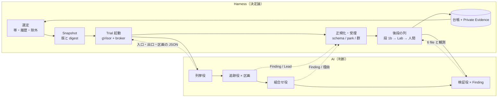
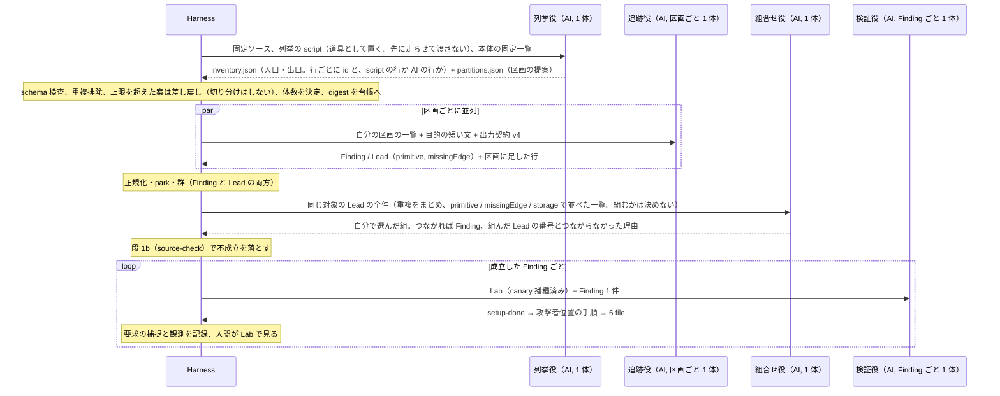

# 区画分配型の探索: 全体像と役の図（2026-10-27）

「調べて報告」の記録。正本ではない。所有者の方針（2026-10-27）: 分解（何を入口・出口と見るか、どう区画に切るか）は判断なので AI の責務にする。Harness は分解の結果を受け取って形を検査し、体数と制限を決め、起こし、束ね、記録する。PHP の動的な hook や後から組み立てられる callback は AST だけでは拾えないので、OpenAnt のような静的分解は AI が自分で使う道具にとどめ、Harness が先に走らせて渡すことはしない（§4）。

## 0. 採る考え方（所有者決定 2026-10-27）

所有者は、考え方を Cloudflare VDH / VVS、Mandiant AVDH、Anthropic defending-code-reference-harness の 3 つに揃えると決めた（出典は [repo 比較](2026-10-27-public-harness-repos-responsibility-split.md)）。この文書で採るのは次の行である。

| 出典 | 採る考え方 | この設計での置き場 |
|---|---|---|
| Cloudflare | hunter に自分の宿題を採点させない。validator は候補しか受け取らず、新しい Finding を出せない | 段 1b と検証役は追跡役の文脈を持たない |
| Cloudflare | `needs_validation` は「正確な不足事実 1 つ」を持ち、severity を持たない | `incomplete` の理由と Lead の missingEdge |
| Cloudflare | 共有 file を書くのは親だけ。coverage の台帳が coverage の主張で、文章は証拠にならない | Harness だけが台帳に書く。`partition-assigned` が区画の記録 |
| Cloudflare | model は交換部品。出した model と別の重みで判断する | 役ごとに model を profile で差し替える。読み直しは別 model 可 |
| Cloudflare | 予算は repo（対象）ごと。1 run は累積の約半分なので再走査する | 対象ごとの上限。再走査は外側の輪の選定が持つ |
| AVDH | 段の順序は厳密に決定論。agent は順序を飛ばせない | 列挙 → 検査 → 追跡 → まとめ → 読み直し → Lab を Harness が順に起こす |
| AVDH | 入口の抽出は安い model で file ごと並列。仮説は広く出し、検証を複数体で行う | 列挙役は安い model 可。追跡役は広く報告し、段 1b で落とす |
| AVDH | threat model は人間が承認してから進む | trust 境界宣言は人間が書く（既存）。inventory は対象ごとに残し人間が直せる |
| Anthropic | 制約は prompt でなく code で強制する | 体数・時間・区画・出力の形は Harness。prompt には書かない |
| Anthropic | 発見と検証は欲しいものが逆（recall と precision）。finder に自己検証させると、verifier が通すものを静かに落とす | 追跡役に基準を渡さない。基準は段 1b と Lab で当てる（契約 v5 の教訓） |
| Anthropic | bug の型を列挙すると recall が下がる。形を言う | 目的文は wp2shell の形のまま。分類表は出口の park にだけ置く |
| Anthropic | 重複の判断は agent、判断が行われたことの強制は pipeline | 群の鍵は Harness、同根かの最終判断は後段の AI |
| Anthropic | model の出力は report でなく lead として扱い、人間が再現してから外へ出す | 人間が Lab で見る（既存の不変条件 6・7） |
| Anthropic | 重大度は分類でなく前提から。model に CVSS を計算させず計算機を渡す | 既存の wbh-screen / wbh-report の範囲。探索には入れない |

所有者の補足（2026-10-28）: 3 社は所有者が思いついた出典で、より良い設計があればそれを参考にする。調べた範囲（[repo 比較](2026-10-27-public-harness-repos-responsibility-split.md)）では、全体をより良く写せる 1 つの実装は無く、部分ごとに強い実装が 2 つある。これも採る。

| 出典 | 採る考え方 | この設計での置き場 |
|---|---|---|
| Shopify | agent が file を「context の 20〜30%、関連する機能」で区画にする。区画ごとに hunter、別 model の verifier が test を oracle にする。code が重複と重大度を持つ | 段階 1〜2 の形そのもの。列挙役の Markdown に区画の大きさの目安「context の 2〜3 割」を書く。Harness の検査は件数のまま |
| Google Mantis | 証拠の階層で `code` だけが verdict を書ける。snapshot が合わない verdict は出さない。再現できないは `not_attempted` で負ではない。却下は意見で、機械の証拠を上書きしない。索引と相関は HINT | 台帳と `incomplete` の規則（既存）。足りない所: 索引と群を「HINT」と文書に明記、役の失敗理由の対応表 |

## 1. 全体像（24 時間の輪）



Harness の輪は今と同じ（選定 → Snapshot → 起動 → 受理 → 後段 → 台帳 → 選定）。変わるのは「起動」の中身で、Root 1 体に文章で構成を頼む代わりに、Harness が役ごとに体を起こす。

## 2. 対象 1 つの中の流れ（役と受け渡し）



## 3. 役の定義

| 役 | 1 体の単位 | 受け取るもの | 返すもの | 定義ファイル |
|---|---|---|---|---|
| 列挙役 | 対象ごと 1 | 固定ソース、列挙の script（道具）、本体の固定一覧 | `inventory.json`（行 id 付き）、`partitions.json` | `agents/enumerator.md` |
| 追跡役 | 区画ごと 1 | 自分の区画、目的の短い文、契約 v4 | Finding / Lead、足した行 | `agents/tracer.md` |
| 組合せ役 | 対象ごと 1、周回数は設定 | 同じ対象の Lead の全件（並べた一覧） | 組んだ Lead の番号、Finding か理由 | `agents/composer.md` |
| 検証役 | Finding ごと 1 | Lab、Finding 1 件 | 6 file | 既存の `wbh-verify` を流用 |

定義は Claude Code のサブエージェント定義と同じ Markdown（frontmatter + 本文）。版と digest で固定し、`owner-approved` の規則は今と同じ。定義（安定した文章）と割り当て（Trial ごとの JSON）は別に記録する。

## 4. 責務の線

規則は 1 行。**中身は AI、形は Harness。** Harness は決定論（同じ入力なら同じ出力）の処理だけを持つ: 出力構造の強制（schema、正規化、保留）、同一性（digest）、重複のまとめ、件数・時間・体数の上限、割り当て、記録。Harness は AI が出すべき中身を先に作らず（床を渡さない）、AI の自由文を読んで分類しない。AI は中身の全部を持つ: 列挙、区画の案、追跡、組合せ、検証の手順、ふるい分けの答え。script は Harness の前処理ではなく、AI がサンドボックスで自分で使う道具。

所有者の指摘（2026-10-27）: Harness が床を先に渡すと列挙役は「もう揃っている」と読んで何も足さない。契約 v5 で Harness が足した文が探索を縮めたのと同じ種類の現象。したがって床は渡さず、道具として置く。

| Harness（決定論。形） | AI（非決定論。中身） |
|---|---|
| 列挙の script と本体の固定一覧をサンドボックスに置く。走らせたか、script の行数、AI の行数を記録 | 入口・出口の列挙（script を自分で走らせて点検し、動的 hook、組み立てられる callback、決まった出口の無い型を足す） |
| 区画の schema 検査、重複排除、上限を超えた案の差し戻し、体数、制限時間 | 区画の切り方の提案と出し直し、区画の中の読み順 |
| 群のキー、AI が出した Lead の全件を並べ直して渡す（候補は作らない）、件数の上限、周回数 | どの Lead を組むか、組が 1 本の経路になるかの判断 |
| Lab の供給、canary、要求の捕捉、観測の記録 | 前提の作り方、攻撃者位置の手順 |
| 出口の park、段 1b の記録、台帳、Private Evidence | 段 1b の 2 問への答え、報告の文 |

分担は観測から決める。各 run には読んだ file 数、tool の回数、token、Finding と Lead、保留の理由、会話の全記録が残っている。決め方は「出力が run や model によらず同じになる処理は Harness へ、ばらつきがあってそのばらつきが収量を生む処理は AI へ」。2026-10-27 の記録に当てた例:

- 同じ経路が Finding と Lead の両方で複数の体から出る → 同一性の問題。Harness のまとめ（Lead にも群を当てる）。
- Finding にするか Lead にするかの線が体ごとに違う → 判断のばらつき。規則では直さず、事実の欄（file、function、line）を構造で要求し、基準は段 1b で当てる。
- `preconditionClass` が 27/32 で unknown、本文は通常利用 → Harness が自由文を読んで分類している。線の外側なので、やめるか後段の AI に答えさせる。
- Claude runtime の Root が file を 0 件読む → 構造の問題。役ごとに入力を Harness が渡す形で消える。

AI の判断には必ず機械的な記録を添える: 列挙なら「script の行 / AI の行（行 id 付き）」、区画なら「提案と Harness が分割した結果」、組合せなら「読ませた Lead の一覧と、組んだ Lead と、結果と理由」、検証なら「捕捉した要求と観測」。

組合せで Harness が組の候補を作らない理由（所有者の指摘、2026-10-27）: primitive 5 種・storage 6 種・missingEdge 5 種の型合わせは判断の先取りで、語彙に乗らない組（別の storage を経由する、3 つで 1 本になる）が候補から落ちる。「この欠けにはこの型」の表は、消した「precondition の文からシナリオを選ぶ正規表現」と同じ種類の規則で、当たらないたびに増える。一覧は AI が出した Lead を Harness が形だけそろえて渡し直すもので、Harness が中身を足すものではない。

## 5. 設定と台帳

```json
"discovery": {
  "mode": "partitioned",
  "enumerator": { "runtime": "claude", "model": "…", "tools": ["enumerate-hooks-v1", "enumerate-sinks-v1"] },
  "partition":  { "maxEntriesPerPartition": 60, "maxPartitions": 8, "maxResubmits": 2 },
  "tracer":     { "runtime": "claude", "model": "…" },
  "composer":   { "rounds": 1, "maxLeads": 80, "runtime": "claude", "model": "…" },
  "verifier":   { "perFinding": true }
}
```

台帳に足す event: `enumeration-recorded`（inventory の digest、script を走らせたか、script の行数、AI の行数、差し戻しの回数）、`partition-assigned`（区画の種別・行数・担当 run）、`composition-recorded`（読ませた Lead の一覧の digest、組んだ Lead の id、結果、理由）。Finding と Lead に `partition` を付ける。

## 6. 測り方

- 同じ 20 対象で現行（v14-wide + 契約 v4）と並べ、k=2。数えるのは群の数と、段 1b を通った数と、Lab で観測できた数。
- 列挙の品質: 行 id を Finding と Lead の sourceTrace に突き合わせ、script の行と AI の行それぞれの「使われた割合」を出す。Harness は正しさを判定せず、後ろの段の数字で測る。
- 受け入れ試験: TranslatePress の ATO（identity 区画）、dev set の既知 7 件。

## 7. 段階

1. 列挙役＋区画＋追跡役（Root 抜きの最小形）。ここで現行と比較して続行を決める。
2. Lead に群を当てる。
3. 組合せ役。**24 時間の輪には入れず、名指しで起動する段にする**（所有者の観察、2026-10-27: Argus の 9 件は全件が人間との共同クレジット、Austin の Elementor Pro は 2 時間の session で本人の発話 8 回。多段になるほど人間が「対象を決める、組の方向を決める、証明を要求する」を担い、読む作業は AI のまま）。輪の中では `composer.rounds` を 0 にし、`campaign compose --target <slug>` のような名指しの入口だけを作る。組合せ役が組を選んで追い、成立の判断は Lab で人間が見る。無人の部分は PRISM 相当（1〜2 段）、名指しの部分は Argus / Austin 相当。
4. 検証役を Finding ごとに起こす。

消すもの: wide の Root 用断片（coordination の handover / fixed）。deep の v11 は残す。
