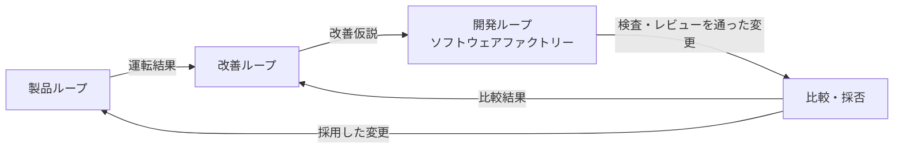

# AI 開発の用語と関係（2026-10-30）

会話で扱う概念の整理。仕様・権限・導入方針を追加する文書ではない。リポジトリ固有の用語は [GLOSSARY](../../GLOSSARY.md)、規則は [SPEC](../SPEC.md) と ADR に従う。一般用語には資料による揺れがあるため、ここでの使い分けを示す。

## 知識を整理する言葉

| 用語 | 意味 | 例 |
| --- | --- | --- |
| 用語集（glossary） | 名前と意味、使い分けを揃えたもの。 | Finding は未確認の主張。 |
| 分類体系（taxonomy） | 主に上位・下位の関係で概念を分類したもの。 | 証拠の種類として HTTP 記録と画面画像を区別する。 |
| オントロジー（ontology） | 対象領域の概念、属性、関係、意味上の制約を明示したもの。 | Finding は Target Snapshot を対象とする。 |
| 知識グラフ（knowledge graph） | 対象や事実を、意味のある関係でつないだ知識表現。 | 架空の Finding A が Snapshot S を対象とする。 |
| ドメインモデル | 業務の概念・関係・振る舞いを説明するモデル。 | 発見、検証、レビュー、提出の関係と状態の変化。 |

用語と関係の整理には [W3C SKOS](https://www.w3.org/TR/skos-primer/) が参考になる。[OWL](https://www.w3.org/TR/owl2-primer/) はクラス、属性、個体などに形式的な意味を与える。SKOS も機械可読なので、「機械が読めるか」だけで分類体系とオントロジーを分けない。オントロジー自身も個体を含められるため、「オントロジーは型だけ、知識グラフはデータだけ」という排他的な区別もしない。

ドメインモデルには概念整理としての用法と、データ・振る舞いを備えた実装パターンとしての用法がある。[Fowler の Domain Model](https://martinfowler.com/eaaCatalog/domainModel.html) は後者を説明する。

今回の目的には、用語集と関係図から始めるのが適する。形式言語やグラフデータベースの導入を意味しない。

## AI を動かし、改善する言葉

| 用語 | ここでの意味 |
| --- | --- |
| モデル | 入力から出力を生成する学習済みの仕組み。 |
| エージェント | モデルが状況に応じて次の行動やツール利用を選び、目的へ進むシステム。 |
| ワークフロー | 作業を進める工程と受け渡し。決められた経路の中で AI を使う場合もある。 |
| オーケストレーション | 複数の処理やエージェントの順序、分担、待ち合わせを調整すること。 |
| ツール | 検索やファイル編集など、エージェントが呼び出せる操作。 |
| スキル | 特定の仕事に使う手順や知識を再利用できるようにまとめたもの。補助スクリプトや資料を含む場合もある。 |
| コンテキスト | ある時点でモデルへ渡される指示、履歴、資料、ツール結果などの情報。 |
| コンテキストエンジニアリング | どの情報を、いつ、どの形でモデルへ渡すかを設計すること。 |
| エージェントハーネス | モデル呼び出し、ツール実行、状態、文脈などを扱う周辺の実行基盤。含める範囲は資料によって異なる。 |
| 評価（eval） | 課題と判定基準を用いて、システムの振る舞いや品質を確かめること。 |
| 実行トレース（trace） | ツール呼び出しや応答など、実行中に起きたことの記録。点数だけでは分からない原因を調べる材料。 |
| ソフトウェアファクトリー | 要求から実装・検査・レビュー・取り込み・運転確認までをつなぐ開発の仕組み。 |
| メタハーネス的な改善 | 実行結果を材料に、ハーネスやその使い方を改善する外側のループ。 |

エージェントとワークフローの区別は [Anthropic の説明](https://www.anthropic.com/research/building-effective-agents)に沿う。業界全体で一意に固定された定義ではない。スキルは [Agent Skills の説明](https://www.anthropic.com/engineering/equipping-agents-for-the-real-world-with-agent-skills)、文脈の設計は [Context Engineering](https://www.anthropic.com/research/effective-context-engineering-for-ai-agents)を参照する。ハーネスの具体例は [長時間動作するエージェントの設計](https://www.anthropic.com/research/effective-harnesses-for-long-running-agents)にある。

開発全体の整理は [Anthropic のコードレビュー運用](https://claude.dev/blog/solving-code-review-at-anthropic/)と [Software Factories, Light and Dark](https://www.oreilly.com/radar/software-factories-light-and-dark/)を踏まえたもの。

用語の定義を、工程の完了条件や検査方法へ結び付けて使う。2 記事の原則と本リポジトリでの確認方法は、[安定運用の対応表](2026-10-30-development-environment-primary-sources.md#安定運用の設計根拠所有者の-2026-10-30-の指示を反映)にまとめた。

## 論文の Meta-Harness と、このプロジェクトの改善

[Meta-Harness 論文](https://arxiv.org/html/2603.28052v1)は、過去候補のコード、評価結果、実行トレースを提案エージェントが読み、ハーネスのコードを探索する具体的な手法である。モデルの重みを更新する方法とは区別する。

この会話での「メタハーネス的な改善」は、それより広い。運転結果から仮説を立て、適切な場所を変更し、比較して採否を決める考え方を指す。ログの保存だけ、改善案の生成だけでは、評価と採否までのループは閉じない。

オントロジーは、この流れに登場する概念と関係を定義する側にある。たとえば「Finding の存在は成立確認を意味しない」「Finding と観測は同じ Snapshot に結び付く」という意味の区別を支える。論理上の整合性が取れても、実際の再現を証明したことにはならない。

本リポジトリの固有名 `Harness` は、一般用語のエージェントハーネスと区別する。制御と記録を受け持つ境界は [ADR 0034](../adr/0034-harness-control-only-deletions.md)、人間の観測が成立確認の根拠になることは [ADR 0040](../adr/0040-human-lab-observation-replaces-judges.md) に従う。

## 混同しやすい隣接語

- **RAG** は、関連情報を検索して生成に使う方法。オントロジーは知識の意味と構造を定義するもの。組み合わせられるが、互いを必須としない。[RAG 原著](https://arxiv.org/abs/2005.11401)
- **ファインチューニング**はモデルの重みを調整すること。ハーネスの改善は、モデル周辺のコードや入力の扱いを変えること。
- **CI** は変更の検査を継続的に実行する開発基盤。AI の eval を CI に載せることはできるが、通常のテスト成功だけで発見能力の向上は証明できない。
