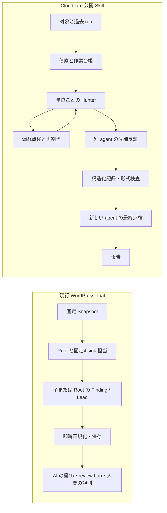

# 現行 WordPress Harness と Cloudflare Audit Skill の探索比較

比較日: 2026-11-04。現行側は `origin/main` の v22-wide と、checked-in の campaign 設定を基準にする。実際の本番設定は Git 外なので、`lab: none` は checked-in 設定の事実であり全本番 Trial の実態とは断定しない。Cloudflare 側は公開 `security-audit-skill` の commit [`c1c8a8c`](https://github.com/cloudflare/security-audit-skill/tree/c1c8a8c1471069fb0e188eeaff69b8e8db6564a8/skills/security-audit) を基準にする。同社の[記事](https://blog.cloudflare.com/build-your-own-vulnerability-harness)にある後続の大規模 Harness は公開 Skill と区別する。

## 主経路

Cloudflare の公開 Skill は「偵察、探索、独立検証、構造化記録、最終点検、報告」の六段である。[主手順](https://github.com/cloudflare/security-audit-skill/blob/c1c8a8c1471069fb0e188eeaff69b8e8db6564a8/skills/security-audit/SKILL.md)、[探索](https://github.com/cloudflare/security-audit-skill/blob/c1c8a8c1471069fb0e188eeaff69b8e8db6564a8/skills/security-audit/HUNTING.md)、[検証と報告](https://github.com/cloudflare/security-audit-skill/blob/c1c8a8c1471069fb0e188eeaff69b8e8db6564a8/skills/security-audit/VALIDATION-AND-REPORTING.md)。

## 差分

| 観点 | 現行 WordPress Harness | Cloudflare 公開 Skill | 影響 |
| --- | --- | --- | --- |
| 担当の作り方 | [v22 目的文](../../src/profiles/wordpress/prompts/wp2shell-bounty-v22-wide.md)が HTML・SQL・ファイル・認証の4 sink 担当を固定する。子の同時上限も別に4である。 | 偵察で入口・境界・機能・攻撃類型の作業単位を作り、適用する類型だけを選んで子に渡す。[偵察](https://github.com/cloudflare/security-audit-skill/blob/c1c8a8c1471069fb0e188eeaff69b8e8db6564a8/skills/security-audit/RECONNAISSANCE.md)、[攻撃類型](https://github.com/cloudflare/security-audit-skill/blob/c1c8a8c1471069fb0e188eeaff69b8e8db6564a8/skills/security-audit/ATTACK-CLASSES.md) | 入口や保存・読み戻しをまたぐ経路に担当を合わせられる。4は役の数ではなく同時実行枠になる。 |
| 次の仕事への接続 | v22 は Root に、有望な Lead へ専門担当を振り向けず、同じ sink の未読を続けるよう指示する。地図と `REGISTRY.md` はあるが、漏れから次の担当を作る循環は弱い。 | Hunter wave の後で別の critic が未割当・薄い単位を開き、次の wave に戻す。[探索](https://github.com/cloudflare/security-audit-skill/blob/c1c8a8c1471069fb0e188eeaff69b8e8db6564a8/skills/security-audit/HUNTING.md) | 保存先や別の読み戻しが見えた時に、仮説を途中で止めず次の具体作業にできる。 |
| 候補の独立検証 | 現行の [出力保存](../../src/discovery/record-discovery-report.ts)は子の有効な Finding / Lead をその場で受理する。後段の `wbh-source-check` と人間 review Lab はある。 | 発見者とは別の agent が候補を反証し、構造化した記録をさらに新しい agent が点検する。親が最終記録を所有する。[検証](https://github.com/cloudflare/security-audit-skill/blob/c1c8a8c1471069fb0e188eeaff69b8e8db6564a8/skills/security-audit/VALIDATION-AND-REPORTING.md) | AI の独立検証を Finding 出力前の工程にできる。ただし現行 Harness に機械的な必須 gate はない。 |
| 実行の証拠 | gVisor の WordPress Lab と Find / SQL / Trace / Observe がある。checked-in の [campaign 設定](../../src/profiles/wordpress/policy/campaign.json)は `lab: none`。Lab を付けても何を試すかは skill の仕事。 | source に加え、隔離されたローカル試行で決定的な挙動を確かめる。実行できない事実は `needs_validation` に残す。[主手順](https://github.com/cloudflare/security-audit-skill/blob/c1c8a8c1471069fb0e188eeaff69b8e8db6564a8/skills/security-audit/SKILL.md) | Lab を付けた比較で「source だけで終えた」を減らせる。Cloudflare の `confirmed` は本 repo の人間確認済みと同義ではない。 |
| 過去 run | `priorResearch: same-target` は別 Snapshot の最新1 Trial の一部研究 file。`priorLeads` は名指しした同一 Snapshot の代表最大8件。現在の [SPEC 不変条件1](../SPEC.md)は過去 Finding の探索入力を許さない。 | 互換な過去の台帳と Finding を再読し、現 source と照合して未解決・変更箇所を作業へ戻す。[主手順](https://github.com/cloudflare/security-audit-skill/blob/c1c8a8c1471069fb0e188eeaff69b8e8db6564a8/skills/security-audit/SKILL.md) | 自分の旧版の発見や失敗を次の版の探索に使うには、時点と秘匿範囲を定める新しい入力契約が要る。 |
| 形式と根拠の検査 | [Finding schema](../../src/profiles/wordpress/discovery/finding.ts)は型・正の行番号・パス表記を検査する。引用先の実在と記録間の参照は独立した gate ではない。 | `findings.json` と coverage ledger の validator が形式と参照を調べる。ただし成功は脆弱性の成立を証明しない。[検証](https://github.com/cloudflare/security-audit-skill/blob/c1c8a8c1471069fb0e188eeaff69b8e8db6564a8/skills/security-audit/VALIDATION-AND-REPORTING.md) | 機械検査は引用ミスと受け渡しの欠落を見つけられるが、成立判断に使ってはならない。 |
| 書込の分離 | Snapshot と対象の隔離、Private Evidence と台帳の境界は強い。一方、協調 Trial の `/workspace/research` は共有の書込領域で、子の scratch を Root の記録から権限で分けていない。 | 親の共有記録、子の scratch、親が昇格させる artifact を分ける。[主手順](https://github.com/cloudflare/security-audit-skill/blob/c1c8a8c1471069fb0e188eeaff69b8e8db6564a8/skills/security-audit/SKILL.md) | 記録の衝突・汚染を防ぐ余地がある。現状での Root 専用書込は指示に留まる。 |
| 継続・規模 | Snapshot、gVisor、broker、Trial 再開、台帳、Private Evidence、Programme Boundary、人間の観測が既にある。[SPEC](../SPEC.md) | 公開物は単一 repo の Skill と補助 validator。記事中の後続 Harness は各段の DB、再開、Gapfill、Feedback、Trace、VVS を持つが、実装は公開 Skill に含まれない。[記事](https://blog.cloudflare.com/build-your-own-vulnerability-harness) | 本 repo の運転基盤は捨てず、公開 Skill の探索手順を接ぐ方が小さい変更で試せる。 |

## 判断

固定4 sink 担当は探索の割当に使わない。HTML、SQL、ファイル、認証は入口を見落としていないか点検する視点として残す。Root は偵察で source に現れた入口・trust 境界・機能・保存と読み戻しから作業単位を作り、`discovery.maxChildren` の同時上限の中で担当数と順序を決める。例えば公開フォームの値が JSON に保存され、後の管理画面 JavaScript で描画されるなら、その経路を writer と reader を含む一つの仕事として渡す。SQL 組立てが別の経路に見えれば別の子へ渡す。認証機能が無い対象に認証専任を置かない。critic が source の別経路を見つけたら次の wave に追加する。

この方針は 2026-11-04 に所有者が「固定割り当てがよくない」「基本的に Audit Skill に寄せる」と確認した。[ADR 0050](../adr/0050-cloudflare-audit-skill-as-wordpress-discovery-base.md)の候補 v23-wide は固定4役を目的文から外している。ただし新スキルの指示だけでは独立点検を Harness が強制できず、過去 Finding の新入力は現行 SPEC で未許可である。これらは別の版付き契約として扱う。検出率の改善は、本番の同条件の旧新版比較まで未測定である。
