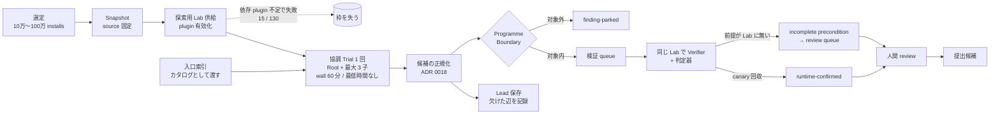
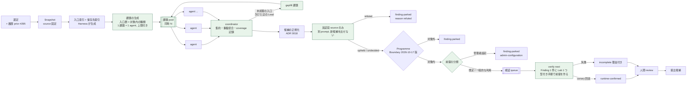

# 設計案: source だけの探索を Harness が課題として配り、検証は Finding 単位で回す（2026-10-18）

調べて報告の形で置く設計案。正本ではない。所有者の方針（2026-10-18）「1 plugin につき Lab を付けず、source だけの review を複数同時に回せる方が便利」と、外部実践の照合（[2026-10-17-external-harness-practices.md](2026-10-17-external-harness-practices.md)）を受けて、現行の主経路（ADR 0029）を置き換える形を書く。採るなら第 6 節の案を ADR 0033 として所有者が `owner-approved` を付ける。不変条件（SPEC 第 2 節の 8 項目）は変えない。

## 0. 結論

1. 探索から Lab を外し、source・trust 境界・Programme Boundary・入口索引・保存先索引だけで回す。依存 plugin のある対象も探索できる。
2. 探索の単位を「対象 1 つに Root＋3 子の協調 Trial 1 回」から「対象 1 つに Harness が配る短い課題の束」に変える。課題は入口索引の群と対象内の種類の組で作り、1 課題 1 agent、tool 回数と時間に上限を置く。coordinator が集約し、未処理の入口と欠けた辺の残った Lead を gapfill として再投入する。
3. Lab の前に source だけの反証段を置く。別 prompt の agent が候補を潰しに行き、新しい候補は出せない。残った候補だけが前提分類と検証に進む。
4. 検証は探索と独立した consumer にする。Finding 1 件につき Lab 1 つ、判定器が canary で確定する。これまでどおり `runtime-confirmed` は判定器だけが出す。
5. 本番の 111 Trial で見えた「候補の 8 割が受理されない種類」「Lead 403 件のうち 224 件が入口未発見で止まる」「Lab 失敗で 15 枠喪失」の 3 つに、それぞれ Programme Boundary 文、課題配分と gapfill、Lab の分離で答える。

## 1. 現行設計（ADR 0029、2026-10-11 〜 2026-10-17）

実測（本番 2026-10-16〜17、26 batch、130 対象、115 Trial）: Root wall 中央値 7 分、60 分到達 0。候補 449 → Finding 46（情報露出 36）＋ Lead 403（入口未発見 224、前提 76、出口未発見 69）。対象範囲内 Finding 4 件は全て `incomplete(precondition)`。runtime-confirmed 0。Lab 失敗 15。

問題の所在:
- Root が自分で閉じる。索引は「カタログ」で網羅の条件ではないため、浅い終了が候補 0 件の正常完了に数えられる。
- 探索と検証が同じ Lab に縛られ、Lab の供給失敗が探索の機会を奪う。
- 候補の種類を選別する段が出口の Programme Boundary しか無く、agent に渡す文は情報露出を対象内にしている。
- 検証は Lab の既定状態でしか試せず、受理側が却下する「管理者設定前提」と、Lab に作れる「一般的な利用」を区別していない。

## 2. 新設計

緑が新しい段。探索 pool と検証 queue は別の consumer として独立に進む。探索だけを流し続けることも、検証だけを消化することもできる。

## 3. 現行との差分

| 観点 | 現行（ADR 0029） | 新設計 |
|---|---|---|
| 探索に渡すもの | source、trust 境界、Programme Boundary、Lab、入口索引 | source、trust 境界、Programme Boundary、入口索引、保存先索引。Lab なし |
| 探索の単位 | 対象 1 つに協調 Trial 1 回（Root＋3 子） | 対象 1 つに課題の束。1 課題 1 agent。coordinator は agent でなく Harness |
| 分担の決め方 | Root の自律 | Harness が入口群 × 種類で配る。索引は分担を指示する |
| 終了条件 | Root の報告、または wall 60 分 | 全課題の終了（observed / blocked）と gapfill の収束、または対象あたりの予算上限 |
| 最低時間 | 置かない | 置かない。課題数と上限で深さが決まる |
| 候補の選別 | 出口の Programme Boundary のみ | 反証段 → Programme Boundary → 前提分類の 3 段 |
| 検証 | 探索と同じ Lab、既定状態のみ | Finding 単位の Lab、一般的な利用は型付き手順で作る、管理者設定前提は park |
| Lead | 保存のみ | 欠けた辺を gapfill 課題として再投入（同じ対象の予算内で） |
| 子の成果 | Root と独立に保存 | 全課題の成果を coordinator が保存。agent 間の報告はしない |
| 比較分母 | 索引あり／なし、旧段付きを混ぜない | 協調 Trial と課題束を混ぜない。既存 event は読み続ける |

## 4. 各段の仕様

### 4.1 課題の生成（Harness）

- 入力: 入口索引（AJAX action、REST route、shortcode、公開 hook、upload、cron、admin-post など既存の種類）、保存先索引（option、post meta、user meta、transient、file、独自 table）、Programme Boundary の対象内の種類。
- 課題 = 入口の群（同じ file か同じ登録箇所でまとめる。1 課題あたり上限 k 個）× 対象内の種類の束。種類ごとに課題を分けるのではなく、1 課題は「この入口群から対象内のどの効果に届くか」を問う。種類ごとの固定割り当て（「N agent を種類 X に」）は作らない（v1.7・v5 の規律を Harness 側で守る）。
- 各課題に予算: tool 呼び出し回数の上限、wall の上限（例 10 分）、出力は Finding / Lead / coverage の schema（ADR 0019）。自由文の報告は research artifact として保存するだけ。
- 対象あたりの予算: 課題数の上限と token の上限。超えたら残りの入口を `unvisited` として記録し、Trial は `incomplete(budget)`。
- 課題の prompt は、既定の目的 prompt（v6）＋ Harness 生成の節（trust 境界、Programme Boundary、割り当てた入口と保存先、出力契約）。目的 prompt の本文は課題で変えない。

### 4.2 課題 pool と同時実行

- 同時数 N は campaign.json に置く。provider の容量不足（#292）と broker の grant 上限で決まるので、開発セットで 4、8、16 を測って決める。
- 1 課題 1 agent（子を持たない）。agent 間の通信はしない。短命で、context を使い切らない。
- 失敗（provider 拒否、schema 不備、wall）は課題単位の `incomplete` で記録し、対象全体は止めない。同じ課題の再投入は 1 回まで。

### 4.3 coordinator（Harness、agent ではない）

- 全課題の出力を集め、候補を正規化し（ADR 0018）、同じ入口・同じ保存先・同じ効果の候補を重複統合する。
- coverage を記録: 入口索引の各項目が `observed` / `blocked` / `unvisited` のどれか。これは Root の自己申告ではなく、課題の割り当てと出力から Harness が決める。
- gapfill: (a) `unvisited` の入口、(b) 欠けた辺が `producer` か `consumer` の Lead を、対象の予算が残っている限り課題として再投入する。Lead の再投入は、その Lead の記録（入口か保存先の所在と欠けた辺）を Harness 生成の節で渡す。公開記録や他対象の情報は渡さない（ADR 0012）。
- 収束: gapfill で新しい Finding も Lead も出なくなったら対象を閉じる。

### 4.4 反証段（source のみ）

- 入力: 正規化された候補 1 件と source。Lab は無い。
- agent は別 prompt（Verifier の v7 系とは別の、反証専用の短い目的文）。新しい候補を出せない。出力は `refuted` / `upheld` / `undecided` と理由コード（guard が有効、入力が届かない、影響が自分だけ、前提が非現実的、など固定の列挙）と、source の参照。
- `refuted` は `finding-parked`（reason `refuted`）として Private Evidence に残す。review には出さない。`upheld` と `undecided` は次へ。
- 役割は Cloudflare の validate agent、OpenAnt の敵対的検証と同じ。判定器の確定ではないので `runtime-confirmed` には関与しない（不変条件 3）。
- 反証段の prompt は agent に渡る文章なので、出典対照表と所有者の読了を経る。

### 4.5 Programme Boundary と前提分類

- Programme Boundary 文は 2026-10-17 版（[#310 の計画](../2026-10-17-thorough-search-v6-plan.md) 第 3 節）。
- 前提分類は brief B のとおり（既定／一般的な利用／管理者設定／不明）。管理者設定は park、一般的な利用は検証側で型付き手順により Lab に作る。

### 4.6 検証 consumer

- `verify next` が queue から Finding を 1 件取り、その Snapshot の Lab を 1 つ立て、必要なら一般的な利用の前提を型付き手順で作り、Verifier と判定器を回し、片付ける。同時数は探索と別に数える（既定 1）。
- 判定の条件はこれまでどおり: 同じ Snapshot digest、canary の回収、失敗は理由付き `incomplete`。
- 検証側の Lab 失敗は `verification-lab-failed` として数え、依存 plugin の供給（#282、#244）はここで扱う。

### 4.7 台帳

- 新しい event: `task-dispatched`、`task-finished`（課題単位の結果と予算消費）、`coverage-recorded`（対象単位）、`refutation-recorded`、`finding-parked` の reason 拡張（`refuted`、`admin-configuration-precondition`）。既存の `discovery-run-*` は協調 Trial の記録として読み続ける。
- funnel: 課題数、observed / blocked / unvisited の比率、候補 → 反証後 → 対象内 → 前提分類後 → 検証 → 確定の各段の件数。協調 Trial の funnel と分けて出す。

## 5. 不変条件との照合

| 不変条件 | 新設計での扱い |
|---|---|
| 1 渡すもの | source、trust 境界、Programme Boundary、入口・保存先索引、割り当てた入口と Lead の所在。公開記録、PoC、payload、再現手順は渡さない。Lab は検証側のみ |
| 2 隔離 | agent は gVisor、egress は broker。課題数が増えても同じ |
| 3 確定 | 判定器だけが `runtime-confirmed`。反証段は候補を落とすだけで確定しない |
| 4 失敗は incomplete | 課題単位、対象単位、検証単位で理由付き incomplete |
| 5 同じ digest | 検証は Finding の Snapshot digest の Lab で行う |
| 6 人間の判断点 | 提出前 review と外部行動の承認のまま。課題の配分と反証は Harness と agent |
| 7 外部送信 | 変えない |
| 8 台帳 | 追記専用、digest 参照。課題の出力は Private Evidence |

## 6. ADR 0033 の案（所有者が付ける）

**題**: 探索を source だけの課題束にし、検証を Finding 単位の consumer に分ける

**決定**: 対象の固定 Snapshot ごとに、Harness が入口索引と保存先索引から課題を生成し、同時 N で短命の agent に配る。coordinator は Harness が担い、候補の正規化、重複統合、coverage の記録、gapfill の再投入を行う。探索に Lab は付けない。候補は source だけの反証段、Programme Boundary、前提分類を通って検証 queue に入り、`verify next` が Finding 1 件につき Lab 1 つで判定器を回す。協調 Trial（ADR 0029）は比較 arm として残し、既存の台帳 event は読み続ける。

**理由**: 本番 115 Trial で Root wall 中央値 7 分、入口未発見の Lead 224 件、Lab 失敗 15 枠、受理されない種類の候補 36 件。外部の到達点（Cloudflare、XBOW、OpenAnt）は狭い課題の並列と反証段と Finding 単位の実行確認で構成されている。所有者の運用方針（探索だけ回す、検証は 1 件ずつ）と一致する。

**採らなかった選択肢**: 協調 Trial に最低時間を置く（長さは網羅を保証しない、compaction で先の発見を失う）。Root に索引の全項目処理を自己申告させる（Harness が割り当てから決める方が確実）。探索中に Lab を使い続ける（依存 plugin で探索機会を失う、Lab 失敗が探索の incomplete に混ざる）。反証を Lab の Verifier に兼ねさせる（Lab の前提に依存し、費用が高い）。

**帰結**: ADR 0029 の「索引は分担を指示しない」「全入口の処理を終了条件にしない」「Harness の続行差し込みを行わない」を置き換える。ADR 0016 の隔離と独立検証、ADR 0018・0019 の正規化と出力契約、ADR 0026 の型付き手順、ADR 0012 の公開記録の扱いは維持。SPEC 第 6 節と第 7 節を書き直す。

## 7. 費用・同時数・運用

- 1 課題の見込み: tool 上限 30〜50 回、wall 10 分、noncache token 5〜15 万。対象あたり課題 10〜30、gapfill 込みで token 100〜300 万（協調 Trial の 50〜100 万に対し 2〜3 倍）。
- 同時 N=8 なら対象 1 つが 30〜60 分。1 日 50〜100 対象。収率 0 の 300 対象より良い。
- 探索 pool は止めずに流し、検証 consumer は Finding が出た分だけ動く。provider の容量不足は課題単位の incomplete で記録し、pool の同時数を自動で下げる（上げるのは手動）。
- wall の強制（#312）は課題単位にも検証単位にも同じ仕組みで掛ける。

## 8. 測定と gate

- 開発セット（TranslatePress 3.2.6、Relevanssi、Brizy）各 3 回: 既知の型の候補が消えないこと。協調 Trial（v5）の結果と並べる。
- 反証段の落とし方: 本番の既存候補 46 件と Lead 403 件に対して反証段だけを回し、落ちた件数と理由コードの分布を見る。対象範囲内 4 件が落ちないこと。
- coverage: observed / blocked / unvisited の比率と、gapfill で増えた Finding の件数。
- 本番 200 Trial 相当（対象 200）: runtime-confirmed 1 件以上、または対象内の有償クラス候補 5 件以上。満たさなければ選定（履歴 prior）と model の見直しへ。

## 9. 実装順

1. 今週の 4 本（A #312、D #297 探索だけの mode、B 前提分類、C 深度記録）と v6。D は本設計の「Lab なし探索」「verify next」そのもの。C の coverage record は coordinator が引き継ぐ。
2. ADR 0033 を所有者が付ける。
3. 課題の生成と pool、coordinator、gapfill（Codex、1 PR ずつ: 課題生成 → pool と同時実行 → coordinator と coverage → gapfill）。
4. 反証段（prompt は出典対照表を経て所有者が読む。Harness 側は 1 PR）。
5. 履歴 prior（#295）。
6. 開発セットで測定 → 本番再開。

## 10. リスク

- 候補が増えて review 負荷が戻る: 反証段と前提分類を同時に入れることが条件。入れずに課題だけ増やさない。
- 課題が細かすぎて chain を見失う: 入口群の大きさ k と gapfill の Lead 再投入で補う。coordinator は Lead の所在を渡すだけで、chain を組むのは agent。
- provider の容量: 同時数を測って決め、自動で下げる。
- 反証段の誤り（本物を落とす）: `refuted` も Private Evidence に残し、開発セットで既知の型が落ちないことを gate にする。`undecided` は落とさない。
- 既存の協調 Trial の比較可能性: 台帳 event を分け、funnel を分ける。
